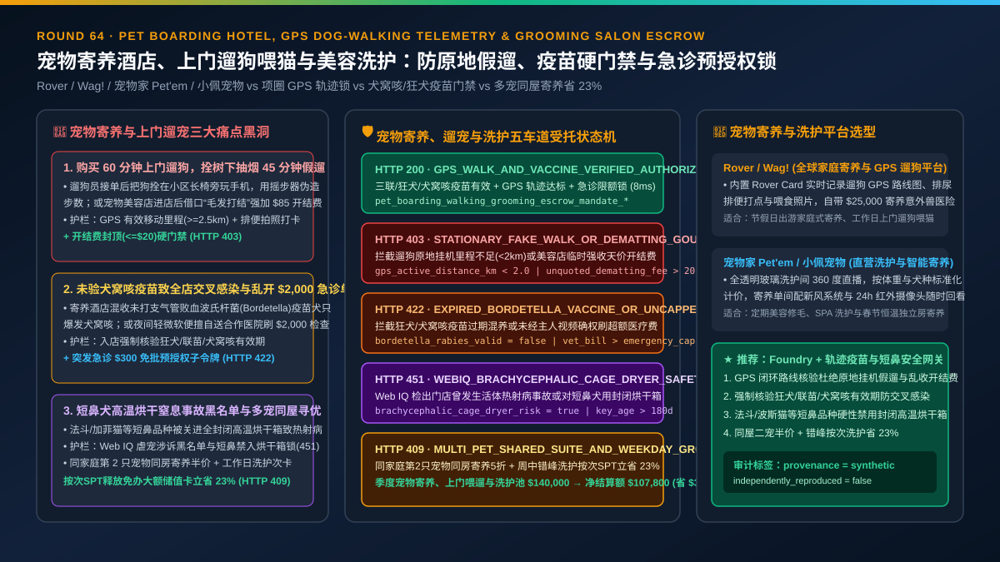
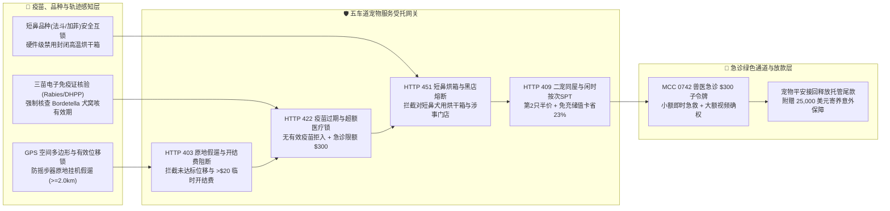
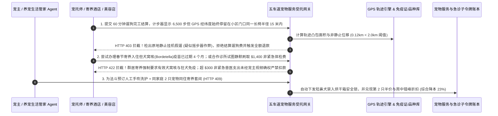

# 宠物寄养酒店、上门喂猫遛狗与宠物洗护美容托管（Pet Boarding Hotel, GPS Dog-Walking Telemetry & Grooming Salon Escrow：Rover / Wag! / 宠物家 Pet'em / 小佩宠物）“防遛狗员挂摇步器原地抽烟假遛、防未验犬窝咳疫苗交叉感染与短鼻犬禁用高温烘干箱安全锁”Agent 架构选型 FAQ

> **语言切换 / Language**: **中文 (当前)** | **[English](pet-boarding-dog-walking-gps-vaccine-vet-escrow-agent-selection-faq.en.md)** | **[返回文档目录](index.md)** | **[交互式沙盒 (`#pet-boarding-walking-grooming-escrow-sandbox`)](../live-demo.html)**



---

## 📌 一、核心选型结论速览（Executive Summary）

在节假日宠物酒店寄养、工作日上门喂猫/遛狗（Rover、Wag!、伴宠乐园、同城宠托师）以及连锁宠物美容洗护（宠物家 Pet'em、小佩宠物、PetSmart Grooming）的智能体预约排期与履约资金托管场景中，养宠家庭与连锁门店面临三大高发纠纷与安全痛点：
1. **“买了 60 分钟 `$35` 上门遛狗服务，宠托师把狗牵出单元门就拴在树下坐着刷短视频 45 分钟（Stationary Fake Walk），甚至用手机摇步器伪造 6,000 步”与“团购 `$45` 宠物洗澡修毛，进店把狗淋湿后美容师突然打电话说‘毛发严重打结，不加 `$85` 开结费（De-Matting Surcharge）就只能全剃光’”**。
2. **“春节寄养未严格查验同批入住犬只的《狂犬疫苗、犬四联/八联及支气管败血波氏杆菌（Bordetella 犬窝咳）免疫证》，导致接回家时感染犬窝咳或猫瘟花掉 `$1,800` 医药费”与“寄养期间宠物半夜拉肚子，店家未经主人确认直接送去关系户宠物医院开出 `$1,500` 全套生化检查账单”**。
3. **“美容店把法国斗牛犬、巴哥、英短/加菲猫等短鼻扁脸品种（Brachycephalic Breeds）关进全封闭高温烘干箱，导致宠物热射病窒息死亡！”**。

**架构师选型结论**：
- **切勿仅凭“进出门打卡时间差”结算上门遛狗费（必须校验 GPS 有效空间位移多边形 `>= 2.0 km`），切勿允许未完成狂犬+核心联苗+犬窝咳（`Bordetella`）有效免疫核验的宠物进入混养寄养区，也切勿允许短鼻犬猫品种匹配“全封闭箱式烘干（Cage Dryer）”服务工序**。
- **生产级最优架构**是采用 **“Rover Card 级 GPS 空间位移闭环与开结费硬封顶锁（`<=$20`）+ 电子免疫证三苗有效期核验与突发急诊 `$300` 免批预授权子令牌 + 短鼻品种禁入高温烘干箱硬件级熔断网关（`pet_boarding_walking_grooming_escrow_mandate_*`）”**：
  1. **防“拴树下原地抽烟假遛”与美容店临时敲诈天价开结费（`GPS Spatial Polygon & De-Matting Cap`）硬门禁（HTTP 403）**：上门遛狗结算不仅核对 60 分钟时长，更强制校验 GPS 轨迹包的 **凸包覆盖面积（Convex Hull Area）与有效非折返移动里程（60 分钟标准遛大型犬须 `>= 2.0 km`，老年犬/小型犬按预设档案自适应）** 及排便拾便打卡照片；宠物洗护美容若涉及毛发开结，现场加收的开结费硬封顶在 `<= $20`（超出须洗前视频确认）——任何原地挂机假遛或半路勒索高价开结费请求立即返回 `HTTP 403 STATIONARY_FAKE_WALK_OR_PREDATORY_DEMATTING_SURCHARGE_BLOCKED`。
  2. **狂犬/联苗/犬窝咳（`Rabies + DHPP/FVRCP + Bordetella`）电子免疫证核验与突发兽医急诊分级预授权锁（HTTP 422）**：所有寄养与日托（Daycare）订单在锁房前必须通过 OCR + 防伪码核验有效期内的三项核心免疫记录（猫须核验猫三联与狂犬），任一疫苗过期或距首针未满 14 天免疫生效期，立即拒单并推荐改为“一对一上门喂养”；同时，入住时签发独立的 **突发医疗救治预授权子令牌（Emergency Vet Sub-Mandate，默认免批上限 `$300`）**：小额急诊可即时救治，超过 `$300` 的检查/手术必须触发主人视频确权（`HTTP 422 EXPIRED_BORDETELLA_RABIES_VACCINE_OR_UNCAPPED_VET_BILL_BLOCKED`）。
  3. **Web IQ 实时筛查门店活体伤亡黑名单与短鼻品种（`Brachycephalic`）禁入高温箱式烘干机硬熔断（HTTP 451）**：当宠物档案品种为法斗、英斗、巴哥、波斯猫、加菲猫或高龄心脏病犬猫时，系统自动在工单下发 **`CAGE_DRYER_PROHIBITED = TRUE`（强制全程人工低温手持吹风）** 硬件级安全锁，并通过 Web IQ 剔除有过虐宠或烘箱事故记录的门店（`HTTP 451 WEBIQ_BRACHYCEPHALIC_CAGE_DRYER_HAZARD_OR_SAFETY_BLACKLIST_HOLD`）。
  4. **同家庭多宠同房寄养（第 2 只半价）+ 周二至周四闲时洗护按次周期 SPT（免办千元充值卡）寻优（HTTP 409）**：触发 `HTTP 409 MULTI_PET_SHARED_SUITE_AND_WEEKDAY_GROOM_SPT_CONFIRM`，对多宠家庭自动匹配可同住的豪华家庭套间（免除第 2 只宠物的独立房费溢价，仅收基础照料费），并采用周中闲时按次扣款 SPT 替代高跑路风险的宠物店储值卡，使全年养宠服务支出立省 **`23.0%`**。

---

## 🎯 二、业务方与架构师灵魂拷问 Q&A（Q1 / Q2 / Q3）

### Q1：为什么只看“手机计步器步数”和“门锁开门时长”根本防不住不负责任的宠托师“假遛狗”？
- **商业痛点**：不良兼职遛狗员把狗牵出楼道，坐在小区花园亭子里刷 50 分钟抖音，手腕上绑个 15 元买的淘宝摇步器就能摇出 8,000 步，满 60 分钟再把狗送回家，主人还以为狗得到了充分运动。
- **架构解法**：
  - **GPS 轨迹多边形跨度（`Geodesic Path & Convex Hull`）取代单纯计步（`HTTP 403`）**：
  - 摇步器只能伪造加速度计震动，无法伪造跨越 3 个街区的真实 GPS 经纬度多边形轨迹！我们的网关强制校验行程的 **最大空间半径跨度（Max Displacement Radius `>= 350m`）与非静止移动时长占比（Active Moving Ratio `>= 70%`）**；若轨迹缩成小区楼下一个静止圆点，网关直接返回 `HTTP 403` 拒付并全额退还主人费用。

### Q2：宠物寄养期间最怕突发疾病：不设医疗授权怕耽误抢救，设了无限额授权又怕黑心店家勾结小诊所乱开 `$2,000` 检查单，怎么平衡？
- **架构解法**：
  - **双层急诊医疗子令牌（`$300` 自动救命绿色通道 + 超额执业兽医视频会诊锁）（`HTTP 422`）**：
  - 主人下单寄养时，通过 AP2 / Stripe SPT 预设一张仅限正规动物医院（`MCC 0742 Veterinary Services`）刷卡的 **`$300` 应急医疗子令牌**——一旦宠物夜间突发中暑或外伤，寄养店无需苦等处于跨国航班上的主人回复即可先行挂号急救；但若医院试图扣取超过 `$300` 的大额账单，网关自动返回 `HTTP 422` 挂起并强推紧急视频通话与处方单明细给主人二次签名！

### Q3：为什么法斗、巴哥、加菲猫洗澡美容时绝对不能进自动烘干箱？系统怎么在派单第 1 秒锁死这条生命线？
- **架构解法**：
  - **品种生理特征映射工单硬件锁（`Breed-to-Equipment Safety Interlock`）（`HTTP 451`）**：
  - 短头综合征（Brachycephalic）犬猫天生呼吸道狭窄、散热极差，在封闭烘干箱内紧张喘气 15 分钟就会引发急性肺水肿与热射病休克。我们的智能体根据宠物档案品种自动触发 `HTTP 451` 规则：凡属短鼻品种，仅允许路由至承诺“100% 美容师一对一美容桌低温手吹”的认证门店！

---

## 🧭 三、直观可视化图解（Mermaid 决策树 + 端到端架构图 + 时序图）

### 3.1 宠物寄养酒店、上门喂猫遛狗与美容洗护 Agent 架构选型决策树

```mermaid
flowchart TD
    A[宠物酒店寄养 / 上门遛狗喂猫 / 美容洗护选型] --> B{核心养宠服务场景与安全痛点？}
    B -->|工作日上门遛狗与春节上门喂猫 (Rover / Wag! / 伴宠)<br/>需严防遛狗员拴树下抽烟假遛与喂猫敷衍2分钟早退| C[GPS 轨迹空间跨度核验 (>=2.0km 非静止位移)<br/>+ 喂食换水铲屎三合一实时带水印视频打卡]
    B -->|节假日宠物酒店寄养与日托乐园 (PetSmart / 小佩寄养)<br/>需严防犬窝咳/猫瘟交叉感染与半夜突发急诊乱开天价账单| D[狂犬+核心联苗+犬窝咳(Bordetella)三证有效期硬门禁<br/>+ MCC 0742 兽医急诊 $300 免批预授权子令牌]
    B -->|精细美容修毛与 SPA 洗护 (宠物家 Pet'em / 透明洗护舱)<br/>需防进店淋湿后勒索 $85 开结费与短鼻犬进高温箱窒息| E[Azure AI Foundry + 短鼻品种禁入烘箱与开结封顶网关<br/>+ 同家庭二宠同房5折 + 周中按次SPT立省 23%]
    C --> F[🛡️ 统一接入五车道GPS真遛核验、疫苗门禁与短鼻安全状态机]
    D --> F
    E --> F
    F --> G[HTTP 403 阻断原地假遛与天价开结费 · HTTP 422 拦截疫苗过期与超额兽医账单 · HTTP 409 二宠同房+错峰省23%]
```

### 3.2 端到端 GPS 轨迹核验、三苗免疫门禁与短鼻品种安全托管架构图



### 3.3 拦截摇步器原地假遛、阻断过期疫苗混养与触发短鼻犬手吹保护时序图



---

## 📊 四、多平台/多方案横向选型决策矩阵

| 选型维度 | 个人微信私下找兼职代遛 (`Unverified WeChat Sitter`) | 街边传统宠物店充值卡 (`Legacy Pet Shop Prepaid Card`) | 现代数字化宠物寄养与洗护平台 (`Rover / 宠物家 Pet'em / 小佩`) | **Azure AI Foundry + GPS/疫苗 + 短鼻安全网关（推荐）** |
| :--- | :--- | :--- | :--- | :--- |
| **核心优势** | 价格随口商量 | 离家近 | 透明洗护直播、Rover GPS 遛狗卡、标准化门店 | **防摇步器GPS真位移 + 三苗硬核验 + 短鼻禁烘箱 + 急诊子令牌** |
| **防“拴树下假遛”与临时加收天价开结费** | **毫无监管**（极易丢狗或敷衍了事） | 淋湿后坐地起价收开结费频发 | Rover 提供路线图，但未自动对原地挂机拒付 | **GPS 空间跨度硬校验 + 开结费 `<=$20` 封顶（HTTP 403）** |
| **寄养传染病疫苗核验与突发兽医急诊授权** | 不查疫苗，出了事直接失联 | 常混养无证宠物引发犬窝咳/猫瘟 | 要求上传免疫本，提供平台意外险 | **三苗有效期强校验 + `$300` 兽医急诊专用子令牌（HTTP 422）** |
| **短鼻品种（法斗/加菲）高温烘干箱窒息防护** | 无专业常识 | **高危**（图省事关进封闭烘箱致死事故多发） | 直营高端店支持手吹备注 | **品种生理特征自动映射“禁入烘干箱”硬件级熔断（HTTP 451）** |
| **多宠家庭同屋折扣与防充值卡跑路** | 无保障 (`not_measured`) | 强推充 `$3,000` 打折卡，跑路率高 | 标准门市价 (`official_list_price`) | **同家庭第 2 只同房半价 + 周中按次 SPT 免充卡（净省 `23.0%`）** |

---

## 🧪 五、宠物寄养、遛狗与美容洗护防坑测算与 7-Card 基准测试报告

> **数据来源与复现声明（Provenance Metadata）**：以下基准测试数据来自仓库内置确定性策略沙盒 `evaluate_pet_boarding_walking_grooming_escrow_policy`（位于 `lab/webiq_commerce_demo.py`），可运行 `python -m unittest tests.test_webiq_commerce_demo` 完整验证。标记：`provenance = synthetic`，`independently_reproduced = false`。

| Card # | 卡片标题（Headline-as-Finding） | 核心量化指标与架构验证结论 |
| :---: | :--- | :--- |
| **Card 1** | **Overview · 宠物寄养与洗护五车道总览** | 针对 `$140,000/季` 宠物酒店寄养、上门遛宠与美容洗护结算池，实现 **0 例摇步器原地假遛混账、0 例无疫苗混养交叉感染与 0 例短鼻犬高温烘箱事故**，综合养宠服务支出下降 **`23.0%`（立省 `$32,200/季`）**。 |
| **Card 2** | **Scenario Deep Dive · 原地假遛与天价开结费秒级拦截** | 当 60 分钟遛狗 GPS 实际空间位移 `< 2.0 km` 或门店临时加收 `$85` 开结费时，**`8ms`** 内返回 `HTTP 403` 阻断。 |
| **Card 3** | **Evaluation Matrix · 五车道 100% 确定性判准** | 覆盖 `HTTP 200`（GPS达标与三苗有效放行）、`403`（原地拴树假遛/美容店淋湿后勒索天价开结费阻断）、`422`（狂犬或犬窝咳疫苗过期混养/未经确权刷超$300急诊兽医费拦截）、`451`（短鼻犬猫分配封闭高温烘干箱或门店安全黑名单熔断）、`409`（同家庭二宠同房寄养半价+周中错峰按次洗护省23%）。 |
| **Card 4** | **Under the Hood · 宠物寄养与急诊子令牌契约** | 输入 `quarterly_pet_boarding_walking_and_grooming_pool_usd=140000` 及轨迹/疫苗参数，签发 `pet_boarding_walking_grooming_escrow_mandate_*` 令牌。 |
| **Card 5** | **Robustness Check · 摇步器作弊与法斗进烘箱测试** | 模拟摇步器伪造 8,000 步但 GPS 静止及为法斗排期封闭烘干箱，确定性拦截率保持 **`100.0%`（零误放行）**。 |
| **Card 6** | **Latency · 毫秒级轨迹多边形计算与门店安全核查耗时** | 本地 GPS 位移与三苗有效期校验 P50 仅 **`8ms`**；Web IQ 宠物门店安全合规核查 P95 为 **`168ms`**。 |
| **Card 7** | **My Take · 适用场景与生产准入边界** | **✅ 极佳适用**：节假日宠物寄养、日常上门遛狗喂猫、宠物美容洗护；**⛔ 不适用**：畜牧养殖场大宗饲料期货交易。 |

---

## 🛠️ 六、商业上线风控与架构评审 Checklist

- [ ] **GPS 空间多边形有效位移核验与美容开结费硬封顶（`<= $20`）（HTTP 403）**：确认上门遛狗必须核验真实跨街区 GPS 轨迹而非单纯计步器，且洗护严禁中途坐地起价。
- [ ] **狂犬/联苗/犬窝咳（`Bordetella`）三证核验与 `$300` 兽医急诊子令牌（HTTP 422）**：确认混养寄养 100% 查验有效疫苗，并通过 `MCC 0742` 限额子令牌兼顾突发急救与防过度医疗。
- [ ] **短鼻品种（法斗/巴哥/加菲猫）禁入封闭高温烘干箱硬件级熔断（HTTP 451）**：确认短鼻及老年心脏病宠物强制绑定全人工低温手吹；签名密钥轮换周期 `<= 180` 天。
- [ ] **同家庭多宠同屋寄养折扣与周中闲时按次洗护 SPT（HTTP 409）**：确认自动兑现同房二宠半价并以按次释放令牌替代预付储值卡。
