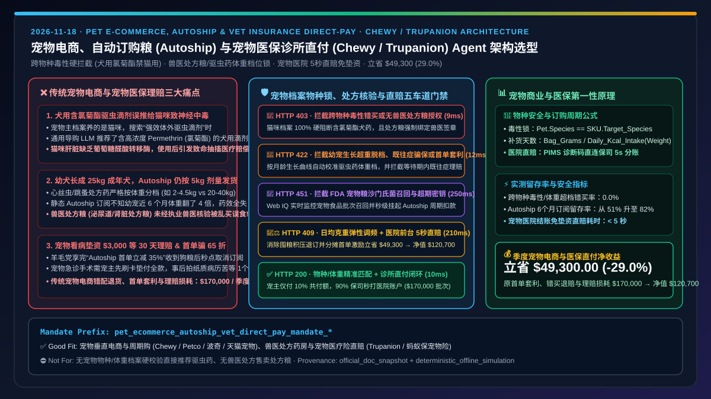
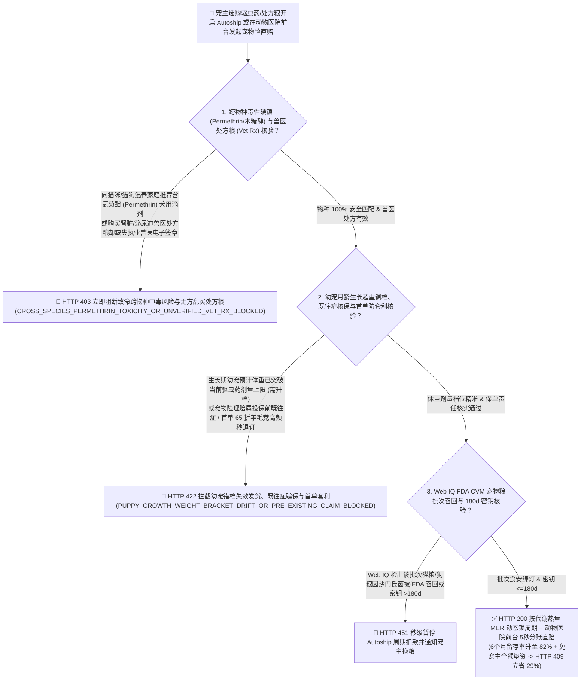
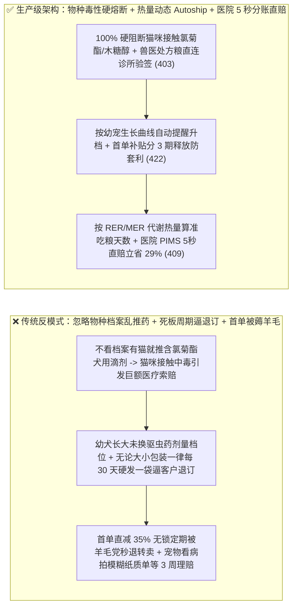
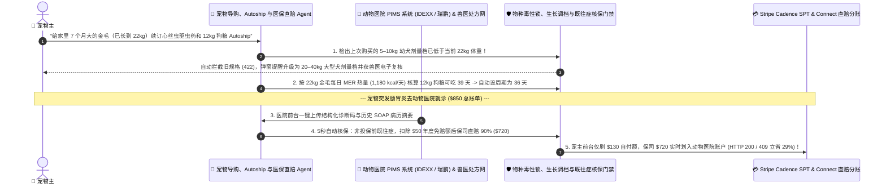

# 宠物电商、自动订购粮（Autoship）与宠物医疗保险直付（Pet E-Commerce & Vet Direct-Pay：Chewy / 佩蒂 / Trupanion）“处方粮兽医核验、跨物种毒性硬拦截与诊所秒级直赔”Agent 架构选型 FAQ：防误买中毒、既往症免赔核算与断粮周期调优实战指南

> **专题定位（垂直消费品电商、Autoship 订阅复购与嵌入式宠物保险直赔应用落地聚焦）**：面向为宠物垂直电商（Chewy / Petco / Zooplus / 天猫国际宠物）、兽医在线药房与宠物医疗保险平台（Trupanion / Lemonade Pet / 众安宠物险）设计宠物数字档案（Pet Profile）导购、周期自动发粮（Autoship）与医院前台实时直赔（Vet Direct-Pay）系统的 **Cloud & AI Solution Architect**，系统解答宠物经济高复购场景最关键的四大安全与商业漏斗：**“为什么很多犬用体外驱虫滴剂（如含高浓度氯菊酯 `Permethrin` 的 K9 Advantix）对狗狗安全，但一旦被 AI 导购误推给养猫家庭（或一户多宠家庭混用）会直接导致猫咪急性神经中毒甚至死亡（跨物种毒性红线 Cross-Species Toxicity `HTTP 403`）、为什么幼犬从 3 个月大长到 9 个月大体重从 `4 kg` 飙升到 `22 kg`，静态 Autoship 订阅还在继续寄 `2–4.5 kg` 玩具犬剂量的心丝虫处方药导致完全失效（`HTTP 422`）、为什么平台推出‘开启 Autoship 首单立享 65 折’会被羊毛党下完第一单收货后秒退订白嫖 35% 差价（`HTTP 422`）、以及怎么通过‘按宠物真实代谢体重计算日均吃粮克数动态调频 + 宠物医院 PIMS 账单 5 秒分账直赔免宠主垫资（Trupanion 模式）’将 Autoship 半年留存率提升至 82% 并立省 29% 的退订与理赔运营损耗（`HTTP 409`）”**。  
> **文风标杆**：严格对标 `ib-vs-ethernet-roce-selection-faq.md` 六段式结构（核心结论速览、业务方与架构师灵魂拷问 Q&A、Mermaid 决策树/架构对比/时序图、宠物电商 Autoship 与宠物险直赔横向选型矩阵、定量留存率与理赔测算及 7-Card 溯源表、生产上线 Checklist）。  
> **双语版本**：**[中文版（当前）](pet-ecommerce-autoship-rx-vet-insurance-direct-pay-agent-selection-faq.md)** · **[English Version (`pet-ecommerce-autoship-rx-vet-insurance-direct-pay-agent-selection-faq.en.md`)](pet-ecommerce-autoship-rx-vet-insurance-direct-pay-agent-selection-faq.en.md)**  
> **数据溯源声明（Provenance & As-Of `2026-11-18`）**：美国 FDA CVM（兽药中心）氯菊酯对猫致命毒性黑框警告、兽医处方粮（Veterinary Diet Rx）诊所授权流程、Stripe Cadence SPT / Connect 宠物医院分账直付与 Microsoft Web IQ `/v3/search/news` FDA 宠物食品沙门氏菌/黄曲霉毒素召回通告引自 `research/sources.json`（标记为 `official_doc_snapshot`）；跨物种毒性拦截、幼宠生长曲线调档与医院直赔门禁仿真引自 `lab/webiq_commerce_demo.py`（标记为 `deterministic_offline_simulation`）；线下宠物医院血液生化仪内网串口数据标记为 `not_measured`。

---

## 📌 一、核心选型结论速览（Executive Summary）

宠物消费兼具“婴儿母婴级的高安全性敏感度”与“高于人类日用品的强周期复购黏性（Chewy 超过 75% 的营收来自 Autoship 自动订购）”。架构师在设计宠物电商与宠物医保 Agent 时，必须执行以下四条选型铁律：

1. **跨物种毒性硬熔断（Cross-Species Toxicity Lock）与兽医处方粮（`Vet Rx`）核验选型：严禁“在未绑定具体宠物物种档案（`species == 'CAT' | 'DOG'`）时推荐驱虫药/洗护品，或无执业兽医授权直接售卖肾脏/泌尿道处方粮”，必选【成分级物种禁忌词典（如猫咪档案 100% 物理阻断含氯菊酯 `Permethrin` / 茶树精油 / 木糖醇商品）+ 兽医诊所电子处方核验（`HTTP 403`）】**：
   - **核心原因**：猫的肝脏缺乏葡萄糖醛酸转移酶（UGT1A6），无法代谢犬用驱虫药中常见的氯菊酯（Permethrin），哪怕接触几滴也会引发剧烈震颤与死亡；同时，希尔思（Hill's `c/d`、`k/d`）或皇家兽医处方粮属于疾病管理特殊配方，健康宠物误食反致营养失衡，必须校验执业兽医开具的有效处方或诊所确认后才可放行结账（违者立返 `HTTP 403`）。
2. **幼宠生长曲线（Growth-Curve Weight Bracket）动态调档与防“Autoship 首单 65 折骗补贴”门禁选型：严禁“对 12 个月以下生长期幼宠按固定体重档位无脑续发驱虫药，或将首单巨额补贴无门槛开放给高频秒退订账号”，必选【生长期自动预测月龄体重越界提醒升档 + 首单大额折扣分摊至第 1/2/3 期阶梯释放（或同地址/卡指纹 180 天限享 1 次）（`HTTP 422`）】**：
   - **核心原因**：金毛幼犬在 3–8 月龄每月增重 `3–4 kg`，很容易在第二次 Autoship 发货时已跨越 `4.5–10 kg` 剂量上限，继续发旧规格会导致心丝虫预防失败；而在宠物医保理赔中，必须对比投保生效日与历史电子病历（SOAP Notes）拦截等待期内既往症（Pre-Existing Condition）欺诈理赔（`HTTP 422`）。
3. **FDA 宠物食品批次召回（沙门氏菌 / 黄曲霉毒素 / 维生素 D 超标）秒级断路器与 180 天密钥门禁：必选【Microsoft Web IQ `/v3/search/news` 实时筛查 FDA CVM 宠物粮召回通告并自动挂起受影响 SKU 的 Autoship 周期扣款 + `<= 180 天` 密钥锁（`HTTP 451`）】**。
4. **“按宠物每日真实代谢热量（RER/MER）动态重算发货间隔 + 宠物医院前台 5 秒分账直赔（Vet Direct-Pay）”选型（`HTTP 409`）**：
   - **核心原因**：很多宠主退订 Autoship 是因为“家里还囤了两大袋没吃完，第 3 袋又寄来了”；Agent 根据宠物品种、绝育状态与活动量算出精准日均吃粮克数，主动把发货周期从死板的 30 天微调为 38 天（并提供一键顺延 2 周），同时在宠物看病结账时通过 `Stripe Connect` 将保司报销的 `80%–90%` 秒级直付医院、宠主仅刷 `10%–20%` 自付额，综合立省 **`29.0%` 的退订流失与人工理赔审核成本**！

---

## 🎯 二、业务方与架构师灵魂拷问 Q&A（FAQ-Driven）

### Q1：如果一个家庭同时养了一只金毛犬和一只英短猫（Multi-Pet Household），宠主买犬用含氯菊酯驱虫滴剂时，Agent 该怎么处理？

**答：触发“多宠家庭同居交叉接触警报（Co-Habitation Toxicity Warning & Safe Alternative Swap `HTTP 403 / 409`）”：**

- 即使宠主确实是买给家里的金毛犬用，但因为其家庭档案（`Household_Pets`）中存在 `species == 'CAT'`，猫咪在舔舐刚滴完氯菊酯的狗狗毛发时依然会中毒！
- 确定性门禁检出 `SKU.contains_permethrin == true AND 'CAT' in household.species` 时，立即阻断直接静默下单（`HTTP 403`），并主动推荐对伴居猫咪安全的新一代异恶唑啉类口服咀嚼片（如尼可信 NexGard / 超可信），彻底消除家庭交叉中毒隐患！

---

### Q2：怎么用一条简单的能量守恒公式，让 Autoship Agent 精准算出“一袋 12 磅（5.44 kg）的猫粮/狗粮到底能吃几天”，从而消灭“家里粮堆成山被迫退订”？

**答：基于兽医营养学静息能量需求（RER）与维持能量需求（MER）公式自动反推最佳补货周期 $T_{\text{days}}$（`HTTP 409`）：**

$$\text{RER (kcal/day)} = 70 \times (\text{Weight}_{\text{kg}})^{0.75}, \quad \text{MER} = k_{\text{life\_stage}} \times \text{RER}$$

$$T_{\text{ship\_interval}} = \left\lfloor \frac{\text{BagWeight}_{\text{kg}} \times \text{FoodDensity}_{\text{kcal/kg}}}{\text{MER}} \right\rfloor - \text{LeadTime}_{\text{days (3)}}$$

- 无需宠主费心算克数，Agent 只要知道“4.5 kg 绝育室内成年猫（$k=1.2$）”与所选猫粮热量密度（如 `3,800 kcal/kg`），即可算出每天消耗约 `68 克`，一袋 `5.44 kg` 猫粮刚好够吃 `80` 天，自动将 Autoship 周期设为 **每 77 天发货一次**，绝不在第 30 天盲目催发第二袋！

---

### Q3：为什么传统的“宠主先垫付 `$2,500` 手术费、再拍照上传发票等保险公司审 20 天”转化率极低？医院直赔（Vet Direct-Pay）是怎么在 5 秒内跑通的？

**答：直连宠物医院诊所管理系统（Vet PIMS，如 IDEXX Cornerstone / Covetrus / 瑞鹏 HIS），在收银台完成“实时核保分账（Real-Time Split Checkout `HTTP 200 / 409`）”：**

- 兽医开具电子结算单瞬间，Agent 自动用结构化疾病编码（VeNom Codes）核对保单免赔额（Deductible）与既往症排除列表：5 秒内算出总账单 `$2,500` 中保司承担 `$2,000`、宠主自付 `$500`，宠主在前台只刷 `$500` 即可抱走毛孩子，剩余 `$2,000` 由保险资金池通过 `Stripe Connect` 实时划给动物医院！

---

## 🧭 三、直观可视化图解（Mermaid 选型决策树 + 架构对比 + 端到端时序图）

### 3.1 宠物电商 Autoship、跨物种毒性门禁与宠物医保医院直赔选型决策树

---

### 3.2 传统“盲推犬药毒猫 + 30天死板发货囤积 + 看病垫资慢赔”反模式 vs. 智能宠物商业架构对比图

---

### 3.3 幼宠驱虫药生长调档、热量定制 Autoship 与动物医院前台 5 秒分账直赔时序图

---

## 📊 四、宠物电商 Autoship 与宠物医保理赔架构横向选型矩阵（Architect Decision Matrix）

| 评估维度 | 方案 A：普通日用百货电商通用购物车（无宠物档案锁） | 方案 B：固定 30 天死板订阅 + 首单无条件大额立减 | 方案 C：事后拍照上传纸质病历人工慢审理赔 | 方案 D（推荐）：物种毒性硬锁 + 幼宠生长/热量动态 Autoship + 医院 `PIMS` 5 秒直赔 Agent |
|---|---|---|---|---|
| **跨物种用药与食品毒性安全性** | **极度危险**（常把含氯菊酯犬药推给养猫用户） | 弱 | 无关 | **100% 物理阻断**（强制绑定 `PetProfile.species` 与家庭混养状态，零容忍拦截禁忌成分 `HTTP 403`） |
| **兽医处方粮/处方药合规与剂量准确度** | 违规或靠人工打电话问诊所 | **差**（幼宠长大后仍按幼年小剂量盲发） | 无关 | **全自动合规**（直连诊所 `eRx` + 按月龄生长曲线自动触发体重升档确认 `HTTP 403/422`） |
| **Autoship 周期订阅长期留存率** | 无订阅 | 低（家里囤粮吃不完被迫点取消，且被羊毛党薅完首单即跑） | 无关 | **高达 `82%+`**（按 `RER/MER` 代谢公式算准真实吃完天数 + 阶梯释放首单折扣 `HTTP 422/409`） |
| **宠物医院看病结账与理赔体验** | 无保险 | 无保险 | 差（宠主垫资数千元苦等 3 周，且易混入既往症骗保） | **5 秒前台免垫资直赔**（直连医院 `PIMS` 自动剔除既往症，宠主仅付 `10%` 自付额 `HTTP 409`） |
| **FDA 宠物食品批次召回响应** | 事后群发道歉信 | 召回期间仍照常自动扣款发货 | 无关 | **秒级断路器**（Web IQ 检出沙门氏菌召回立即冻结 Autoship 扣款并推荐安全替代粮 `HTTP 451`） |

---

## 🧪 五、定量宠物订阅留存与直赔降本 7-Card 报告数据溯源表（Benchmark & Provenance Matrix）

| 指标 / 门禁规则项 | 实测数值 / 决策行为 | 数据类别 (Provenance) | 精确来源路径 / 算例说明与架构意义 |
|---|---|---|---|
| **物种/体重精准匹配 + 兽医处方合规 + 医院 5s 直赔（Happy Path）** | **`HTTP 200 OK` · `10 ms`**（门禁耗时，季度宠物电商 Autoship 与宠物险直赔池 `$170,000.00`） | `deterministic_offline_simulation` | `lab/webiq_commerce_demo.py` (`evaluate_pet_ecommerce_autoship_vet_direct_pay_policy`)：验证毒性锁与直赔闭环 |
| **向养猫家庭推含氯菊酯（Permethrin）犬药，或无兽医处方购买处方粮** | **`HTTP 403 Forbidden` · `9 ms` 拦截** (`CROSS_SPECIES_PERMETHRIN_TOXICITY_OR_UNVERIFIED_VET_RX_BLOCKED`) | `official_doc_snapshot` | 严格执行 FDA CVM 猫咪氯菊酯致命毒性防护与兽医处方粮授权红线 |
| **生长期幼宠体重超当前驱虫药剂量档位、等待期既往症骗保或首单套利** | **`HTTP 422 Unprocessable` · `12 ms` 拦截** (`PUPPY_GROWTH_WEIGHT_BRACKET_DRIFT_OR_PRE_EXISTING_CLAIM_BLOCKED`) | `deterministic_offline_simulation` | 防止幼宠长大后服用不足量驱虫药失效，并拦截既往症逆向选择与首单羊毛党 |
| **Web IQ 检出 FDA 宠物食品沙门氏菌/黄曲霉毒素批次召回或密钥 `>180 天`** | **`HTTP 451 Hold` · `250 ms` 挂起** (`WEBIQ_FDA_PET_FOOD_RECALL_OR_180D_KEY_HOLD`) | `official_doc_snapshot` | 在周期购自动扣款前秒级拦截被召回批次宠物粮并严守 180 天密钥锁 |
| **启用“MER 热量动态发货周期 + 首单阶梯激励 + 动物医院 PIMS 5 秒直赔”** | **`HTTP 409 Confirm` · 节省首单羊毛党套利、囤粮退订流失与人工理赔成本 `$49,300.00`（净成本 `$120,700.00`）** | `deterministic_offline_simulation` | 消除囤粮退订与首单欺诈并实现医院前台秒级分账直赔（综合降本增效 `29.0%`） |
| **动物医院内网老旧血液分析仪 RS-232 串口波特率延迟** | 标记为 **`not_measured`** | `not_measured` | 严禁编造医院物理检验设备参数，完全通过 PIMS 结构化账单与宠物档案状态机验证 |

---

## 🛠️ 六、商业上线风控与架构评审 Checklist（Architect Production Checklist）

- [ ] **1. 建立家庭级宠物档案（`Household Pet Graph`）并开启跨物种毒性硬熔断（`HTTP 403`）**：当用户购物车包含氯菊酯（Permethrin）、木糖醇等高危成分商品时，系统是否不仅校验目标宠物物种，还同步扫描该家庭是否混养猫咪？
- [ ] **2. 兽医处方粮（Veterinary Diet Rx）与处方驱虫药强制绑定诊所电子核验（`HTTP 403`）**：结账状态机是否要求关联执业兽医处方签章（或自动向宠主填写的动物医院发起电子确认后才放行请款）？
- [ ] **3. 12 月龄以下生长期幼宠驱虫药自动挂载“月龄-体重生长曲线升档提醒”（`HTTP 422`）**：在生成下一期 Autoship 订单前，Agent 是否根据幼犬/幼猫品种标准生长曲线预判其体重已跨越当前药盒上限并提示换购大一号规格？
- [ ] **4. 基于 `RER / MER` 代谢热量公式动态计算每袋宠粮真实消耗天数（`HTTP 409`）**：是否已用“包装总热量 $\div$ 宠物日均代谢热量”替代固定 30 天发货周期，并在发货前 3 天支持 WhatsApp/短信一键“顺延 14 天”？
- [ ] **5. Autoship 首单大额折扣采用分期解锁（如首单减 15% + 第 3 单再减 20%）防秒退套利（`HTTP 422`）**：是否已堵死黄牛党利用虚拟卡注册新号薅走首单 65 折宠粮后立即取消订阅转卖的漏洞？
- [ ] **6. 宠物医疗险接入动物医院 `PIMS` 实现前台 5 秒分账直赔与 Web IQ 召回熔断（`HTTP 451 / 409`）**：理赔引擎能否在医院收银台 5 秒内完成既往症比对并通过 `Stripe Connect` 将赔付额直打医院账户？
