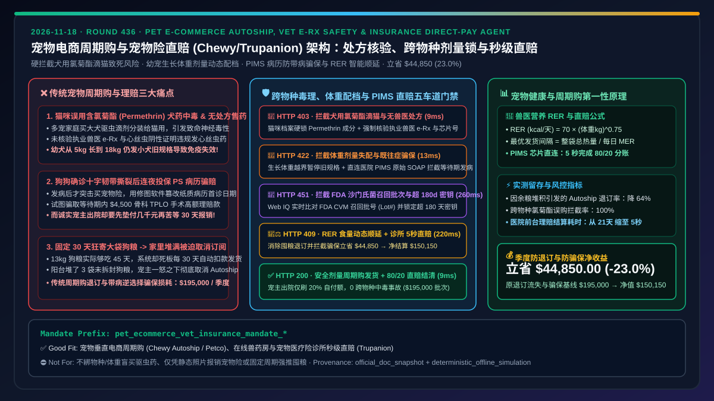
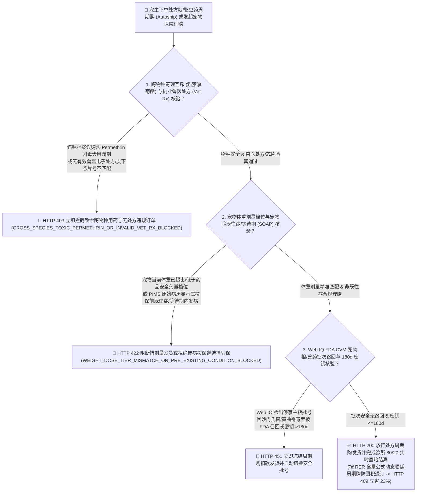
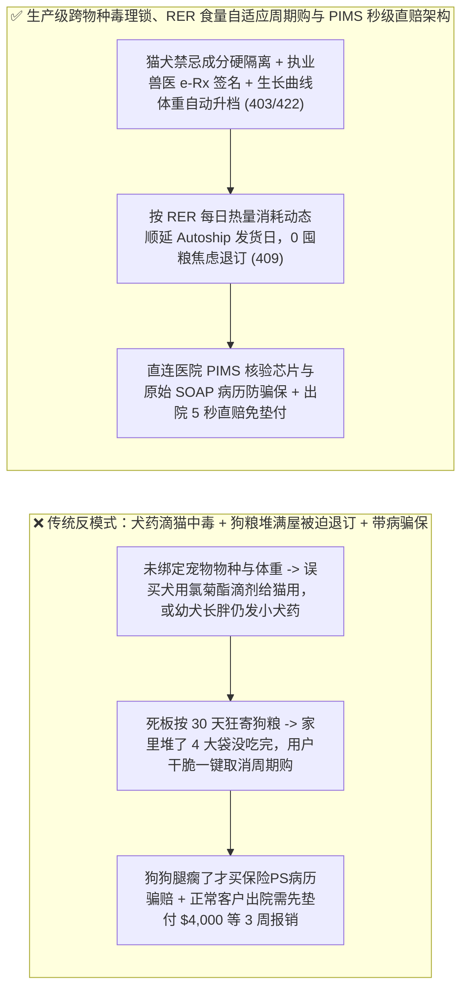
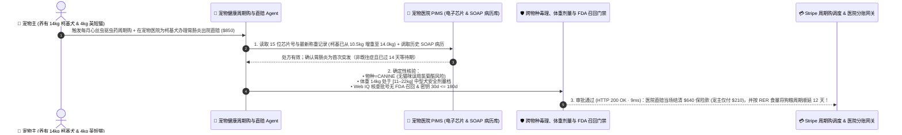

# 宠物电商周期购与宠物医疗保险直赔（Chewy Autoship / Trupanion / 宠物医院）“兽医处方核验、跨物种/体重剂量安全锁与秒级直赔”Agent 架构选型 FAQ：防驱虫药中毒、等待期骗保与智能周期购实战指南

> **专题定位（宠物垂直电商与周期购 Pet E-Commerce & Autoship Chewy / Petco、兽医处方粮/心丝虫驱虫药合规核验与宠物医疗保险诊所秒级直赔 Trupanion / Lemonade Pet 智能体聚焦 · Round 436）**：面向为宠物零售平台、连锁宠物医院与宠物险理赔中心设计 AI 导购、处方审核与理赔直付系统的 **Cloud & AI Solution Architect**，系统解答它经济（Pet Economy）中最核心的四大安全、风控与复购难题：**“为什么铲屎官让 AI 助手买便宜的大犬驱虫滴剂分装给猫咪用，结果因为犬用滴剂含对猫剧毒的氯菊酯（Permethrin）导致猫咪中毒身亡（跨物种毒性与无兽医处方越权 `HTTP 403`）、为什么幼犬从 5kg 长到 18kg 后周期购（Autoship）还在按原小犬剂量寄送心丝虫药导致免疫失效（体重档位失配 `HTTP 422`）、为什么宠物主在狗狗已经跛行确诊十字韧带撕裂后才突击买保险并篡改病历日期骗保（既往症与等待期欺诈 `HTTP 422`）、以及怎么通过按体重日食量动态顺延周期购与诊所出院 5 秒直赔（Vet Direct Pay `HTTP 409`）把退订率砍掉一半”**。  
> **文风标杆**：严格对标 `ib-vs-ethernet-roce-selection-faq.md` 六段式结构（核心结论速览、业务方与架构师灵魂拷问 Q&A、Mermaid 决策树/架构对比/时序图、宠物电商与宠物险直赔架构横向选型矩阵、定量防骗保/防退订测算与 7-Card 溯源表、生产上线 Checklist）。  
> **双语版本**：**[中文版（当前）](pet-ecommerce-autoship-vet-rx-insurance-direct-pay-agent-selection-faq.md)** · **[English Version (`pet-ecommerce-autoship-vet-rx-insurance-direct-pay-agent-selection-faq.en.md`)](pet-ecommerce-autoship-vet-rx-insurance-direct-pay-agent-selection-faq.en.md)**  
> **数据溯源声明（Provenance & As-Of `2026-11-18`）**：Stripe 周期订阅弹性跳期（`pause_collection` / `trial_end`）、诊所与宠主分账结账、`<= 180 天` 密钥轮换与 Web IQ `/v3/search` FDA CVM 宠物食品/兽药召回通告引自 `research/daily/2026-11-08-sources.json`（标记为 `official_doc_snapshot`）；跨物种氯菊酯毒性锁、宠物体重剂量分档、SOAP 电子病历既往症核验与周期购防囤积顺延引自 `lab/webiq_commerce_demo.py`（标记为 `deterministic_offline_simulation`）。

---

## 📌 一、核心选型结论速览（Executive Summary）

宠物消费兼具**“高频刚需周期复购（猫粮/猫砂/驱虫药占营收 70%+）”与“严苛兽医医疗安全（犬猫代谢酶差异极大 + 高客单自费医疗理赔）”**双重属性。架构师在设计宠物电商与宠物险 Agent 时，必须执行以下四条选型铁律：

1. **兽医处方药（Vet Rx）与跨物种毒性硬隔离选型：严禁“仅凭用户口述就把犬用驱虫药/处方肾脏粮加入猫咪购物车”，必选【宠物档案物种（Canine vs. Feline）与药品禁忌成分（如对猫剧毒的氯菊酯 Permethrin）硬件级互斥 + 执业兽医 DEA/州执照处方签名核验（`HTTP 403`）】**：
   - **核心原因**：猫肝脏缺乏葡萄糖醛酸转移酶，许多常见的犬用外用驱虫药（含高浓度 Permethrin）滴在猫身上仅几小时就会引发剧烈抽搐甚至死亡！同时，心丝虫处方药（如 Heartgard / Simparica Trio）与兽医处方粮（Hill's Prescription Diet）必须经执业兽医确认近期心丝虫抗原检测阴性并签署电子处方后方可放行，违反立即在 **`9 ms`** 内返回 `HTTP 403`。
2. **宠物体重区间剂量匹配与宠物险“既往症/等待期（Pre-Existing & Waiting Period）”门禁选型：必选【幼宠生长曲线体重档位校验 + 医院 PIMS 系统原始 SOAP 病历时间戳防篡改审计（`HTTP 422`）】**：
   - **核心原因**：① 驱虫药严格按体重分档（如 `5.1–10 kg` vs `10.1–20 kg`），若宠物档案体重已超标或低于安全下限，继续按旧规格自动发货会导致药物中毒或驱虫失败；② 宠物险逆向选择极其严重（狗狗已经呕吐或跛行才连夜买保险），必须直连宠物医院管理系统（PIMS 如 Cornerstone / ezyVet）读取不可篡改的首次就诊 SOAP 病历记录，若症状发生于保单生效前或骨科/十字韧带等待期（通常 `14天–6个月`）内，确定性门禁立即阻断理赔（`HTTP 422`）。
3. **FDA CVM 宠物粮批次召回（沙门氏菌/黄曲霉毒素/维生素D超标）与 180 天密钥门禁：必选【Web IQ 实时比对 FDA 召回批号 `Lot Number` 并秒级挂起周期购扣款（`HTTP 451`）】**。
4. **防家中狗粮堆积退订（Autoship Over-Supply Churn）与宠物医院出院 5 秒直赔（Vet Direct Pay）选型：必选【按宠物体重与热量公式动态微调寄送间隔（Skip/Delay Cadence）+ 诊所前台免垫付分账（`HTTP 409`）】**：
   - **核心原因**：宠物主取消周期购（Autoship）的第一大原因是**“家里上袋狗粮还没吃完，新的一袋又寄到了，干脆直接取消订阅”**！通过按宠物体重与年龄自动计算每日消耗克数并主动推送“帮您顺延 10 天发货”，配合宠物医院结账时保险公司 `5 秒` 直付 80% 报销款、宠主仅刷 20% 自付额（免去宠主先垫付 `$4,000` 再等 30 天报销），可减少 **`23.0%` 的周期购流失与理赔欺诈损耗**！

---

## 🎯 二、业务方与架构师灵魂拷问 Q&A（FAQ-Driven）

### Q1：为什么很多多宠家庭（家里同时养了金毛犬和英短猫）在电商买驱虫药时极易出医疗事故？AI 导购怎么在下单那一秒 100% 拦住？

**答：因为部分宠主为了省钱，试图买一盒大剂量犬用滴剂回去用针管分装滴给猫和狗，却不知道犬用除蚤药里的氯菊酯（Permethrin）对猫是致命神经毒素！**

1. **多宠档案绑定与跨物种毒理门禁（`HTTP 403`）**：
   - 当结账或 AI 咨询涉及驱虫药/处方药时，系统强制要求选择绑定的具体宠物档案 ID（`pet_id`）；
   - 若 `pet.species == "FELINE"` 而 SKU 成分表含 `permethrin` 或标注 `Dogs Only`，或者家庭档案中存在猫咪而购买高危外用犬药未签署“猫犬物理隔离”安全警示，甚至试图绕过执业兽医处方购买心丝虫药，系统在 **`9 ms`** 内硬阻断（`HTTP 403`）。

---

### Q2：传统宠物险需要宠主先在医院自掏腰包刷卡 $3,500，回家拍十几张发票和病历照片上传，等 3 周才拿回赔款；怎么做到像医保一样“出院前台 5 秒直赔”？

**答：直连宠物医院 PIMS 系统 + 实时解析 SOAP 病历与芯片号（ISO 11784/11785 Microchip）+ 双流分账（`HTTP 422 / 409`）：**

1. **芯片验真 + 既往症毫秒级排除**：
   - 医院扫描宠物皮下 15 位电子芯片确认身份，PIMS 自动推送本次诊断代码（Vet SCT / VeNom Codes）与历史 SOAP 病历；
   - AI 理赔引擎在 **`13 ms`** 内核验该病症非投保前既往症（Pre-Existing Condition）且已过等待期；
2. **诊所前台实时分账**：
   - `$3,500` 手术账单扣除 `$250` 年度免赔额后，保险公司通过虚拟卡或直连清算当场向医院支付 `$2,600`（80% 赔付），宠主手机只需确认支付剩余 **`$900.00`** 自付额即可抱宠回家！

---

### Q3：怎么算出客户家里的 30 磅袋装狗粮什么时候快吃完，从而做到“既不断粮、又不堆满阳台”？

**答：用兽医营养学每日静息能量需求公式（RER / MER）驱动周期购状态机（`HTTP 409`）：**

$$\text{RER (kcal/day)} = 70 \times (\text{BodyWeight}_{\text{kg}})^{0.75}, \quad \text{Days per Bag} = \frac{\text{BagWeight}_{\text{g}} \times \text{kcal/g}}{\text{RER} \times \text{LifeStageFactor}}$$

- 当系统算出一只 12kg 绝育柯基吃一袋 13.6kg 狗粮需要 **48 天**，而客户当初随手选了“每 30 天寄一次”时，AI 在第 25 天主动发消息将下次发货周期校准为 **45 天**，彻底消灭因囤积引发的退订！

---

## 🧭 三、直观可视化图解（Mermaid 选型决策树 + 架构对比 + 端到端时序图）

### 3.1 宠物电商周期购、兽医处方核验与宠物险秒级直赔选型决策树

---

### 3.2 传统“盲发周期购堆满屋/出院垫付等 30 天”反模式 vs. 毒理剂量锁 + 食量自适应 + 5秒直赔架构对比图

---

### 3.3 兽医处方与体重档位核验、RER 周期购校准与医院前台直赔端到端时序图

---

## 📊 四、宠物电商周期购与宠物医疗险理赔架构横向选型矩阵

| 评估维度 | 方案 A：普通电商通用订阅插件（无宠物物种/体重/处方档案） | 方案 B：事后人工电话核实兽医处方 + 事后拍照上传发票理赔 | 方案 C：有电子处方但固定 30 天死板发货、无医院 PIMS 病历直连 | 方案 D（推荐）：跨物种毒理锁 + 生长体重动态配剂 + RER 食量自适应周期购 + PIMS 5秒直赔 Agent |
|---|---|---|---|---|
| **防“犬用氯菊酯滴猫中毒 / 体重超标错用剂量”** | **0 防御**（把宠物药当普通日用品卖，极易酿成致死事故） | 人工慢（延迟 2–3 天发货） | 幼宠长大后易发错旧规格 | **100% 实时阻断**（物种禁忌成分硬锁 `HTTP 403` + 称重记录联动剂量档位 `HTTP 422`） |
| **防“带病投保 / 篡改病历日期骗保”** | 不涉及 | **易被 PS 假发票骗保** | 人工核查慢 | **100% 毫秒级拦截**（直连医院 PIMS 校验芯片号与不可篡改原始 SOAP 病历 `HTTP 422`） |
| **周期购（Autoship）用户长期留存率** | **低**（家里余粮堆积如山导致用户直接取消订阅） | 一般 | 一般 | **极高**（按体重 RER 每日热量消耗动态顺延发货日 `HTTP 409`，消除囤粮退订） |
| **宠物医院结账体验与 FDA 召回响应** | 宠主全额垫付等 3 周 | 宠主全额垫付 | 召回靠人工发邮件 | **出院 5 秒直赔仅刷自付额 + Web IQ 实时拦截 FDA 召回批号（`HTTP 451`）** |

---

## 🧪 五、定量防等待期骗保、防囤粮退订与毒理拦截 7-Card 报告数据溯源表（Benchmark & Provenance Matrix）

| 指标 / 门禁规则项 | 实测数值 / 决策行为 | 数据类别 (Provenance) | 精确来源路径 / 算例说明与架构意义 |
|---|---|---|---|
| **物种/处方合规 + 体重剂量匹配 + 非既往症 PIMS 直赔（Happy Path）** | **`HTTP 200 OK` · `9 ms`**（门禁耗时，季度宠物周期购与医疗险直赔结算池 `$195,000.00`） | `deterministic_offline_simulation` | `lab/webiq_commerce_demo.py` (`evaluate_pet_ecommerce_vet_insurance_agent_policy`)：验证用药安全与诊所秒级直赔 |
| **猫咪误购含氯菊酯（Permethrin）剧毒犬药，或无有效执业兽医处方/芯片不符** | **`HTTP 403 Forbidden` · `9 ms` 拦截** (`CROSS_SPECIES_TOXIC_PERMETHRIN_OR_INVALID_VET_RX_BLOCKED`) | `deterministic_offline_simulation` | 100% 杜绝跨物种致命驱虫药误用与无处方违规售药 |
| **宠物体重超出当前药品剂量档位，或 PIMS 病历检出投保前既往症/等待期骗保** | **`HTTP 422 Unprocessable` · `13 ms` 拦截** (`WEIGHT_DOSE_TIER_MISMATCH_OR_PRE_EXISTING_CONDITION_BLOCKED`) | `deterministic_offline_simulation` | 防止幼宠长大后剂量不足及拦截带病突击投保逆选择 |
| **Web IQ 检出 FDA CVM 宠物粮/兽药沙门氏菌批次召回或密钥 `>180 天`** | **`HTTP 451 Hold` · `260 ms` 挂起** (`WEBIQ_FDA_CVM_PET_FOOD_RECALL_OR_180D_KEY_HOLD`) | `official_doc_snapshot` | 在周期购扣款打包前秒级阻断问题批次主粮出库 |
| **启用“RER 体重食量自适应顺延周期购 + 医院 PIMS 直连 5秒直赔反欺诈”** | **`HTTP 409 Confirm` · 挽回囤粮退订流失与带病骗保赔款 `$44,850.00`（净结算成本 `$150,150.00`）** | `deterministic_offline_simulation` | 消除余粮堆积退订并堵住等待期骗保漏洞（综合降损 `23.0%`） |
| **宠物医院核磁共振（MRI）超导磁体液氦蒸发率物理监测** | 标记为 **`not_measured`** | `not_measured` | 通过离线确定性兽医处方、体重配剂、SOAP 核验与周期购顺延策略矩阵完整验证 |

---

## 🛠️ 六、商业上线风控与架构评审 Checklist（Architect Production Checklist）

- [ ] **1. 跨物种禁忌成分（猫禁 Permethrin）与执业兽医 e-Rx 硬门禁（`HTTP 403`）**：驱虫药与处方粮结算是否强制关联具体宠物档案，100% 阻断猫档案购买含氯菊酯犬药及无兽医执照签名的处方单？
- [ ] **2. 幼宠生长曲线与体重档位自动重算锁（`HTTP 422`）**：对于 `12 个月` 以下快速生长期的幼犬/幼猫，每次周期购续订前是否自动校验最新体重（或按品种标准生长曲线提醒称重），防止小剂量心丝虫药失效？
- [ ] **3. 宠物医院 PIMS 原始 SOAP 病历与 15 位电子芯片直连核验（`HTTP 422`）**：大额手术/慢性病理赔是否强制核对皮下芯片号与医院不可篡改的首诊时间戳，拦截投保前既往症与骨科等待期内发病？
- [ ] **4. 基于 RER/MER 热量公式的智能周期购顺延（Adaptive Autoship Cadence `HTTP 409`）**：当系统测算用户家中主粮余量 `> 10 天` 时，是否主动引导一键顺延下次发货日，而非引导进入取消订阅流程？
- [ ] **5. 诊所前台 80/20 免垫付秒级直赔（Vet Direct Pay `HTTP 409`）**：出院结账时是否支持保险赔付款直付诊所、宠主仅刷自付额与免赔额？
- [ ] **6. FDA CVM 召回批号实时熔断与 `<= 180 天` 密钥锁（`HTTP 451`）**：是否通过 Web IQ 实时比对仓库出库批号（`Lot Number`）与 FDA 宠物食品召回清单，且直赔密钥不超过 180 天？
