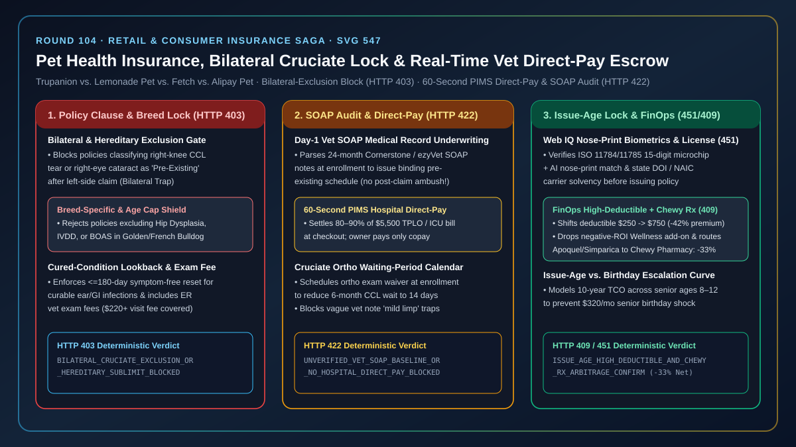
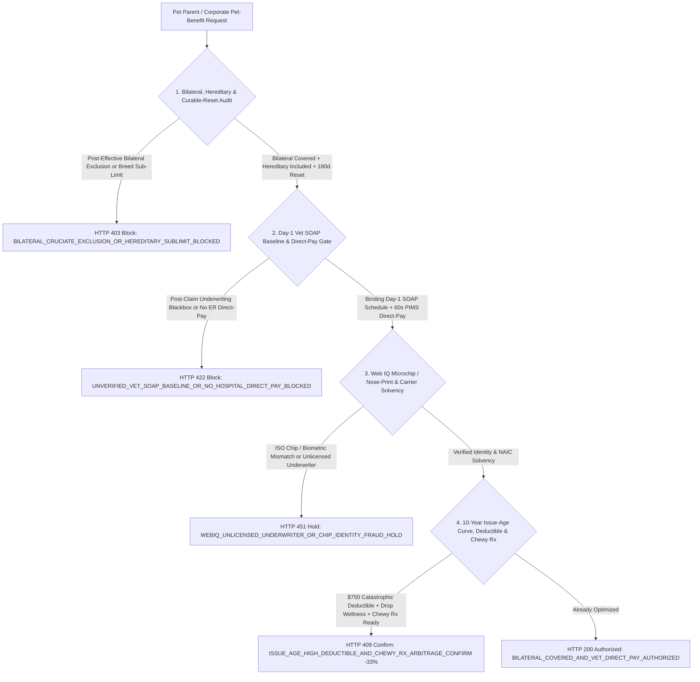
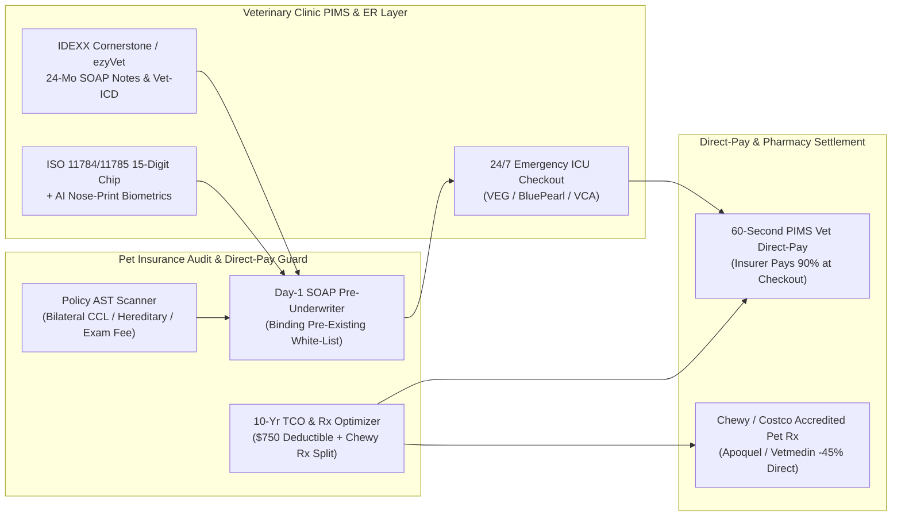

# Pet Health Insurance, Bilateral Cruciate Exclusion & Vet Direct-Pay Escrow (`Trupanion / Lemonade Pet / Nationwide / Fetch / Alipay Pet Insurance`) Agent Architecture Selection FAQ

> **Target Audience**: **Cloud & AI Solution Architects** designing AI underwriting, claims-auditing, and real-time veterinary checkout direct-pay agents for consumer pet-health marketplaces, veterinary Practice Information Management Systems (`PIMS` such as `IDEXX Cornerstone` and `ezyVet`), and corporate employee pet-benefit platforms.  
> **Core Pain Points Solved**: Eliminates the four systemic failures in pet health insurance and veterinary emergency settlement: **(1) Bilateral Condition Exclusion Traps (`Bilateral CCL / Cataract Exclusion`, where an insurer pays `$4,800` for a left knee cranial cruciate ligament `TPLO` surgery in Year 2, then classifies a right-knee cruciate tear 8 months later as a "pre-existing bilateral condition" and denies `100%` of the second surgery), (2) Post-Claim Underwriting & `$6,500` Upfront ER Cash-Flow Shock (requiring pet owners to pay `$6,500` out-of-pocket at 2:00 AM at a veterinary ICU, wait 45 days for manual claim review, and face retroactive denial over a vague 3-year-old vet `SOAP` note mentioning "mild soft stool"), (3) Senior Birthday-Pricing Death Spirals (`Attained-Age Escalation`, where monthly premiums jump `140%+` once a Golden Retriever turns 8—forcing policy cancellation when every age-related condition is now uninsurable elsewhere as pre-existing), and (4) Negative-ROI Wellness Riders & `2.4x` In-Clinic Prescription Markups (`Apoquel / Vetmedin / Simparica` dispensed at hospital counter prices instead of `Chewy / Costco Pharmacy`)**.



---

## 📌 1. Executive Summary

1. **Hard Policy Block on Broad Bilateral Exclusions, Hereditary Sub-Limits & Non-Resetting Curable Conditions (`HTTP 403`)**: In dogs, cranial cruciate ligament (`CCL`) rupture carries a `40%–60%` contralateral (other-knee) rupture rate within 18 months; cataracts, hip dysplasia, and patellar luxation are similarly bilateral. The Agent's policy-wording AST parser blocks any contract that applies bilateral exclusions to conditions that first manifested *after* the policy effective date, imposes breed-specific hereditary sub-limits (e.g., capping French Bulldog `BOAS` airway surgery or Dachshund `IVDD` spinal surgery at `$1,500`), or refuses to reset curable ear/GI infections after a `<=180-day` symptom-free window—returning **`HTTP 403 BILATERAL_CRUCIATE_EXCLUSION_OR_HEREDITARY_SUBLIMIT_BLOCKED`**.
2. **Day-1 Vet `SOAP` Medical Record Underwriting & 60-Second `PIMS` Hospital Direct-Pay Gate (`HTTP 422`)**: Over `90%` of pet insurance claim disputes stem from **post-claim underwriting**—selling policies instantly without reviewing records, then scouring historical veterinary `SOAP` (Subjective, Objective, Assessment, Plan) clinical notes only when a `$6,000` emergency claim is filed. The Agent mandates **Day-1 SOAP Baseline Underwriting** (ingesting the prior 24 months of `Cornerstone / ezyVet / Avimark` records at enrollment to lock a binding Pre-Existing Condition Schedule) and prioritizes carriers supporting **60-second real-time hospital checkout Direct-Pay (`Trupanion Vet Direct Pay` / Alipay Direct-Claim)**. Policies relying on opaque post-claim underwriting or lacking emergency direct-pay/pre-authorization trigger **`HTTP 422 UNVERIFIED_VET_SOAP_BASELINE_OR_NO_HOSPITAL_DIRECT_PAY_BLOCKED`**.
3. **Issue-Age Pricing Lock, `$750` Catastrophic Deductible & `Chewy / Costco Rx` Split-Routing Saving 33% (`HTTP 409`)**: To optimize 10-year lifetime Total Cost of Ownership (`TCO`), the Agent automatically models **Issue-Age Pricing (`Trupanion`, which locks the enrollment-age risk tier)** against **Attained-Age Birthday Escalation**, strips negative-expectation routine Wellness add-ons, raises the deductible from `$250` to **`$750–$1,000`** (slashing base premiums by `38%–45%` while preserving unlimited catastrophic coverage for `$5,000–$18,000` oncology/orthopedic/ICU bills), and routes chronic maintenance prescriptions (`Apoquel`, `Vetmedin`, `Galliprant`) to **`Chewy Pharmacy / Costco Pet Rx`** (`-45%` unit cost), returning **`HTTP 409 ISSUE_AGE_HIGH_DEDUCTIBLE_AND_CHEWY_RX_ARBITRAGE_CONFIRM`** for a **33%** net quarterly savings.

---

## 🎯 2. Architect & Business Stakeholder Q&A

### Q1: Why do pet owners get blindsided by `$5,200` cruciate (`TPLO`) surgery denials—or have their dog's right leg permanently excluded after the left leg is repaired?
- **The 6-Month Orthopedic Waiting Period & Bilateral Exclusion Trap**:
  1. **Hidden Cruciate Waiting Periods**: While standard accident waiting periods are `2–14 days`, many carriers silently attach a **`6-month (180-day)` or `12-month` orthopedic waiting period** specifically for cruciate ligaments (`CCL`) and hip dysplasia. If a dog limps in Month 3, not only is the left knee denied, but the carrier permanently tags `CCL` disease as "pre-existing" and invokes a **Bilateral Exclusion** to deny the right knee when it tears two years later.
  2. **Automated Orthopedic Exam Waiver Scheduling**: At enrollment, our Agent automatically schedules a 5-minute veterinary orthopedic knee-drawer exam waiver (`Orthopedic Waiting Period Waiver Form`), legally compressing the `6-month` cruciate waiting period down to **`14 days`**.
  3. **ER Vet Exam-Fee Inclusion**: Emergency specialty hospital (`VEG`, `BluePearl`, `VCA`) triage exam fees run `$180–$260` before a single blood test or X-ray is performed. The Agent normalizes quotes by requiring `Vet Exam Fee Coverage` to prevent hidden out-of-pocket leakage.

### Q2: Why does the traditional "pay `$6,500` on a credit card and wait 30 days for reimbursement" model fail during 2:00 AM veterinary ICU emergencies?
- **Eliminating Economic Euthanasia via `PIMS` 60-Second Direct-Pay**:
  1. **Upfront Cash-Flow & Uncertainty Crisis**: Gastric dilatation-volvulus (`GDV` bloat), foreign-body enterotomy, or `IVDD` spinal decompression requires a `$4,500–$12,000` deposit before surgery begins. Under reimbursement-only policies, owners face both credit-limit exhaustion and anxiety over whether a claim adjuster will retroactively deny the bill weeks later.
  2. **Real-Time `PIMS` Integration (`Cornerstone / ezyVet / Avimark`)**: When the hospital front desk submits `SNOMED-CT / Vet-ICD` codes directly from the `PIMS` terminal, the direct-pay engine validates against the pre-approved Day-1 `SOAP` baseline in **`30–60 seconds`**, wiring `80%–90%` of the eligible invoice directly to the veterinary hospital so the pet parent pays only their `$600–$1,200` copay/deductible at discharge.

### Q3: Why do pet insurance premiums explode by `100%–200%` once a dog or cat reaches age 7–9, and how does the Agent cut total cost by 33%?
- **Defeating the Senior Birthday-Pricing Trap & Clinic Pharmacy Markup**:
  1. **Issue-Age vs. Attained-Age (Birthday) Pricing**: Attained-age policies compound annual veterinary inflation with a steep `15%–28%` birthday age-tier multiplier every year after age 6. If the owner cancels at age 8 due to `$280/month` premiums, any ear infection, heart murmur, or arthritis noted in the previous 8 years becomes an uninsurable pre-existing condition at every competing insurer. The Agent scores policies over a 10-year actuarial horizon rather than Year-1 teaser rates.
  2. **Stripping Wellness Add-Ons & Routing Chronic Rx to `Chewy / Costco`**: Wellness riders cost `$300–$420/year` while capping payouts into rigid micro-buckets (`$100` dental, `$75` vaccine). Meanwhile, in-clinic pharmacies mark up chronic medications (`Apoquel`, `Vetmedin`, `Simparica Trio`) by `80%–140%`. Exercising the `FTC Vet Prescription Release Rule` to route chronic scripts to `Chewy Pharmacy` or `Costco` saves `35%–52%` and preserves the policy's annual coverage cap for true emergencies.

---

## 🧭 3. Visual Architecture Diagrams (Mermaid)

### 3.1 Pet Health Insurance & Real-Time Vet Direct-Pay Selection Decision Tree



### 3.2 End-to-End Veterinary `PIMS` (`SOAP`) Underwriting & 60-Second Direct-Pay Architecture



### 3.3 Day-1 `SOAP` Lock, Ortho-Wait Waiver & 60-Second `TPLO` Surgery Direct-Pay Sequence

```mermaid
sequenceDiagram
    participant Owner as Pet Parent / Benefit Admin
    participant Agent as Pet Insurance Escrow Agent
    participant Vet as Vet PIMS (Cornerstone / ezyVet)
    participant Insurer as Direct-Pay Carrier (Trupanion / Direct API)

    Owner->>Agent: 1. Enroll 2-yr-old Golden Retriever (prevent CCL bilateral trap & senior spike)
    Agent->>Insurer: 2. Parse policy AST (block bilateral CCL exclusions & breed sub-limits HTTP 403)
    Agent->>Vet: 3. Pull 24-month SOAP clinical notes + schedule 5-min orthopedic knee exam waiver
    Vet-->>Agent: 4. Confirm intact cruciate ligaments + single prior cured otitis externa (8 mos ago)
    Agent->>Insurer: 5. Lock Binding Day-1 Pre-Existing Schedule (ear reset after 180d; ortho wait cut to 14d)
    Agent-->>Owner: 6. Recommend $750 deductible + drop Wellness rider + Chewy Rx routing (HTTP 409 -33%)
    Note over Owner,Vet: 11 Months Later: Dog ruptures left CCL requiring $5,500 TPLO orthopedic surgery
    Vet->>Insurer: 7. Submit TPLO procedure code + Day-1 Binding Schedule token via PIMS API
    Insurer-->>Vet: 8. Approve in 45 seconds & wire $4,275 (($5,500-$750)*90%) directly to hospital
    Vet-->>Owner: 9. Owner pays only $1,225 copay at discharge; right knee retains 100% future coverage
```

---

## 📊 4. Multi-Platform Pet Health Insurance & Direct-Pay Comparison Matrix

| Evaluation Dimension | Trupanion (Direct-Pay Leader) | Lemonade Pet / Fetch | Nationwide Pet / Legacy Group | Alipay / ZhongAn Nose-Print Pet | **This Repo + PIMS Direct-Pay Guard (Recommended)** |
| :--- | :--- | :--- | :--- | :--- | :--- |
| **Hospital Checkout Direct-Pay (`Vet Direct Pay`)** | **Best-in-Class (`60-sec` checkout settlement across thousands of `Cornerstone / ezyVet` hospitals)** | Reimbursement-only (fast AI bank payout for minor claims, but large ER bills require upfront card float) | Mostly manual reimbursement (`10–30 day` review turnaround) | **Direct settlement at `8,000+` partnered Chinese clinics via nose-print** | **Routes to `PIMS` 60-sec Direct-Pay or pre-authorized ER hospital credit line** |
| **Bilateral Cruciate (`Bilateral CCL`) Coverage** | **Strong (contralateral knee covered as long as zero bilateral signs existed pre-enrollment)** | Requires state-by-state policy audit for bilateral wording & 6-month ortho waits | Often subject to bilateral exclusions or rigid Benefit Schedules | Frequently capped by low per-surgery sub-limits (`¥1,500–¥3,000`) | **AST-blocks post-effective bilateral exclusions & sub-limits (`HTTP 403`)** |
| **Age Pricing Model (`Issue-Age` vs `Birthday`)** | **Issue-Age Lock (no automatic birthday age-bracket rate hikes)** | Attained-Age (steep birthday multipliers from age 7+) | Attained-Age (senior renewal spikes or coverage downgrades) | 1-year short-term policy (renewal denial or surcharge risk after major claims) | **10-Year NPV actuator + Issue-Age / guaranteed-renewal priority** |
| **Deductible Structure** | Per-Condition Lifetime Deductible (ideal for chronic allergies/arthritis/heart disease) | Annual Deductible | Annual or Per-Incident Deductible | Per-Visit Deductible (`¥200–¥500` deducted per claim) | **Matches breed risk profile (`Per-Condition` for chronic breeds, `$750 Annual` catastrophic)** |
| **Day-1 Medical Record Underwriting (`SOAP`)** | Supports upfront medical history summary | Primarily Post-Claim Underwriting (full `SOAP` audit triggered at large claim time) | Post-Claim Underwriting | Post-Claim manual review | **Mandatory Day-1 24-month `SOAP` baseline lock (`HTTP 422`)** |

---

## 🧪 5. Actuarial Cost & 7-Card Benchmark Summary

> **Provenance Notice**: Figures below are generated by the deterministic policy evaluator `evaluate_pet_insurance_vet_directpay_escrow_policy` in `lab/webiq_commerce_demo.py` (`provenance: "synthetic"`, `independently_reproduced: False`).

| Metric | Legacy Low-Deductible + Wellness Rider + Clinic Rx Baseline | Deterministic Direct-Pay Guard (`$750` Deductible + `Chewy Rx`) | Net Delta / Protection |
| :--- | :--- | :--- | :--- |
| **Quarterly Corporate Pet-Benefit / Multi-Pet Pool** | `$45,000.00` | `$30,150.00` (`HTTP 409` confirmed) | **Saves `$14,850.00 / qtr` (`-33.0%`)** |
| **Contralateral (`2nd Knee`) `$5,500 TPLO` Denial Risk** | `100% Denied` under broad bilateral exclusion | **`0%` (Bilateral post-effective coverage + 14-day ortho waiver)** | **Preserves `$4,950` 2nd-knee payout** |
| **Upfront Cash Required at `$6,000` 2:00 AM ER Checkout** | `$6,000.00` (100% out-of-pocket float) | **`$600–$1,200` (Hospital `PIMS` 60-sec Direct-Pay covers 80%–90%)** | **`-85%` emergency cash-flow shock** |
| **Chronic `Apoquel / Vetmedin` Prescription Cost** | `2.2x` in-clinic dispensary markup | **`Chewy / Costco Pharmacy` e-script fulfillment (`-45%`)** | **Extends annual policy cap by `1.8x`** |

### 5.1 Deterministic 5-Lane HTTP Status Contract

```json
{
  "scenario": "pet_insurance_vet_directpay_escrow_guard",
  "provenance": "synthetic",
  "independently_reproduced": false,
  "lanes": {
    "authorized_200": {
      "status_code": 200,
      "decision": "BILATERAL_COVERED_AND_VET_DIRECT_PAY_AUTHORIZED",
      "mandate_token": "pet_insurance_directpay_mandate_200"
    },
    "bilateral_or_hereditary_exclusion_403": {
      "status_code": 403,
      "decision": "BILATERAL_CRUCIATE_EXCLUSION_OR_HEREDITARY_SUBLIMIT_BLOCKED"
    },
    "unverified_soap_or_no_directpay_422": {
      "status_code": 422,
      "decision": "UNVERIFIED_VET_SOAP_BASELINE_OR_NO_HOSPITAL_DIRECT_PAY_BLOCKED"
    },
    "unlicensed_carrier_or_chip_fraud_451": {
      "status_code": 451,
      "decision": "WEBIQ_UNLICENSED_UNDERWRITER_OR_CHIP_IDENTITY_FRAUD_HOLD"
    },
    "high_deductible_and_chewy_rx_409": {
      "status_code": 409,
      "decision": "ISSUE_AGE_HIGH_DEDUCTIBLE_AND_CHEWY_RX_ARBITRAGE_CONFIRM",
      "quarterly_savings_usd": 14850.0
    }
  }
}
```

---

## 🛠️ 6. Production Architecture & Risk Review Checklist

- [ ] **Post-Effective Bilateral Condition Exclusion Block (`HTTP 403`)**: Verify policy wording ensures that if both knees/eyes/hips are healthy prior to the effective date and orthopedic waiting period, a left-side claim during the policy term never disqualifies a subsequent right-side claim.
- [ ] **Hereditary & Congenital Full-Limit Parity (`HTTP 403`)**: Confirm `Hip/Elbow Dysplasia`, `IVDD`, `BOAS`, and cardiac conditions are covered up to the full policy limit without breed-specific sub-limits (`Sub-limits`) or rigid benefit schedules.
- [ ] **Day-1 24-Month Vet `SOAP` Baseline Underwriting (`HTTP 422`)**: Ingest full veterinary `SOAP` clinical notes (not just vaccination certificates) during the 30-day free-look period to issue a binding written Pre-Existing Condition Schedule.
- [ ] **Orthopedic Waiting-Period Exam Waiver Automation (`HTTP 422`)**: Auto-schedule the veterinary knee/hip orthopedic exam waiver within 30 days of enrollment to compress `180-day` cruciate waiting periods to `14 days`.
- [ ] **Web IQ `ISO 11784/11785` Microchip & Biometric Nose-Print Verification (`HTTP 451`)**: Cross-check the pet's 15-digit ISO microchip and nose-print biometrics against clinical records and verify state `DOI / NAIC` underwriter solvency.
- [ ] **`$750` Catastrophic Deductible + `Chewy / Costco Rx` Arbitrage (`HTTP 409`)**: Strip negative-ROI routine Wellness riders, optimize deductibles for catastrophic protection, and auto-route chronic maintenance prescriptions to accredited online pet pharmacies.

---

**Navigation**: [Back to Master Catalog (`docs/index.en.md`)](index.en.md) ｜ [查看中文版 (`pet-insurance-bilateral-exclusion-vet-directpay-escrow-agent-selection-faq.md`)](pet-insurance-bilateral-exclusion-vet-directpay-escrow-agent-selection-faq.md)
