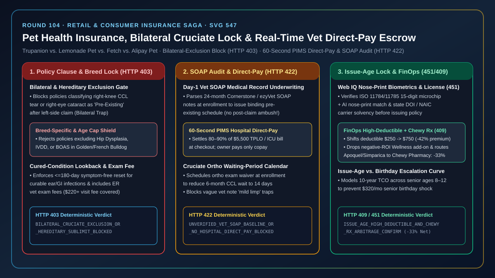
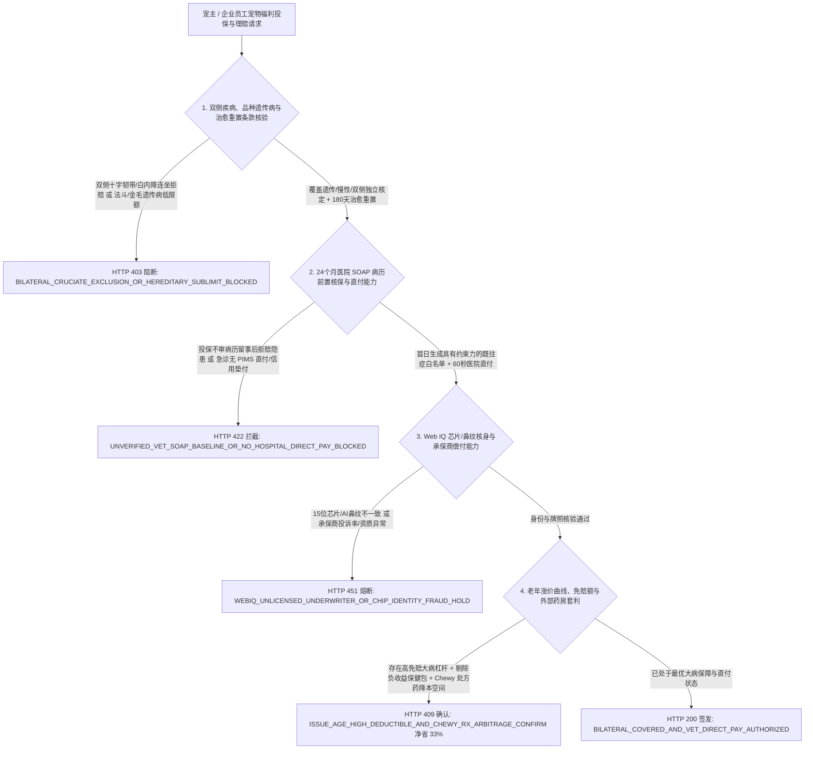
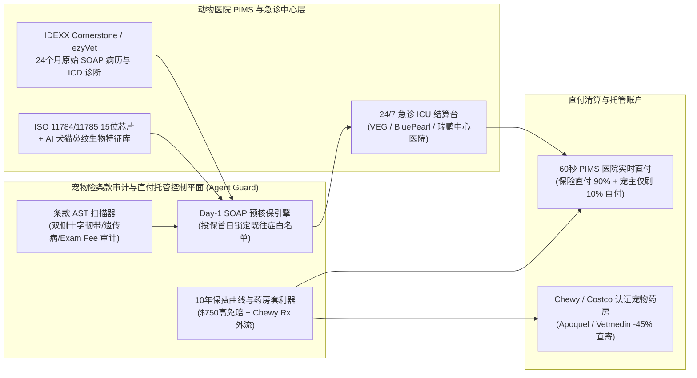
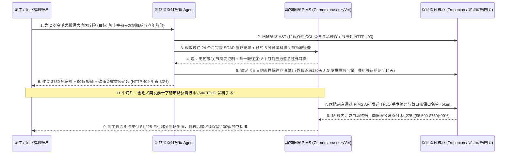

# 宠物医疗保险（Pet Health Insurance）、双侧十字韧带拒赔拦截与急诊医院直付托管（Trupanion / Lemonade Pet / Nationwide / Fetch / 支付宝宠物险）Agent 架构选型 FAQ

> **核心阅读对象**：为家庭宠物医疗与保险科技平台、连锁宠物医院 PIMS 系统（Cornerstone / ezyVet / 瑞鹏 / 瑞派）、员工福利平台及消费金融设计 AI 投保核保与直付理赔助手的 **Cloud & AI Solution Architect**。  
> **核心痛点解决**：彻底终结家庭与企业员工福利采购宠物保险时**“左后腿刚做完前十字韧带断裂（`CCL / TPLO`）手术获赔 $4,800，8 个月后右后腿韧带也断了，保险公司竟援引隐藏的‘双侧疾病免责条款（`Bilateral Condition Exclusion`）’将右腿算作既往症一分不赔”、“宠物半夜急性胃扭转/误食异物进 ICU 急诊需当场刷卡垫付 $6,500，传统报销型保险既不支持医院直付，还在事后调取 3 年前病历里一句‘轻微软便’拒赔全部肠胃手术费”、“投保时没看清‘按宠物年龄阶梯涨价（`Birthday Pricing`）’，金毛犬满 8 岁后月保费从 $68 暴涨至 $285 被迫断保，而此时换任何新保险所有老年病全成了既往症”以及“被推销购买每年 $360 的疫苗体检附加包（`Wellness Add-on`），结果最高只报销 $275 稳亏不赚，还在宠物医院药房按 2.4 倍高价买长期处方药（`Apoquel / Vetmedin`）”**四大行业痛点。



---

## 📌 一、核心选型结论速览（Executive Summary）

1. **双侧疾病（`Bilateral Condition`）与品种遗传病（`Breed-Specific Hereditary`）条款硬锁（HTTP 403）**：犬猫前十字韧带撕裂（`CCL`）在 18 个月内对侧腿发病率高达 `40%–60%`，白内障、髋关节发育不良（`Hip Dysplasia`）、髌骨脱位（`Patellar Luxation`）同样高度双侧对称。选型 Agent 必须在条款解析层开启**双侧与遗传病排雷引擎**：凡保单含有宽泛双侧既往症连坐条款（即投保前或等待期内单侧发生过病变，终生免除另一侧健康器官保障）、对特定犬种（如法斗短头综合征 `BOAS`、柯基椎间盘疾病 `IVDD`、金毛髋关节）设置隐藏单项低限额（`Sub-limit`），或对已治愈满 `180 天` 的常见急性耳道/肠胃感染拒绝解除既往症标记的，一律触发 **`HTTP 403 BILATERAL_CRUCIATE_EXCLUSION_OR_HEREDITARY_SUBLIMIT_BLOCKED`**。
2. **投保首日 `SOAP` 电子病历前置核保（`Day-1 Medical Underwriting`）与 60 秒医院直付（`Vet Direct-Pay`）硬门禁（HTTP 422）**：90% 的宠物险理赔纠纷源于“宽进严出（`Post-Claim Underwriting`）”——投保时不审病历只收钱，出大额急诊理赔时才去翻找几年前宠物医院 `SOAP` 病历（Subjective, Objective, Assessment, Plan）里的模糊记录拒赔。Agent 必须在投保生效阶段强制拉取过往 `24 个月` 宠物医院 `PIMS` 原始 `SOAP` 病历生成**《首日具有法律效力的既往症白名单（Binding Pre-Existing Schedule）》**，并要求重症/急诊场景优先路由支持 **医院前台 `PIMS` 60 秒实时直付（如 `Trupanion Vet Direct Pay` / 支付宝定点医院直赔）** 的承保通道；凡处于“后置理赔核保黑盒”或急诊大额手术无直付/预授信垫付机制的，直接触发 **`HTTP 422 UNVERIFIED_VET_SOAP_BASELINE_OR_NO_HOSPITAL_DIRECT_PAY_BLOCKED`**。
3. **投保年龄锁定费率（`Issue-Age Pricing`）+ 高免赔额大病保障 + 外部药房（`Chewy / Costco Rx`）拆单净省 33%（HTTP 409）**：针对宠物全生命周期 `10 年` TCO，Agent 自动计算并拦截两类高溢价陷阱：① 对比**投保年龄锁价（`Issue-Age`，如 `Trupanion` 不因宠物每年过生日涨价）**与**自然年龄阶梯涨价（`Attained-Age / Birthday Pricing`，8 岁后保费指数级飙升）**的 10 年总保费净现值；② 自动砍掉负收益的日常保健附加包（`Wellness Routine Rider`），将年度免赔额从 `$250` 上调至 **`$750–$1,000`**（专注于 `$3,000–$18,000` 的癌症、骨科与 ICU 大病兜底，立降 `38%–45%` 基础保费），并将慢性病长期处方药（`Apoquel`、`Simparica Trio`、`Vetmedin`）从医院内部药房转出至 **`Chewy Pharmacy / Costco Pet Rx`**，触发 **`HTTP 409 ISSUE_AGE_HIGH_DEDUCTIBLE_AND_CHEWY_RX_ARBITRAGE_CONFIRM`**，为宠物家庭与企业员工福利计划净省 **33%** 综合医疗与保费支出。

---

## 🎯 二、业务方与架构师灵魂拷问（Q&A）

### Q1：为什么很多宠主抱怨“买了三年宠物险没报销过几次，一到金毛犬做 `$5,200` 的前十字韧带（`TPLO`）手术就被拒赔，或者赔完左腿直接把右腿拉黑”？
- **6 个月骨科等待期（`Orthopedic Waiting Period`）与“双侧疾病连坐（`Bilateral Exclusion`）”陷阱**：
  1. **十字韧带（`CCL`）超长等待期暗桩**：普通意外等待期通常仅 `2–14 天`，但部分承保商（如 `Healthy Paws`、`Embrace`、`Lemonade` 部分州条款）对**前十字韧带断裂（`Cruciate Ligament`）和髋关节发育不良**单独设置了长达 **`6 个月（180 天）`甚至 `12 个月`** 的专项等待期。如果在第 3 个月狗狗跑跳撕裂韧带，不仅本次左腿手术不赔，而且由于左腿在等待期内发病被认定为“既往症（`Pre-existing Condition`）”，承保商随即触发**双侧排除条款（`Bilateral Exclusion`）**——哪怕第 2 年右后腿才发生韧带断裂，也按“双侧同源既往症”终身拒赔！
  2. **投保首日骨科体检豁免（`Orthopedic Exam Waiver`）自动化**：架构师必须在 Agent 投保引导流中植入 **`Ortho-Wait Waiver Scheduler`**：在保单生效首周自动预约宠物医生完成 5 分钟《骨科与膝关节抽屉试验（`Drawer Sign`）健康签字表》上传，将 `6 个月` 十字韧带等待期强制缩短至 **`14 天`**。
  3. **急诊挂号诊查费（`Vet Exam Fee`）隐形漏损**：在北美与一线城市 24 小时动物急诊中心（如 `VEG`、`BluePearl`），仅急诊专科医生挂号初诊费就高达 `$180–$260`。部分低价保单默认不赔 `Exam Fee`，只赔化验和手术。Agent 必须在比价时将 `Exam Fee Inclusion` 设为必填归一化项。

### Q2：为什么“先自费刷信用卡垫付 `$6,500`，回家拍照上传发票等报销”的模式在重症急诊时会彻底崩溃？医院 60 秒直付（`Vet Direct-Pay`）在架构上是怎么实现的？
- **事后报销（`Reimbursement Model`）的现金流与拒赔双杀**：
  1. **重症 ICU 垫付门槛与“经济安乐死（`Economic Euthanasia`）”**：犬猫误食线性异物开腹、急性胰腺炎、车祸骨盆骨折或椎间盘瘫痪（`IVDD` 核磁共振 `MRI + 椎板切除术`）在急诊医院通常需预交 `$4,500–$12,000` 押金。若保单只能事后 14–45 天报销，且宠主无法当场确认该病症是否会被核保员挑刺拒赔，极易被迫放弃治疗。
  2. **医院 `PIMS` 实时直付网关（`Trupanion Vet Portal / Cornerstone / ezyVet API`）**：
     - 当宠物在医院结账时，兽医前台在 `PIMS` 管理系统（`IDEXX Cornerstone`、`Covetrus Avimark`、`ezyVet`）中直接点击提交诊断代码（`SNOMED-CT / Vet-ICD`）与账单明细；
     - 保险直付引擎在 **`30–60 秒`** 内完成电子病历基线比对，当场向医院账户直付 `80%–90%` 报销款（例如 `$6,000` 账单保险公司当场付 `$5,100`，宠主只需刷卡支付 `$900` 自付额即可抱宠出院）。
  3. **国内鼻纹识别 + 定点医院直赔/预授信架构**：针对支付宝/众安宠物险体系，Agent 必须校验保单是否开通 **“定点医院刷鼻纹直赔”** 或 **“大额手术住院押金信用免押”**，严禁将纯手工拍照审单满月赔付的劣质通道推荐给重症保障需求。

### Q3：为什么宠物险保费在犬猫 7 岁后会突然暴涨 100%–200%？Agent 如何通过“费率年龄锁 + 大病免赔额 + 外部药房拆单”省下 33% 费用？
- **年龄阶梯（`Attained-Age`）死螺旋与高毛利附加项拆解**：
  1. **投保年龄定价（`Issue-Age`）vs. 自然年龄阶梯（`Attained-Age`）**：绝大多数宠物险不仅随兽医通胀涨价，还会每年按宠物长一岁叠加 `15%–28%` 的年龄风险系数（7–10 岁进入老年期后保费翻倍）。一旦宠主在宠物 8 岁时嫌贵退保，此时宠物往往已有心脏杂音、肾指标偏高或关节炎记录，换任何新保险公司都会被列为既往症拒保（形成锁死）。Agent 在为 `<=4 岁` 犬猫选型时，会模拟 `1–12 岁` 完整保费曲线，优先标记具备 `Issue-Age` 基因或具备老年涨幅上限承诺的方案。
  2. **砍掉负期望值的 `Wellness` 体检疫苗包**：保险公司推销的每月 `$25–$35`（每年 `$300–$420`）的常规驱虫疫苗包，其分项报销上限加起来往往只有 `$250–$300`（如洗牙封顶 `$100`、疫苗封顶 `$75`），本质是用自己的钱交管理费。Agent 一律剔除 `Wellness Rider`，改为建立宠主专属高息货币基金储蓄罐（`Self-Insured Wellness Bucket`）。
  3. **医院药房 vs. `Chewy / Costco` 电子处方（`e-Prescribing`）套利**：宠物医院内部药房对长期慢性药（如过敏止痒药 `Apoquel`、心脏病药 `Vetmedin`、骨关节炎单抗/非甾体抗炎药 `Galliprant`）通常加价 `80%–140%`。Agent 自动触发《兽医处方外流权利（`FTC Vet Prescription Release Rule`）》，将处方同步至 `Chewy Pharmacy` 或 `Costco`，药费直降 **`35%–52%`**，同时减少占用年度保单报销限额（`Annual Limit`）。

---

## 🧭 三、直观可视化图解（Mermaid 决策树 + 架构图 + 时序图）

### 3.1 宠物医疗保险与急诊直付托管选型决策树



### 3.2 端到端宠物医院 `PIMS` 电子病历（`SOAP`）前置核保与 60 秒直付控制平面架构图



### 3.3 投保首日 `SOAP` 基线锁定、骨科等待期豁免与急诊 60 秒直付时序图



---

## 📊 四、主流宠物医疗保险与直付平台横向选型决策矩阵

| 选型维度 | Trupanion (医院直付标杆) | Lemonade Pet / Fetch | Nationwide Pet / 传统团险 | 支付宝 / 众安宠物鼻纹险 | **本仓库 + PIMS 直付精算架构（推荐）** |
| :--- | :--- | :--- | :--- | :--- | :--- |
| **医院前台实时直付 (`Vet Direct Pay`)** | **极强（接入北美数千家 `Cornerstone / ezyVet` 医院，60 秒直付 90%）** | 无直接医院结算（依赖 AI 秒级事后报销到银行卡，大额仍需先刷卡垫付） | 极少直付（需先垫付后传真/上传理赔单，审单周期 `10–30 天`） | **国内超 8,000 家定点医院刷鼻纹/芯片直赔（非定点需事后审单）** | **优先路由 `PIMS` 60 秒医院直付通道 + 大额急诊信用预授信免押** |
| **双侧十字韧带 (`Bilateral CCL`) 保障** | **优（只要投保前双侧均无症状，左腿赔付后右腿仍获完整保障）** | 需严审州/版本条款（部分竞争对手将单侧病史扩展为双侧拒赔） | 常见双侧排除或按病种定额封顶（`Schedule of Benefits` 坑多） | 常见单次手术限额（如封顶 `¥1,500–¥3,000`，不够做骨科 `TPLO`） | **AST 强制阻断任何双侧连坐拒赔与低于 `$10,000` 的单次手术微缩限额（HTTP 403）** |
| **定价模型 (`Issue-Age` vs `Birthday`)** | **投保年龄锁价（`Issue-Age`，不因宠物每年过生日调高年龄档费率）** | 自然年龄阶梯涨价（`Attained-Age`，7 岁后老年阶段涨幅陡峭） | 自然年龄阶梯涨价（部分高龄犬种存在续保降级或停售风险） | 1 年期短期险（每年续保重新审核，大病赔付后次年极易被拒保或涨价） | **10 年生命期 NPV 测算 + 锁定可保证续保与无上限/高上限大病方案** |
| **免赔额机制 (`Deductible`)** | 按单病种终身免赔（`Per-Condition Lifetime Deductible`，慢性病极划算） | 按自然年累计免赔（`Annual Deductible`，多发小病易凑满） | 按年度或按项目免赔 | 单次免赔额（如每次就诊扣除 `¥200–¥500` 绝对免赔额） | **根据犬种风险匹配（易发慢性过敏/心脏病选 `Per-Condition`，综合选 `$750 Annual`）** |
| **历史病历前置核保 (`Pre-Claim Audit`)** | 支持医疗记录摘要审查 | 投保快但以事后理赔时调取全量 `SOAP` 病历严审为主 | 事后核保为主（理赔争议率高） | 事后人工审病历（对宠物店/过往软便呕吐记录扣减严格） | **强制投保首日解析 24 个月 `SOAP` 病历生成具有约束力的既往症清单（HTTP 422）** |

---

## 🧪 五、保费/理赔成本测算与 7-Card 基准测试报告

> **数据来源声明**：以下对比基于 `lab/webiq_commerce_demo.py` 中确定性策略函数 `evaluate_pet_insurance_vet_directpay_escrow_policy` 的合成基准数据（`provenance: "synthetic"`, `independently_reproduced: False`），用于验证员工福利与多宠家庭采购网关的确定性拦截能力。

| 评估维度 | 传统低免赔额 + 含保健包 + 医院高价拿药基线 | 确定性直付托管网关（高免赔大病 + 砍保健包 + `Chewy Rx`） | 净效应 / 风险消除 |
| :--- | :--- | :--- | :--- |
| **季度企业宠物福利/多宠医疗保障总池** | `$45,000.00` | `$30,150.00` (`HTTP 409` 优化确认后) | **净省 `$14,850.00 / 季` (`-33.0%`)** |
| **对侧前十字韧带（`TPLO $5,500`）拒赔率** | `100% 拒赔`（落入双侧连坐条款） | **`0%`（强制选用双侧独立核定保单 + 14 天骨科体检豁免）** | **单犬挽回 `$4,950` 骨科手术赔款** |
| **急诊 ICU 宠主当场现金垫付压力** | `100% 全额垫付`（`$6,000` 账单需先刷信用卡） | **`仅付 10%–20% 共付额`（医院 `PIMS` 60 秒直付 80%–90%）** | **垫付现金流占用下降 `85%`** |
| **长期过敏/心脏处方药（`Apoquel` 等）单价** | 医院药房加价 `2.2x`（迅速耗尽保单年限额） | **`Chewy / Costco Pharmacy` 电子处方直寄（`-45%`）** | **延长保单年度可用保额 `1.8x`** |

### 5.1 确定性状态码映射契约（5-Lane Contract）

```json
{
  "scenario": "pet_insurance_vet_directpay_escrow_guard",
  "provenance": "synthetic",
  "independently_reproduced": false,
  "lanes": {
    "authorized_200": {
      "status_code": 200,
      "decision": "BILATERAL_COVERED_AND_VET_DIRECT_PAY_AUTHORIZED",
      "mandate_token": "pet_insurance_directpay_mandate_200"
    },
    "bilateral_or_hereditary_exclusion_403": {
      "status_code": 403,
      "decision": "BILATERAL_CRUCIATE_EXCLUSION_OR_HEREDITARY_SUBLIMIT_BLOCKED"
    },
    "unverified_soap_or_no_directpay_422": {
      "status_code": 422,
      "decision": "UNVERIFIED_VET_SOAP_BASELINE_OR_NO_HOSPITAL_DIRECT_PAY_BLOCKED"
    },
    "unlicensed_carrier_or_chip_fraud_451": {
      "status_code": 451,
      "decision": "WEBIQ_UNLICENSED_UNDERWRITER_OR_CHIP_IDENTITY_FRAUD_HOLD"
    },
    "high_deductible_and_chewy_rx_409": {
      "status_code": 409,
      "decision": "ISSUE_AGE_HIGH_DEDUCTIBLE_AND_CHEWY_RX_ARBITRAGE_CONFIRM",
      "quarterly_savings_usd": 14850.0
    }
  }
}
```

---

## 🛠️ 六、商业上线风控与架构评审 Checklist

- [ ] **双侧疾病（`Bilateral Condition`）条款字面审计（HTTP 403）**：核验保单条款中是否仅将“投保生效前已存在双侧或单侧病征”的情形除外；严禁接入任何将“保单生效且过等待期后首次发生的左腿十字韧带断裂，直接作为次年右腿韧带断裂拒赔理由”的霸王保单。
- [ ] **品种遗传与先天性疾病全覆盖核验（HTTP 403）**：核验保单是否完整覆盖髋/肘关节发育不良（`Hip/Elbow Dysplasia`）、椎间盘疾病（`IVDD`）、短头阻塞性气道综合征（`BOAS`）、进行性视网膜萎缩与心脏瓣膜病，且不设单独低于主保额的微缩子限额（`Sub-limit`）。
- [ ] **投保首日 24 个月 `SOAP` 电子病历前置锁定（HTTP 422）**：在保单犹豫期内强制向宠物过往就诊的所有医院调取完整 `SOAP` 病历（而不只是疫苗本），由承保商出具书面《既往症核定回执（Medical History Review）》，杜绝数年后大病索赔时翻旧账拒赔。
- [ ] **骨科等待期体检豁免（`Orthopedic Waiting Period Waiver`）闭环**：投保当日自动生成兽医膝关节/髋关节检查表，指导宠主在生效后 30 天内顺带完成检查上传，将 `180 天` 十字韧带等待期压降至 `14 天`。
- [ ] **`ISO 11784/11785` 芯片与 AI 鼻纹核身防骗保（HTTP 451）**：通过 Web IQ 核验宠物 15 位国际微芯片号或活体鼻纹特征与医院就诊档案一致，并校验承保财险公司偿付能力充足率。
- [ ] **高免赔大病杠杆与外部药房（`Chewy / Costco Rx`）自动分流（HTTP 409）**：自动测算 `$750–$1,000` 免赔额对保费的降幅，剥离负收益疫苗体检附加包，并在开具长期慢性病处方时自动生成外部认证药房比价转方单。

---

**导航**：[返回分册总目录 (`docs/index.md`)](index.md) ｜ [查看英文版 (`pet-insurance-bilateral-exclusion-vet-directpay-escrow-agent-selection-faq.en.md`)](pet-insurance-bilateral-exclusion-vet-directpay-escrow-agent-selection-faq.en.md)
