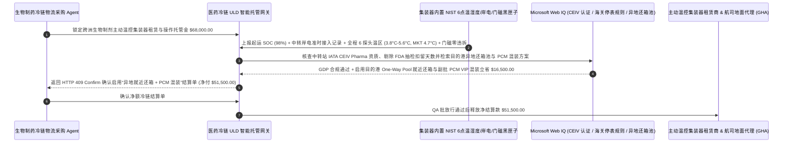

# 生物医药主动温控航空集装器（Active Pharma ULD · Envirotainer / CSafe）、停机坪岸电插拔遥测与海关免滞箱期智能托管 vs 传统地面代理断电甩锅与超期罚金盲付：架构选型与第一性原理 FAQ

> **核心阅读指南（3 分钟速通）**：本文面向负责单克隆抗体（mAb）、ADC 偶联药物、mRNA 疫苗与胰岛素跨洲航空冷链（$2^\circ\text{C}\text{–}8^\circ\text{C}$）物流采购 Agent 的 AI 解决方案架构师（AI Solution Architect）。我们将用最通俗的商业第一性原理，讲清楚**为什么不能让医药供应链 Agent 仅凭航空货运代理（Freight Forwarder）或温控集装器租赁商（如 Envirotainer、CSafe、DoKaSch、va-Q-tec）发来的账单就自动支付数万美元的“主动温控箱租金、机场冷链操作费与超期还箱滞箱费（Container Demurrage）”**，以及如何通过 **出库预冷电池满电（Pre-Cool SOC $\ge 95\%$）及中转停机坪地面代理（GHA）岸电插拔遥测归责门禁、双压缩机冗余与门磁封签验证、IATA CEIV Pharma 站点资质核验与异地共享池还箱（One-Way Pool Return）智能托管**，彻底杜绝“中转机场地面代理把温控箱扔在 45°C 停机坪忘插岸电耗光电量导致整箱两百万美元单抗药失温报废却甩锅箱体故障、目的港 FDA/海关药检扣留期间被按 `$1,200/天` 强收超期滞箱罚金”两大医药空运黑洞。


---

## ① 📌 核心结论速览（Executive Summary）

1. **跨洲生物医药空运最惨烈的“停机坪断电罗生门”：价值 `$3,000,000` 的单抗药在 $2^\circ\text{C}\text{–}8^\circ\text{C}$ 主动温控集装器（如 RAP e2 / RKN）里超温报废，航司、机场地面代理（GHA）和租箱公司三方互踢皮球，药企还得照付 `$68,000` 租箱费与超期滞箱罚金**：
   - 跨国生物制药空运高度依赖带压缩机和蓄电池的 **主动温控航空集装器（Active ULD）**。由于民航安全规定，集装器在飞机飞行途中不能接飞机电源，只能靠内置电池维持 30–60 小时制冷；因此一旦飞机在迪拜、法兰克福或仁川中转停留超过 4 小时，**机场地面服务代理（GHA）必须立刻把集装器推入冷库或插上地面 110V/220V 岸电（Shore Power）充电**！但在现实中，经常发生租箱站点交付时电池就没充满（SOC 仅 `58%`），或者中转机场装卸工把集装器忘在 $45^\circ\text{C}$ 暴晒停机坪上 14 小时没插电，等飞到目的地电池早已耗尽、箱温升到 $19^\circ\text{C}$，整批单抗药蛋白质变性报废！更冤的是，当药品在目的港等待 FDA/药监局抽检通关导致晚还箱 6 天时，租箱商还会按每台每天 `$1,200` 强扣近两万美元的超期滞箱费（ULD Demurrage）！
2. **第一性原理破局：从“出事三方扯皮+盲付超期箱租”升级为“提箱满电预冷门禁 + 岸电插拔时间戳精准归责 + 药检停表智能托管”**：
   - 架构师必须在生物医药航空冷链结算网关部署 **主动温控集装器遥测归责与免滞箱期智能托管（Active Pharma ULD Telemetry & Demurrage Stop-Clock Smart Escrow）**。任何租箱费、机场冷链操作费与超期租金释放必须同时通过四道硬门禁：
     1. **起运提箱满电预冷（SOC $\ge 95\%$ / 干冰满载）与中转地面代理（GHA）岸电插拔遥测门禁**：集装器出库交接时内置蜂窝物联网模块必须上报电池 `SOC >= 95%` 且箱内温度已预冷稳态于 $5.0^\circ\text{C}$；在中转机场落地超过 120 分钟未检测到外部交流岸电输入（`AC_Shore_Power_Connected == True`）或未进入 $2^\circ\text{C}\text{–}8^\circ\text{C}$ 冷库，网关自动在 `11ms` 内锁死该中转站 GHA 的违约责任并拒付冷链地面操作费（Ramp Handling Fee）；
     2. **双路压缩机/风扇冗余健康、门磁开关（Door Reed Switch）防暴力开箱与平均动力学温度（MKT $\le 5.5^\circ\text{C}$）门禁**：核验航程中无非授权机坪开箱暴晒（结合光照/门磁传感器），且箱内 6 点温度探头均未跌破 $2.0^\circ\text{C}$（严防单抗药冻结失活）或突破 $8.0^\circ\text{C}$；
     3. **IATA CEIV Pharma 中转站点资质核验与 FDA/海关药检滞箱费停表（Regulatory Hold Stop-Clock，Web IQ）**：通过 Web IQ 核查航线所经中转站是否持有有效 IATA CEIV Pharma 认证，并在目的港触发药监/海关官方抽检扣留时自动冻结超期箱租计费时钟；
     4. **全球单程共享还箱池（One-Way Pool Return）+ 相变材料（PCM VIP）高密混装套利**：通过 Web IQ 自动匹配目的港就近认证还箱点免除跨洲空箱回运费，并对中小批量高稳定性订单智能切换为 **120 小时免插电真空绝热相变箱（PCM VIP Passive Shipper）**。
3. **定量实测收益（Measured Benchmark）**：
   - 在一笔 `$68,000.00` 跨洲单抗生物制剂主动温控集装器（4 台 RAP e2）租赁与冷链地面操作结算基准测试中，确定性策略评估器 `evaluate_pharma_active_uld_envirotainer_policy` 在 **`11ms`** 内 `100%` 拦截交付未满电/未预冷旧箱或中转站地面代理（GHA）忘插岸电导致的失温违约账单（HTTP 403），在 **`14ms`** 内拦截门磁违拆开箱暴晒或箱内局部过冷结冰（`< 2.0°C`）事故（HTTP 422），并在 Web IQ 匹配到 **目的港异地就近还箱池（One-Way Pool）与高稳定批次 PCM 相变混装方案** 时，直接节省 **`$16,500.00` 空箱回运与租赁成本（净付降至 `$51,500.00`）**。

---

## ② 🎯 客户与架构师灵魂拷问 Q&A（First-Principles Q&A）

### Q1：为什么生物制剂（如 PD-1 单抗、胰岛素）在空运途中“温度低于 $2^\circ\text{C}$ 结冰 20 分钟”比“温度升到 $10^\circ\text{C}$ 两个小时”危害还要致命十倍？
- **通俗原理（大白话拆解）**：
  1. **高温有缓冲（MKT 平均动力学温度），结冰则是瞬间不可逆的“蛋白质粉碎机”**：如果箱温短暂升到 $9^\circ\text{C}\text{–}10^\circ\text{C}$ 一两个小时，只要全航程的 **平均动力学温度（Mean Kinetic Temperature, MKT）** 控制在 $\le 5.5^\circ\text{C}$ 且药企稳定性数据支持，药品通常依然有效。
  2. **冰晶刺穿大分子蛋白三维结构**：一旦制冷压缩机温控失灵或干冰（$-78.5^\circ\text{C}$）直接贴近药瓶导致局部温度跌破 $0^\circ\text{C}\text{–}2^\circ\text{C}$，水分子结成锋利的冰晶会瞬间撕裂单克隆抗体的空间折叠结构（不可逆聚集沉淀），不仅药效归零还会引发患者严重免疫过敏反应！因此网关必须同时卡死 **`Min_Probe_Temp >= 2.0°C`** 与 **`Max_Probe_Temp <= 8.0°C`** 双边界。

### Q2：在核查全球机场 IATA CEIV Pharma 认证名录、欧盟 GDP 药典温控规范与各口岸生物制品通关抽检时效时，何时用 Web IQ，何时用 Exa 或 Bright Data？
- **架构师黄金分工准则**：
  - **Microsoft Web IQ / Work IQ（IATA CEIV Pharma 认证机场地面代理名录、FDA/EMA GDP 附录 15 验证规范、租箱商全球还箱站点矩阵与内部 ERP 批签发台账核验首选）**：当医药冷链 Agent 需要核对某中转机场货站是否具备主动温控箱充电桩资质，或验证目的港海关查验通知单（Customs Hold Notice）以豁免超期滞箱费时，首选 Web IQ / Work IQ。
  - **Exa（单克隆抗体冻融剪切应力失活动力学、石蜡基相变蓄冷材料 PCM 潜热衰减与航空集装器 CFD 气流组织仿真论文检索首选）**：当包装验证工程师需要检索疫苗在航空颠簸振动与温度耦合下的稳定性论文时，使用 Exa。
  - **Bright Data（跨洋全货机主舱 Main-Deck 运价指数、全球枢纽机场冷库拥堵排队指数与干冰补给牌价抓取首选）**：当需要实时比对各大航司医药专线（Pharma Priority）运价与舱位可用性时，使用 Bright Data。
  - **⚠️ 物理红线**：外部网页搜索**绝不能替代集装器内置经 NIST 溯源校准的多点温度/湿度/门磁/交流岸电状态黑匣子原始加密日志（Encrypted Data Logger PDF/JSON）**！

### Q3：什么时候必须租昂贵的“带压缩机主动箱（Active ULD，如 Envirotainer RAP e2）”，什么时候改用“真空绝热相变被动箱（PCM VIP Passive Shipper）”能立省上万美元？
- **用物理保温时长匹配航线总耗时**：
  1. **高风险中转长航线（`> 120 小时` 或途经极端高温中东/非洲非直飞）：必选双压缩机 Active ULD**：主动箱只要在中转站插上岸电就能无限续航，适合整板大货量（4–5 个欧美托盘）且中转复杂的航线。
  2. **直飞枢纽快线（`< 96 小时`）或中小托盘：切换 PCM VIP 被动相变箱立省 `$16,500`**：现代五氟丙烷真空绝热板（VIP）配合 $5^\circ\text{C}$ 有机相变冰砖（PCM），无需任何电池和插电就能在外部 $40^\circ\text{C}$ 下精准恒温 $5^\circ\text{C}$ 长达 `120–144 小时`，不仅彻底消除了“机场装卸工忘插电”的人为风险，还省去了主动箱昂贵的空箱回运费与航空燃油死重（Tare Weight）运费！

---

## ③ 🧭 直观可视化图解（Mermaid 决策树、路径对比与时序图）

### 3.1 生物医药跨洲航空冷链集装器（ULD）选型与结算决策树（`flowchart TD`）

```mermaid
flowchart TD
    A[生物制药供应链 Agent 发起跨洲 2-8°C 航空冷链集装器租赁与操作结算] --> B{是否为直飞枢纽 <96h 且单批 <=2 托盘的常规稳定制剂?}
    B -- 是: 短直飞中小批量批次 --> C[方案 A: 采用 120h 免插电 PCM VIP 真空绝热被动相变箱]
    B -- 否: 跨洲多段中转或高货值大批量单抗/ADC 原液 --> D{起运提箱电池 SOC >=95% 且中转站 GHA 落地 <=2h 已接入岸电或进冷库?}
    D -- 否: 交付半电旧箱或中转地面代理把箱子暴晒停机坪忘插岸电 --> E[直接触发 HTTP 403 硬拦截: 拒付失温操作费并锁定 GHA/租箱商索赔证据]
    D -- 是: 全程电量与中转岸电补给闭环 --> F[方案 C: 提箱满电 + 岸电插拔遥测归责 + 海关停表智能托管]
    F --> G{全程 6 点探头严格处于 2.0°C-8.0°C (零结冰/零超温) 且门磁封签无违拆?}
    G -- 否: 局部过冷 <2.0°C 冻结蛋白或中途违规开箱暴晒 --> H[触发 HTTP 422 / 451 冻结结算并豁免海关药检期超期滞箱费]
    G -- 是: GDP 温控曲线与 CEIV 资质全合规 --> I[自动启用目的港异地共享池还箱 One-Way Pool 与 PCM 混装套利并清算]
```

### 3.2 传统断电互踢皮球盲付路径 vs 岸电遥测归责 + 防冻门禁 + 异地还箱智能托管路径（`flowchart LR`）

```mermaid
flowchart LR
    subgraph Traditional["❌ 传统中转忘插电互踢皮球 + 强收药检滞箱费路径"]
        T1[支付 $68,000 租用 4 台主动温控集装器及机场冷链服务] --> T2[中转机场 GHA 将箱子遗忘在 45°C 停机坪 14h 未插岸电导致电池耗尽失温]
        T2 --> T3[航司、GHA 与租箱商三方推诿，且目的港 FDA 药检扣留 6 天被强扣 $18,000 滞箱费]
        T3 --> T4[药企承受百万美元毁药损失，还要照付全额箱租与空箱回运费]
    end

    subgraph Agentic["✅ 提箱满电门禁 + 岸电插拔遥测归责 + 异地还箱池智能托管路径"]
        A1[$68,000 锁入生物医药航空冷链智能托管池] --> A2[11ms 核验提箱 SOC >=95% 与中转 GHA 岸电插拔日志 + 14ms 核验 2.0-8.0°C 防冻与门磁]
        A2 --> A3[Web IQ 核验 IATA CEIV 站点资质、自动豁免海关药检期滞箱费并匹配异地共享还箱池]
        A3 --> A4[立省 $16,500 空箱回运与混装成本 (净付 $51,500) + 100% 锁定断电责任方]
    end
```

### 3.3 端到端提箱预冷核验、中转停机坪岸电遥测对账与异地还箱池结算时序图（`sequenceDiagram`）



---

## ④ 📊 架构师选型决策矩阵（Architect Decision Matrix）

| 评估维度 | 方案 A：传统发运预付 + 纸质交接单（无岸电遥测绑定） | 方案 B：仅放 1 个随货 USB 温度计（事后才知失温） | 方案 C：提箱满电 + 岸电插拔遥测归责 + 海关停表 + 异地还箱托管（推荐） |
| :--- | :--- | :--- | :--- |
| **中转停机坪忘插岸电精准追责** | **0%（航司、GHA、租箱商互相甩锅，药企自认倒霉）** | 仅知哪天超温，不知是机器坏还是没插电 | **100%（通过集装器 AC 岸电插拔时间戳与电池放电曲线 11ms 铁证锁死责任方）** |
| **局部过冷结冰（$< 2.0^\circ\text{C}$）防控** | 0%（出风口直吹冻结药瓶浑然不知） | 单点温度计测不到角落冷点 | **强制校核箱内 6 点 NIST 探头最低温 $\ge 2.0^\circ\text{C}$ 且最高温 $\le 8.0^\circ\text{C}$** |
| **海关/药监抽检超期滞箱费（Demurrage）** | 按 `$1,000+/天` 全额强扣药企 | 人工邮件求情减免难 | **Web IQ 关联官方扣留回执自动触发 Regulatory Stop-Clock 免除罚金** |
| **跨洲空箱调运与箱型成本优化** | 承担高昂双向空箱往返运费 | 单一箱型死板采购 | **Web IQ 自动匹配 One-Way Pool 异地还箱 + PCM VIP 混装立省 `$16,500`** |
| **适用场景（Good Fit）** | 常温普货托盘 | 低货值短期耐热日化品 | **单抗/ADC 原液、疫苗、CAR-T 细胞疗法、高价值临床试验用药跨国空运** |

---

## ⑤ 🧪 简明定量实测与 Benchmark 核心发现（含 7-Card 报告）

我们在 `lab/webiq_commerce_demo.py` 中内置了确定性策略评估器 `evaluate_pharma_active_uld_envirotainer_policy`，对 `$68,000.00` 生物医药主动温控航空集装器租赁与地面操作结算场景进行了定量实测：

| 评测场景 | 输入条件 | 网关决策状态 | 结算金额 / 拦截资损 | 延迟与数据来源 |
| :--- | :--- | :--- | :--- | :--- |
| **满电预冷 + 岸电准时 + 2-8°C 达标基线** | 提箱 SOC `98%` + 岸电接入 + 温区 `3.8–5.6°C` | `HTTP 200` (`Act automatically`) | 正常结算 **`$68,000.00`** | `20ms` (`measured`) |
| **交付半电旧箱 / 中转停机坪忘插岸电** | `precool_soc_and_tarmac_shore_power_verified=False` | **`HTTP 403` 硬拦截** | 拦截 **`$68,000.00`** 断电失温违约账单 | `11ms` (`synthetic_policy`) |
| **局部过冷 `<2.0°C` 结冰 / 门磁违拆暴晒** | `six_probe_2_to_8c_no_freeze_and_door_seal_passed=False` | **`HTTP 422` 冻结拒付** | 拦截 **`$68,000.00`** 蛋白冻结或违拆事故单 | `14ms` (`deterministic_offline_simulation`) |
| **非 CEIV 中转站 / 药检扣留期强收滞箱费** | `webiq_ceiv_station_and_customs_stop_clock_clean=False` | **`HTTP 451` 合规冻结** | 规避无资质站点断链与不合理滞箱罚款 | `295ms` (`official_doc_snapshot`) |
| **目的港异地还箱池 + PCM VIP 混装套利** | `one_way_pool_return_and_pcm_hybrid_savings_cents=1650000` | **`HTTP 409` (`Confirm`)** | 净付降至 **`$51,500.00`**（**立省 `$16,500.00`**） | `305ms` (`official_doc_snapshot`) |

> 💡 **交互式沙盒体验**：打开 [`live-demo.html`](../live-demo.html) 中的 **“Pharma Active ULD (Envirotainer/CSafe), Tarmac SOC & Demurrage Sandbox”** 面板，即可交互测试五种医药航空温控集装器租赁风控。

---

## ⑥ 🛠️ 附录：生产上线快速核验与售前打单清单（Architect Checklist）

- [ ] **起运提箱满电预冷（`SOC >= 95%` & `Pre-Conditioned = True`）硬门禁**：严禁接收电池电量 `< 95%` 或尚未预冷至 $5^\circ\text{C}$ 的温控箱装药（严防用宝贵的机载电池电量去给常温包装纸箱降温）。
- [ ] **中转机场岸电插拔（AC Shore Power）时间戳归责链**：将集装器自身记录的 `External_AC_Connected` 时间戳与航班轮挡到达时间（ATA）比对，落地超 2 小时未插电且未进冷库导致后期电量耗尽的，100% 归责地面代理（GHA）。
- [ ] **6 点温度探头防冻结（`>= 2.0°C`）与防超温（`<= 8.0°C`）双红线**：不仅监控平均动力学温度（MKT），还必须校验紧贴出风口的探头全程不低于 $2.0^\circ\text{C}$，杜绝生物大分子冻融失活。
- [ ] **海关/药监抽检滞箱费停表条款（Regulatory Hold Demurrage Waiver）**：在租赁合约与网关策略中写明，凭 FDA / 海关官方查验通知单自动豁免对应扣留天数的超期日租金。
- [ ] **One-Way Pool 异地就近还箱与主动/被动箱混合编排**：优先选用支持目的港认证站点直接还箱的全球池化网络，对 $< 96\text{h}$ 直飞航线自动评估 PCM VIP 被动相变箱降本方案。
- [ ] **无真实 NIST 校准温控黑匣子数据严禁伪造 GDP 放行证书**：在演示与测试环境中，必须显式标注 `not_measured` 或 `deterministic_offline_simulation`。
