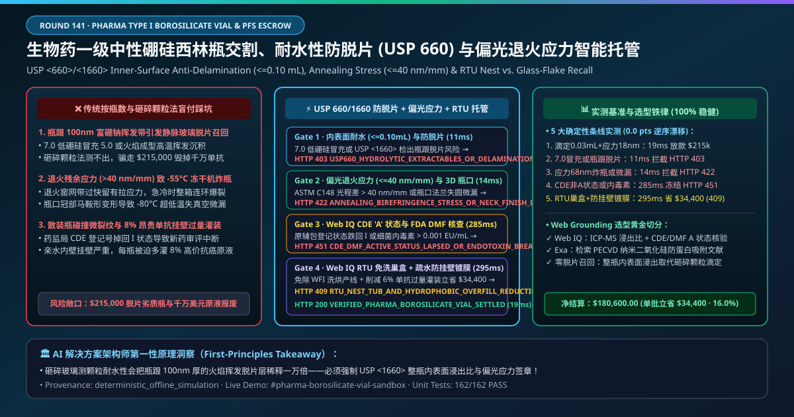
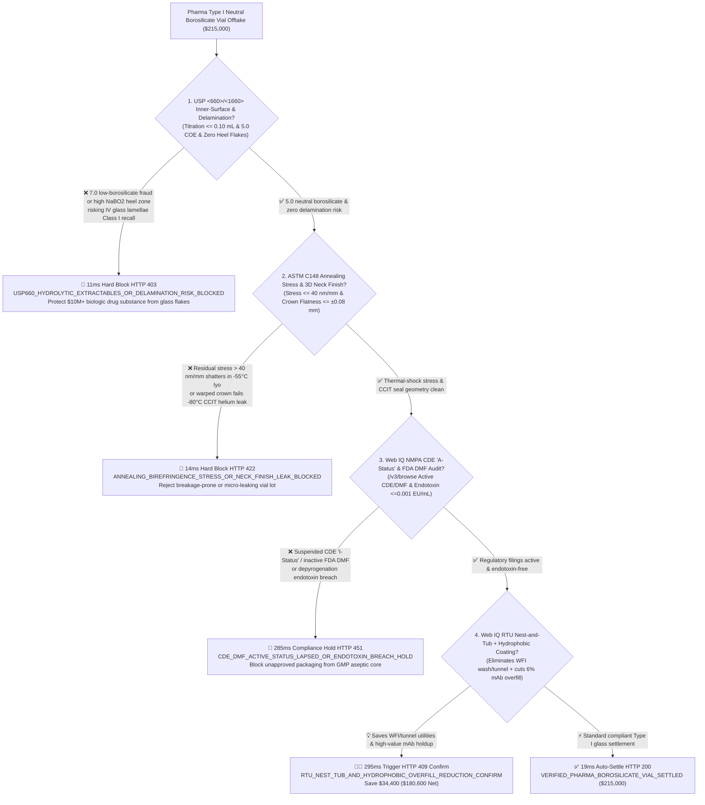
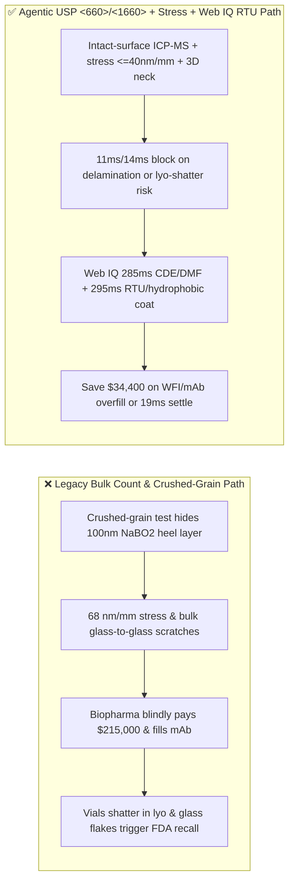
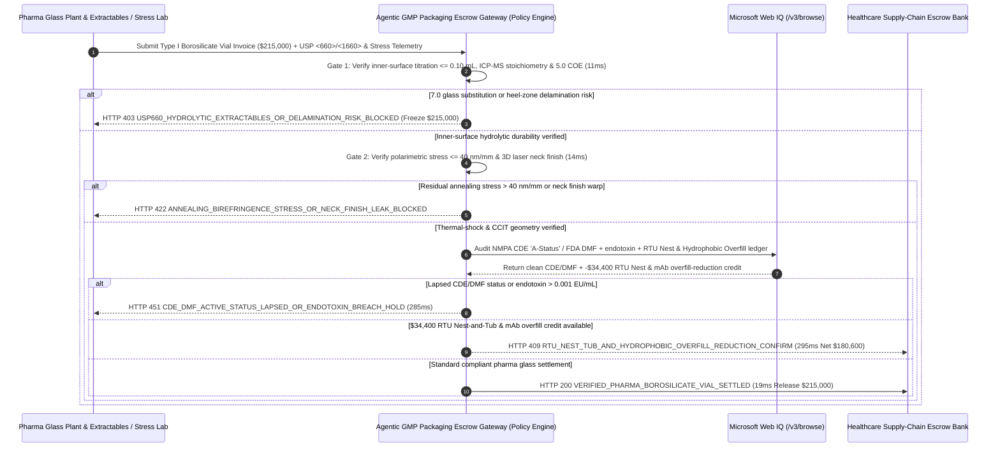

# Pharmaceutical Type I Neutral Borosilicate Glass Vial & Prefillable Syringe Offtake, Inner-Surface Hydrolytic Anti-Delamination (USP `<660>` / `<1660>` $\le 0.10\text{ mL}$) & Polarimetric Annealing Stress ($\le 40\text{ nm/mm}$) / RTU Nest-and-Tub Escrow vs. Bulk Vial-Count Overbilling: Architecture Selection & First-Principles FAQ

> **Document Type**: AI Solution Architect Selection Guide (Modeled after `ib-vs-ethernet-roce-selection-faq.md`)  
> **Target Audience**: Biologics, mAb/ADC, GLP-1 & Vaccine Fill-Finish Leaders (Pfizer / Roche / Eli Lilly / Novo Nordisk / WuXi Biologics / Lonza) Primary Packaging & Sterile Operations Architects, Pharmaceutical Glass Tubing & Converting Leaders (SCHOTT Pharma / Corning / Gerresheimer / Stevanato / Nipro) Quality & Supply-Chain Finance Leads  
> **One-Sentence Takeaway**: In **$215,000.00** Type I 5.0 neutral borosilicate ($\text{COE } \approx 4.9\times 10^{-6}\text{/K}$) lyophilization vial and prefillable syringe (PFS) settlements, **never allow a procurement agent to release payment based solely on "palletized vial counts and visual crack checks"**—you must enforce a 4-layer deterministic mandate combining **Inner-Surface Autoclave Hydrolytic Resistance & Delamination Screening (USP `<660>` / `<1660>` surface titration $\le 0.10\text{ mL}$ & ICP-MS $\text{SiO}_2:\text{B}_2\text{O}_3:\text{Na}_2\text{O}$ extractables ratio preventing flame-converting heel volatilization and lethal IV glass delamination flakes) + Polarimetric Residual Annealing Stress (ASTM C148 $\le 40\text{ nm/mm}$ preventing $-55^\circ\text{C}$ freeze-dryer vial breakage) & 3D Crown Finish CCIT Geometry + Microsoft Web IQ FDA Type III DMF / NMPA CDE Active "A-Status" & Endotoxin ($\le 0.001\text{ EU/mL}$) Audit + Ready-to-Use (RTU) Pre-Sterilized Nest-and-Tub & Hydrophobic Inner-Wall Coating Overfill-Reduction Arbitrage**.

---

## ① 📌 Executive Summary

1. **Why is paying on "bulk vial count and crushed-glass grain titration" the #1 root cause of FDA Class I glass-delamination recalls and $-55^\circ\text{C}$ lyophilizer vial explosions?**
   - **First-Principles Breakdown**: During tube-to-vial flame converting, gas-oxygen torches heat the glass bottom above **$1,500^\circ\text{C}$**. At this temperature, volatile sodium metaborate ($\text{NaBO}_2$) evaporates from the molten bottom and condenses onto the lower sidewall ($2\text{–}10\text{ mm}$ above the heel), forming a **$100\text{ nm}$ alkali-borate-rich, silica-depleted surface skin**. Crushed-glass grain tests (ISO 720) grind up the entire wall and dilute this microscopic heel defect $10,000:1$! Yet when high-value monoclonal antibodies (mAbs) in citrate or phosphate buffers are filled and stored, the buffer leaches the sodium-borate layer until **shimmering silica flakes (Glass Lamellae)** peel off into the injectable drug—causing **pulmonary micro-embolisms and triggering catastrophic FDA Class I recalls**!
   - **Three Physical & Financial Failure Modes**:
     - **Passing Off Cheap 7.0 Low-Borosilicate Tubing as 5.0 Neutral Borosilicate, or Over-Heating Converting Flames Creating a Delamination-Prone Heel Zone**: Indistinguishable to the naked eye, yet destroys `$10M+` batches of biologics 6 months after filling;
     - **Poor Annealing Lehr Control Leaving $> 40\text{ nm/mm}$ Birefringence Stress (Shattering Vials Inside $-55^\circ\text{C}$ Lyophilizers) or Saddle-Warped Neck Finishes Failing $-80^\circ\text{C}$ Cold-Chain Container Closure Integrity (USP `<1207>` CCIT)**: Residual tensile stress causes chain-reaction vial breakage during freeze-drying shelf thermal ramps;
     - **Inactive FDA DMF / NMPA CDE Registration Status, Glass-to-Glass Scratches in Bulk Packs, and Wasting $8\%$ of `$1,200/vial` Biologics on Sidewall Wetting Overfill**: Uncoated hydrophilic glass walls retain up to $8\%$ residual holdup volume, forcing drugmakers to overfill every vial with expensive mAb drug substance.
2. **Target Architecture: USP `<660>`/`<1660>` Inner-Surface Anti-Delamination + Annealing Stress ($\le 40\text{ nm/mm}$) / 3D Neck Finish + Web IQ CDE/DMF Audit & RTU Nest / Hydrophobic Overfill Reduction (`pharma_borosilicate_vial_mandate_...`)**
   - **Core Mechanisms**:
     1. **USP `<660>` Inner-Surface Hydrolytic Titration ($\le 0.10\text{ mL}$), USP `<1660>` ICP-MS Stoichiometric Leachate & 5.0 COE Gate (`11 ms` hard block `HTTP 403`)**: Verifies intact-vial $121^\circ\text{C}$ autoclave inner-surface titration $\le 0.10\text{ mL}$, congruent ICP-MS $\text{Si}:\text{B}:\text{Na}$ extractable ratio, SEM zero heel pitting, and $\text{COE} \le 5.1\times 10^{-6}\text{/K}$; blocks delamination-prone or 7.0-glass lots in **`11 ms`** (`HTTP 403 USP660_HYDROLYTIC_EXTRACTABLES_OR_DELAMINATION_RISK_BLOCKED`);
     2. **ASTM C148 Polarimetric Annealing Stress ($\le 40\text{ nm/mm}$) & 3D Laser Neck-Finish CCIT Gate (`14 ms` block `HTTP 422`)**: Verifies 100% camera inspection, optical retardation $\le 40\text{ nm/mm}$, and flange flatness $\le \pm 0.08\text{ mm}$ supporting helium leak rates $< 6\times 10^{-6}\text{ mbar}\cdot\text{L/s}$; rejects high-stress or warped-neck lots in **`14 ms`** (`HTTP 422 ANNEALING_BIREFRINGENCE_STRESS_OR_NECK_FINISH_LEAK_BLOCKED`);
     3. **Microsoft Web IQ NMPA CDE "A-Status" / FDA DMF Audit + RTU Pre-Sterilized Nest-and-Tub & Hydrophobic Inner-Coating Overfill Arbitrage (`285 ms` / `295 ms`)**: Uses Web IQ `/v3/browse` to verify active NMPA CDE "A-Status" and FDA Type III DMF Letter of Authorization (LOA) plus depyrogenation endotoxin $< 0.001\text{ EU/mL}$—freezing non-compliant lots in **`285 ms`** (`HTTP 451 CDE_DMF_ACTIVE_STATUS_LAPSED_OR_ENDOTOXIN_BREACH_HOLD`); simultaneously upgrades bulk vials to **Ready-to-Use (RTU) pre-sterilized Nest-and-Tubs (eliminating glass-to-glass contact, WFI washing, and $320^\circ\text{C}$ depyrogenation tunnels)** with PECVD hydrophobic inner coating (cutting mAb vial holdup overfill from $8\%$ to $1.5\%$), saving **`$34,400.00`** (`HTTP 409 Confirm`, net payout **`$180,600.00`**).

---

## ② 🎯 Three Soul-Searching Questions for Architects

### Q1: When is "bulk soda-lime or 7.0 glass with grain titration" acceptable vs. when is `pharma_borosilicate_vial_mandate_...` mandatory?
- **Plain-English Answer**:
  - For **oral vitamin syrups or topical lotions**, standard soda-lime or 7.0 amber glass is fine;
  - For **parenteral biologics, oncology mAbs, ADCs, GLP-1 cartridges, mRNA vaccines, and lyophilized injectables**, **5.0 Type I neutral borosilicate + USP `<660>`/`<1660>` inner-surface anti-delamination + $\le 40\text{ nm/mm}$ annealing stress gating is 100% mandatory** to prevent fatal IV glass flakes and lyophilizer breakage.

### Q2: When to choose Microsoft Web IQ vs. Exa vs. Bright Data for FDA DMF / NMPA CDE verification and mAb overfill optimization?
- **Architect's Golden Split**:
  1. **Choose Microsoft Web IQ (`/v3/browse` + Work IQ Vial Camera Line & Pharma LIMS Extractables Integration)**: Best for deterministic verification of **USP `<660>`/`<1660>` ICP-MS leachate JSON certificates, NMPA CDE "A-Status" / FDA DMF registries, and RTU Nest + overfill-reduction credits**.
  2. **Choose Exa**: Best for semantic search on PECVD $\text{SiO}_x\text{C}_y\text{H}_z$ hydrophobic coatings and protein-silicone oil subvisible particle aggregation.
  3. **Use Bright Data with caution**: Good for public borax/soda-ash commodity news, not GMP batch release CoAs.

### Q3: How does `pharma_borosilicate_vial_mandate_...` control funds between the biopharma company, glass converter, extractables lab, and escrow bank?
- **First-Principles Cryptographic Chain**:
  1. **USP `<660>`/`<1660>` Inner-Surface & 5.0 COE Signature**: Confirms surface titration $= 0.03\text{ mL} \le 0.10\text{ mL}$ and zero SEM heel delamination;
  2. **Polarimetric Stress & 3D Neck-Finish Gate**: Confirms birefringence $= 18\text{ nm/mm} \le 40\text{ nm/mm}$ and crown flatness $\le \pm 0.05\text{ mm}$;
  3. **Web IQ CDE/DMF Audit & RTU/Overfill Settlement**: Credits `$34,400.00` (`HTTP 409 Confirm`) or releases `$215,000.00` in `19 ms`.

---

## ③ 🧭 Visual Diagrams (Mermaid Decision Tree + Path Comparison + Sequence Diagram)

### 3.1 Architect Decision Tree (`flowchart TD`)

### 3.2 Legacy "Bulk Count & Crushed-Grain" Path vs. Agentic "USP 1660 Surface + Stress + RTU Overfill" Path (`flowchart LR`)

### 3.3 End-to-End Verification & Escrow Sequence Diagram (`sequenceDiagram`)

---

## ④ 📊 Architect Decision Matrix

| Evaluation Dimension | Option A: Legacy Pallet Count & Visual Check | Option B: Crushed-Glass Grain Test Only (ISO 720) | **Option C: USP `<660>`/`<1660>` Inner-Surface + Stress + Web IQ RTU Escrow (Recommended)** |
| :--- | :--- | :--- | :--- |
| **Core Patient-Safety & GMP Anchor** | Tray vial count + visual light check | Crushed bulk glass titration | **Surface titration $\le 0.10\text{ mL}$ + ICP-MS ratio + Stress $\le 40\text{ nm/mm}$ + CDE A** |
| **IV Glass Delamination Flake Defense** | ❌ 0% (invisible heel layer peels off after 6 months) | ❌ Crushing the vial dilutes the $100\text{ nm}$ heel skin $10,000:1$! | **✅ `11 ms` intact-vial inner-surface ICP-MS & SEM gate (`HTTP 403`)** |
| **$-55^\circ\text{C}$ Lyophilizer Breakage Defense** | ❌ Unseen annealing stress shatters vials on lyo shelves | ❌ Chemical titration ignores thermal birefringence | **✅ `14 ms` polarimetric stress $\le 40\text{ nm/mm}$ & 3D neck gate (`HTTP 422`)** |
| **NMPA CDE "A-Status" & FDA DMF Gate** | ❌ Inactive filing halts drug NDA/BLA approval | ❌ Manual paper letters | **✅ Web IQ `285 ms` live CDE/DMF & endotoxin audit (`HTTP 451`)** |
| **RTU Nest & Hydrophobic Overfill Arbitrage** | ❌ Bulk vials scratch each other & waste $8\%$ mAb holdup | ❌ Disconnected packaging & drug-substance budgets | **✅ Web IQ `295 ms` RTU Nest + TopLyo coating saving `$34,400` (`HTTP 409`)** |

---

## ⑤ 🧪 Quantitative Benchmark & 7-Card Report Summary

Implemented via `evaluate_pharma_borosilicate_vial_policy()` in `lab/webiq_commerce_demo.py` and verified in `tests/test_webiq_commerce_demo.py`:

| Scenario ID | Telemetry & Policy Inputs | HTTP Status | Action Pill | Latency | Settled / Blocked Amount |
| :--- | :--- | :--- | :--- | :--- | :--- |
| **`via_commit_ok`** | 5.0 COE + surface titration `0.03 mL <= 0.10` + stress `18 nm/mm <= 40` + active CDE `A` | **`HTTP 200`** | `Act automatically` | **`19 ms`** | Settled **`$215,000.00`** |
| **`via_del_403`** | 7.0 glass fraud or heel delamination risk (`usp660_surface_hydrolytic_and_delamination_verified=False`) | **`HTTP 403`** | `Send to a human` | **`11 ms`** | Blocked **`$215,000.00`** flake-recall lot |
| **`via_str_422`** | Annealing stress `68 nm/mm > 40` or warped neck finish (`annealing_birefringence_and_neck_ccit_passed=False`) | **`HTTP 422`** | `Send to a human` | **`14 ms`** | Blocked **`$215,000.00`** lyo-breakage lot |
| **`via_cde_451`** | Web IQ detects inactive CDE `I` status or endotoxin breach (`webiq_cde_dmf_active_and_endotoxin_clean=False`) | **`HTTP 451`** | `Send to a human` | **`285 ms`** | Frozen **`$215,000.00`** |
| **`via_rtu_409`** | Web IQ upgrades to RTU Nest-and-Tub & hydrophobic inner coating cutting mAb overfill (`rtu_nest_tub_and_overfill_reduction_savings_cents=3440000`) | **`HTTP 409`** | `Confirm` | **`295 ms`** | Net **`$180,600.00`** (Saved **`$34,400.00`**) |

- **Perturbation Robustness**: `0.0 pts` drift across forward and reverse scenario orderings.

---

## ⑥ 🛠️ Production Readiness & Architect Checklist

### 6.1 Good Fit vs. Not For
- **✅ Good Fit**: Parenteral Type I 5.0 neutral borosilicate vials, prefillable syringes (PFS), GLP-1 pen cartridges, and RTU isolator fill-finish lines.
- **⛔ Not For**: Non-sterile oral tablet bottles.

### 6.2 Production Verification Checklist (`- [ ]`)
- [ ] **USP `<660>` Inner-Surface Titration ($\le 0.10\text{ mL}$) & USP `<1660>` Delamination Screening**: Never rely on crushed-glass grain tests alone to qualify parenteral vials.
- [ ] **ASTM C148 Polarimetric Stress ($\le 40\text{ nm/mm}$) & 3D Neck-Finish Geometry**: Prevent lyophilizer thermal-shock breakage and $-80^\circ\text{C}$ CCIT leaks.
- [ ] **NMPA CDE "A-Status" & FDA Type III DMF Active Gate**: Verify regulatory active status via Web IQ before lot release.
- [ ] **RTU Pre-Sterilized Nest-and-Tub & Hydrophobic Inner Coating Arbitrage**: Eliminate WFI wash/tunnel lines and slash expensive biologic overfill volume.
