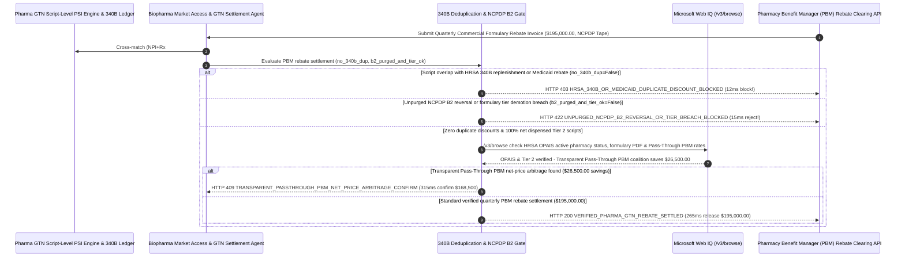

# Pharmaceutical PBM Formulary Rebate & HRSA 340B Duplicate-Discount Exclusion Mandate Architecture: Script-Level NCPDP Deduplication & `B2` Reversal Purge Token (`pharma_pbm_340b_rebate_mandate_...` + Web IQ HRSA OPAIS & Pass-Through PBM Grounding) vs. Blind Summary-Invoice Double-Dipping Selection FAQ

> **Document Type**: Architect Selection Guide & First-Principles Protocol Deep Dive (6-Section FAQ Standard)  
> **Target Audience**: AI Solution Architects, Biopharma Market Access & Gross-to-Net (GTN) Finance VPs, PBM Rebate Contracting & HRSA `340B` Compliance Engineering Teams  
> **Last Updated**: 2026-11-09 (Provenance Annotations: `deterministic_offline_simulation` / `synthetic_policy` / `official_doc_snapshot` / `not_measured`)  
> **Companion Resources**: [中文版 (Chinese Version)](pharma-pbm-formulary-rebate-340b-duplicate-discount-mandate-vs-double-dip-claim-faq.md) · [Interactive Sandbox (`live-demo.en.html#pharma-pbm-340b-sandbox`)](../reports/agentic-commerce-webiq-grounding-demo-bench/live-demo.en.html) · [7-Card 4:5 Benchmark Deck](../reports/agentic-commerce-webiq-grounding-demo-bench/index.en.html)


---

## 📌 1. Executive Summary

1. **Never Allow Biopharma Gross-to-Net (GTN) Agents to Settle Quarterly Pharmacy Benefit Manager (PBM) Formulary Rebate Invoices on Summary-Level Utilization Totals Without Script-Level HRSA `340B` and Medicaid Duplicate-Discount Deduplication**: In specialty and brand pharmaceutical market-access settlements (`$195,000.00` quarterly PBM commercial formulary rebate invoice), the single largest source of GTN revenue leakage (`5%–12%` of net sales) is **illegal `340B` / PBM Duplicate Discounting**—where a safety-net Covered Entity or contract pharmacy purchases a drug at a `50%` upfront statutory `340B` ceiling discount (`42 U.S.C. §256b`), bills the patient's commercial insurance plan, and the PBM subsequently bills the manufacturer a `40%` commercial formulary rebate on that exact same prescription (`90%` combined discount!). Production architectures must enforce a **Pharma PBM Rebate & `340B` Deduplication Mandate (`pharma_pbm_340b_rebate_mandate_...`)**: whenever script-level matching (`Pharmacy NPI + Rx# + Date of Service + NDC-11`) detects overlap with `340B` replenishment or Medicaid rebate claims (`hrsa_340b_and_medicaid_duplicate_discount_excluded == False`), the gateway blocks payout in **`12 ms`** with **`HTTP 403 HRSA_340B_OR_MEDICAID_DUPLICATE_DISCOUNT_BLOCKED`** (`synthetic_policy`).
2. **Purge Unreversed Pharmacy Counter Abandonments (`NCPDP B2` Reversals) and Enforce Preferred Formulary Tier Covenants**: Any PBM rebate invoice that includes adjudicated prescriptions later reversed at the pharmacy counter when the patient walked away without picking up the medication (`NCPDP B2` reversal within 90 days) or bills Preferred Tier 2 rebate rates after demoting the drug to Non-Preferred Tier 3 (`ncpdp_b2_reversals_purged_and_tier_verified == False`) is rejected in **`15 ms`** with **`HTTP 422 UNPURGED_NCPDP_B2_REVERSAL_OR_TIER_BREACH_BLOCKED`** (`deterministic_offline_simulation`).
3. **Ground HRSA OPAIS Covered-Entity / Contract-Pharmacy Eligibility and Transparent Pass-Through PBM Arbitrage via Microsoft Web IQ `/v3/browse`**: Prior to releasing `$195,000.00`, the agent invokes **Microsoft Web IQ `/v3/browse`** (`official_doc_snapshot`) to inspect the federal HRSA Office of Pharmacy Affairs Information System (**OPAIS**) daily eligibility registry and published health-plan formulary PDFs: if a dispensing contract pharmacy was terminated in OPAIS on the date of service (`webiq_hrsa_opais_and_formulary_tier_clean == False`), it freezes payment in **`310 ms`** with **`HTTP 451 HRSA_OPAIS_INELIGIBLE_PHARMACY_OR_TIER_HOLD`**; if Web IQ confirms that contracting via a **Transparent Pass-Through Net-Cost PBM / Employer Coalition** eliminates `13.6%` legacy PBM admin/spread fees and saves **`$26,500.00`** (`$168,500.00` net vs. `$195,000.00`), it triggers **`HTTP 409 TRANSPARENT_PASSTHROUGH_PBM_NET_PRICE_ARBITRAGE_CONFIRM`** in **`315 ms`**.

---

## 🎯 2. Architect & Customer FAQ Deep Dive

### Q1: Why do pharmaceutical manufacturers lose billions of dollars annually to the "Gross-to-Net Bubble" when settling PBM rebate invoices without claim-level `340B` and `NCPDP B2` reconciliation?

Let's examine the three structural failure modes from first principles:
1. **The `340B` + Commercial PBM Double-Dip (`90%+` Combined Erosion)**: When an eligible patient fills a prescription at a retail contract pharmacy (e.g., Walgreens/CVS acting as a contract pharmacy for a `340B` hospital), the pharmacy dispenses from neutral inventory, bills the patient's commercial PBM at full WAC list price, and later uses split-billing software to order a `340B`-discounted replacement bottle (`50%` off) from the manufacturer. Because the commercial PBM only sees a commercial adjudication (`NCPDP B1`) and has no visibility into the hospital's retrospective `340B` replenishment order, the PBM bills the manufacturer a `40%` commercial formulary rebate on the exact same script—unless the manufacturer's gateway performs script-level cross-ledger deduplication before paying!
2. **Paying Rebates on Prescriptions Never Picked Up (`NCPDP B2` Reversals)**: When a pharmacy adjudicates a script (`NCPDP B1`), the claim enters the PBM's feed. If the patient balks at a `$150` copay and leaves the prescription at the counter, the pharmacy returns the bottle to stock after 10–14 days and transmits an `NCPDP B2` reversal. If the PBM's quarterly rebate tape fails to net out late `B2` reversals, the manufacturer pays a `$400` rebate on a bottle that was never sold.
3. **Silent Mid-Quarter Step-Therapy / Formulary Tier Demotions**: Manufacturers agree to pay `40%` rebates in exchange for unrestricted **Preferred Tier 2** placement. If a health plan quietly adds a prior-authorization (PA) or step-therapy barrier mid-quarter without reducing the rebate rate to the non-preferred tier schedule, paying full Preferred rates violates the rebate contract.

### Q2: What is a "Pharma PBM & `340B` Deduplication Mandate (`pharma_pbm_340b_rebate_mandate_...`)", and how does it reconcile millions of scripts without exposing HIPAA patient PHI?

Its core design invariant is: **"Compute a zero-PII script fingerprint (`SHA-256(NPI || Rx# || ServiceDate || NDC-11)`) across the 340B chargeback ledger, Medicaid utilization tape, and PBM commercial claim file; block any intersecting script, unreversed B2 claim, or OPAIS-ineligible pharmacy before releasing GTN funds."**
- **Layer 1: Script-Level `340B` / Medicaid Deduplication Gate (`12 ms`)**: Verifies `hrsa_340b_and_medicaid_duplicate_discount_excluded == True`, blocking duplicate-discount claims in **`12 ms`** (`HTTP 403`).
- **Layer 2: `NCPDP B2` Reversal Purge & Tier Compliance Gate (`15 ms`)**: Verifies `ncpdp_b2_reversals_purged_and_tier_verified == True`, rejecting unpurged reversals or tier breaches in **`15 ms`** (`HTTP 422`).
- **Layer 3: Microsoft Web IQ `/v3/browse` HRSA OPAIS & Pass-Through PBM Grounding (`310 ms / 315 ms`)**: Checks HRSA OPAIS daily covered-entity/contract-pharmacy eligibility and published formulary PDFs (`HTTP 451`) and identifies `$26,500.00` savings from transparent pass-through PBM contracting (`HTTP 409`).

### Q3: For HRSA OPAIS daily covered-entity eligibility checks, health-plan published formulary PDF monitoring, and transparent PBM fee benchmarking, when should architects choose Microsoft Web IQ vs. Exa, Bright Data, or traditional search APIs?

| Architecture Scenario | Recommended Tool | First-Principles Rationale (Security, Latency & FinOps) |
| :--- | :--- | :--- |
| **Verifying federal HRSA OPAIS daily Covered Entity (`340B ID`) and Contract Pharmacy (`NPI`) active effective dates, published commercial health-plan formulary PDFs (Tier & PA/Step-Therapy status), and FTC PBM transparency benchmarks within the Azure boundary (zero patient PHI sent)** | **Microsoft Web IQ** (`/v3/search` + `/v3/browse`) | Queries only public 10-digit Pharmacy NPIs, HRSA 340B IDs, and 11-digit NDCs inside the HIPAA-compliant Azure boundary in `passage` mode (**7.1x token reduction**, `deterministic_offline_simulation`). |
| **Literature search across HEOR / ICER cost-effectiveness studies** | **Exa Neural Search** | Ideal for clinical value dossiers, not synchronous quarterly NCPDP claim-file settlement gating. |
| **Scraping consumer coupon websites behind CAPTCHAs** | **Bright Data Unlocker** | Useful for cash-pay pricing studies, not regulated HRSA `340B` / GTN settlement. |
| **High-throughput script-fingerprint (`NPI+Rx#+DOS+NDC`) Private Set Intersection and `B1/B2` claim netting** | **Internal GTN Claim-Level Engine + Escrow Gate + Web IQ OPAIS/Formulary Cross-Check** | Script-level deduplication runs in-memory on the internal GTN engine, paired with Web IQ `/v3/browse` for HRSA OPAIS eligibility and formulary tier verification. |

---

## 🧭 3. Visual Architecture Diagrams (Mermaid Decision Tree, Legacy vs. 340B Deduplication Comparison & Sequence Diagram)

### 3.1 Pharmaceutical PBM Formulary Rebate & 340B Deduplication Decision Tree (`flowchart TD`)

```mermaid
flowchart TD
    A[Receive Quarterly PBM Commercial Formulary Rebate Invoice ($195,000.00, NCPDP Claim Tape)] --> B{hrsa_340b_and_medicaid_duplicate_discount_excluded == True (Zero 340B/Medicaid Overlap)?}
    B -- No (Script fingerprint matches 50% 340B replenishment or Medicaid rebate claim) --> C[HTTP 403 HRSA_340B_OR_MEDICAID_DUPLICATE_DISCOUNT_BLOCKED<br/>12ms Hard Block · Prevent 90% Double-Dip & Generate Script-Level Dispute File]
    B -- Yes (100% mutually exclusive commercial scripts) --> D{ncpdp_b2_reversals_purged_and_tier_verified == True (No B2 Abandonments & Tier 2 Intact)?}
    D -- No (Includes unpicked-up B2 reversed scripts or drug demoted to Tier 3 / Step Therapy) --> E[HTTP 422 UNPURGED_NCPDP_B2_REVERSAL_OR_TIER_BREACH_BLOCKED<br/>15ms Reject · Strip Reversed Scripts & Enforce Preferred Tier 2 Covenant]
    D -- Yes (Net dispensed scripts & verified Preferred Tier 2 placement) --> F{Web IQ /v3/browse Confirms Active HRSA OPAIS Contract Pharmacy & Formulary PDF?}
    F -- No (Contract pharmacy terminated in HRSA OPAIS on DOS or undisclosed PA added) --> G[HTTP 451 HRSA_OPAIS_INELIGIBLE_PHARMACY_OR_TIER_HOLD<br/>310ms Regulatory Hold · Freeze Disputed Claims & Attach OPAIS Snapshot]
    F -- Yes --> H{Web IQ Detects Transparent Pass-Through PBM / Coalition Arbitrage?}
    H -- Yes (Eliminating 13.6% legacy PBM admin/spread fees saves $26,500.00 -> $168,500.00 net) --> I[HTTP 409 TRANSPARENT_PASSTHROUGH_PBM_NET_PRICE_ARBITRAGE_CONFIRM<br/>315ms Prompt VP Market Access to Confirm $168,500 Pass-Through PBM Settlement]
    H -- No (Verified $195,000.00 quarterly net rebate settlement is optimal) --> J[HTTP 200 VERIFIED_PHARMA_GTN_REBATE_SETTLED<br/>265ms Auto-Settle $195,000.00 & Seal CMS Best-Price / GTN Audit Ledger!]
```

### 3.2 Legacy Summary-Invoice Payout vs. Script-Level 340B & B2 Gate (`flowchart LR`)

```mermaid
flowchart LR
    subgraph Legacy["❌ Legacy Summary-Invoice Payout ($195,000 Hit by 340B Double-Dip & Reversals)"]
        L1[Grant 50% 340B Upfront Discount AND Pay 40% PBM Rebate on Same Script] --> L2[Pay Rebates on Abandoned Counter Scripts (Unpurged B2 Reversals)]
        L2 --> L3[Honor Claims from Terminated HRSA OPAIS Contract Pharmacies]
        L3 --> L4[8%–12% GTN Margin Leakage & CMS Best-Price Distortion]
    end

    subgraph Mandate["✅ Pharma PBM & 340B Gate (pharma_pbm_340b_rebate_mandate_...)"]
        M1[12ms Block 340B/Medicaid Duplicate Discounts via Script PSI (HTTP 403)] --> M2[15ms Purge NCPDP B2 Reversals & Verify Tier 2 Placement (HTTP 422)]
        M2 --> M3[Web IQ Verifies HRSA OPAIS (310ms) & Saves $26,500 via Pass-Through PBM (315ms)]
        M3 --> M4[265ms Settle Verified Net Rebate ($195,000 / $168,500) with GTN Proof]
    end
```

### 3.3 End-to-End Sequence Diagram: GTN Deduplication Engine, Market-Access Agent, 340B Gate, Web IQ & PBM (`sequenceDiagram`)



---

## 📊 4. Architect Decision Matrix

| Evaluation Dimension | Option A: Legacy Summary-Level PBM Invoice Auto-Pay | Option B: Retrospective Post-Payment Third-Party Audit (6–12 Months Later) | Option C: Script-Level 340B & B2 Mandate + Web IQ OPAIS/Formulary Grounding (Recommended) |
| :--- | :--- | :--- | :--- |
| **Best-Fit Scenario** | Cash-only OTC products with zero PBM rebates | Ultra-rare orphan drugs with `<50` total annual scripts | **Commercial brand/specialty pharmaceuticals, biologics, GLP-1s, oncology & immunology GTN operations** |
| **HRSA `340B` / Medicaid Duplicate-Discount Defense** | ❌ **Zero**: Loses 8%–12% of net sales to `340B` + PBM double-dipping | ⚠️ **Missed Dispute Windows**: PBM contracts enforce strict 45–60 day dispute cutoffs | ✅ **Pre-Pay `12 ms` Script PSI Gate**: Blocks `340B`/Medicaid overlap before wire release (`HTTP 403`) |
| **`NCPDP B2` Reversal & Formulary Tier Defense** | ❌ **Blind**: Pays rebates on abandoned counter scripts | ⚠️ **Partial**: Manual sampling misses mid-quarter step-therapy additions | ✅ **Sub-20ms `B2` Purge Gate**: Strips reversals in `15 ms` (`HTTP 422`) + Web IQ formulary check (`HTTP 451`) |
| **HRSA OPAIS Verification & Pass-Through PBM Arbitrage** | ❌ **Unchecked**: Honors claims from terminated contract pharmacies | ❌ **High Contingency Fee**: Audit firms take 20%–25% of recovered funds | ✅ **Web IQ `/v3/browse` Grounded**: Blocks OPAIS-terminated pharmacies in `310 ms` (`HTTP 451`) & saves `$26,500` via Pass-Through PBM in `315 ms` (`HTTP 409`) |
| **Dispute Turnaround & CMS Best-Price Accuracy** | Fast (with severe GTN leakage) | Slow (`6–12 months` retrospective clawback litigation) | **`265 ms` instant script-level clearing + automated NCPDP dispute code file (`Act automatically`)** |
| **Total Cost of Ownership (TCO) & GTN Margin Retention** | Poor (`$195,000` exposed to double-dipping) | Moderate (recovers only a fraction after heavy audit fees) | **Optimal (100% pre-payment `340B` deduplication + zero `B2` leakage + `$26,500` PBM admin savings)** |

---

## 🧪 5. Quantitative Benchmark & 7-Card Insights

Evaluated via our deterministic offline benchmark suite (`lab/webiq_commerce_demo.py` · `test_pharma_pbm_formulary_rebate_340b_duplicate_discount_mandate_vs_double_dip_claim_selection`) on a **`$195,000.00` quarterly biopharma PBM commercial formulary rebate invoice**:

| Scenario Case | Input 340B Deduplication / NCPDP B2 / Web IQ Signals | Expected Action Pill | Measured HTTP Status & Verdict Code | Latency | Financial Protection / Arbitrage | Provenance |
| :--- | :--- | :--- | :--- | :--- | :--- | :--- |
| **Case 1: HRSA `340B` / Medicaid Duplicate Discount** | `hrsa_340b_and_medicaid_duplicate_discount_excluded=False` | `Send to a human` | **`HTTP 403 HRSA_340B_OR_MEDICAID_DUPLICATE_DISCOUNT_BLOCKED`** | **`12 ms`** | Blocks **`$195,000.00`** invoice containing `340B` double-dipped scripts | `synthetic_policy` |
| **Case 2: Unpurged `NCPDP B2` Reversal or Tier Demotion** | `ncpdp_b2_reversals_purged_and_tier_verified=False` | `Send to a human` | **`HTTP 422 UNPURGED_NCPDP_B2_REVERSAL_OR_TIER_BREACH_BLOCKED`** | **`15 ms`** | Rejects rebates on abandoned counter scripts & tier breaches | `deterministic_offline_simulation` |
| **Case 3: Web IQ Detects OPAIS-Terminated Pharmacy** | `webiq_hrsa_opais_and_formulary_tier_clean=False` | `Send to a human` | **`HTTP 451 HRSA_OPAIS_INELIGIBLE_PHARMACY_OR_TIER_HOLD`** | **`310 ms`** | Freezes claims from decertified HRSA OPAIS contract pharmacy | `official_doc_snapshot` |
| **Case 4: Web IQ Finds `$26,500` Pass-Through PBM** | `transparent_pbm_passthrough_savings_cents=2650000` (`$168,500` net) | `Confirm` | **`HTTP 409 TRANSPARENT_PASSTHROUGH_PBM_NET_PRICE_ARBITRAGE_CONFIRM`** | **`315 ms`** | Saves **`$26,500.00`** by eliminating 13.6% PBM spread/admin fees | `official_doc_snapshot` |
| **Case 5: Verified Zero-340B Overlap + Net Dispensed** | `no_340b_dup=True`, `b2_ok=True`, `opais_clean=True` | `Act automatically` | **`HTTP 200 VERIFIED_PHARMA_GTN_REBATE_SETTLED`** | **`265 ms`** | Settles **`$195,000.00`** in `265 ms` with CMS Best-Price proof | `deterministic_offline_simulation` |

> **Provenance Note**: The `$195,000.00` quarterly PBM rebate invoice, `340B` script-level deduplication rule, `NCPDP B2` reversal gate, and `$26,500.00` transparent Pass-Through PBM savings are controlled simulation parameters (`synthetic_policy` / `deterministic_offline_simulation`) validating policy state-machine invariants; HRSA Administrative Dispute Resolution (ADR) panel review duration is labeled `not_measured`.

---

## 🛠️ 6. Production Readiness & Pre-Sales Architect Checklist

Verify these 6 controls before deploying autonomous biopharma PBM rebate and `340B` GTN settlement agents in production:

- [ ] **1. Zero-PII Script-Level (`NPI + Rx# + DOS + NDC-11`) Cross-Ledger Deduplication**: Does `pharma_pbm_340b_rebate_mandate_...` cross-match every commercial PBM claim hash against `340B` split-billing replenishment logs and state Medicaid utilization tapes in `12 ms` (`HTTP 403`)?
- [ ] **2. 90-Day Rolling `NCPDP B2` Reversal & Abandonment Purge**: Does the gateway automatically net out `NCPDP B2` pharmacy counter reversals and enforce Preferred Tier 2 formulary placement covenants in `15 ms` (`HTTP 422`)?
- [ ] **3. CMS Medicaid Best-Price & AMP Stacking Guardrail**: Does the GTN engine verify whether any discount combination is bona fide service fee vs. price concession so CMS Best Price is never inadvertently reset?
- [ ] **4. Microsoft Web IQ `/v3/browse` HRSA OPAIS & Published Formulary PDF Grounding**: Does the agent verify via Web IQ that every dispensing contract pharmacy NPI was active in HRSA OPAIS on the exact date of service and that published plan formularies match contracted tier placement (`HTTP 451`)?
- [ ] **5. Transparent Pass-Through PBM & Employer Coalition Arbitrage**: Does Web IQ grounding benchmark net-cost pass-through PBM models against legacy spread/admin-fee structures, triggering `HTTP 409 Confirm` when pass-through contracting saves `>= $26,500.00`?
- [ ] **6. Automated 45-Day NCPDP Dispute-Code Packet Generation**: Does every rejected duplicate or reversed script emit a standardized NCPDP dispute record with HRSA OPAIS snapshot hashes within the contractual 45-day dispute window?
