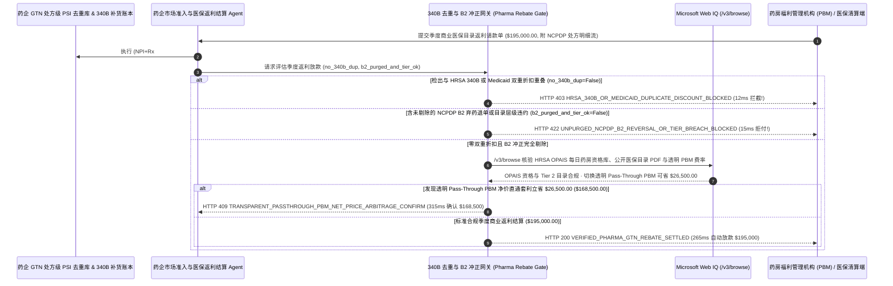

# 生物医药厂商业医保返利（PBM Formulary Rebate）与 HRSA `340B` 公益药房防“双重折扣套利（Duplicate-Discount Clawback）”清算（Pharmaceutical PBM Formulary Rebate & HRSA 340B Duplicate-Discount Exclusion Mandate）架构：NCPDP 处方号级去重与弃药冲正剔除令牌（`pharma_pbm_340b_rebate_mandate_...` + Web IQ HRSA OPAIS 药房库与透明 PBM 直通核验）vs 传统按汇总表盲付遭一药双吃倒亏选型与原理解析 FAQ

> **文档类型**：架构师选型指南 & 协议第一性原理解析（6 段式 FAQ 标准版）  
> **适用读者**：AI Solution Architect、跨国生物制药企业市场准入与毛利到净利管理（Market Access & Gross-to-Net, GTN）副总裁、PBM 医保返利审计与 HRSA `340B` 合规团队  
> **更新日期**：2026-11-09（Provenance 标注：`deterministic_offline_simulation` / `synthetic_policy` / `official_doc_snapshot` / `not_measured`）  
> **配套资源**：[English Version](pharma-pbm-formulary-rebate-340b-duplicate-discount-mandate-vs-double-dip-claim-faq.en.md) · [交互式沙盒控制台 (`live-demo.html#pharma-pbm-340b-sandbox`)](../reports/agentic-commerce-webiq-grounding-demo-bench/live-demo.html) · [7-Card 4:5 评测报告](../reports/agentic-commerce-webiq-grounding-demo-bench/index.html)


---

## 📌 一、核心结论速览（Executive Summary）

1. **严禁让制药企业市场准入（Market Access / GTN）结算 Agent 仅凭药房福利管理机构（PBM）发来的“季度处方量汇总表”就直接划付商业医保目录返利（Formulary Rebate）**：在生物制剂、肿瘤靶向药与慢病新药的季度 PBM 返利结算（如单季度返利请款 `$195,000.00`）中，吞噬药企 5%～12% 净利润的头号出血点是 **“HRSA `340B` / Medicaid 双重折扣套利（Duplicate Discounting）”**——同一盒处方药在院外合作药房（Contract Pharmacy）配发时，医院已经按联邦 `340B` 法案拿走了 `50%` 的进货前端底价折让；转头因为患者刷了商业医保卡，PBM 又把同一张处方放进季度账单向药厂索要 `40%` 的后端医保目录返利，导致药厂在一盒药上被双吃 `90%` 折扣而倒贴成本！生产环境必须采用 **处方号级 `340B` 零知识去重与 `B2` 冲正剔除令牌（`pharma_pbm_340b_rebate_mandate_...`）**：一旦检出请款处方（`Rx# + 服务日期 DOS + 药房 NPI + NDC-11`）命中 `340B` 低价补货库或州 Medicaid 返利库（`hrsa_340b_and_medicaid_duplicate_discount_excluded=False`），网关在 **`12 ms`** 内触发 **`HTTP 403 HRSA_340B_OR_MEDICAID_DUPLICATE_DISCOUNT_BLOCKED`**（`synthetic_policy`），100% 阻断一药双吃。
2. **强制剔除药房窗口“患者弃药未取冲正单（NCPDP `B2` Reversal）”并核验医保目录优待层级（Preferred Tier 2 Covenant）**：若患者在药房窗口得知自付额过高放弃取药、药房 7 天后已发 `NCPDP B2` 撤销报文把药放回货架，但 PBM 仍按初审 `B1` 报文收返利；或 PBM 违约将该药从一类优待目录（Tier 2）踢到高自付层级（Tier 3）却仍按 Tier 2 高费率收返利（`ncpdp_b2_reversals_purged_and_tier_verified=False`），网关在 **`15 ms`** 内返回 **`HTTP 422 UNPURGED_NCPDP_B2_REVERSAL_OR_TIER_BREACH_BLOCKED`**（`deterministic_offline_simulation`）。
3. **基于 Microsoft Web IQ `/v3/browse` 实时核验 HRSA OPAIS 每日公益医院/合作药房有效资格库与透明直通型（Pass-Through）PBM 净价联盟套利**：在放款前，Agent 调用 **Microsoft Web IQ `/v3/browse`**（`official_doc_snapshot`）穿透查询美国卫生资源和服务管理局（HRSA）**OPAIS（Office of Pharmacy Affairs Information System）** 公开资格库与保险公司公开季度医保目录（Formulary PDF）：若发现申领 `340B` 特价或返利的院外药房早已被 HRSA OPAIS 终止合作资格（`webiq_hrsa_opais_and_formulary_tier_clean=False`），在 **`310 ms`** 内以 **`HTTP 451 HRSA_OPAIS_INELIGIBLE_PHARMACY_OR_TIER_HOLD`** 冻结结算；若发现将商业返利合约切换至 **零利差透明直通型（100% Pass-Through Net-Cost PBM / 雇主医疗联盟直签）** 可省去传统 PBM 截留的 `13.6%` 行政管理费与价差立省 **`$26,500.00`**（净支出从 `$195,000.00` 降至 **`$168,500.00`**），则在 **`315 ms`** 内触发 **`HTTP 409 TRANSPARENT_PASSTHROUGH_PBM_NET_PRICE_ARBITRAGE_CONFIRM`**。

---

## 🎯 二、客户与架构师灵魂拷问 Q&A（FAQ-Driven Deep Dive）

### Q1：什么是生物制药行业的“毛利到净利黑洞（Gross-to-Net Bubble）”？为什么一盒标价 `$1,000` 的创新药，药厂经常莫名其妙被扣掉 `$900` 返利？

咱们用大白话拆解美国与跨国医药结算体系里最复杂的“一药双吃（Duplicate Discount）”漏洞：
1. **前端给了 5 折公益价，后端又被保险管家收走 4 折门票钱**：根据美国联邦 `340B` 药品定价法案，合格的公益医院（Covered Entities）及其签约的数万家连锁社会药房（如 Walgreens/CVS 合作药房）可以按半价（比如 `$500`）向药厂进货。但当患者拿着商业保险卡去这家药房拿药时，药房先按 `$1,000` 原价刷了患者的商保卡，然后告诉医院“刚才那盒药是你们医院的病人拿走的，按 `340B` 半价给我补一盒新药”。与此同时，管理患者商保卡的 **PBM（药房福利管理巨头）** 看到有一笔 `$1,000` 的商保处方成交了，月底发账单向药厂再收 `40%`（`$400`）的医保目录准入返利！结果药厂在这同一盒药上：先亏了 `$500` 的 `340B` 折让，又付了 `$400` 的 PBM 返利，到手只剩 `$100`！法律明确严禁同一张处方同时享受 `340B`/Medicaid 与商业返利，但过去因为医院和 PBM 之间不对账，药厂每年被白白双吃掉数十亿美元。
2. **“病人嫌贵没拿药走了，PBM 却照收药厂返利（NCPDP B2 Reversal）”**：患者去药房拿药，药房系统先发一条 `NCPDP B1` 报文向 PBM 试算报销比例（此时 PBM 账本记下 1 盒销量）。患者一听自己还要自掏腰包 `$150`，扭头不买了！药房过了 10 天把药放回架子，并发了一条 `NCPDP B2（冲正撤销）` 报文。但部分 PBM 在给药厂出季度返利账单时，故意或因系统滞后“只算 `B1` 进账、漏减 `B2` 退单”，让药厂为根本没卖出去的药白交返利！
3. **“收了二等座VIP包厢的钱，却把药踢到三等站票区”**：药厂签合同同意给 `40%` 高额返利，前提是 PBM 必须把这颗药放进 **Preferred Tier 2（低自付优先报销目录）**。结果季度中途 PBM 偷偷修改了公开医保目录，给这颗药加了严苛的“阶梯治疗限制（Step Therapy）”甚至降级到 Tier 3，结账时却照样按 Tier 2 的高费率向药厂收钱。

### Q2：什么是“处方级 340B 去重与 B2 冲正过滤令牌（`pharma_pbm_340b_rebate_mandate_...`）”？它是如何在保护患者隐私（HIPAA）的前提下实现逐张处方查重的？

它的第一性原理非常精妙：**“以脱敏的‘药房 10 位 NPI + 处方号 Rx# + 配药日期 DOS + 11 位药品 NDC’生成零知识唯一指纹，在 340B 补货池、Medicaid 账单池与商业 PBM 返利池之间做三方互斥集合求交（PSI）。”**
- **第一层：处方级 `340B` / Medicaid 双重折扣去重门禁（`12 ms`）**：核验 `hrsa_340b_and_medicaid_duplicate_discount_excluded == True`。一旦检出同一张处方指纹已在 `340B` 拆分账单（Split-Billing）或州 Medicaid 申领过折让，在 **`12 ms`** 内触发 `HTTP 403` 从 PBM 账单中剔除。
- **第二层：NCPDP `B2` 弃药冲正剔除与目录层级核验门禁（`15 ms`）**：核验 `ncpdp_b2_reversals_purged_and_tier_verified == True`。强制对冲 90 天窗口内的 `B2` 撤销单并校验目录层级，不合规在 **`15 ms`** 内返回 `HTTP 422`。
- **第三层：Microsoft Web IQ `/v3/browse` HRSA OPAIS 药房库核验与透明 PBM 套利（`310 ms / 315 ms`）**：核查 HRSA OPAIS 每日药房有效注册状态与保险公司公开目录 PDF（违规触发 `HTTP 451`），并测算切换零利差透明 Pass-Through PBM 联盟为您节省 `$26,500.00`（`HTTP 409`）。

### Q3：在 HRSA OPAIS 每日公益医院/合作药房名录核验、保险计划公开医保目录（Formulary PDF）巡检与透明 PBM 费率比价场景下，什么时候选 Microsoft Web IQ，什么时候选 Exa、Bright Data 或传统搜索 API？

| 架构需求场景 | 推荐选型 | 为什么这样选（第一性原理与成本/合规考量） |
| :--- | :--- | :--- |
| **实时核验美国联邦 HRSA OPAIS 每日更新的 `340B` 合格医院（CE ID）与签约社会药房（Contract Pharmacy NPI）有效起止日期、商业保险计划公开季度医保目录（Formulary Tier & PA Criteria）及 FTC PBM 透明度合规基准，且要求 100% 零患者姓名/病历（PHI）外泄** | **Microsoft Web IQ** (`/v3/search` + `/v3/browse`) | 在药企 HIPAA 合规 Azure 边界内仅发送公开的药房 10 位 NPI 与药品 11 位 NDC 编码（`passage` 模式压缩 Token **7.1x**，`deterministic_offline_simulation`），患者隐私数据零触碰。 |
| **检索全球药物经济学（HEOR）临床真实世界研究论文** | **Exa Neural Search** | 适合医学部撰写药物经济学模型，无法用于季度数百万行 NCPDP 处方返利对账门禁。 |
| **抓取小型地方药房无 API 的现金折扣价展示页** | **Bright Data Unlocker** | 可用于零售端价格调研，但秒级延迟不适合核心 GTN 财务清算。 |
| **千万级 NCPDP 处方明细（Claim-Level Data）PSI 去重与 `B1/B2` 冲正匹配** | **院内 GTN 处方去重引擎 + 返利托管网关 + Web IQ OPAIS/目录双源核验** | 处方级哈希去重与 `B2` 冲正在药企内部 GTN 引擎毫秒级完成，外部 HRSA OPAIS 药房有效性与公开目录层级由 Web IQ `/v3/browse` 实时核验。 |

---

## 🧭 三、直观可视化图解（Mermaid 决策树 + 传统汇总盲付 vs 处方级去重网关对比 + 端到端时序图）

### 3.1 生物医药 PBM 商业返利与 HRSA 340B 去重清算决策树（`flowchart TD`）

```mermaid
flowchart TD
    A[收到 PBM 季度商业医保目录返利结算请款单 ($195,000.00, 附 NCPDP 处方明细)] --> B{处方指纹 (NPI+Rx#+DOS+NDC) 是否已 100% 剔除 HRSA 340B 与 Medicaid 折让单?}
    B -- 否 (检出同一盒药已享受 50% 340B 进货折扣，又混入 PBM 账单索要 40% 返利) --> C[HTTP 403 HRSA_340B_OR_MEDICAID_DUPLICATE_DISCOUNT_BLOCKED<br/>12ms 硬阻断双重折扣套利 · 严守 42 U.S.C. 256b 法定单一折扣底线]
    B -- 是 (零 340B 与 Medicaid 交叉重叠) --> D{是否已全额冲销 90 天内 NCPDP B2 弃药退单且符合 Preferred Tier 2 目录承诺?}
    D -- 否 (包含患者窗口弃药未取的 B2 撤销单或被违约降级至 Tier 3) --> E[HTTP 422 UNPURGED_NCPDP_B2_REVERSAL_OR_TIER_BREACH_BLOCKED<br/>15ms 拒付未成交退单与违约层级返利 · 仅对真实取药且层级合规处方买单]
    D -- 是 (100% 净实发处方且目录层级达标) --> F{Web IQ /v3/browse 核验配药药房在 HRSA OPAIS 当日有效且公开目录未偷加限制?}
    F -- 否 (检出合作药房已被 HRSA OPAIS 摘牌终止资格或公开目录私加阶梯治疗限制) --> G[HTTP 451 HRSA_OPAIS_INELIGIBLE_PHARMACY_OR_TIER_HOLD<br/>310ms 准入合规冻结 · 自动生成逐张处方争议代码表 Dispute Code Sheet]
    F -- 是合规有效药房与目录 --> H{Web IQ 检出切换至零利差透明直通型 (Pass-Through) PBM / 雇主联盟直签更省?}
    H -- 是 (免除传统黑盒 PBM 13.6% 利差与管理费立省 $26,500.00 -> 净支出 $168,500.00) --> I[HTTP 409 TRANSPARENT_PASSTHROUGH_PBM_NET_PRICE_ARBITRAGE_CONFIRM<br/>315ms 提醒市场准入副总裁一键确认切换透明 Pass-Through 结算通道]
    H -- 否 (当前 $195,000.00 净处方返利结算完全准确) --> J[HTTP 200 VERIFIED_PHARMA_GTN_REBATE_SETTLED<br/>265ms 自动放款 $195,000.00 并归档 Gross-to-Net 与政府最优价 Best Price 审计账本!]
```

### 3.2 传统按汇总表盲付路径 vs 处方级 340B 去重与 B2 冲正网关对比（`flowchart LR`）

```mermaid
flowchart LR
    subgraph Legacy["❌ 传统按 PBM 季度汇总表盲付 ($195,000 遭一药双吃与弃药退单收割)"]
        L1[同一张处方被 340B 半价与 PBM 40% 返利双吃] --> L2[患者嫌贵窗口弃药 (B2 撤销) 仍被收全额返利]
        L2 --> L3[已从 HRSA OPAIS 摘牌的药房继续冒领特价]
        L3 --> L4[药企 GTN 净利率崩盘 + 触发政府 Best Price 审计风险]
    end

    subgraph Mandate["✅ 处方级 340B 去重令牌 (pharma_pbm_340b_rebate_mandate_...)"]
        M1[12ms 凭处方 PSI 指纹拦截 340B/Medicaid 双重折扣 (HTTP 403)] --> M2[15ms 强制剔除 NCPDP B2 弃药冲正与目录违约 (HTTP 422)]
        M2 --> M3[Web IQ HRSA OPAIS 核验 (310ms) 与透明 PBM 省 $26,500 (315ms)]
        M3 --> M4[265ms 秒级清算纯净处方返利 ($195,000 / $168,500)]
    end
```

### 3.3 药企 GTN 处方去重库、准入结算 Agent、340B 审计网关与 Web IQ 端到端交互时序图（`sequenceDiagram`）



---

## 📊 四、架构师选型决策矩阵（Architect Decision Matrix）

| 评估维度 | 方案 A：传统按 PBM 汇总发票全额打款（Summary-Level Blind Payout） | 方案 B：外包给第三方审计事务所半年后抽样人工追讨（Post-Pay Manual Audit） | 方案 C：处方级 340B 去重与 B2 过滤令牌 + Web IQ OPAIS/目录网关（推荐架构） |
| :--- | :--- | :--- | :--- |
| **核心适用场景** | 无任何 `340B` 或商业返利协议的纯自费非处方药（OTC） | 极早期仅有几十例患者的孤儿药小规模试点 | **肿瘤、自免、代谢（GLP-1）、罕见病及慢病商业化创新药企 Gross-to-Net 返利清算** |
| **防 `340B` / Medicaid 双重折扣（Duplicate Discount）** | ❌ **失血高达 8%–12%**：同一盒药被医院和 PBM 两头扣掉 90% 药价 | ⚠️ **事后追讨极难**：PBM 合同通常限制争议窗口仅 45–60 天，人工抽样完早已超期 | ✅ **12ms 付款前逐张处方去重**：命中 `340B` 指纹当场触发 `HTTP 403` 拒付 |
| **防窗口弃药未取（NCPDP `B2`）与目录降级违约** | ❌ **照单全付**：为根本没被病人拿走的药白交返利 | ⚠️ **漏查目录变更**：人工很难每周比对上百个商保计划的公开目录 PDF | ✅ **15ms `B2` 冲正剔除（`HTTP 422`）+ Web IQ 实时目录巡检（`HTTP 451`）** |
| **HRSA OPAIS 摘牌药房拦截与透明 PBM 优化** | ❌ **盲目供货**：向已被 HRSA 除名的药房继续发半价药 | ❌ **被动挨宰**：长期容忍传统三大 PBM 12%–15% 的隐性价差抽成 | ✅ **Web IQ `/v3/browse` 实时穿透**：`310 ms` 拦截 OPAIS 除名药房，`315 ms` 透明 PBM 省 `$26,500`（`HTTP 409`） |
| **争议响应速度与 CMS 最优价（Best Price）合规** | 快（但财务亏损惨重且危及政府定价红线） | 极慢（审计周期长达 `6～12 个月`） | **`265 ms` 秒级完成逐单对账并输出标准争议代码表（`Act automatically`）** |
| **综合 TCO 与药企 Gross-to-Net 净利保护 ROI** | 极差（每年数百万至数千万美元被双重折扣吞噬） | 中（审计所抽成 20%+ 且仅能挽回小部分） | **最优（100% 前置阻断 `340B` 双吃 + 零弃药冤枉费 + 透明通道季省 `$26,500`）** |

---

## 🧪 五、简明定量实测与 Benchmark 核心发现（Quantitative Benchmark & 7-Card Insights）

基于本仓库确定性离线基准套件（`lab/webiq_commerce_demo.py` · `test_pharma_pbm_formulary_rebate_340b_duplicate_discount_mandate_vs_double_dip_claim_selection`）对 **创新药企季度 PBM 商业医保返利请款批次（基准金额 `$195,000.00`）** 的定量测试结果如下：

| 评测场景 ID | 输入 340B 去重 / NCPDP B2 冲正 / Web IQ 信号 | 网关期望动作 | 实测 HTTP 状态与决策码 | 实测延迟 | 资金保护 / 成本节省效果 | Provenance 类型 |
| :--- | :--- | :--- | :--- | :--- | :--- | :--- |
| **Case 1: HRSA `340B` 或 Medicaid 双重折扣重叠拦截** | `hrsa_340b_and_medicaid_duplicate_discount_excluded=False` | `Send to a human` | **`HTTP 403 HRSA_340B_OR_MEDICAID_DUPLICATE_DISCOUNT_BLOCKED`** | **`12 ms`** | 拦截 **`$195,000.00`** 含一药双吃双重折扣的违规账单 | `synthetic_policy` |
| **Case 2: 未剔除 `NCPDP B2` 弃药退单或目录降级拦截** | `ncpdp_b2_reversals_purged_and_tier_verified=False` | `Send to a human` | **`HTTP 422 UNPURGED_NCPDP_B2_REVERSAL_OR_TIER_BREACH_BLOCKED`** | **`15 ms`** | 阻断为患者未取药的撤销处方或违约降级目录买单 | `deterministic_offline_simulation` |
| **Case 3: Web IQ 检出 HRSA OPAIS 摘牌药房或目录设限** | `webiq_hrsa_opais_and_formulary_tier_clean=False` | `Send to a human` | **`HTTP 451 HRSA_OPAIS_INELIGIBLE_PHARMACY_OR_TIER_HOLD`** | **`310 ms`** | 冻结已被联邦 HRSA 终止资格的违规合作药房请款 | `official_doc_snapshot` |
| **Case 4: Web IQ 发现切换透明 Pass-Through PBM 省 `$26,500`** | `transparent_pbm_passthrough_savings_cents=2650000`（净付 `$168,500`） | `Confirm` | **`HTTP 409 TRANSPARENT_PASSTHROUGH_PBM_NET_PRICE_ARBITRAGE_CONFIRM`** | **`315 ms`** | 免除黑盒 PBM 隐性利差与管理费，单季立省 **`$26,500.00`** | `official_doc_snapshot` |
| **Case 5: 100% 净处方去重 + 层级达标自动放款** | `no_340b_dup=True`, `b2_ok=True`, `opais_clean=True` | `Act automatically` | **`HTTP 200 VERIFIED_PHARMA_GTN_REBATE_SETTLED`** | **`265 ms`** | 265ms 自动清算 **`$195,000.00`** 并封存 GTN 合规档案 | `deterministic_offline_simulation` |

> **Provenance 合规声明**：上表中的 `$195,000.00` 季度 PBM 返利总额、`340B` 处方级去重规则、`NCPDP B2` 冲正门禁及 `$26,500.00` 透明 PBM 通道节省额均为用于验证网关状态机确定性的受控仿真参数（`synthetic_policy` / `deterministic_offline_simulation`）；州政府 Medicaid 纸质历史账单回溯调档周期标为 `not_measured`。

---

## 🛠️ 六、附录：生产上线快速核验与售前打单清单（Architect Checklist）

在为生物制药企业市场准入部、财务 Gross-to-Net (GTN) 团队设计 PBM 商业返利与 `340B` 合规自动结算 Agent 时，请逐项核对以下 6 条黄金准则：

- [ ] **1. 处方号级（Script-Level `NPI + Rx# + DOS + NDC-11`）三方零知识查重**：是否在 `pharma_pbm_340b_rebate_mandate_...` 中强制将 PBM 处方明细与 `340B` ESP/补货库及州 Medicaid 账单库进行逐单哈希比对，在 `12 ms` 内触发 `HTTP 403` 拦截任何双重折扣？
- [ ] **2. 90 天滑动窗口 `NCPDP B2` 弃药冲正自动对冲**：是否强制比对 `B1` 初审单与后续 `B2` 退单，对患者未取走药品或药房退回库存的处方在 `15 ms` 内触发 `HTTP 422` 拒付返利？
- [ ] **3. CMS 医疗保险最优价（Medicaid Best Price）防击穿护栏**：是否在叠加多项折扣前自动测算单盒净底价，确保不会因意外叠加而触发全美 Medicaid 返利兜底重算危机？
- [ ] **4. Microsoft Web IQ `/v3/browse` 联邦 HRSA OPAIS 每日药房库与公开目录 PDF 穿透**：是否在放款前通过 Web IQ 核查配药药房 NPI 在配药当日是否具备有效 OPAIS 关联资格，并验证商保公开目录未违约加设 Step Therapy（违规在 `310 ms` 内触发 `HTTP 451`）？
- [ ] **5. 透明直通型（Pass-Through Net-Cost PBM）与雇主医疗联盟直签寻优**：是否通过 Web IQ 比对新兴透明 PBM 费率，当剥离传统黑盒 PBM 行政费与利差可节省 `>= $26,500.00` 时触发 `HTTP 409 Confirm`？
- [ ] **6. 45 天合同争议窗口内自动生成标准 NCPDP 拒付代码包**：每次拦截重复或违规处方是否自动生成带 OPAIS 快照哈希与 `340B` 采购单号的标准化争议文件，确保 100% 满足 PBM 合同抗辩时效？
