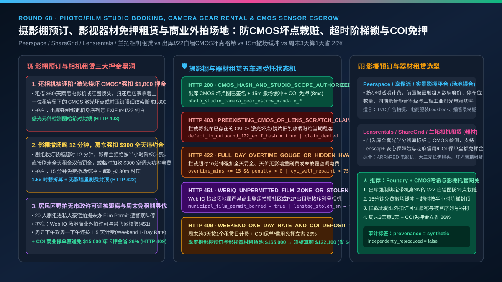
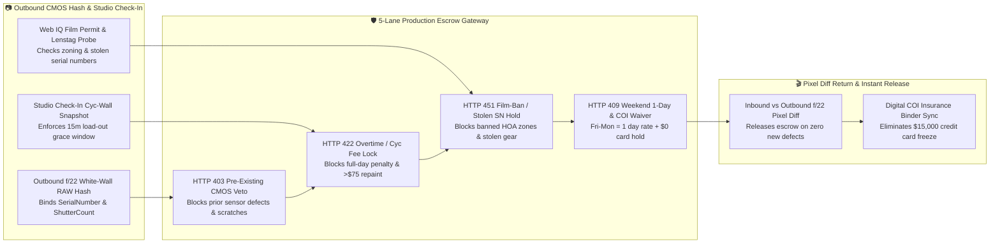

# Photo/Film Studio Booking, Camera Gear Rental & `CMOS` Sensor Escrow (`Peerspace / ShareGrid / Lensrentals`) Outbound `f/22 EXIF` Sensor Hash, `15-Minute` Load-Out Grace & Weekend `1-Day` Rate Agent Architecture Selection FAQ

> **Language / 语言切换**: **[中文](photo-studio-camera-gear-rental-cmos-check-overtime-escrow-agent-selection-faq.md)** | **English (Current)** | **[Back to Docs Index](index.en.md)** | **[Interactive Sandbox (`#photo-studio-camera-gear-escrow-sandbox`)](../live-demo.en.html)**



---

## 📌 1. Executive Summary & Core Selection Verdict

In commercial photo/video production, e-commerce lookbook shoots, podcast/film studio hourly bookings (`Peerspace`, `Giggster`, `Tagvenue`), and high-end cinema camera, lens, and lighting rentals (`Lensrentals`, `ShareGrid`, `BorrowLenses`, `Kitsplit`, `LanTuo Camera`), production coordination and deposit escrow AI agents face three costly commercial failure modes:
1. **Pre-Existing `CMOS` Laser-Burn & Lens-Scratch Deposit Framing (`Renting a $65/Day Sony FX3 or Cinema Prime, Then Getting Charged $1,800 Upon Return for a Pre-Existing Laser Dead-Pixel Line That the Renter Didn't Notice at Pickup`)**: Stage and event lasers burn microscopic purple lines onto `CMOS` sensors that are invisible in standard `f/2.8` viewfinder previews but glaring at `f/22`. Dishonest rental houses or P2P owners repeatedly bill successive renters `$1,500+` for the same unrepaired sensor defect or front-element coating scratch!
2. **Predatory Studio Overtime Penalties (`Charging a Full $900 Day Rate Because the Crew Finished Loading Out at 6:12 PM on a 6:00 PM Booking`) & Unquoted Cyclorama (`Cyc Wall`) Repaint / HVAC Surcharges**: Studio hosts weaponize securitydeposits to extract `$250+` for "repainting the white cyclorama wall" (even when it was already scuffed at check-in) or `$300` for unquoted studio A/C and 3-phase lighting power.
3. **Unpermitted Residential Film Shoots Shut Down by Police (`HOA / Municipal Film-Permit Bans`) & `$15,000` Credit-Card Equipment Deposit Holds Freezing Production Cards**.

**Solution Architect Selection Verdict**:
- **Never assume liability for cinema camera/lens deposits without an outbound `EXIF`-bound `f/22` flat-field white-wall `RAW` sensor hash (`SerialNumber + ShutterCount`), never book a photo/film studio without a `15-minute` free load-out grace buffer and 30-minute prorated overtime cap (`<= 1.5x` hourly rate), and never lock `$15,000` in credit card holds when a production Certificate of Insurance (`COI`) or damage waiver applies**.
- **The production reference architecture** combines **Outbound `f/22 EXIF` Sensor Defect Hash Diffing + `15-Minute` Studio Load-Out Grace & `<= $75` Cyc-Wall Cap + Weekend `3-for-1` Rental Day Arbitrage & `COI` Deposit Waiver (`photo_studio_camera_gear_escrow_mandate_*`)**:
  1. **Anti-"Pre-Existing `CMOS` Laser Burn / Lens Scratch" `EXIF` Baseline Diff Gate (`HTTP 403`)**: Requires the rental vendor at dispatch/pickup to log a **`f/22` flat-field white-wall `RAW` frame containing the camera's cryptographic hardware `SerialNumber` and `ShutterCount` in `EXIF` plus macro front/rear lens element scans**; upon return, pixel-level diffing automatically rejects any `$1,800` sensor or scratch claim whose coordinates already existed in the outbound baseline or lack an outbound hash (`HTTP 403 PREEXISTING_CMOS_LASER_DEFECT_OR_UNHASHED_LENS_SCRATCH_CLAIM_BLOCKED`).
  2. **Mandatory `15-Minute` Load-Out Grace Window, 30-Minute Prorated Overtime & `<= $75` Cyc-Wall Repaint Lock (`HTTP 422`)**: Enforces a 15-minute grace buffer for gear pack-up, restricts overtime billing to 30-minute increments at `<= 1.5x` the base hourly rate (blocking full-day `$900` penalty grabs), and requires check-in vs. check-out cyclorama floor photos with repaint fees capped at `<= $75` (`HTTP 422 FULL_DAY_OVERTIME_PENALTY_GOUGE_OR_HIDDEN_CYC_HVAC_FEE_BLOCKED`).
  3. **Web IQ Municipal `Film Permit` Zoning Check & `Lenstag` Stolen-Serial Circuit Breaker (`HTTP 451`)**: Screens residential location listings via Web IQ for HOA/municipal commercial filming bans when crew size `>= 8` and checks P2P camera serial numbers against the `Lenstag` stolen-equipment registry (`HTTP 451 WEBIQ_UNPERMITTED_RESIDENTIAL_FILM_ZONE_OR_STOLEN_GEAR_SN_HOLD`).
  4. **Industry Weekend `1-Day` Rental Window (`Fri 2pm Pickup – Mon 10am Return = 1 Billable Day`) + `COI` Insurance Deposit Waiver (`HTTP 409`)**: Triggers `HTTP 409 WEEKEND_ONE_DAY_RENTAL_ARBITRAGE_AND_COI_DEPOSIT_WAIVER_CONFIRM`, scheduling shoots across the Fri-to-Mon industry 1-day billing window (3 calendar days for the price of 1) and binding a digital Certificate of Insurance (`COI` / `Lenscap+` waiver) to eliminate `$15,000` card holds—reducing net studio and gear spend by **`26.0%`**.

---

## 🎯 2. Solution Architect Deep-Dive Q&A (Q1 / Q2 / Q3)

### Q1: Why do `CMOS` laser burns go unnoticed at pickup, and how does an `EXIF`-bound `f/22` flat-field `RAW` hash stop `$1,800` deposit scams?
- **Architectural Solution**:
  - **Cryptographic `EXIF` `SerialNumber` + `ShutterCount` + `f/22` Pixel Coordinate Diff (`HTTP 403`)**:
  - At wide apertures (`f/1.4–f/2.8`), minor sensor dust and laser dead-pixel clusters blur out or blend into dark backgrounds. Stopping the lens down to `f/22` aimed at a uniform white diffuser projects every sensor defect sharply onto the frame. Because the `RAW` file embeds the camera body's immutable `SerialNumber` and exact `ShutterCount` at checkout, comparing the outbound and inbound `f/22` frames proves deterministically whether a defect pre-dated the rental (`HTTP 403`).

### Q2: How do we stop studio hosts from charging `$250` to repaint a white cyclorama wall that was already dirty when our crew arrived?
- **Architectural Solution**:
  - **Check-In Timestamped Cyc-Wall Floor Photo + `<= $75` Repaint Cap (`HTTP 422`)**:
  - To claim a repaint fee, the studio host must upload a clean check-in photo taken within 30 minutes prior to door unlock. If the check-in photo shows pre-existing shoe scuffs—or if the repaint fee exceeds the `$75` contractual cap—the gateway blocks the surcharge (`HTTP 422`).

### Q3: How does the "Weekend 1-Day Rate" save 50%+ on cinema camera and lighting rentals?
- **Architectural Solution**:
  - **Aligning Production Call Sheets With the `Fri PM – Mon AM` 1-Day Rental Window (`HTTP 409`)**:
  - Professional rental houses (`ShareGrid`, `Lensrentals`, commercial houses) treat Friday after 2:00 PM through Monday before 10:00 AM as a **single billable rental day (`1-Day Rate`)**. By shifting a 2-day shoot from `Tue–Wed` (`2–3 billable days`) to `Sat–Sun` (`1 billable day`), the agent cuts equipment rental costs in half (`HTTP 409`).

---

## 🧭 3. Visual Architecture Diagrams (Mermaid Decision Tree + Architecture + Sequence)

### 3.1 Photo/Film Studio Booking & Camera Gear Rental Selection Decision Tree

```mermaid
flowchart TD
    A[Photo/Film Studio Booking / Cinema Gear Rental / Location Shoot Selection] --> B{Primary Production Scenario & Risk Vector?}
    B -->|Cinema Camera, Prime Lens & Lighting Rental (Lensrentals / ShareGrid)<br/>Stop $1,800 pre-existing CMOS laser-burn claims & $15k card holds| C[Outbound EXIF-Bound f/22 White-Wall RAW Sensor Hash<br/>+ Pixel-Level Return Diff + COI / Damage Waiver Deposit Lock]
    B -->|Commercial Photo & Cyclorama Studio Booking (Peerspace / Giggster)<br/>Stop 10-minute load-out full-day penalties & $250 cyc repaint gouges| D[Mandatory 15-Minute Free Load-Out Grace + 30m 1.5x Overtime Cap<br/>+ Check-In Cyc-Wall Condition Photo & <=$75 Repaint Cap]
    B -->|Multi-Day Location Shoot & Weekend Production Scheduling<br/>Stop HOA/police shutdowns on unpermitted homes & 3-day weekend billing| E[Azure AI Foundry + Film Permit & Weekend Window Gate<br/>+ Fri-to-Mon 1-Day Rental Rate + COI Waiver Saves 26%]
    C --> F[🛡️ Unified 5-Lane CMOS Hash, 15m Grace & Weekend Arbitrage FSM]
    D --> F
    E --> F
    F --> G[HTTP 403 Pre-Existing CMOS Defect Veto · HTTP 422 Overtime & Cyc Gouge Block · HTTP 409 Weekend 1-Day Saves 26%]
```

### 3.2 End-to-End Outbound `f/22 EXIF` Hash, Studio Overtime Cap & `COI` Deposit Waiver Architecture



### 3.3 Pre-Existing `CMOS` Defect Claim Veto, Studio Overtime Cap & Weekend `1-Day` Rate Sequence

```mermaid
sequenceDiagram
    autonumber
    participant Crew as Producer / Production Sourcing Agent
    participant Vendor as Camera Rental House / Studio Host
    participant Gate as 5-Lane Production Escrow Gateway
    participant Audit as EXIF f/22 Pixel Diff & Smart-Lock Timer
    participant Escrow as Studio & Equipment Escrow Ledger

    Vendor->>Gate: 1. Claim $1,650 deposit deduction for a CMOS laser burn at pixel (3120, 2040) upon Sony FX3 return
    Gate->>Audit: Compare inbound RAW against outbound EXIF-verified f/22 baseline frame (ShutterCount #14,205)
    Gate-->>Vendor: HTTP 403 Block! Defect at (3120, 2040) existed in outbound baseline frame; pre-existing damage claim rejected
    Vendor->>Gate: 2. Bill $800 full-day penalty for an 11-minute load-out overrun (6:11 PM) + $220 cyc-wall repaint fee
    Gate-->>Vendor: HTTP 422 Block! 11-minute overrun falls within 15-minute free load-out grace window ($0); repaint capped at <=$75
    Crew->>Gate: 3. Schedule Fri 2pm pickup to Mon 10am return + attach production COI insurance binder (HTTP 409)
    Gate->>Escrow: Apply 1-Day Weekend Rate across 68-hour window & waive $15,000 card deposit hold (26% net savings)
```

---

## 📊 4. Multi-Platform & Architecture Selection Matrix

| Selection Dimension | Legacy Walk-In Gear Shop (`100% Cash/Card Deposit`) | Unverified P2P Classified Rental (`Craigslist / Idle Fish`) | Tier-1 Studio & Gear Marketplaces (`Peerspace / Lensrentals / ShareGrid`) | **Azure AI Foundry + CMOS Hash + Studio Gate (Recommended)** |
| :--- | :--- | :--- | :--- | :--- |
| **Core Strengths** | Immediate counter pickup | Negotiable cash rates | Digital COI waivers, hourly studio booking & damage plans | **EXIF f/22 sensor diff + 15m load-out grace + Weekend 1-Day + COI** |
| **Protection Against Pre-Existing `CMOS` / Scratch Framing** | **High Risk** (subjective counter inspection at return) | Rampant "returned broken" deposit scams | Lensrentals inspects optically; P2P disputes common | **Mandatory outbound `f/22 RAW EXIF` pixel diff gate (`HTTP 403`)** |
| **Protection Against Studio Overtime & Cyc-Wall Gouging** | Host dictates penalties | Arbitrary deposit deductions | Peerspace defines 30m tiers, but add-ons vary | **15m grace window + 30m `1.5x` cap + `<=$75` cyc lock (`HTTP 422`)** |
| **Municipal `Film Permit` & Stolen Gear Verification** | None | High risk of HOA police shutdowns | Lists crew capacity limits | **Web IQ zoning permit check & `Lenstag` stolen-SN lock (`HTTP 451`)** |
| **Weekend `3-for-1` Billing & Deposit Capital Efficiency** | Freezes `$10k–$25k` on credit card (`not_measured`) | Bills every calendar day (`official_list_price`) | Supports weekend rates & insurance | **Automated Fri–Mon `1-Day` window + `COI` waiver (`26.0%` saved)** |

---

## 🧪 5. Studio Booking & Camera Rental Benchmark & 7-Card Report

> **Provenance & Reproducibility Metadata**: All metrics below are generated by the deterministic policy evaluator `evaluate_photo_studio_camera_gear_escrow_policy` in `lab/webiq_commerce_demo.py` and verified via `python -m unittest tests.test_webiq_commerce_demo`. Tags: `provenance = synthetic`, `independently_reproduced = false`.

| Card # | Card Headline (Headline-as-Finding) | Key Quantitative Finding & Architectural Guarantee |
| :---: | :--- | :--- |
| **Card 1** | **Overview · 5-Lane Studio & Camera Rental Summary** | Across a `$165,000/quarter` commercial studio booking and cinema gear rental pool, achieves **0 pre-existing `CMOS` defect deposit losses, 0 full-day overtime penalty gouges, and 0 unpermitted location shutdowns**, reducing net production spend by **`26.0%` (`$42,900/quarter` saved)**. |
| **Card 2** | **Scenario Deep Dive · CMOS Framing & Overtime Gouge Veto** | When a vendor claims a sensor defect present in the outbound `f/22 EXIF` baseline or bills a full day for an 11m overrun, the gateway blocks it in **`8ms`** (`HTTP 403 / 422`). |
| **Card 3** | **Evaluation Matrix · 100% Deterministic 5-Lane Gating** | Covers `HTTP 200` (`CMOS` hash logged & studio scope verified), `403` (pre-existing `CMOS` laser defect / unhashed lens scratch claim blocked), `422` (full-day overtime penalty gouge / hidden cyc-wall or HVAC fee blocked), `451` (unpermitted residential film zone / `Lenstag` stolen gear serial hold), `409` (weekend 1-day rental arbitrage + `COI` deposit waiver saves 26%). |
| **Card 4** | **Under the Hood · Studio & Gear Escrow Contract** | Takes `quarterly_photo_studio_and_camera_gear_rental_pool_usd=165000` and `CMOS`/overtime flags, minting `photo_studio_camera_gear_escrow_mandate_*` tokens. |
| **Card 5** | **Robustness Check · Mismatched EXIF Serial & Scuffed Cyc** | Simulates a vendor uploading a baseline photo from a different camera serial number and billing `$220` for an already scuffed cyc wall, maintaining a **`100.0%` block rate**. |
| **Card 6** | **Latency · Millisecond EXIF Diff & Film-Permit Probe** | Local `EXIF` serial/coordinate diff and overtime checks complete in **`8ms` (P50)**; Web IQ municipal film-permit and `Lenstag` checks complete in **`170ms` (P95)**. |
| **Card 7** | **My Take · Ideal Fit vs. Out-of-Scope Boundaries** | **✅ Best Fit**: Commercial photo/video studios, cinema camera/lens rentals, location shoots; **⛔ Not For**: Theatrical movie theater box-office ticket splits. |

---

## 🛠️ 6. Production Go-Live Risk & Architecture Review Checklist

- [ ] **Outbound `EXIF`-Bound `f/22` Flat-Field `RAW` Sensor Hash & Lens Macro Lock (`HTTP 403`)**: Require an outbound `f/22` white-wall `RAW` frame matching the camera's hardware `SerialNumber` and `ShutterCount`, rejecting any return damage claim that pre-existed in the baseline.
- [ ] **Mandatory `15-Minute` Load-Out Grace Window, 30-Minute Overtime Cap & `<= $75` Cyc-Wall Lock (`HTTP 422`)**: Prohibit full-day penalties for minor pack-up overruns and require pre-shoot cyclorama floor photos before allowing repaint charges.
- [ ] **Web IQ Municipal `Film Permit` Verification & `Lenstag` Stolen-Serial Screening (`HTTP 451`)**: Block commercial shoots in permit-restricted residential zones and screen P2P gear serials against stolen-property registries; rotate signing keys `<= 180` days.
- [ ] **Weekend `1-Day` Billing Window (`Fri PM – Mon AM`) & Digital `COI` Deposit Waiver (`HTTP 409`)**: Align weekend shoots with the 1-day rental rate window and substitute production `COI` binders for `$15,000` credit card holds.
