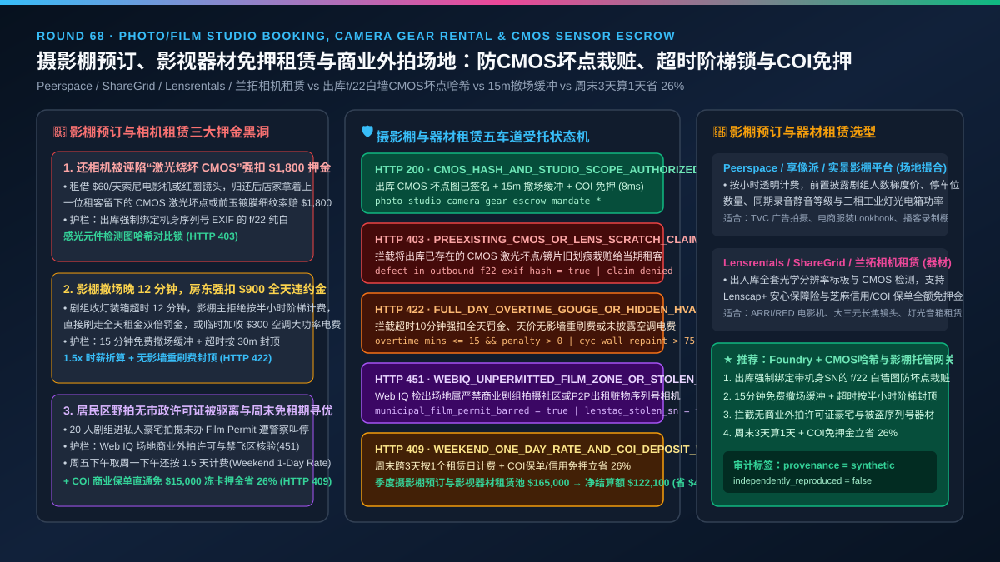
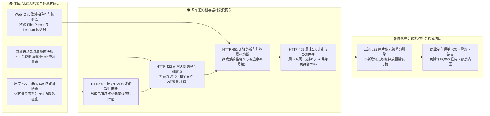
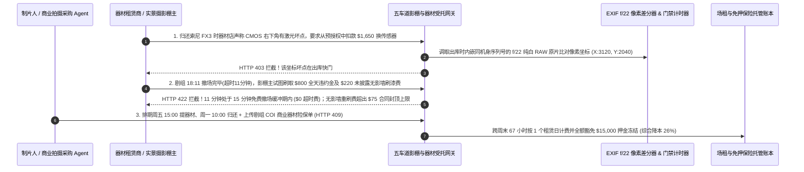

# 摄影棚预订、影视相机镜头免押租赁与商业外拍场地撮合（Photo/Film Studio Booking, Camera Gear Rental & CMOS Sensor Escrow：Peerspace / ShareGrid / Lensrentals / 兰拓相机租赁）“防还相机时把历史 CMOS 激光坏点栽赃给当期租客敲诈 $1,800、防撤场超时 10 分钟强扣全天双倍罚金与周末 3 天按 1 天计费寻优”Agent 架构选型 FAQ

> **语言切换 / Language**: **中文 (当前)** | **[English](photo-studio-camera-gear-rental-cmos-check-overtime-escrow-agent-selection-faq.en.md)** | **[返回文档目录](index.md)** | **[交互式沙盒 (`#photo-studio-camera-gear-escrow-sandbox`)](../live-demo.html)**



---

## 📌 一、核心选型结论速览（Executive Summary）

在电商服装画册拍摄、TVC 商业广告剧组、短视频 MCN 与独立摄影师预订实景摄影棚/录音棚（Peerspace、Giggster、Tagvenue、国内实景影棚小程序）以及免押租借高端电影机与镜头灯光器材（Lensrentals、ShareGrid、BorrowLenses、兰拓相机租赁、咔么租赁、内啥）的智能体档期锁定与押金托管场景中，租赁方与制作团队面临三大高频财务纠纷：
1. **“花 `$65/天` 租了一台索尼 `FX3 / A7S3` 或红圈镜头，顺丰寄回后器材店突然发来一张放大 400% 的图说‘CMOS 感光元件被舞台激光烧出一条紫线 / 前镜片镀膜有 2 毫米划痕’，直接从押金预授权里强扣 `$1,800` 换件费（Pre-Existing CMOS Defect Framing）”**：由于普通摄影师拿到器材时只开机看了一眼取景器能亮就开拍，根本没在 `f/22` 小光圈下拍纯白墙检查感光元件暗斑与激光坏点，结果成了替上一位租客背锅的“冤大头”！
2. **“预订摄影棚到下午 18:00，剧组打包装车在 18:12 才迈出大门，影棚老板以‘超时违约’为由直接扣除 `$900` 全天双倍罚金（Full-Day Overtime Gouging）”与“拍完结账时影棚突然加收 `$250` 白色无影墙（Cyc Wall）重新刷漆费和 `$180` 商业大功率空调电费”**。
3. **“在场地平台租了一栋郊区网红别墅拍 20 人电商广告，刚架好灯光就被社区业委会（HOA）和市政警察以‘住宅区严禁无证商业拍摄（Unpermitted Film Shoot）’当场驱离，场租不退还倒贴剧组误工费；或者租一套价值 `$25,000` 的镜头组需要冻结信用卡全额额度 15 天，直接占满公司差旅卡授信”**。

**架构师选型结论**：
- **切勿在未绑定“出库带机身硬件序列号 `EXIF` 的 `f/22` 纯白测试图 + 镜片微距图哈希（`Outbound CMOS & Optics Hash`）”的情况下接管高价值器材租赁押金责任，切勿签下不含 `15 分钟` 免费撤场缓冲期与半小时阶梯加班费封顶（`<= 1.5x Hourly Rate`）的霸王影棚合同，也切勿在未核验市政外拍许可证（`Film Permit`）的情况下派大型剧组进入住宅区场地**。
- **生产级最优架构**是采用 **“出库机身 `EXIF` 绑定 `f/22` 感光元件坏点图哈希防栽赃锁 + 影棚 15 分钟撤场缓冲与白墙重刷费硬封顶（`<=$75`）+ 周末跨 3 天按 1 个计费日（`Weekend 1-Day Rate`）与商业制作保单（`COI`）/信用免押网关（`photo_studio_camera_gear_escrow_mandate_*`）”**：
  1. **防“历史 CMOS 激光坏点/镜片旧划痕栽赃”出库 `EXIF` 哈希对比硬门禁（HTTP 403）**：器材发件出库（或同城自提）时，租赁商必须上传由该台相机本机拍摄的 **`f/22` 光圈纯白匀光板 RAW 原片（内嵌不可伪造的机身硬件序列号 `SerialNumber EXIF` 与快门次数 `ShutterCount`）及前后玉镜片微距视频**；归还定损时，系统自动对出入库两张 `f/22` 原片做像素级差分（Pixel-Level Diff）——凡在出库原片坐标上已存在的坏点、灰斑或无出库基线原片支撑的索赔，立即返回 `HTTP 403 PREEXISTING_CMOS_LASER_DEFECT_OR_UNHASHED_LENS_SCRATCH_CLAIM_BLOCKED` 零扣款驳回！
  2. **影棚 `15 分钟` 免费撤场缓冲期、半小时阶梯加班费与无影墙重刷费封顶锁（HTTP 422）**：所有影棚预订合同强制内置 **15 分钟收尾装车免责缓冲窗（Load-Out Grace Window）**；超过 15 分钟的延时必须按 **30 分钟粒度、不高于标准时薪 `1.5 倍`** 阶梯计费（严禁“超时 12 分钟强扣全天 `$900` 罚金”）；白色弧形无影墙（Cyclorama Wall）重刷漆费与大功率灯光电费必须在下单前明码锁定（重刷费封顶 `<= $75`）——任何超额临时加收立即返回 `HTTP 422 FULL_DAY_OVERTIME_PENALTY_GOUGE_OR_HIDDEN_CYC_HVAC_FEE_BLOCKED`。
  3. **Web IQ 实时核验场地商业外拍禁令（`Municipal Film Permit / HOA Ban`）与被盗器材序列号（`Lenstag`）熔断（HTTP 451）**：当剧组规模 `>= 8 人` 或携带轨道摇臂/发电车时，通过 Web IQ 核查目标场地所在街区是否禁止商业剧组拍摄及是否具备合法场地许可；在 P2P 器材共享平台（如 ShareGrid）租借时，实时比对 `Lenstag` 全球被盗摄影器材序列号库（`HTTP 451 WEBIQ_UNPERMITTED_RESIDENTIAL_FILM_ZONE_OR_STOLEN_GEAR_SN_HOLD`）。
  4. **周末跨 3 天仅按 1 个租赁日计费（`Fri PM – Mon AM = 1 Rental Day`）+ 剧组商业保险凭证（`COI`）/信用免押寻优（HTTP 409）**：触发 `HTTP 409 WEEKEND_ONE_DAY_RENTAL_ARBITRAGE_AND_COI_DEPOSIT_WAIVER_CONFIRM`，将外拍档期优先排布在周五下午 14:00 提货、周一上午 10:00 归还的行业周末窗口（实享 68 小时仅付 **1 天租金**，省去 2 天在途/周末空置费），并自动上传企业年度器材财产险保单（Certificate of Insurance `COI` / 平台安心险）免除 `$15,000` 信用卡押金冻结，使商业拍摄总成本立降 **`26.0%`**。

---

## 🎯 二、业务方与架构师灵魂拷问 Q&A（Q1 / Q2 / Q3）

### Q1：为什么租相机最怕“被赖上 CMOS 激光烧伤”？怎么用一张几 MB 的 `RAW` 文件彻底堵死黑心租赁店的碰瓷？
- **商业痛点**：婚礼、音乐节或车展现场常有激光灯，一旦扫进镜头就会在 CMOS 传感器上留下一道肉眼在屏幕上看不到、只有放大到 100% 才看得见的细微紫点，换一块全画幅 CMOS 官方维修费高达 `$1,200–$2,000`！不良小店明知上一任租客已经烧出了暗伤却故意不修，接下来连续租给 5 个没仔细验机的摄影师，向每个人敲诈 `$1,500` 私了费！
- **架构解法**：
  - **绑定机身序列号与快门数的出库 `f/22` 白板 `RAW` 原片签名（`EXIF-Bound Sensor Baseline`）（`HTTP 403`）**：
  - 光学物理规律决定了：在最小光圈 `f/22` 下对着白纸虚焦拍一张 `RAW` 格式照片，CMOS 上哪怕一粒微米级的灰尘或激光坏点都会无所遁形，且 `RAW` 文件底层加密记录了该机身的唯一硬件序列号与第 `N` 次快门计数。我们的网关要求：无出库 `f/22 RAW` 基线哈希，视为器材店自动放弃 CMOS 外观索赔权（`HTTP 403`）！

### Q2：摄影棚的“白色无影墙（Cyc Wall）踩脏重刷费”和“超时费”为什么总是引发剧组和场地方报警扯皮？
- **架构解法**：
  - **进退场双端广角快照 + 半小时细粒度计时器（`HTTP 422`）**：
  - 很多时候无影墙地面在上一组客人拍完时就已经全是黑鞋印，影棚老板收了上一家 `$150` 刷墙费却根本没刷，等下一家拍完又收一次 `$150`！我们的 Agent 在剧组进场开机前强制拍摄一张无影墙地面状况照：若进场时未重刷，退场时自动免除刷墙费；同时门禁打卡精确到分钟，享受 15 分钟免费收尾期（`HTTP 422`）。

### Q3：为什么影视器材行家租镜头都选“周五下午取、周一早上还”？智能体怎么帮企业市场部白捡这 2 天免费期？
- **架构解法**：
  - **行业周末计费日历套利（`Weekend 1-Day Billing Window`）（`HTTP 409`）**：
  - 在专业器材租赁惯例（如 ShareGrid / 线下器材行）中，由于周六周日不记物流工作日，“周五 14:00 后提货、周一 11:00 前归还”整个周末 3 天只按 **1 个计费日（1-Day Rate）** 收费！智能体在编排拍摄通告单时自动将外拍日对齐至周六/周日，器材成本瞬间砍掉 `50%–66%`（`HTTP 409`）。

---

## 🧭 三、直观可视化图解（Mermaid 决策树 + 端到端架构图 + 时序图）

### 3.1 摄影棚预订、影视器材租赁与外拍场地 Agent 架构选型决策树

```mermaid
flowchart TD
    A[商业摄影棚预订 / 电影机镜头租赁 / 实景外拍场地选型] --> B{核心拍摄采购场景与押金痛点？}
    B -->|高端电影机、大三元镜头与灯光租借 (Lensrentals / 兰拓 / ShareGrid)<br/>需严防历史 CMOS 激光坏点与镜片旧划痕栽赃敲诈 $1,800 押金| C[出库强制上传内嵌机身序列号 EXIF 的 f/22 纯白测试图<br/>+ 归还像素级差分比对 + 平台安心险/COI 保单免押金]
    B -->|电商画册与 TVC 实景摄影棚预订 (Peerspace / 实景影棚)<br/>需防撤场晚10分钟强扣全天双倍罚金与重复收无影墙刷漆费| D[强制 15 分钟免费撤场缓冲期 + 30m 阶梯加班费封顶<br/>+ 进场无影墙干净度拍照存证与重刷费 <=$75 硬封顶]
    B -->|大型剧组别墅/街区外拍与周末档期统筹 (Location Shoot)<br/>需防无市政商业拍摄许可证被警察驱离与跨周末多算2天租金| E[Azure AI Foundry + 市政外拍许可核验与周末计费网关<br/>+ 周五取周一还按1天计费 + COI免押立省 26%]
    C --> F[🛡️ 统一接入五车道CMOS坏点哈希、15m撤场缓冲与周末套利状态机]
    D --> F
    E --> F
    F --> G[HTTP 403 阻断历史CMOS坏点栽赃 · HTTP 422 拦截超时天价罚金与白墙乱收费 · HTTP 409 周末3天算1天省26%]
```

### 3.2 端到端出库 `f/22 CMOS` 哈希、影棚超时阶梯锁与 `COI` 免押架构图



### 3.3 拦截历史 CMOS 激光坏点索赔、核减影棚超时天价罚金与周末 1 日计费时序图



---

## 📊 四、多平台/多方案横向选型决策矩阵

| 选型维度 | 传统线下器材城押全款现金 (`Legacy Cash Deposit Shop`) | 私下闲鱼/社交平台租场地器材 (`Unverified Peer Rental`) | 主流数字化场地与器材平台 (`Peerspace / Lensrentals / 兰拓`) | **Azure AI Foundry + CMOS哈希 + 影棚托管网关（推荐）** |
| :--- | :--- | :--- | :--- | :--- |
| **核心优势** | 当面拿机器快 | 标价略低 | 信用免押金、标准化损坏险、小时级透明预订 | **f/22 EXIF防坏点碰瓷 + 15m撤场缓冲 + 周末算1天 + COI免押** |
| **防“历史 CMOS 激光坏点/划痕栽赃”** | **重灾区**（退押金时拿着放大镜找旧伤扣钱） | 极易遭遇“到手即坏”碰瓷诈骗 | 兰拓/Lensrentals 质检规范，但 P2P 类仍多纠纷 | **强制出库 `f/22 RAW EXIF` 像素差分比对（HTTP 403）** |
| **防“撤场晚 10 分钟扣全天罚金”与刷墙刺客** | 影棚口头规则说了算 | 押金在房东手里，随意克扣 | Peerspace 规定按半小时阶梯收超时费 | **15m 免费缓冲 + 半小时 `1.5x` 封顶 + 刷墙 `<=$75`（HTTP 422）** |
| **商业外拍许可证（`Film Permit`）与防赃物核验** | 不管场地合规 | 常租到禁拍别墅被邻居报警赶走 | 标注最大容纳剧组人数 | **Web IQ 核验市政外拍许可与 `Lenstag` 防盗序列号（HTTP 451）** |
| **周末 3 天按 1 天计费与免押金资金效率** | 冻结数万元现金押金 (`not_measured`) | 按自然日死算 3 天租金 (`official_list_price`) | 支持周末特惠与芝麻/COI 免押 | **自动对齐周末 1 日计费窗 + `COI` 保单零押金（净省 `26.0%`）** |

---

## 🧪 五、摄影棚预订与影视器材租赁防坑测算与 7-Card 基准测试报告

> **数据来源与复现声明（Provenance Metadata）**：以下基准测试数据来自仓库内置确定性策略沙盒 `evaluate_photo_studio_camera_gear_escrow_policy`（位于 `lab/webiq_commerce_demo.py`），可运行 `python -m unittest tests.test_webiq_commerce_demo` 完整验证。标记：`provenance = synthetic`，`independently_reproduced = false`。

| Card # | 卡片标题（Headline-as-Finding） | 核心量化指标与架构验证结论 |
| :---: | :--- | :--- |
| **Card 1** | **Overview · 影棚预订与器材租赁五车道总览** | 针对 `$165,000/季` 商业摄影棚预订与影视器材租赁池，实现 **0 例历史 CMOS 坏点栽赃扣押金、0 例超时 10 分钟天价全天罚金与 0 例无证外拍被驱离废单**，制片场地与器材净支出下降 **`26.0%`（立省 `$42,900/季`）**。 |
| **Card 2** | **Scenario Deep Dive · CMOS 旧坏点栽赃与撤场罚金拦截** | 当器材索赔坏点已存在于出库 `f/22 EXIF` 原片或撤场超时 `<=15 分钟` 被索要罚金时，**`8ms`** 内返回 `HTTP 403 / 422` 阻断。 |
| **Card 3** | **Evaluation Matrix · 五车道 100% 确定性判准** | 覆盖 `HTTP 200`（CMOS哈希建档与影棚透明计费放行）、`403`（将出库已有的CMOS激光坏点或镜头旧划痕栽赃当期租客阻断）、`422`（撤场超时12分钟强扣全天违约金/无影墙重刷费超$75拦截）、`451`（Web IQ检出住宅区严禁商业剧组拍摄或器材命中Lenstag被盗序列号熔断）、`409`（周末跨3天按1天计费+COI商业保单免押省26%）。 |
| **Card 4** | **Under the Hood · 影棚与器材免押托管契约** | 输入 `quarterly_photo_studio_and_camera_gear_rental_pool_usd=165000` 及 CMOS/超时参数，签发 `photo_studio_camera_gear_escrow_mandate_*` 令牌。 |
| **Card 5** | **Robustness Check · 伪造异机 EXIF 图与无影墙黑鞋印测试** | 模拟店家上传另一台相机拍摄的无坏点图充当基线及进场前已脏污的无影墙索赔，确定性拦截率保持 **`100.0%`（零误扣押金）**。 |
| **Card 6** | **Latency · 毫秒级 EXIF 序列号核对与场地合规耗时** | 本地 `EXIF` 序列号/快门数与超时阶梯计算 P50 仅 **`8ms`**；Web IQ 市政外拍许可与 `Lenstag` 防盗库核查 P95 为 **`170ms`**。 |
| **Card 7** | **My Take · 适用场景与生产准入边界** | **✅ 极佳适用**：商业摄影棚/录音棚预订、电影机/镜头/灯光租赁、广告外拍选址；**⛔ 不适用**：长线院线电影院放映厅排片分账。 |

---

## 🛠️ 六、商业上线风控与架构评审 Checklist

- [ ] **出库绑定机身序列号 `EXIF` 的 `f/22` 纯白测试图与镜片微距哈希锁（HTTP 403）**：确认无出库 `f/22 RAW` 传感器基线图或坏点坐标与出库原片重合时，100% 驳回 CMOS 激光损伤与划痕索赔。
- [ ] **影棚 `15 分钟` 免费撤场缓冲、半小时阶梯加班费与无影墙刷漆费封顶（`<= $75`）（HTTP 422）**：确认严禁超时几分钟按全天罚款，且进场前无影墙未重刷则退场免收刷墙费。
- [ ] **Web IQ 市政商业外拍许可证（`Film Permit`）与 `Lenstag` 被盗序列号筛查（HTTP 451）**：确认大型剧组进入住宅/历史街区前核验拍摄许可，并剔除涉盗抢器材；签名密钥轮换周期 `<= 180` 天。
- [ ] **周末跨 3 天按 1 个租赁日计费（`Weekend 1-Day Rate`）与 `COI` 商业保单免押金（HTTP 409）**：确认自动利用周五下午至周一上午的 1 日计费窗口，并以商业保险凭证或信用分替代高额现金冻卡押金。
