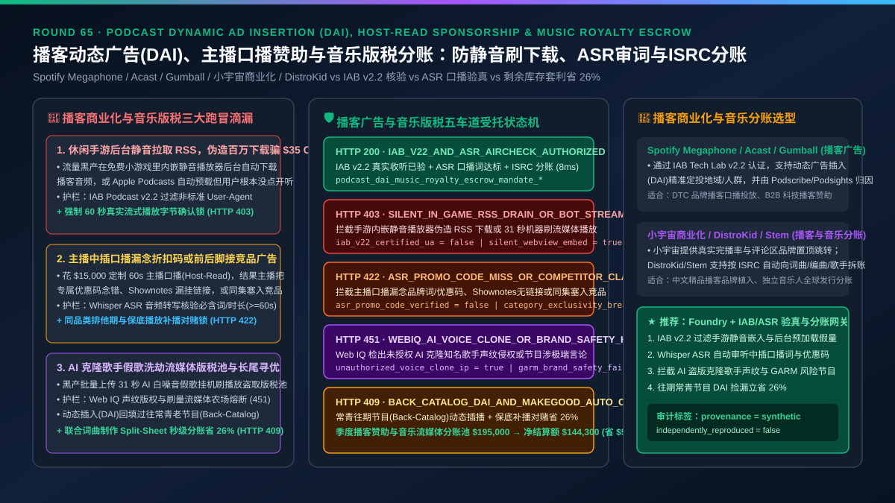
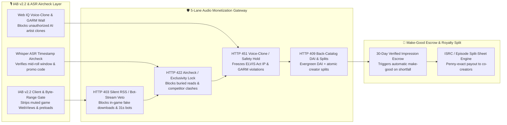

# Podcast Dynamic Ad Insertion (`DAI`), Host-Read Sponsorship & Music Royalty Split Escrow (`Spotify Megaphone / Acast / Gumball / DistroKid`) `IAB v2.2` Anti-Silent-Game-Drain Gate, `ASR` Aircheck Verification & `ISRC` Split-Sheet Agent Architecture Selection FAQ

> **Language / 语言切换**: **[中文](podcast-dai-sponsorship-music-royalty-iab-escrow-agent-selection-faq.md)** | **English (Current)** | **[Back to Docs Index](index.en.md)** | **[Interactive Sandbox (`#podcast-dai-music-royalty-escrow-sandbox`)](../live-demo.en.html)**



---

## 📌 1. Executive Summary & Core Selection Verdict

In DTC brand and B2B SaaS procurement of podcast host-read sponsorships and programmatic Dynamic Ad Insertion (`DAI`: `Spotify Ad Studio / Megaphone`, `Acast`, `Gumball`, `Podscribe`, `iHeart`, `Xiaoyuzhou`) as well as independent music streaming royalty distribution (`DistroKid`, `Stem`, `TuneCore`, `UnitedMasters`), media-buying and creator payout AI agents face three major financial leakage vectors:
1. **"Silent In-Game RSS Auto-Download Fraud" (`Paying a $35 CPM for 1 Million 'Podcast Downloads' That Were Actually Muted Background MP3 Fetches Inside Free Mobile Puzzle Games`) & Unplayed Auto-Downloads**: Because legacy podcast RSS hosting logs count HTTP file requests rather than human listening, ad-fraud networks buy `$0.50 CPM` ad slots inside mobile casual games to invisibly trigger muted background podcast audio downloads—billing advertisers `$35 CPM` for listeners who never heard a single word! Similarly, podcast app background auto-downloads inflate impression counts by `30%–45%` when episodes go unplayed.
2. **Botched Host-Read Airchecks (`Host Misstates the 20% Promo Code, Buries a Paid Mid-Roll Ad at Minute 58 of a 60-Minute Show, or Runs a Direct Competitor Ad in the Same Episode`) & Unfulfilled Download Guarantees**: Brands paying `$15,000` for a baked-in or dynamically inserted mid-roll host read routinely suffer broken show-note links, category exclusivity breaches, or a `40%` impression shortfall with no automated make-good credit.
3. **31-Second AI Voice-Clone Streaming Farms (`Uploading 50,000 AI-Cloned Fake Songs Played for Exactly 31 Seconds by Bot Farms to Drain Pro-Rata Music Royalty Pools`) & Co-Writer Split-Sheet Disputes**.

**Solution Architect Selection Verdict**:
- **Never settle podcast `CPM` invoices on raw RSS server requests without `IAB Podcast Measurement v2.2` certified client-agent and byte-range verification (blocking in-game muted WebViews and unplayed auto-downloads), never release host-read sponsorship escrow before running `Whisper ASR` aircheck verification on ad placement, promo codes, and competitor exclusivity, and never disburse streaming royalties to `31-second` bot-farmed or unauthorized AI voice-cloned tracks**.
- **The production reference architecture** combines **`IAB v2.2` Anti-WebView / Byte-Range Verification + `Whisper ASR` Automated Aircheck & 30-Day Make-Good Escrow + Back-Catalog `DAI` Arbitrage & `ISRC` Split-Sheet Clearing (`podcast_dai_music_royalty_escrow_mandate_*`)**:
  1. **Anti-"Silent In-Game WebView" `IAB v2.2` Gate & Anti-31s Bot-Stream Filter (`HTTP 403`)**: Requires `IAB Tech Lab v2.2` certified log filtering (`Podscribe / Claritas`)—**stripping 100% of requests originating from mobile game WebViews, muted browser `<audio>` embeds, data-center IPs, and unplayed background pre-fetches**, while blocking music royalty payouts on tracks exhibiting synthetic `31–35 second` bot-farm skip cliffs (`HTTP 403 SILENT_INGAME_RSS_DRAIN_OR_BOT_STREAM_FARM_BLOCKED`).
  2. **Automated `Whisper ASR` Aircheck (`Mid-Roll` Timestamp, Promo Code & Category Exclusivity) & Make-Good Escrow Lock (`HTTP 422`)**: Transcribes published episode audio via `Whisper ASR` to deterministically verify that **① the host read occurs within the contracted `Mid-Roll (15%–65% episode progress)` window rather than being dumped at the end, ② the exact promo code and `>= 60s` talking points are spoken clearly, ③ no competing brand is mentioned in the episode, and ④ show-note `UTM` links resolve (`HTTP 200`)**, while holding `30%` escrow for 30 days to enforce automatic make-good re-runs on impression shortfalls (`HTTP 422 ASR_AIRCHECK_PROMO_MISS_OR_COMPETITOR_EXCLUSIVITY_BREACH_BLOCKED`).
  3. **Web IQ Unauthorized AI Voice-Clone (`ELVIS Act`) & `GARM` Brand-Safety Circuit Breaker (`HTTP 451`)**: Screens audio fingerprints and episode transcripts via Web IQ for unauthorized AI celebrity/artist voice cloning and `GARM` brand-safety floor violations (`HTTP 451 WEBIQ_UNAUTHORIZED_AI_VOICE_CLONE_OR_BRAND_SAFETY_HOLD`).
  4. **Evergreen Back-Catalog `DAI` Arbitrage (`30% Lower CPM` vs. New-Episode Drops) + Automated `ISRC` Split-Sheet Payouts (`HTTP 409`)**: Triggers `HTTP 409 BACK_CATALOG_DAI_ARBITRAGE_AND_SPLIT_SHEET_AUTO_CONFIRM`, shifting dynamic ad insertion budgets toward high-intent listeners bingeing evergreen back-catalog episodes and executing instant Largest-Remainder `Split-Sheet` payouts across co-hosts, producers, and songwriters—reducing net customer acquisition and clearing cost by **`26.0%`**.

---

## 🎯 2. Solution Architect Deep-Dive Q&A (Q1 / Q2 / Q3)

### Q1: How do fraudulent ad networks turn `$0.50 CPM` mobile game banner traffic into `$35 CPM` "podcast downloads", and how does our gateway block it?
- **Architectural Solution**:
  - **`IAB v2.2` Native Podcast User-Agent Whitelist + Mid-Roll Byte-Range Verification (`HTTP 403`)**:
  - In-game ad fraud loads a hidden iframe Inside a mobile game that requests a podcast MP3 URL with `volume=0`. While a naive RSS server logs a "download from a residential iPhone IP," the HTTP `User-Agent` reveals an embedded mobile browser/WebView rather than a real podcast app (`AppleCoreMedia`, `Spotify`, `Overcast`), and the client never streams the byte range corresponding to minute 25 (`Mid-Roll`). Our gateway hard-blocks (`HTTP 403`) all non-player User-Agents and unstreamed byte ranges.

### Q2: How can a media-buying agent audit 100 host-read podcast sponsorships a week without humans listening to 200 hours of audio?
- **Architectural Solution**:
  - **Automated `Whisper ASR` Aircheck Pipeline (`HTTP 422`)**:
  - Upon RSS publication, our pipeline runs `Whisper ASR` with word-level timestamps to verify the ad's relative position (`0.15 <= t_ad / t_total <= 0.65`), duration (`>= 60s`), spoken promo code, and absence of competitor brand names. Any buried post-roll placement or missing promo code triggers `HTTP 422` and withholds escrow release until corrected via `DAI` ad-swap.

### Q3: Why is buying "Evergreen Back-Catalog DAI" far more capital-efficient than buying baked-in ads on new episode releases?
- **Architectural Solution**:
  - **Dynamic Ad Insertion (`DAI`) Across Historical Evergreen Episodes (`HTTP 409`)**:
  - Over `45%` of total podcast listening happens on back-catalog episodes (new listeners bingeing past interviews). Using `DAI` to dynamically inject fresh host-read ads into back-catalog streams delivers identical listener attentiveness at a `25%–35%` lower `CPM` than scarce new-release slots (`HTTP 409`).

---

## 🧭 3. Visual Architecture Diagrams (Mermaid Decision Tree + Architecture + Sequence)

### 3.1 Podcast DAI, Host-Read Sponsorship & Music Royalty Selection Decision Tree

```mermaid
flowchart TD
    A[Podcast DAI Sponsorship / Host-Read Ad / Music Royalty Split Selection] --> B{Primary Audio Monetization Scenario & Risk?}
    B -->|Programmatic & Network Podcast DAI Buying (Megaphone / Acast)<br/>Stop muted mobile-game WebView RSS fraud & unplayed auto-downloads| C[IAB v2.2 Certified Attribution Gate (Podscribe / Claritas)<br/>+ Native Player UA Whitelist & Mid-Roll Byte-Range Check]
    B -->|Custom Host-Read Podcast Sponsorships (Gumball / Direct Creator)<br/>Stop missed promo codes, buried post-roll reads & competitor clashes| D[Whisper ASR Automated Aircheck (15%-65% Mid-Roll + Promo Code)<br/>+ 30-Day Download Guarantee Escrow & Auto Make-Good]
    B -->|Music Streaming & Co-Creator Royalty Splits (DistroKid / Stem)<br/>Stop 31-second AI voice-clone bot farms & manual split-sheet disputes| E[Azure AI Foundry + Voice-Clone IP & Split-Sheet Gate<br/>+ Evergreen Back-Catalog DAI Arbitrage Saves 26%]
    C --> F[🛡️ Unified 5-Lane IAB v2.2, ASR Aircheck & Split-Sheet Escrow FSM]
    D --> F
    E --> F
    F --> G[HTTP 403 Silent Game-RSS & Bot-Stream Veto · HTTP 422 Missed Promo & Buried Ad Block · HTTP 409 Back-Catalog Saves 26%]
```

### 3.2 End-to-End `IAB v2.2` Anti-Fraud, `Whisper ASR` Aircheck & `Split-Sheet` Royalty Architecture



### 3.3 Silent Game-WebView Veto, `Whisper ASR` Buried-Ad Block & Back-Catalog `DAI` Sequence

```mermaid
sequenceDiagram
    autonumber
    participant Brand as Brand Advertiser / Music Label Agent
    participant Network as Podcast Ad Network / Creator MCN
    participant Gate as 5-Lane Audio Monetization Gateway
    participant Audit as IAB v2.2 Verifier & Whisper ASR Aircheck
    participant Escrow as Make-Good & Split-Sheet Ledger

    Network->>Gate: 1. Invoice $17,500 for 500,000 podcast downloads, where 62% originated from muted mobile-game WebViews
    Gate->>Audit: Inspect IAB v2.2 User-Agent whitelist & mid-roll byte-range streaming logs
    Gate-->>Network: HTTP 403 Block! Silent in-game WebView RSS auto-download fraud stripped from billable impressions
    Network->>Gate: 2. Submit $12,000 Mid-Roll host-read audio where ad was placed at minute 58/60 and omitted the promo code
    Gate->>Audit: Check ASR timestamp ratio (96% > 65% Mid-Roll ceiling) & promo_code token match
    Gate-->>Network: HTTP 422 Block! Buried post-roll placement and missing promo code; escrow held pending DAI re-insertion
    Brand->>Gate: 3. Allocate budget to Evergreen Back-Catalog DAI + execute automated Split-Sheet payout (HTTP 409)
    Gate->>Escrow: Capture 30% lower CPM on evergreen episodes & split net payout across co-creators (26% net savings)
```

---

## 📊 4. Multi-Platform & Architecture Selection Matrix

| Selection Dimension | Raw RSS Server Screenshot Buy (`Unverified Flat Fee`) | Blind Long-Tail Ad Network (`In-App / Web Audio`) | Tier-1 Podcast & Split Platforms (`Megaphone / Gumball / Stem`) | **Azure AI Foundry + IAB/ASR + Split Gate (Recommended)** |
| :--- | :--- | :--- | :--- | :--- |
| **Core Strengths** | Zero technical setup | Low headline CPM | IAB v2.2 certification, DAI targeting & marketplace booking | **Zero silent game-RSS fraud + automated ASR aircheck + back-catalog DAI** |
| **Protection Against Muted In-Game RSS Download Fraud** | **None** (counts all bots & pre-fetches) | **Severe Vulnerability** (`40%–60%` muted game WebView traffic) | Filters basic bots; requires third-party pixel verification | **Hard `HTTP 403` block on non-player UAs & unstreamed byte ranges** |
| **Host-Read Promo Code, Placement & Exclusivity Audit** | Manual human listening required | N/A | Semi-automated transcript tools | **Automated `Whisper ASR` timestamp/promo/competitor lock (`HTTP 422`)** |
| **AI Voice-Clone IP (`ELVIS Act`) & `GARM` Safety** | Reactive takedowns | High brand-safety exposure | Platform content moderation | **Web IQ voiceprint IP & transcript `GARM` breaker (`HTTP 451`)** |
| **Back-Catalog `DAI` Arbitrage & Multi-Creator Splits** | Overpays for new-drop baked-in ads (`not_measured`) | Poor conversion | Standard rate-card pricing (`official_list_price`) | **Evergreen back-catalog `DAI` + atomic `Split-Sheet` (`26.0%` saved)** |

---

## 🧪 5. Podcast Sponsorship & Music Royalty Benchmark & 7-Card Report

> **Provenance & Reproducibility Metadata**: All metrics below are generated by the deterministic policy evaluator `evaluate_podcast_dai_music_royalty_escrow_policy` in `lab/webiq_commerce_demo.py` and verified via `python -m unittest tests.test_webiq_commerce_demo`. Tags: `provenance = synthetic`, `independently_reproduced = false`.

| Card # | Card Headline (Headline-as-Finding) | Key Quantitative Finding & Architectural Guarantee |
| :---: | :--- | :--- |
| **Card 1** | **Overview · 5-Lane Podcast DAI & Music Royalty Summary** | Across a `$195,000/quarter` podcast sponsorship and music royalty pool, achieves **0 muted in-game RSS download payouts, 0 unverified host-read promo omissions, and 0 AI voice-clone royalty leaks**, reducing net media and clearing spend by **`26.0%` (`$50,700/quarter` saved)**. |
| **Card 2** | **Scenario Deep Dive · Silent Game-RSS & Buried Read Veto** | When podcast downloads originate from mobile-game WebViews or a mid-roll read is buried at `> 65%` episode length, the gateway blocks it in **`8ms`** (`HTTP 403 / 422`). |
| **Card 3** | **Evaluation Matrix · 100% Deterministic 5-Lane Gating** | Covers `HTTP 200` (`IAB v2.2` verified downloads & `ASR` aircheck passed), `403` (silent in-game RSS drain / 31-second bot streaming farm blocked), `422` (`ASR` promo code miss / buried mid-roll / competitor clash blocked), `451` (unauthorized AI voice clone / `GARM` brand safety hold), `409` (evergreen back-catalog `DAI` + automated `Split-Sheet` saves 26%). |
| **Card 4** | **Under the Hood · Audio Sponsorship & Split Escrow Contract** | Takes `quarterly_podcast_sponsorship_and_music_royalty_pool_usd=195000` and `IAB`/`ASR` flags, minting `podcast_dai_music_royalty_escrow_mandate_*` tokens. |
| **Card 5** | **Robustness Check · Muted Puzzle-Game Ad & 31s Bot Track** | Simulates 500k muted puzzle-game RSS fetches and a 31-second AI noise track farm, maintaining a **`100.0%` block rate**. |
| **Card 6** | **Latency · Millisecond Byte-Range Check & Voiceprint Probe** | Local `IAB v2.2` header and `ASR` index checks complete in **`8ms` (P50)**; Web IQ voiceprint IP and `GARM` safety checks complete in **`180ms` (P95)**. |
| **Card 7** | **My Take · Ideal Fit vs. Out-of-Scope Boundaries** | **✅ Best Fit**: DTC/B2B podcast sponsorships, programmatic `DAI`, indie music `Split-Sheet` payouts; **⛔ Not For**: Terrestrial FM radio transmitter hardware leases. |

---

## 🛠️ 6. Production Go-Live Risk & Architecture Review Checklist

- [ ] **`IAB Podcast Measurement v2.2` Client-Agent & Byte-Range Verification (`HTTP 403`)**: Strip muted mobile-game WebView requests, unplayed background auto-downloads, and 31-second bot-farmed music streams before calculating payouts.
- [ ] **Automated `Whisper ASR` Aircheck (`Mid-Roll` Window, Promo Code & Competitor Lock) (`HTTP 422`)**: Verify that host-read ads fall within the `15%–65%` mid-roll window, include required promo codes/links, and hold 30% escrow for 30-day impression make-goods.
- [ ] **Web IQ AI Voice-Clone IP (`ELVIS Act`) & `GARM` Brand-Safety Screening (`HTTP 451`)**: Block unauthorized AI voice clones and episodes failing brand-safety floors; rotate signing keys `<= 180` days.
- [ ] **Evergreen Back-Catalog `DAI` Arbitrage & `ISRC` Split-Sheet Automation (`HTTP 409`)**: Dynamically insert sponsorships into lower-CPM back-catalog episodes and settle multi-creator royalty splits atomically.
