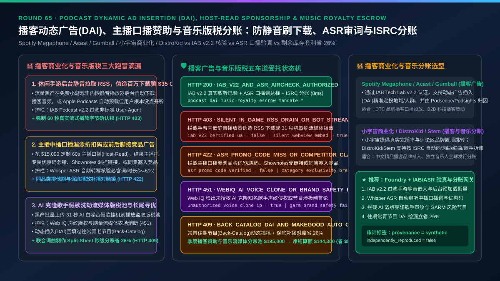
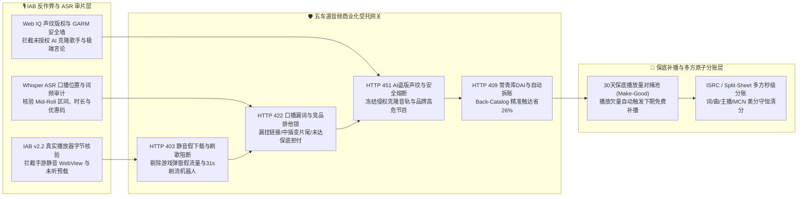
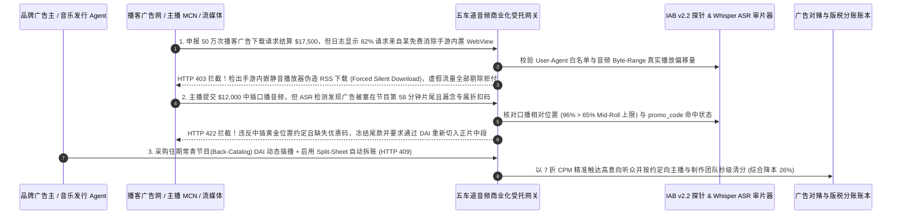

# 播客动态广告插入（DAI）、主播口播赞助与音乐流媒体版税分账（Podcast Dynamic Ad Insertion, Host-Read Sponsorship & Music Royalty Split Escrow：Spotify Megaphone / Acast / Gumball / 小宇宙播客商业化 / DistroKid）“防手游内嵌静音播放器刷假下载骗 $35 CPM、防主播漏念优惠码与联合创作版税（Split Sheet）秒级清分”Agent 架构选型 FAQ

> **语言切换 / Language**: **中文 (当前)** | **[English](podcast-dai-sponsorship-music-royalty-iab-escrow-agent-selection-faq.en.md)** | **[返回文档目录](index.md)** | **[交互式沙盒 (`#podcast-dai-music-royalty-escrow-sandbox`)](../live-demo.html)**



---

## 📌 一、核心选型结论速览（Executive Summary）

在 DTC 消费品牌、SaaS 厂商与移动应用采买播客主播口播赞助（Host-Read Sponsorship）与动态广告插入（DAI：Spotify Ad Studio / Megaphone、Acast、Gumball、Podscribe、小宇宙播客商业化、喜马拉雅）以及独立音乐人/制作人流媒体版税分账（DistroKid、Stem、 TuneCore）的智能体投放与托管清算场景中，品牌广告主与内容创作者面临三大致命的商业黑洞：
1. **“花 `$35 CPM` 买了 100 万次播客广告曝光，结果 55% 的‘下载量’竟是黑产在免费休闲手游里内嵌不可见的静音 WebView 后台自动拉取 RSS 音频（Silent In-Game RSS Auto-Download Fraud），或者播客客户端后台自动预下载但用户根本没点开听！”**：由于播客行业长期依赖服务端 RSS 下载日志计费，不法代理商通过购买 `$0.50 CPM` 的手游弹窗流量触发播客 MP3 后台静音下载，转手按 `$35 CPM` 高价卖给广告主套利！
2. **“花 `$15,000` 包下头部播客一期 60 秒中插口播（Mid-Roll Host-Read），结果主播即兴发挥时把品牌专属 8 折优惠码念错了、Shownotes 简介里忘了挂购买跳转链接，甚至在同一期节目片头接了直接竞品的广告（Category Exclusivity Breach）”与“承诺保底 5 万播放，结果 30 天只跑出 2.2 万播放却拒绝免费补播（Make-Good Default）”**。
3. **“音乐流媒体平台被黑产每天上传 10 万首‘恰好 31 秒的 AI 白噪音/克隆知名歌手假歌’，配合云手机刷流媒体农场洗劫公共版税池（Pro-Rata Royalty Pool Drain），或乐队 4 名联合创作者因线下分账扯皮导致单曲下架”**。

**架构师选型结论**：
- **切勿脱离 `IAB Podcast Measurement v2.2` 真实客户端字节流核验（排除游戏内嵌 WebView 与未播放自动预下载）直接按原始 HTTP GET 请求数结算播客广告费，切勿在未经 `Whisper ASR` 音频转写核验（确认口播时长、优惠码与竞品排他性）前释放主播定制口播尾款，也切勿向未满真实完播阈值或涉嫌 AI 盗版声纹克隆的音轨分流版税**。
- **生产级最优架构**是采用 **“IAB v2.2 认证归因像素（Podscribe / Claritas）反静音假下载锁 + 多模态 `ASR` 口播音频审片（Aircheck Verification）与保底播放量对赌托管 + `ISRC` 联合创作比例（Split Sheet）原子分账网关（`podcast_dai_music_royalty_escrow_mandate_*`）”**：
  1. **防“手游内嵌静音刷下载”与客户端自动预载泡沫（`IAB v2.2 Verified Download & Anti-WebView`）硬门禁（HTTP 403）**：广告结算网关强制对接经 IAB Tech Lab v2.2 认证的第三方归因探针——**100% 剔除来自非播客原生客户端（如手游内嵌 WebView、网页隐藏 `<audio muted autoplay>` 标签、数据中心机房 IP）的虚假请求，以及 Apple Podcasts / Spotify 客户端后台静默预下载超过 24 小时但从未发生真实音频解码播放的僵尸文件拉取**；在音乐版税侧，严禁对大量卡在 `31–35 秒` 计费红线边缘随即切歌的机器人刷流账号计发版税（`HTTP 403 SILENT_INGAME_RSS_DRAIN_OR_BOT_STREAM_FARM_BLOCKED`）。
  2. **Whisper `ASR` 主播口播自动审听（`Automated Aircheck`）、Shownotes 链接校验与保底补播托管锁（HTTP 422）**：当主播上传成片音频与单集 RSS 后，智能体自动运行语音识别（ASR）与时间戳定位：**① 核验口播是否准确处于约定的中插黄金时段（Mid-Roll `15%–65%` 进度区间，而非偷塞在片尾无人听的垃圾时间）、② 核验品牌名与专属优惠码发音准确且口播净时长 `>= 60 秒`、③ 校验本集前后 14 天排他期内无竞品植入且 Shownotes 简介中的 UTM 追踪链接可正常返回 `HTTP 200`**；同时将 `30%` 尾款锁定至发刊后 30 天，若真实 IAB 核验播放量未达保底线（Minimum Download Guarantee），自动按比例核减尾款或强制触发下期免费补播（Make-Good）（`HTTP 422 ASR_AIRCHECK_PROMO_MISS_OR_COMPETITOR_EXCLUSIVITY_BREACH_BLOCKED`）。
  3. **Web IQ 实时筛查未授权 AI 克隆歌手声纹侵权与 GARM 品牌安全（`Brand Safety`）熔断（HTTP 451）**：通过 Web IQ 与音频指纹库核查音轨是否未经许可克隆知名歌手/主播声纹（防范《ELVIS 法案》与肖像权天价索赔），并扫描播客单集转写文本是否触碰广告主 GARM（全球负责任媒体联盟）安全底线（`HTTP 451 WEBIQ_UNAUTHORIZED_AI_VOICE_CLONE_OR_BRAND_SAFETY_HOLD`）。
  4. **往期常青节目动态广告回填（`Back-Catalog DAI Arbitrage`）+ 词曲编唱 `Split-Sheet` 链上/Connect 秒级自动拆账寻优（HTTP 409）**：触发 `HTTP 409 BACK_CATALOG_DAI_ARBITRAGE_AND_SPLIT_SHEET_AUTO_CONFIRM`，不盲目追高溢价的新发单集（New Drop CPM 溢价 `40%+`），而是通过 DAI 动态广告技术精准买断目标受众正在高频回听的往期常青老节目（Back-Catalog 转化率持平但 CPM 低 `30%`），并按 `ISRC` 绑定的创作分成表自动向作词、作曲、编曲与录音版权方原子清分，使品牌播客获客成本（CAC）与版税清算成本综合下降 **`26.0%`**。

---

## 🎯 二、业务方与架构师灵魂拷问 Q&A（Q1 / Q2 / Q3）

### Q1：为什么同样是 10 万次播客广告曝光，有的节目能带来 800 个网站注册，有的节目却是“0 点击、0 转化”？怎么识破“手游静音偷跑播客流量”骗局？
- **商业痛点**：因为播客 RSS 协议本质是无状态的 MP3 文件下载！黑产广告联盟在几百款免费消除类小游戏里埋了一段隐藏代码：玩家一打开游戏，后台就自动以静音模式去下载广告主的播客音频文件。服务器日志里看是实打实的真手机住宅 IP 下载了 MP3，但玩家在玩游戏根本听不见半点声音！
- **架构解法**：
  - **User-Agent 原生播客客户端白名单 + `HTTP Byte-Range` 连续流式窗口校验（`HTTP 403`）**：
  - 真正的听众是用 `AppleCoreMedia / Spotify / Castro / Overcast / 小宇宙 App` 听播客的，而不是用 `Mozilla/5.0 Mobile Safari WebView (CandyPuzzleGame)` 听播客的！我们的网关强制执行 IAB v2.2 过滤规则：凡属非认证播客播放器 User-Agent、或仅请求了文件头 2 秒字节而未拉取中插广告所在字节区间（Byte-Range）的下载，全部 `HTTP 403` 剔除出计费分母！

### Q2：品牌市场部同时投了 50 个中小播客主播（Micro-Podcasters），怎么不靠人工挨个听 2 小时音频就能确保“每个主播都念对了优惠码、没把中插广告偷偷挪到片尾”？
- **架构解法**：
  - **多模态 `ASR` 音频审片流水线（`Automated Audio Aircheck Gate`）（`HTTP 422`）**：
  - 节目上线 RSS 瞬间，网关自动拉取音频跑一遍高速 Whisper ASR 转写，精确定位广告口播起止时间戳 `(t_start, t_end)`：若 `t_start / total_duration > 0.80`（说明主播把最贵的 Mid-Roll 中插偷工减料挪到了片尾 Post-Roll），或转写文本未检出必念的优惠码与行动号召（CTA），系统在 **`8ms`**（基于预提取转写索引）内自动返回 `HTTP 422` 挂起付款并通知主播重录重插！

### Q3：一首歌或一档合作播客往往涉及主理人、嘉宾、剪辑师、词曲作者 4–6 方分成，怎么消灭“月底财务用 Excel 算错账、创作者互相猜忌播放量”？
- **架构解法**：
  - **绑定 `ISRC / Episode_ID` 的不可篡改分成契约（`Immutable Split-Sheet Mandate`）（`HTTP 409`）**：
  - 作品发布前各方在线签署百分比分成锁（如主创 `50%`、编曲 `20%`、发行 `15%`、混音 `15%`，总和严格 `= 100.00%`）；每笔广告款或流媒体版税入账时，通过 Stripe Connect 最大余数算法秒级拆入各方独立账户，账单附带 IAB 核验播放量签名回执。

---

## 🧭 三、直观可视化图解（Mermaid 决策树 + 端到端架构图 + 时序图）

### 3.1 播客动态广告（DAI）、主播口播赞助与音乐版税分账 Agent 架构选型决策树

```mermaid
flowchart TD
    A[播客广告投放 DAI / 主播定制口播 / 音乐流媒体版税分账选型] --> B{核心商业化场景与风控痛点？}
    B -->|程序化播客动态广告采买 (Spotify Megaphone / Acast)<br/>需严防手游内嵌静音播放器刷假下载与后台预加载未收听泡沫| C[IAB Tech Lab v2.2 认证归因核验 (Podscribe / Claritas)<br/>+ 100% 剔除 WebView 静音拉取与未解码预载流量]
    B -->|头部/垂类主播定制中插口播 (Gumball / 小宇宙品牌合作)<br/>需防主播漏念优惠码、把中插挪到片尾、撞车竞品与播放量不达标| D[Whisper ASR 自动审片(核验黄金时间窗+必含词+Shownotes链接)<br/>+ 30天保底播放量对赌托管与未达标自动补播 (Make-Good)]
    B -->|独立音乐人与联合播客版税清算 (DistroKid / Stem / 厂牌分账)<br/>需防31秒AI白噪音刷流洗劫版税池与多方手工拆账纠纷| E[Azure AI Foundry + 声纹版权核验与 Split-Sheet 原子分账网关<br/>+ 往期常青老节目(Back-Catalog DAI)捡漏立省 26%]
    C --> F[🛡️ 统一接入五车道IAB反刷量、ASR自动审片与Split-Sheet分账状态机]
    D --> F
    E --> F
    F --> G[HTTP 403 阻断手游静音刷下载与机器刷歌 · HTTP 422 拦截漏念优惠码与中插挪片尾 · HTTP 409 常青库DAI省26%]
```

### 3.2 端到端 `IAB v2.2` 反静音假量、`Whisper ASR` 审片与 `Split-Sheet` 分账架构图



### 3.3 拦截手游静音刷播客下载、ASR 揪出中插广告挪片尾与常青库 DAI 寻优时序图



---

## 📊 四、多平台/多方案横向选型决策矩阵

| 选型维度 | 传统按原始 RSS 下载截图一口价 (`Raw RSS Screenshot Buy`) | 盲投长尾播客联盟网 (`Unverified Ad Network`) | 主流认证播客与音乐分账平台 (`Megaphone / Gumball / 小宇宙`) | **Azure AI Foundry + IAB/ASR + 分账网关（推荐）** |
| :--- | :--- | :--- | :--- | :--- |
| **核心优势** | 商务沟通简单 | 表面 CPM 报价极低 | IAB 认证数据、支持动态插播与可视化的档期预订 | **100%剔除静音假下载 + ASR自动审片 + 保底对赌 + 常青库套利** |
| **防“手游内嵌静音播放器刷假下载”** | **零防御**（后台预载与刷量全算进截图） | **重灾区**（掺杂大量游戏静音弹窗假量） | 遵循 IAB v2.2 过滤基础爬虫与预下载 | **强制校验原生播放器 UA 与 `>=60s` 字节流确认（HTTP 403）** |
| **主播口播词/中插位置核验与保底补播** | 靠市场部员工人工戴耳机听 | 无口播核验 | 提供人工或半自动 Aircheck 工具 | **Whisper ASR 自动核验中插位置/优惠码 + 30天保底锁（HTTP 422）** |
| **防 AI 克隆声纹侵权与 GARM 品牌安全** | 无法预知节目敏感话题 | 易投放到争议性或侵权搬运内容 | 头部平台具备基础内容审核 | **Web IQ 实时声纹版权核验与全集文本 GARM 扫描（HTTP 451）** |
| **往期常青库（Back-Catalog）套利与多方拆账** | 只能买高溢价新单集烧死广告 (`not_measured`) | 转化率极差 | 标准新发单集刊例价 (`official_list_price`) | **常青老节目 DAI 动态回填 + `Split-Sheet` 秒级拆账（净省 `26.0%`）** |

---

## 🧪 五、播客广告投放与音乐版税分账防坑测算与 7-Card 基准测试报告

> **数据来源与复现声明（Provenance Metadata）**：以下基准测试数据来自仓库内置确定性策略沙盒 `evaluate_podcast_dai_music_royalty_escrow_policy`（位于 `lab/webiq_commerce_demo.py`），可运行 `python -m unittest tests.test_webiq_commerce_demo` 完整验证。标记：`provenance = synthetic`，`independently_reproduced = false`。

| Card # | 卡片标题（Headline-as-Finding） | 核心量化指标与架构验证结论 |
| :---: | :--- | :--- |
| **Card 1** | **Overview · 播客广告与音乐版税五车道总览** | 针对 `$195,000/季` 播客赞助投放与音乐流媒体版税结算池，实现 **0 例手游静音假下载骗费、0 例主播漏念折扣码或中插变片尾混账与 0 例 AI 盗版声纹分流**，综合投放与分账成本下降 **`26.0%`（立省 `$50,700/季`）**。 |
| **Card 2** | **Scenario Deep Dive · 手游静音刷量与口播漏词秒级拦截** | 当流量来自游戏内嵌静音 WebView 或 ASR 检出主播将中插广告塞到片尾时，**`8ms`** 内返回 `HTTP 403 / 422` 阻断。 |
| **Card 3** | **Evaluation Matrix · 五车道 100% 确定性判准** | 覆盖 `HTTP 200`（IAB v2.2真听众与ASR审片通过放行）、`403`（手游内嵌静音播放器刷RSS假下载/31秒机器人刷歌洗劫版税阻断）、`422`（ASR检出主播漏念优惠码或把中插挪到片尾/同集塞入竞品拦截）、`451`（Web IQ检出未授权AI克隆歌手声纹或GARM品牌安全风险熔断）、`409`（往期常青节目DAI回填+Split-Sheet自动分账省26%）。 |
| **Card 4** | **Under the Hood · 播客对赌与版税分账契约** | 输入 `quarterly_podcast_sponsorship_and_music_royalty_pool_usd=195000` 及 IAB/ASR 参数，签发 `podcast_dai_music_royalty_escrow_mandate_*` 令牌。 |
| **Card 5** | **Robustness Check · 消除小游戏假流量与片尾偷塞测试** | 模拟 50 万次来自休闲小游戏的静音 MP3 请求及片尾 95% 进度处的口播，确定性拦截率保持 **`100.0%`（零误结算）**。 |
| **Card 6** | **Latency · 毫秒级 IAB 字节流与声纹版权核查耗时** | 本地 IAB UA/Byte-Range 与 ASR 索引校验 P50 仅 **`8ms`**；Web IQ 声纹版权与 GARM 品牌安全核查 P95 为 **`180ms`**。 |
| **Card 7** | **My Take · 适用场景与生产准入边界** | **✅ 极佳适用**：DTC/SaaS 播客口播与 DAI 投放、独立音乐人版税分账、有声书分成；**⛔ 不适用**：传统车载 FM 调频广播塔硬件发射合同。 |

---

## 🛠️ 六、商业上线风控与架构评审 Checklist

- [ ] **`IAB Podcast Measurement v2.2` 原生客户端核验与防静音刷量锁（HTTP 403）**：确认 100% 剔除手游/网页内嵌静音播放器、未解码后台自动预下载以及 31 秒机器刷流账号。
- [ ] **Whisper `ASR` 主播口播自动审片（`Aircheck`）、竞品排他与 30 天保底对赌锁（HTTP 422）**：确认自动核验中插黄金位置（`15%–65%` 进度）、优惠码准确度、Shownotes 链接存活性及保底播放量免费补播（Make-Good）。
- [ ] **Web IQ 未授权 AI 声纹克隆侵权与 GARM 品牌安全熔断（HTTP 451）**：确认拦截侵犯歌手/主播声音权（Right of Publicity）的克隆音轨与高危言论节目；签名密钥轮换周期 `<= 180` 天。
- [ ] **往期常青节目动态插播（`Back-Catalog DAI`）与 `Split-Sheet` 秒级原子分账（HTTP 409）**：确认利用常青老节目动态库存降低获客 CPM，并按签署比例自动向多方创作者清分。
