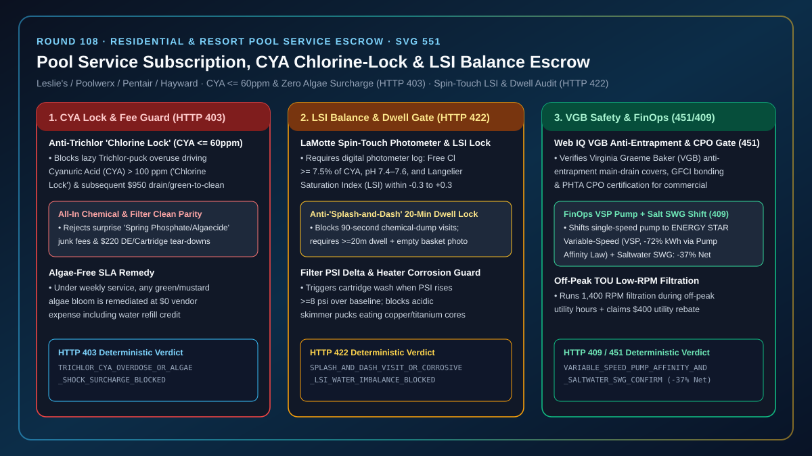
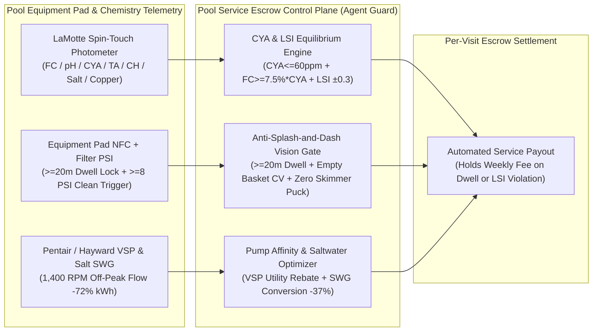

# Pool Service Subscription, `CYA` Chlorine-Lock & Variable-Speed Pump Escrow (`Leslie's / Poolwerx / Pentair / Hayward`) Agent Architecture Selection FAQ

> **Target Audience**: **Cloud & AI Solution Architects** designing AI subscription verification, digital water-chemistry auditing, and energy-optimization agents for residential pool-service marketplaces, resort/HOA aquatic facilities, and smart-pool IoT ecosystems (`Pentair IntelliCenter / Hayward OmniLogic / Fluidra iAquaLink`).  
> **Core Pain Points Solved**: Eliminates the four most expensive failure modes in recurring pool maintenance subscriptions: **(1) Trichlor `CYA` "Chlorine Lock" & `$950` Green-to-Clean Extortion (lazy technicians relying exclusively on stabilized `Trichlor` pucks until Cyanuric Acid `CYA` exceeds `150 ppm`—rendering free chlorine chemically inactive so the pool turns swamp-green in July, then billing the homeowner `$950` for an emergency drain, acid wash, and refill), (2) `$4,200` Pool Heater Acid-Corrosion Ruin (dropping `pH 2.8` acidic Trichlor tablets directly into the skimmer basket so stagnant acid water backs up into the copper/titanium heat exchanger when the pump turns off), (3) 90-Second "Splash-and-Dash" Visits (charging `$180/month` for "full brush, vacuum, and basket service" while security cameras show the tech dumping a jug of bleach and leaving in 85 seconds), and (4) `$240/Month` Single-Speed Pump Electricity Waste**.



---

## 📌 1. Executive Summary

1. **Hard Block on `Trichlor` `CYA` Overdose (`<=60 ppm`), Surprise "Phosphate/Algaecide" Upsells & Algae Remediation Fees (`HTTP 403`)**: Every pound of `Trichlor` (`Trichloroisocyanuric acid`) added to a 10,000-gallon pool adds `6.5 ppm` of chlorine along with **`4.0 ppm` of non-evaporating Cyanuric Acid (`CYA`) stabilizer**. Once `CYA` climbs past `100 ppm`, over `97%` of hypochlorous acid (`HOCl`) is bound up in "Chlorine Lock." The Agent enforces a strict contract guardrail: **water `CYA` is capped at `<=60–80 ppm` (mandating unstabilized liquid sodium hypochlorite or saltwater chlorination `SWG` once stabilizer is in range), seasonal phosphate/conditioner junk fees are blocked, and any algae bloom occurring during active weekly service must be remediated at `$0` vendor expense**. Violations trigger **`HTTP 403 TRICHLOR_CYA_OVERDOSE_OR_ALGAE_SHOCK_SURCHARGE_BLOCKED`**.
2. **`LaMotte Spin-Touch` Photometer (`FC >= 7.5% CYA`, `LSI ∈ [-0.3, +0.3]`) & `>=20-Minute` Dwell Proof Gate (`HTTP 422`)**: To defeat test-strip guesswork and 90-second "Splash-and-Dash" visits, the Agent requires two physical proofs before releasing weekly escrow: (a) **Digital Photometer & Langelier Saturation Index (`LSI`) Lock**: the technician must upload a timestamped Bluetooth `LaMotte WaterLink Spin Touch` 7-parameter log proving **`Free Chlorine >= 0.075 * CYA`**, **`pH 7.4–7.6`**, **`Dissolved Copper == 0.0 ppm`** (proving the heater core is not dissolving), and overall **`LSI` within `-0.30 to +0.30`**; and (b) **Anti-Splash-and-Dash Dwell & Visual Proof**: equipment-pad `NFC` check-in/out must confirm **`>=20 minutes`** on-site dwell time accompanied by photos of the emptied skimmer/pump hair baskets and filter `PSI` pressure gauge. Failures trigger **`HTTP 422 SPLASH_AND_DASH_VISIT_OR_CORROSIVE_LSI_WATER_IMBALANCE_BLOCKED`**.
3. **`ENERGY STAR` Variable-Speed Pump (`VSP` Affinity Law `-72% kWh`) + Saltwater (`SWG`) Conversion Saving 37% (`HTTP 409`)**: By the fluid-mechanics **Pump Affinity Law**, reducing pump shaft speed (`RPM`) by `50%` cuts flow in half but **reduces electrical power consumption by `(0.5)^3 = 87.5%` (`1/8th` power)**! When the Agent detects a legacy single-speed `1.5–2.0 HP` pump or high monthly liquid-chlorine surcharges, it triggers **Aquatic Energy & Chlorination FinOps**: upgrading to an `ENERGY STAR` Variable-Speed Pump (`Pentair IntelliFlo3 VSF` running at `1,400 RPM` during off-peak utility hours with a `$350–$450` utility rebate) paired with a Saltwater Chlorine Generator (`SWG`)—returning **`HTTP 409 VARIABLE_SPEED_PUMP_AFFINITY_AND_SALTWATER_SWG_CONFIRM`** and reducing net quarterly pool operating spend by **37%**.

---

## 🎯 2. Architect & Business Stakeholder Q&A

### Q1: Why does a pool with "high chlorine readings" still turn bright green in mid-summer—and how do unethical vendors monetize this via `$950` drain-and-clean bills?
- **The Chemistry of Cyanuric Acid (`CYA`) Over-Stabilization & the `7.5%` Rule**:
  1. **The `Trichlor` Puck Trap**: 3-inch `Trichlor` tablets are cheap and shelf-stable, so cut-rate pool services use them year-round. While chlorine gas off-gasses and oxidizes organics every day, the Cyanuric Acid (`CYA`) carrier never evaporates. Within 6–8 months, `CYA` exceeds `140–200 ppm`.
  2. **Why `3.0 ppm` Chlorine Fails at High `CYA`**: To prevent green algae, unbound active hypochlorous acid (`HOCl`) requires **Free Chlorine (`FC`) to be maintained at `>=7.5%` of `CYA`**. At `40 ppm CYA`, `3.0 ppm FC` is plenty; at `160 ppm CYA`, you need `12.0 ppm FC` just to keep algae at bay! Standard dip strips still turn purple at `4.0 ppm`, fooling the homeowner until a summer thunderstorm triggers an explosive algae bloom—at which point the vendor charges `$950` to drain the pool and start the cycle over. Our Agent hard-locks `Trichlor` dosing once `CYA` hits `50 ppm`.

### Q2: How does putting chlorine tablets in the skimmer basket destroy a `$4,200` gas or heat-pump pool heater in 36 months?
- **Preventing `pH 2.8` Acid Backflow & Langelier (`LSI`) Etching**:
  1. **Stagnant Acidic Brine in the Plumbing Loop**: `Trichlor` dissolves at a scorching **`pH of 2.8`**. When tablets sit inside the poolside skimmer basket and the circulation pump shuts off overnight, hyper-acidic, high-chlorine water migrates backward into the pump mechanical seal and the heater's cupronickel/titanium heat exchanger, stripping metal ions into the water (which stains plaster blue-green and turns blonde hair green) until the heat exchanger ruptures.
  2. **Zero-Skimmer-Puck Rule & `0.0 ppm` Copper Telemetry**: The Agent prohibits skimmer tablet placement, requires an inline check valve between the heater and any erosion feeder/salt cell, and monitors `Spin-Touch` dissolved copper (`>=0.1 ppm` triggers an immediate `HTTP 422` acid-corrosion alert).

### Q3: How does the Agent stop 90-second "Splash-and-Dash" visits where the technician never brushes the tile line or empties the pump strainer basket?
- **Equipment-Pad `NFC` Dwell Time + Basket CV + Filter `PSI` Tracking**:
  1. **Biofilm Requires Mechanical Brushing**: Algae forms a polysaccharide biofilm on steps and walls that liquid chlorine alone cannot penetrate without mechanical brushing. A 90-second visit that skips brushing guarantees mustard algae within weeks.
  2. **Deterministic 20-Minute Gate**: The technician must tap the equipment-pad `NFC` tag at arrival and departure (`>=20 min` dwell), upload a photo of the clean pump/skimmer baskets, and log the filter pressure gauge (`PSI`). When filter pressure rises `>=8 PSI` above clean baseline, the Agent automatically schedules a cartridge/DE wash.

---

## 🧭 3. Visual Architecture Diagrams (Mermaid)

### 3.1 Pool Maintenance Subscription, `CYA / LSI` Balance & `VSP` FinOps Decision Tree

```mermaid
flowchart TD
    A[Residential / Resort Pool Service & Upgrade Request] --> B{1. CYA Chlorine-Lock Cap, Algae Guarantee & Surcharge Audit}
    B -->|Trichlor Overdose CYA > 80ppm / Seasonal Phosphate Junk Fee or Paid Algae Recovery| C[HTTP 403 Block: TRICHLOR_CYA_OVERDOSE_OR_ALGAE_SHOCK_SURCHARGE_BLOCKED]
    B -->|CYA <= 60ppm Cap + $0 Algae SLA + All-In Chemical Parity| D{2. Spin-Touch Photometer LSI & >=20m Brush/Dwell Gate}
    D -->|Splash-and-Dash (<20m Dwell) / Skimmer Acid Pucks or LSI Outside ±0.3 / FC < 7.5% CYA| E[HTTP 422 Block: SPLASH_AND_DASH_VISIT_OR_CORROSIVE_LSI_WATER_IMBALANCE_BLOCKED]
    D -->|Spin-Touch LSI Balanced + >=20m Dwell + Clean Basket Proof| F{3. Web IQ VGB Drain Cover, GFCI Bonding & CPO Check}
    F -->|Expired/Missing VGB Anti-Entrapment Drain Cover or Unbonded GFCI / Uncertified CPO| G[HTTP 451 Hold: WEBIQ_UNSAFE_VGB_DRAIN_COVER_OR_UNBONDED_GFCI_HAZARD_HOLD]
    F -->|VGB Suction & Electrical Bonding Verified| H{4. Variable-Speed Pump (Affinity Law) & Saltwater SWG Shift}
    H -->|Legacy Single-Speed Pump Active or High Liquid-Chlorine Spend| I[HTTP 409 Confirm: VARIABLE_SPEED_PUMP_AFFINITY_AND_SALTWATER_SWG_CONFIRM -37%]
    H -->|Already Running VSP + Saltwater SWG| J[HTTP 200 Authorized: LSI_BALANCED_AND_20MIN_BRUSH_SERVICE_AUTHORIZED]
```

### 3.2 End-to-End `Spin-Touch` Photometer, Anti-Splash-and-Dash & `VSP` Affinity Architecture



### 3.3 Weekly `CYA / LSI` Audit, Splash-and-Dash Interception & `VSP + SWG` Upgrade Sequence

```mermaid
sequenceDiagram
    participant Owner as Homeowner / Resort Engineering
    participant Agent as Pool Service Escrow Agent
    participant Tech as Technician App (Spin-Touch & Pad NFC)
    participant Vendor as Pool Service Provider (Poolwerx / Leslie's)

    Vendor->>Agent: 1. Submit monthly invoice ($220 base + $185 spring phosphate surcharge) & 4 weekly visit logs
    Agent->>Vendor: 2. Audit contract guardrails (return HTTP 403 blocking $185 phosphate junk fee & locking Trichlor at CYA=58ppm)
    Agent->>Tech: 3. Verify 4 weekly pad NFC dwell durations, Spin-Touch LSI logs & empty pump-basket photos
    Tech-->>Agent: 4. Detect Week-3 visit lasted only 2 minutes (Splash-and-Dash) with pH=7.0 / LSI=-0.55 (corrosive to heater!)
    Agent->>Vendor: 5. Return HTTP 422 holding Week-3 payout; require free return visit to brush walls & rebalance LSI to -0.05
    Agent-->>Owner: 6. Recommend upgrading 2.0HP single-speed pump to Pentair VSP + Salt SWG with $400 utility rebate (HTTP 409 -37%)
```

---

## 📊 4. Multi-Platform Pool Service & Smart Water-Care Comparison Matrix

| Evaluation Dimension | Poolwerx / Leslie's (National Franchise/Retail) | Independent "One-Pole" Route Tech | Smart Floating Monitor + DIY (`Sutro / WaterGuru`) | Resort / Commercial `PHTA CPO` | **This Repo + Spin-Touch LSI & VSP Guard (Recommended)** |
| :--- | :--- | :--- | :--- | :--- | :--- |
| **Water Testing Precision & `LSI` Control** | Uses `LaMotte Spin-Touch` photometers, but aggressively upsells high-margin phosphate/clarifier bottles | **Relies on cheap 5-way test strips (`±50 ppm` CYA/calcium error)** | Measures `pH / Free Cl / ORP` daily, but omits `CYA`, calcium, and physical brushing | Certified `CPO` daily photometric logs | **Requires Bluetooth `Spin-Touch` 7-parameter log (`LSI ∈ [-0.3, +0.3]`, `Copper = 0 ppm` `HTTP 422`)** |
| **Anti-`CYA` Chlorine-Lock Protection** | Liquid/salt plans available, but base plans still use `Trichlor` pucks | **High Risk (overuses `Trichlor` pucks until `CYA > 150 ppm`, then bills `$950` drain)** | Alerts owner to buy liquid bleach | Automated bulk sodium hypochlorite / `CO2` | **Hard-blocks `Trichlor` once `CYA >= 50 ppm`; mandates liquid Cl or `SWG` (`HTTP 403`)** |
| **Anti-"Splash-and-Dash" Verification** | Truck GPS only (does not prove backyard brushing or basket cleaning) | **Rampant in summer peak (`90-sec` chemical dump & run)** | N/A (DIY brushing) | Engineering shift log | **Equipment-pad `NFC` (`>=20m` dwell) + empty-basket photo + filter `PSI` log (`HTTP 422`)** |
| **Heater & Heat-Pump Corrosion Guard** | Trained on inline feeders | Frequently drops `pH 2.8` pucks in skimmer basket (dissolves copper heat exchangers) | Low-pH mobile alert | Automated `pH` controller | **Monitors `Copper > 0.1 ppm` & blocks corrosive `LSI < -0.30` before heater fails** |
| **Electricity & Chemical `TCO`** | High retail chemical markups | Low monthly teaser (`$120`), high repair/drain shock | `$29–$49/mo` sensor cartridges + DIY labor | High 24/7 pump energy spend | **`ENERGY STAR VSP` (`-72% kWh`) + Saltwater `SWG` saves 37% net (`HTTP 409`)** |

---

## 🧪 5. Maintenance & Energy Cost Benchmark Summary (7-Card Standard)

> **Provenance Notice**: Figures below are generated by the deterministic policy evaluator `evaluate_pool_service_cya_lsi_escrow_policy` in `lab/webiq_commerce_demo.py` (`provenance: "synthetic"`, `independently_reproduced: False`).

| Metric | Legacy Single-Speed Pump + `Trichlor` Overdose Baseline | Deterministic Pool Guard (`VSP` Affinity + `SWG` + `Spin-Touch LSI`) | Net Delta / Protection |
| :--- | :--- | :--- | :--- |
| **Quarterly HOA / Resort / Residential Pool Pool Spend** | `$32,000.00` | `$20,160.00` (`HTTP 409` confirmed) | **Saves `$11,840.00 / qtr` (`-37.0%`)** |
| **Daily Pump Filtration Electricity (`24k Gal` Pool)** | `16.8 kWh / day` (`2.0 HP` single-speed @ 8 hrs) | **`3.8 kWh / day` (`VSP` @ `1,400 RPM` off-peak for 12 hrs)** | **`-77.4%` pump electricity cost** |
| **Summer `CYA` Chlorine-Lock Algae Drain Incidence** | `34%` (`$650–$1,200` surprise green-to-clean bill) | **`0%` (`CYA <= 60 ppm` cap + `FC >= 7.5% CYA` ratio lock)** | **Zero summer green-pool failures** |
| **`$4,200` Pool Heater Acid-Corrosion Failure Rate** | Fails in `3.5 yrs` from skimmer pucks / `LSI < -0.5` | **`0%` (`LSI ∈ [-0.3, +0.3]` + `0.0 ppm` dissolved copper gate)** | **Extends heater lifespan `10+ yrs`** |

### 5.1 Deterministic 5-Lane HTTP Status Contract

```json
{
  "scenario": "pool_service_cya_lsi_escrow_guard",
  "provenance": "synthetic",
  "independently_reproduced": false,
  "lanes": {
    "authorized_200": {
      "status_code": 200,
      "decision": "LSI_BALANCED_AND_20MIN_BRUSH_SERVICE_AUTHORIZED",
      "mandate_token": "pool_service_cya_lsi_mandate_200"
    },
    "trichlor_cya_overdose_or_algae_fee_403": {
      "status_code": 403,
      "decision": "TRICHLOR_CYA_OVERDOSE_OR_ALGAE_SHOCK_SURCHARGE_BLOCKED"
    },
    "splash_and_dash_or_corrosive_lsi_422": {
      "status_code": 422,
      "decision": "SPLASH_AND_DASH_VISIT_OR_CORROSIVE_LSI_WATER_IMBALANCE_BLOCKED"
    },
    "unsafe_vgb_drain_or_unbonded_gfci_451": {
      "status_code": 451,
      "decision": "WEBIQ_UNSAFE_VGB_DRAIN_COVER_OR_UNBONDED_GFCI_HAZARD_HOLD"
    },
    "vsp_pump_and_saltwater_swg_409": {
      "status_code": 409,
      "decision": "VARIABLE_SPEED_PUMP_AFFINITY_AND_SALTWATER_SWG_CONFIRM",
      "quarterly_savings_usd": 11840.0
    }
  }
}
```

---

## 🛠️ 6. Production Architecture & Risk Review Checklist

- [ ] **Cyanuric Acid (`CYA <= 60 ppm`) Cap & `$0` Algae Remediation SLA (`HTTP 403`)**: Prohibit stabilized `Trichlor / Dichlor` dosing once `CYA` reaches `50–60 ppm`, block seasonal phosphate/algaecide upcharges, and require the vendor to remediate any algae bloom during active service at `$0` cost.
- [ ] **Bluetooth `LaMotte Spin-Touch` Photometer (`FC >= 7.5% CYA`, `LSI ∈ [-0.3, +0.3]`) Gate (`HTTP 422`)**: Reject manual test-strip estimates, enforce balanced Langelier Saturation Index (`LSI`), and flag any dissolved copper (`Copper >= 0.1 ppm`) indicating heater heat-exchanger etching.
- [ ] **Equipment-Pad `NFC` Dwell (`>=20 Min`) & Empty-Basket / `PSI` Photo Gate (`HTTP 422`)**: Block 90-second "Splash-and-Dash" visits by requiring `>=20 minutes` on-site dwell plus photos of cleaned skimmer/pump baskets and filter `PSI`.
- [ ] **Web IQ `VGB` Anti-Entrapment Drain Cover, `GFCI` Bonding & `PHTA CPO` Check (`HTTP 451`)**: Verify compliant dual `VGB` (`ASME/ANSI A112.19.8`) anti-entrapment main drain covers within their 5-year service rating, active `GFCI` and equipotential bonding on pumps/lights, and `PHTA CPO` operator credentials on commercial/HOA pools.
- [ ] **`ENERGY STAR` Variable-Speed Pump (`VSP`) + Saltwater (`SWG`) Conversion (`HTTP 409`)**: Replace single-speed filtration pumps with off-peak low-RPM Variable-Speed Pumps (capturing utility rebates) and saltwater chlorine generators.

---

**Navigation**: [Back to Master Catalog (`docs/index.en.md`)](index.en.md) ｜ [查看中文版 (`pool-maintenance-subscription-cya-chlorine-lock-lsi-escrow-agent-selection-faq.md`)](pool-maintenance-subscription-cya-chlorine-lock-lsi-escrow-agent-selection-faq.md)
