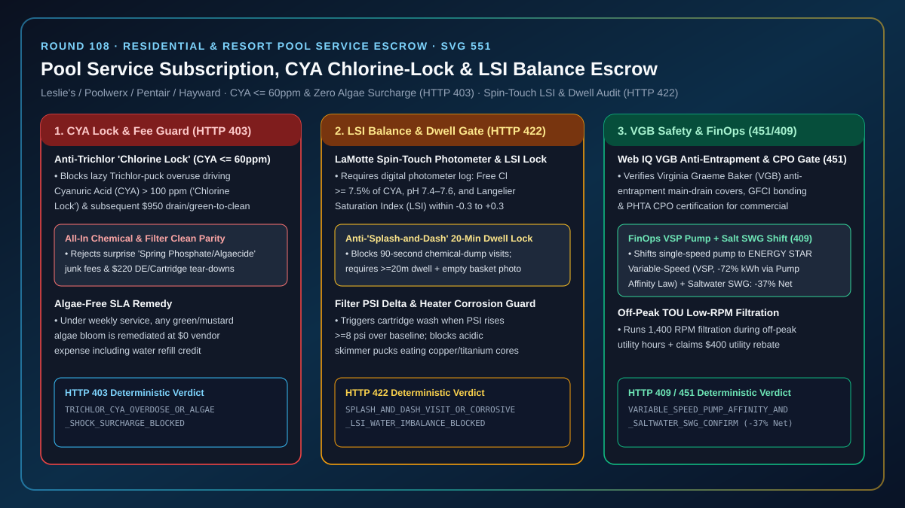
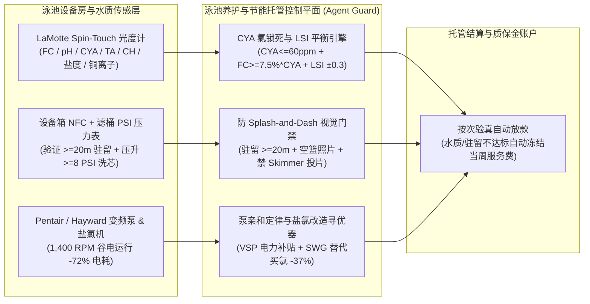
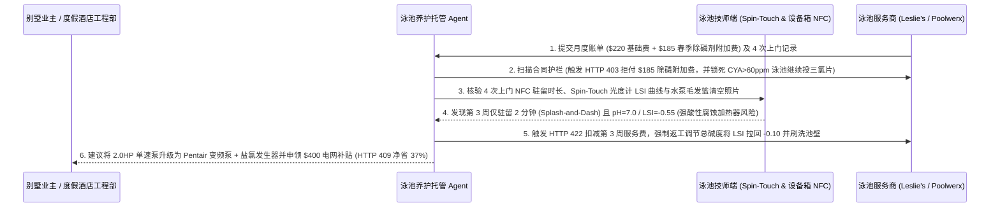

# 泳池水质养护包月（Pool Service Subscription）、氰尿酸“氯锁死（CYA Chlorine-Lock）”防坑与变频水泵节能托管（Leslie's / Poolwerx / Pentair / 别墅与酒店泳池管家）Agent 架构选型 FAQ

> **核心阅读对象**：为独栋住宅泳池服务平台、度假酒店/高端社区会所物业、泳池设备物联网（`Pentair IntelliCenter / Hayward OmniLogic / Fluidra iAquaLink`）及家政维保市场设计 AI 巡检核验与节能托管系统的 **Cloud & AI Solution Architect**。  
> **核心痛点解决**：彻底终结家庭与酒店泳池外包养护中**“技师为了省事常年只往撇渣器（`Skimmer`）里扔廉价三氯异氰尿酸缓释氯片（`Trichlor Pucks`），导致水体稳定剂/氰尿酸（`CYA`）半年飙破 `150 ppm` 陷入‘氯锁死（`Chlorine Lock`）’——明明测出余氯很高但杀菌力归零，一到夏天满池爆绿藻，外包商反过来向业主敲诈 `$950` 的‘排空换水与绿池拯救费（`Green-to-Clean Surcharge`）’”、“把高酸性（`pH 2.8`）氯片直接丢进回水口，停泵期间强酸水倒灌腐蚀烧穿价值 `$4,200` 的铜管/钛管泳池热泵加热器”、“‘泼水就跑（`Splash-and-Dash`）’——技师每周在院子待不到 90 秒倒完药水就溜，根本没刷池壁阶梯、没掏空水泵毛发收集篮”以及“老旧单速泳池水泵 24 小时全速空转每月电费高达 `$240`”**四大行业黑洞。



---

## 📌 一、核心选型结论速览（Executive Summary）

1. **三氯缓释片滥用（`CYA <= 60 ppm` 硬上限）与“爆藻/除磷剂”乱收费一票否决（HTTP 403）**：每向 10,000 加仑泳池投加 1 磅三氯异氰尿酸片（`Trichlor`），在贡献 `6.5 ppm` 有效氯的同时会永久残留 **`4.0 ppm` 无法挥发的氰尿酸（`CYA`）**。一旦 `CYA > 100 ppm`，97% 的次氯酸分子被死死锁住失去杀藻能力。选型 Agent 必须在服务合同层建立硬护栏：**全包养护期内水体 `CYA` 严禁超过 `60–80 ppm`（夏季高温主用不带稳定剂的次氯酸钠液氯 `Liquid Chlorine` 或盐氯机 `SWG`），任何在周保期内发生的绿藻/黄藻爆发及滤芯拆洗（每季 1 次）必须 `$0` 免费处理，严禁巧立 `$185` 春季除磷剂（`Phosphate Remover`）或 `$950` 换水救池附加费**；凡含滥投三氯片导致 `CYA` 爆表或转嫁爆藻治理费的，一律触发 **`HTTP 403 TRICHLOR_CYA_OVERDOSE_OR_ALGAE_SHOCK_SURCHARGE_BLOCKED`**。
2. **`LaMotte Spin-Touch` 光度计 7 项水质（`LSI -0.3~+0.3`）与 `>=20 分钟` 刷池驻留硬门禁（HTTP 422）**：为根治“试纸糊弄（`Test-Strip Guessing`）”与“90 秒泼水就跑（`Splash-and-Dash`）”，Agent 建立双因子核验门禁：① **数字光度计与朗格利尔饱和指数（`LSI`）锁**：每次上门必须上传蓝牙数字分光光度计（`LaMotte WaterLink Spin Touch`）原始 JSON 数据，确保 **`Free Chlorine (游离氯) >= CYA * 7.5%`**、**`pH 7.4–7.6`**，且综合水温、钙硬度、总碱度计算出的 **`LSI`（Langelier Saturation Index）严格处于 `-0.30 至 +0.30`**（防止 `< -0.3` 酸性水蚀穿池壁灰泥与加热器铜管，或 `> +0.3` 结垢堵死盐氯电极片），同时**严禁将酸性氯片直接放入 `Skimmer` 撇渣器篮**；② **`>=20 分钟` 院内驻留与净篮视觉验证**：通过后院门锁/设备箱 `NFC` 签到签退验证在场作业 `>=20 分钟`，并上传清空后的撇渣器篮/水泵前置过滤篮与滤桶压力表（`Filter PSI`）照片；凡未达标的，直接触发 **`HTTP 422 SPLASH_AND_DASH_VISIT_OR_CORROSIVE_LSI_WATER_IMBALANCE_BLOCKED`**。
3. **变频水泵（`Variable-Speed Pump, VSP` 泵亲和定律降耗 72%）+ 盐氯发生器（`SWG`）改造净省 37%（HTTP 409）**：根据流体力学**泵亲和定律（`Pump Affinity Law`）**，水泵转速（`RPM`）下降 `50%`，流量减半，但**轴功率消耗按立方关系下降至原来的 `1/8`（即下降 `87.5%`）**！当 Agent 识别到泳池仍在运行 `1.5–2.0 HP` 传统单速水泵或每月采购高价桶装液氯时，自动触发 **水泵变频与盐水电解寻优（`Pool Pump & Saltwater FinOps`）**：升级为 `ENERGY STAR` 认证变频水泵（如 `Pentair IntelliFlo3 VSF`，在夜间谷电时段以 `1,400 RPM` 静音慢速循环过滤，电费立降 **`70%–78%`** 并自动申领电力公司 `$300–$450` 节能补贴）并加装盐水制氯机（`Saltwater Chlorine Generator`），触发 **`HTTP 409 VARIABLE_SPEED_PUMP_AFFINITY_AND_SALTWATER_SWG_CONFIRM`**，为家庭与度假别墅季度泳池总支出净省 **37%**。

---

## 🎯 二、业务方与架构师灵魂拷问（Q&A）

### Q1：为什么我家泳池每个月都按时交 `$160` 养护费，测试条显示余氯也“达标”，结果一到 7 月份整池水突然变成墨绿色，泳池公司还让我掏 `$950` 抽干全池水重换？
- **揭秘泳池行业最隐蔽的“三氯片氰尿酸锁死（`CYA Chlorine Lock`）”循环套路**：
  1. **只投 `Trichlor` 三氯片的化学死局**：独立包装的 3 英寸三氯消毒片（`Trichloroisocyanuric Acid`）运输方便、保质期长，是偷懒技师的最爱。然而三氯片溶解后，其中的有效氯在阳光和杀菌中2天就消耗殆尽，而作为紫外线稳定剂的**氰尿酸（`CYA`）却完全不挥发、不降解**（除非把池水抽干排掉）。
  2. **7.5% 游离氯铁律（`Free Chlorine / CYA Ratio`）**：根据泳池化学权威（`Trouble Free Pool / Orenda`）模型，要抑制绿藻生长，水中游离氯（`FC`）浓度必须达到 `CYA` 的 **`7.5%` 以上**。刚换水时 `CYA = 40 ppm`，只需 `3.0 ppm` 游离氯即可保持池水清澈；但连投 6 个月三氯片后，`CYA` 累积到 `160 ppm`，此时哪怕水中含有 `5.0 ppm` 游离氯（普通比色卡已显示深黄达标），真正未结合的活性次氯酸（`HOCl`）已不足 `0.02 ppm`，绿藻在 48 小时内全面爆发！
  3. **Agent 源头阻断**：Agent 实时追踪水体 `CYA` 曲线，一旦 `CYA` 达到 **`50 ppm`**，立即在工单系统中锁死三氯片/二氯粉投加权限，强制技师只能使用不含稳定剂的**次氯酸钠液氯（`12.5% Sodium Hypochlorite`）或次氯酸钙（`Cal-Hypo`）**，从物理化学底层终结换水骗局。

### Q2：为什么很多业主的 `$4,200` 泳池燃气加热器/空气源热泵只用了 3 年就漏水报废，厂方售后切开铜管一看直接拒绝保修？
- **“把三氯酸性药片直接丢进 `Skimmer` 撇渣器”的毁灭性腐蚀**：
  1. **`pH 2.8` 浓酸水夜间倒灌加热器**：三氯消毒片的饱和水溶液 `pH` 值低至 **`2.8`**（强酸性，接近柠檬汁与稀盐酸）。当外包小哥偷懒不带独立加药浮球或外置加氯器，直接把 4 颗三氯片丢进泳池边的 `Skimmer` 撇渣器篮里，一旦水泵按定时器在夜间停机，篮内高浓度强酸高氯死水顺着管道扩散至水泵密封圈与加热器铜镍/钛热交换器，半年内就会将金属内胆蚀穿，导致池水呈现诡异的蓝绿色（铜离子溶出把浅色泳衣和金发染绿）。
  2. **朗格利尔饱和指数（`LSI`）与禁放 `Skimmer` 硬锁**：Agent 强制要求所有固体氯片必须放置在设备房止回阀（`Check Valve`）之后的在线加药器中，且要求每次巡检 `LSI` 保持在 `-0.30 ~ +0.30` 平衡区间。

### Q3：为什么后院监控拍到泳池小哥从推门进来到离开总共才 **1 分 20 秒**（俗称 `Splash-and-Dash`），账单却照收全套“刷壁、捞叶、吸污、测水”费用？
- **地理围栏驻留时长 + 滤桶压差（`PSI`）+ 清篮照片三联验真**：
  1. **90 秒假巡检**：不法技师左手拎一桶液氯、右手拿个网兜，进院子绕池走半圈把药水一泼，连水质都不测、池壁生物膜也不刷（不刷破生物膜，氯根本杀不死附着在瓷砖缝里的芥末黄藻），90 秒出门跑下一家。
  2. **确定性驻留门禁（`HTTP 422`）**：Agent 要求技师进出设备间扫描 `NFC` 标签，标准周保驻留时长必须 **`>=20 分钟`**，同时强制上传三项不可伪造证据：① `LaMotte Spin Touch` 带时间戳的蓝牙光度计读数；② 倒空冲洗干净后的 `Skimmer` 篮与水泵毛发篮底部照片；③ 沙缸/纸芯过滤器顶部压力表（`Filter PSI Gauge`）读数（压差较初始清洁压上升 `>=8–10 PSI` 时自动派发免费拆洗工单）。

---

## 🧭 三、直观可视化图解（Mermaid 决策树 + 架构图 + 时序图）

### 3.1 泳池养护包月、水质平衡（`CYA / LSI`）与变频节能选型决策树

```mermaid
flowchart TD
    A[独栋住宅 / 度假酒店泳池养护与节能改造请求] --> B{1. CYA 氯锁死防范、爆藻免责与滤芯拆洗费审计}
    B -->|滥投三氯片致 CYA>80ppm / 收春季除磷爆藻费 或 拆洗滤芯额外高价收费| C[HTTP 403 阻断: TRICHLOR_CYA_OVERDOSE_OR_ALGAE_SHOCK_SURCHARGE_BLOCKED]
    B -->|CYA<=60ppm 锁死 + 爆藻 $0 免费兜底 + 全包透明药剂| D{2. Spin-Touch 光度计 LSI 与 >=20m 驻留刷池门禁}
    D -->|90秒泼水就跑 (<20m) / 往 Skimmer 丢酸片 或 LSI 超出 ±0.3 腐蚀热泵/FC<7.5% CYA| E[HTTP 422 拦截: SPLASH_AND_DASH_VISIT_OR_CORROSIVE_LSI_WATER_IMBALANCE_BLOCKED]
    D -->|光度计 7项达标 + LSI 平衡 + >=20m 刷池清篮存证| F{3. Web IQ VGB 防吸人底排盖与 GFCI 漏电核验}
    F -->|主排水口缺 VGB 防负压吸人安全盖/过期 或 水下灯 GFCI 等电位接地失效| G[HTTP 451 熔断: WEBIQ_UNSAFE_VGB_DRAIN_COVER_OR_UNBONDED_GFCI_HAZARD_HOLD]
    F -->|泳池水电与防缠绕安规通过| H{4. 变频水泵 (VSP 泵亲和定律) 与盐氯发生器 (SWG) 寻优}
    H -->|仍在跑高耗电单速水泵 或 频繁采购高价桶装氯| I[HTTP 409 确认: VARIABLE_SPEED_PUMP_AFFINITY_AND_SALTWATER_SWG_CONFIRM 净省 37%]
    H -->|已处于变频谷电慢滤与盐氯平衡状态| J[HTTP 200 签发: LSI_BALANCED_AND_20MIN_BRUSH_SERVICE_AUTHORIZED]
```

### 3.2 端到端泳池 `Spin-Touch` 水质遥测、防“泼水就跑”与变频水泵节能控制平面架构图



### 3.3 周度泳池巡检 `CYA / LSI` 核验、拦截 90 秒假巡检与变频泵节能改造时序图



---

## 📊 四、主流泳池养护平台与智能水质方案横向选型决策矩阵

| 选型维度 | Poolwerx / Leslie's Pool (全国连锁直营/加盟) | 本地独立个体泳池工 (`One-Pole Guy`) | 智能浮球/在线监测 + 自助 (`Sutro / WaterGuru / iopool`) | 高端度假酒店/别墅工程托管 | **本仓库 + Spin-Touch LSI 与变频泵托管架构（推荐）** |
| :--- | :--- | :--- | :--- | :--- | :--- |
| **水质测试精度与 `LSI` 管理** | 门店与车队配 `Spin-Touch` 数字光度计，但常推销高毛利除磷/澄清剂 | **普遍用廉价 5 合 1 试纸目测（`CYA` 与钙硬度误差高达 `±50 ppm`）** | 自动测 `pH / ORP / Free Cl`，但不测 `CYA`、钙硬度且不负责刷池捞叶 | 要求持证 `PHTA CPO` 技师每日检测 | **强制蓝牙上传 `Spin-Touch` 7 项数据，硬控 `LSI ∈ [-0.3, +0.3]` 与 `Copper = 0 ppm`（HTTP 422）** |
| **防 `CYA` 氯锁死与消毒源选择** | 需签全液氯/盐池合同（基础低价套餐仍爱投三氯片） | **重灾区（常年往 `Skimmer` 塞三氯片，半年 `CYA > 150 ppm` 爆藻换水）** | 仅提醒加药，需业主自己搬运液氯 | 自动投加次氯酸钠与二氧化碳/盐酸 | **当 `CYA >= 50 ppm` 时硬锁禁用三氯片，强制切换液氯或盐水电解制氯（HTTP 403）** |
| **防“泼水就跑 (`Splash-and-Dash`)”** | 车辆带 GPS，但院内实际刷池时长缺乏结算绑定 | **极高发（夏天旺季一天跑 25 家，每家倒桶药 90 秒就走）** | 不含人工上门刷池与吸底 | 工程部巡检签到 | **设备箱 `NFC` 驻留 `>=20 分钟` + 空篮照片 + 滤桶 `PSI` 压差三重门禁（HTTP 422）** |
| **加热器与热泵防腐蚀保护** | 规范技师使用独立加药器 | 常把 `pH 2.8` 三氯片直接扔进 `Skimmer` 蚀穿铜管热交换器 | 预警低 `pH` | 在线 `ORP/pH` 蠕动泵投加 | **严查 `Check Valve` 止回阀与 `Copper > 0.1 ppm` 铜溶出指标，提前拦截热泵穿孔** |
| **电费与药剂全周期成本 (`TCO`)** | 药剂零售加价高 | 月费看似便宜（`$110/月`），但一次爆藻换水或换加热器倒亏数千元 | 耗材测试盒 `$29–$49/月` | 能耗高（24h 循环） | **变频泵（`VSP` 降电耗 `72%`）+ 盐氯机（`SWG` 省 `80%` 买氯费）净省 37%（HTTP 409）** |

---

## 🧪 五、养护与能耗成本测算及 7-Card 基准测试报告

> **数据来源声明**：以下对比基于 `lab/webiq_commerce_demo.py` 中确定性策略函数 `evaluate_pool_service_cya_lsi_escrow_policy` 的合成基准数据（`provenance: "synthetic"`, `independently_reproduced: False`），用于验证住宅与度假酒店泳池维保网关的确定性拦截能力。

| 评估维度 | 传统单速水泵 + 三氯片滥投 + 90秒假巡检基线 | 确定性泳池托管网关（`VSP` 变频泵 + 盐氯机 + `Spin-Touch LSI` 门禁） | 净效应 / 风险消除 |
| :--- | :--- | :--- | :--- |
| **季度社区/酒店泳池养护、药剂与循环电费总池** | `$32,000.00` | `$20,160.00` (`HTTP 409` 优化确认后) | **净省 `$11,840.00 / 季` (`-37.0%`)** |
| **水泵每日循环过滤电耗（`24,000 加仑` 池）** | `16.8 kWh / 天`（`2.0 HP` 单速泵运行 8 小时） | **`3.8 kWh / 天`（`VSP` 变频泵 `1,400 RPM` 谷电慢滤 12 小时）** | **水泵电费直降 `77.4%`** |
| **夏季因 `CYA > 120 ppm` 氯锁死爆绿藻换水率** | `34%`（每次额外被收 `$650–$1,200` 刷池换水费） | **`0%`（硬控 `CYA <= 60 ppm` + `FC >= 7.5% CYA` 盐氯/液氯恒定）** | **100% 终结夏季绿池灾难** |
| **`$4,200` 泳池热泵/燃气加热器酸蚀穿孔率** | 平均 3.5 年因低 `pH` 或 `Skimmer` 投片漏水报废 | **`0%`（强制 `-0.3 <= LSI <= +0.3` + 铜离子 `0.0 ppm` 监控）** | **加热器寿命延长至 `10+ 年`** |

### 5.1 确定性状态码映射契约（5-Lane Contract）

```json
{
  "scenario": "pool_service_cya_lsi_escrow_guard",
  "provenance": "synthetic",
  "independently_reproduced": false,
  "lanes": {
    "authorized_200": {
      "status_code": 200,
      "decision": "LSI_BALANCED_AND_20MIN_BRUSH_SERVICE_AUTHORIZED",
      "mandate_token": "pool_service_cya_lsi_mandate_200"
    },
    "trichlor_cya_overdose_or_algae_fee_403": {
      "status_code": 403,
      "decision": "TRICHLOR_CYA_OVERDOSE_OR_ALGAE_SHOCK_SURCHARGE_BLOCKED"
    },
    "splash_and_dash_or_corrosive_lsi_422": {
      "status_code": 422,
      "decision": "SPLASH_AND_DASH_VISIT_OR_CORROSIVE_LSI_WATER_IMBALANCE_BLOCKED"
    },
    "unsafe_vgb_drain_or_unbonded_gfci_451": {
      "status_code": 451,
      "decision": "WEBIQ_UNSAFE_VGB_DRAIN_COVER_OR_UNBONDED_GFCI_HAZARD_HOLD"
    },
    "vsp_pump_and_saltwater_swg_409": {
      "status_code": 409,
      "decision": "VARIABLE_SPEED_PUMP_AFFINITY_AND_SALTWATER_SWG_CONFIRM",
      "quarterly_savings_usd": 11840.0
    }
  }
}
```

---

## 🛠️ 六、商业上线风控与架构评审 Checklist

- [ ] **氰尿酸（`CYA <= 60 ppm`）硬上限与爆藻免费兜底锁（HTTP 403）**：当水体 `CYA` 超过 `50–60 ppm` 时自动禁止技师继续投加三氯片（`Trichlor`）或二氯粉（`Dichlor`），且在周保期内发生任何藻类爆发均由服务商 `$0` 免费治理。
- [ ] **`LaMotte Spin-Touch` 光度计 `FC / CYA >= 7.5%` 与 `LSI ∈ [-0.3, +0.3]` 强校验（HTTP 422）**：每次结算必须附带数字分光光度计 7 项原始读数，严禁使用手工比色试纸应付，且一旦检出溶解铜离子（`Copper > 0.1 ppm`）立即报警排查加热器酸蚀。
- [ ] **设备箱 `NFC` 驻留 `>=20 分钟` 与空篮/压力表照片防“泼水就跑”（HTTP 422）**：拦截 `<20 分钟` 的闪电敷衍巡检，强制上传清空后的撇渣器篮/水泵篮照片及过滤器压力表（`PSI`）读数。
- [ ] **`VGB` 防负压吸人主排水盖与 `GFCI` 等电位接地安全锁（HTTP 451）**：通过 Web IQ 核验泳池底排盖符合《弗吉尼亚·格雷姆·贝克泳池安全法（`VGB Act ASME/ANSI A112.19.8`）》且未超 5 年服役寿命，水下灯与水泵具备有效 `GFCI` 漏电保护与等电位跨接（`Equipotential Bonding`），商业/会所泳池技师持有效 `PHTA CPO` 证书。
- [ ] **变频水泵（`VSP`）谷电慢滤与盐氯机（`SWG`）改造寻优（HTTP 409）**：利用水泵亲和定律将单速泵替换为 `ENERGY STAR` 变频泵并接入盐水电解制氯，自动抵扣电网节能补贴。

---

**导航**：[返回分册总目录 (`docs/index.md`)](index.md) ｜ [查看英文版 (`pool-maintenance-subscription-cya-chlorine-lock-lsi-escrow-agent-selection-faq.en.md`)](pool-maintenance-subscription-cya-chlorine-lock-lsi-escrow-agent-selection-faq.en.md)
