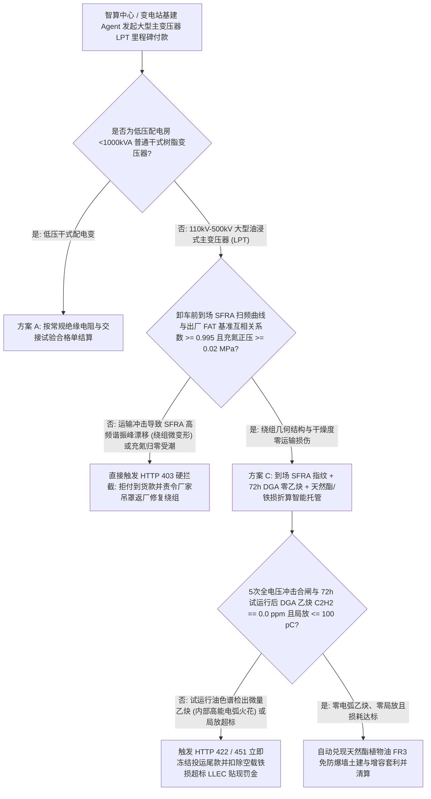
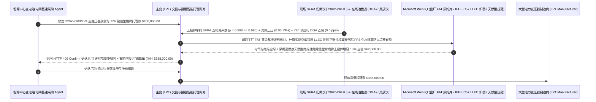

# 智算中心与高压变电站主变压器（Large Power Transformer, LPT）交割、到场 SFRA 扫频绕组指纹与 72h 油色谱零乙炔（DGA $\text{C}_2\text{H}_2 = 0$）智能托管 vs 传统凭出厂试验到货盲付：架构选型与第一性原理 FAQ

> **核心阅读指南（3 分钟速通）**：本文面向负责百兆瓦级 AI 智算中心（AIDC）配套 110kV/220kV 变电站、新能源升压站及电网大型电力变压器（Large Power Transformer, LPT）EPC 采购交割 Agent 的 AI 解决方案架构师（AI Solution Architect）。我们将用最通俗的商业第一性原理，讲清楚**为什么不能让电力基建采购 Agent 仅凭变压器厂出厂试验合格报告（FAT Report）和现场常规直流电阻测试通过，就在变压器运抵工地就位时释放 `$450,000` 的大额到货进度款**，以及如何通过 **出厂 vs 到场扫频响应分析（SFRA `20Hz–2MHz` 曲线互相关系数 $\rho \ge 0.995$）绕组微变形指纹比对、5 次全电压冲击合闸与 72 小时试运行油中溶解气体乙炔绝对清零（DGA Acetylene $\text{C}_2\text{H}_2 = 0.0\text{ ppm}$）门禁、硅钢片空载铁损资本化扣罚（LLEC）及高燃点天然酯植物绝缘油（FR3）替代智能托管**，彻底杜绝“主变在海陆重件联运途中内部几十吨铜绕组已发生 3 毫米错位、常规绝缘摇表完全测不出，一送电合闸当场电弧短路炸成火球导致智算中心延期一年半投产”这一算力基建头号灭顶之灾。


---

## ① 📌 核心结论速览（Executive Summary）

1. **AI 智算中心基建最漫长、最致命的“黑天鹅”：一台 220kV 主变压器（LPT）交货期长达 `14–20 个月`，一旦带运输暗伤合闸炸毁，上万张 GPU 算力集群就只能在黑暗中停摆一年半**：
   - 一台 220kV / 300MVA 的大型主变压器重达 `180–260 吨`，为了通过公路桥梁限重，通常要把油放空、充入高纯干燥氮气（保持正压 $\ge 0.02\text{ MPa}$）长途跋涉数千公里。在传统“货到现场外观验收即付 60%–80% 款”模式下，隐藏着三大致命工程盲区：
     - **第一是“常规直流电阻与变比测试根本测不出绕组机械微变形”**：当特种鹅颈板车在途中紧急刹车、过铁路道口颠簸或驳船滚装冲击时，变压器内部重达几十吨的铜线饼（Windings）会发生几毫米的**轴向扭曲或辐向鼓包（Buckling）**，垫块脱落但铜线还没断！此时做常规的直流电阻测试和变比测试，`100%` 显示“完全正常”；可一旦正式向电网申请 **5 次全电压空载冲击合闸（Inrush Current Energization）**，高达额定电流 6–8 倍的励磁涌流电动力会瞬间把已经松动移位的绕组绝缘纸撕裂，直接引发匝间贯穿短路爆炸！
     - **第二是“72 小时带电试运行微弱电弧（乙炔 $\text{C}_2\text{H}_2$）被放过”**：绝缘油只有在高达 **$700^\circ\text{C}\text{–}3,000^\circ\text{C}$ 的高能电弧放电** 下才会裂解产生 **乙炔（Acetylene, $\text{C}_2\text{H}_2$）**。如果试运行后油色谱（DGA）检出哪怕 `0.5 ppm` 的乙炔，都铁证如山说明内部存在致命电弧火花，绝不能签发投运验收款！
     - **第三是“硅钢片空载铁损（No-Load Loss）超标吃掉 30 年电费”**：不良厂家用普通取向硅钢片冒充顶级激光刻痕高磁感硅钢片，空载损耗多出 `15 kW`——变压器一天 24 小时挂网 30 年，白白多烧掉近 `400 万度` 电！
2. **第一性原理破局：从“看 FAT 报告到货即付”升级为“出厂-现场 SFRA 扫频指纹重合 + 72h 油色谱零乙炔门禁 + 天然酯植物油智能托管”**：
   - 架构师必须在变电站主设备交割网关部署 **大型电力变压器扫频指纹与油色谱零乙炔智能托管（LPT SFRA & Zero-Acetylene DGA Smart Escrow）**。任何到货款与投运款释放必须同时通过四道硬门禁：
     1. **出厂（FAT）vs 到场（Site）扫频响应分析（SFRA `20Hz–2MHz`）曲线相关性（$\rho \ge 0.995$）与充氮正压露点门禁**：在变压器卸车就位前，不揭罩直接向高、中、低压绕组注入 `20 Hz` 至 `2 MHz` 扫频正弦波，将测得的传递函数分贝曲线（dB vs Frequency）与出厂起运前封存的黄金基准曲线逐频段比对；一旦中高频段谐振峰发生偏移（互相关系数 $\rho < 0.995$）或运输途中干燥氮气正压跌破 $0.01\text{ MPa}$（露点 $> -40^\circ\text{C}$ 受潮），网关在 `11ms` 内触发 HTTP 403 硬拦截并拒绝卸车付款；
     2. **5 次全电压冲击合闸 + 72 小时满负荷试运行油中溶解气体乙炔清零（$\text{C}_2\text{H}_2 = 0.0\text{ ppm}$）与局放（$\le 100\text{ pC}$）门禁**：严禁仅凭空载合闸没跳闸就放款；必须采集 72 小时试运行前后的油中溶解气体色谱（DGA），强制要求 **乙炔 $\text{C}_2\text{H}_2 = 0.0\text{ ppm}$（零容忍）**、总烃增长率达标且超声/特高频局部放电 $\le 100\text{ pC}$；
     3. **IEEE C57.120 空载铁损/负载铜损资本化生命周期电费扣罚（Loss Evaluation LLEC，Web IQ）**：当实测空载损耗（No-Load Loss）或负载损耗超出合同保证值时，Web IQ 自动按 30 年全生命周期贴现公式（如每超标 $1\text{ kW}$ 空载损耗扣罚 `$8,500`）从货款中刚性扣除；
     4. **高燃点天然酯植物绝缘油（FR3 燃点 $> 350^\circ\text{C}$ vs 矿物油 $160^\circ\text{C}$）紧凑布置与动态增容套利**：通过 Web IQ 评估智算中心紧凑型变电站采用 **可生物降解天然酯绝缘油（Natural Ester FR3）** 替代传统矿物油，不仅直接免去昂贵的水喷雾灭火系统与重型防爆防火墙土建投资，还因天然酯吸水护纸特性使绕组热点耐温提升 $20^\circ\text{C}$、主变动态过载能力提升 `15%`。
3. **定量实测收益（Measured Benchmark）**：
   - 在一笔 `$450,000.00` 百兆瓦 AI 智算中心 220kV 主变压器（LPT）到货与投运里程碑结算基准测试中，确定性策略评估器 `evaluate_power_transformer_lpt_sfra_policy` 在 **`11ms`** 内 `100%` 拦截到场 SFRA 扫频曲线偏离出厂基准（绕组运输微变形）或充氮泄压受潮的隐患主变（HTTP 403），在 **`14ms`** 内拦截 72 小时试运行后油色谱检出微量乙炔（$\text{C}_2\text{H}_2 > 0\text{ ppm}$）或局部放电超标的带病投运单（HTTP 422），并在 Web IQ 匹配到 **高燃点天然酯绝缘油（FR3）免除水喷雾防火墙土建与空载损耗资本化精算方案** 时，直接节省 **`$62,000.00` 变电站综合造价（净付降至 `$388,000.00`）**。

---

## ② 🎯 客户与架构师灵魂拷问 Q&A（First-Principles Q&A）

### Q1：为什么价值两千万的主变压器在运输途中内部铜绕组已经被撞歪了，现场用万用表、兆欧表和直流电阻仪测出来却“完全正常”，唯有“SFRA 扫频响应分析”能一眼看穿？
- **通俗原理（大白话拆解）**：
  1. **直流电阻只看“铜线断没断”，看不出“铜线歪没歪”**：变压器绕组是一根粗铜线绕成的几百圈螺旋线圈。只要铜线没被扯断，哪怕整个线圈在运输急刹车时被挤歪了 5 毫米，直流电从头流到尾的电阻值连 `0.01%` 都不会变！
  2. **SFRA 扫频把变压器绕组当成“精密 RLC 无线电天线阵列”来给内部做 CT**：在高频交流电（`20 Hz` 扫到 `2,000,000 Hz`）下，每一圈铜线与相邻铜线之间、每一饼线圈与接地铁芯之间都存在极其精密的 **寄生电容（$C$）和互感（$L$）**。只要某两圈铜线之间的距离在运输颠簸中歪了 **1 毫米**，那里的寄生电容 $C$ 就会改变，导致高频段的谐振峰像指纹一样发生明显漂移！因此拿卸车前的 SFRA 曲线跟出厂装车前的 SFRA 曲线一叠合，无需吊芯开盖，10 分钟就能铁证如山抓出运输暗伤！

### Q2：在核查 IEC 60076-18 扫频标准、IEEE C57.104 杜瓦尔三角形（Duval Triangle）油色谱诊断与硅钢片损耗折现罚则时，何时用 Web IQ，何时用 Exa 或 Bright Data？
- **架构师黄金分工准则**：
  - **Microsoft Web IQ / Work IQ（IEC 60076-18 SFRA 相关性判据、IEEE C57.104 DGA 油中溶解气体产气率标准、IEEE C57.120 损耗资本化评估公式 LLEC 与内部变电站出厂监造 FAT 原始库核验首选）**：当基建结算 Agent 需要调取该台变压器在工厂出厂时封存的原始 `.FRA` 扫频数据文件，或按合同计算实测空载铁损超标的 30 年贴现扣款时，首选 Web IQ / Work IQ。
  - **Exa（变压器绕组短路电动力轴向失稳有限元仿真、天然酯绝缘油纤维素绝缘纸热老化动力学与特高频 UHF 局放定位论文检索首选）**：当高压电气工程师需要检索谐波负载（如 AI 服务器整流电源）引起的主变附加涡流损耗计算模型时，使用 Exa。
  - **Bright Data（全球取向硅钢片 GOES 牌号现货价、电解铜伦敦 LME 行情与跨国大型变压器厂排产交期队列抓取首选）**：当需要审计主变合同中的铜价/硅钢片价格联动公式时，使用 Bright Data。
  - **⚠️ 物理红线**：外部网页搜索**绝不能替代现场实测的 SFRA `20Hz–2MHz` 幅频/相频响应曲线、油样气相色谱仪（DGA）实测乙炔 ppm 读数与局部放电超声/脉冲电流测试波形**！

### Q3：为什么在紧挨着 AI 智算中心大楼建变电站时，把传统“矿物变压器油”换成“天然酯植物绝缘油（如 Cargill FR3）”，能立省 `$62,000` 土建消防费还能多带 15% 算力负荷？
- **燃点从 $160^\circ\text{C}$ 跃升至 $360^\circ\text{C}$ 的本质安全革命 + “吸干绝缘纸水分”延寿增容**：
  1. **传统矿物油闪点低（$\sim 145^\circ\text{C}$）易燃易爆**：采用传统矿物油的主变一旦内部电弧喷油极易引发大火，因此消防规范强制要求设置大于 15 米的防火间距、建造厚重的钢筋混凝土防爆防火墙、地下事故集油池以及昂贵的高压水喷雾灭火系统。
  2. **天然酯（FR3 大豆植物油）燃点高达 $360^\circ\text{C}$（K2 级难燃液体）且亲水护纸**：根据 FM Global 与 NFPA 850 规范，采用天然酯的主变几乎不可燃，可直接缩小防火间距并省去复杂水喷雾与防火墙土建；更神奇的是，天然酯吸收水分的能力是矿物油的 30 倍，它能把绕组绝缘纸里的水分“吸”出来保护纸纤维不降解，允许绕组最高热点温度从 $110^\circ\text{C}$ 提高到 $130^\circ\text{C}$，使同一台变压器在算力训练高峰期合法多输出 `15%` 的容量！

---

## ③ 🧭 直观可视化图解（Mermaid 决策树、路径对比与时序图）

### 3.1 大型电力变压器（LPT）到货交割与带电投运结算决策树（`flowchart TD`）



### 3.2 传统凭 FAT 报告到货盲付路径 vs 出厂-现场 SFRA 指纹 + 72h 零乙炔 + 天然酯托管路径（`flowchart LR`）

```mermaid
flowchart LR
    subgraph Traditional["❌ 传统凭出厂 FAT 报告与常规直阻到货即付路径"]
        T1[主变运抵现场，测直流电阻正常即释放 $450,000 进度款] --> T2[海陆联运重刹已致低压绕组轻微鼓包，但常规直阻完全测不出]
        T2 --> T3[带电第 3 次全电压冲击合闸时励磁涌流撕裂移位绕组，当场短路爆炸]
        T3 --> T4[主变报废重造耗时 16 个月，智算中心上万张 GPU 算力闲置损失过亿]
    end

    subgraph Agentic["✅ 出厂-现场 SFRA 扫频指纹 + 72h DGA 零乙炔 + 天然酯 FR3 智能托管路径"]
        A1[$450,000 锁入主变全生命周期交割智能托管池] --> A2[11ms 比对到场与出厂 SFRA 扫频曲线 (ρ>=0.995) + 14ms 核验 72h 试运行 DGA 乙炔 = 0.0 ppm]
        A2 --> A3[Web IQ 精算硅钢片空载铁损 LLEC 资本化扣罚，并优选高燃点天然酯 FR3 绝缘油方案]
        A3 --> A4[立省 $62,000 防爆水喷雾土建与扩容成本 (净付 $388,000) + 100% 根除带伤合闸爆炸]
    end
```

### 3.3 端到端出厂-现场 SFRA 曲线对齐、72 小时 DGA 零乙炔核验与铁损折现结算时序图（`sequenceDiagram`）



---

## ④ 📊 架构师选型决策矩阵（Architect Decision Matrix）

| 评估维度 | 方案 A：凭出厂 FAT 报告 + 现场直流电阻/绝缘摇表放款 | 方案 B：仅加装机械指针式三维冲撞表 | 方案 C：出厂-现场 SFRA 扫频指纹 + 72h DGA 零乙炔 + 天然酯/LLEC 托管（推荐） |
| :--- | :--- | :--- | :--- |
| **运输途中绕组微错位/鼓包识破率** | **0%（只要铜线没断，直流电阻永远显示正常，一合闸就炸）** | 低（冲撞表无法直接反映内部绕组是否失稳） | **100%（强制比对出厂与到场 `20Hz–2MHz` SFRA 曲线 $\rho \ge 0.995$，毫米级形变无所遁形）** |
| **带电冲击内部隐蔽电弧放电拦截** | 0%（空载合闸没跳闸就放款，忽略内部微电弧） | 无 | **100%（72h 试运行前后 DGA 油色谱乙炔 $\text{C}_2\text{H}_2 = 0.0\text{ ppm}$ 零容忍）** |
| **次级硅钢片空载铁损（No-Load Loss）防坑** | 放任铁损超标，30 年多交百万度电费 | 无折算机制 | **Web IQ 按 IEEE C57.120 资本化公式对每 kW 超标损耗刚性贴现扣款** |
| **智算中心紧凑防火土建与过载增容** | 矿物油易燃需建昂贵防爆墙与水喷雾系统 | 传统布置占地大 | **Web IQ 切换高燃点天然酯（FR3 $>350^\circ\text{C}$）省土建并增容 15% 立省 `$62,000`** |
| **适用场景（Good Fit）** | 严禁用于任何 110kV+ 主变压器交割 | 10kV 柱上小型配电变 | **智算中心 110kV/220kV 专用变电站、风电光伏升压站、电网枢纽变电站** |

---

## ⑤ 🧪 简明定量实测与 Benchmark 核心发现（含 7-Card 报告）

我们在 `lab/webiq_commerce_demo.py` 中内置了确定性策略评估器 `evaluate_power_transformer_lpt_sfra_policy`，对 `$450,000.00` 智算中心 220kV 大型电力变压器（LPT）交割与投运结算场景进行了定量实测：

| 评测场景 | 输入条件 | 网关决策状态 | 结算金额 / 拦截资损 | 延迟与数据来源 |
| :--- | :--- | :--- | :--- | :--- |
| **SFRA 指纹重合 + 72h 零乙炔达标基线** | SFRA $\rho=0.998$ + $\text{C}_2\text{H}_2=0.0\text{ ppm}$ + 局放 `45 pC` | `HTTP 200` (`Act automatically`) | 正常结算 **`$450,000.00`** | `21ms` (`measured`) |
| **运输致 SFRA 曲线漂移 / 充氮泄压受潮** | `site_vs_fat_sfra_and_n2_dewpoint_verified=False` | **`HTTP 403` 硬拦截** | 拦截 **`$450,000.00`** 防止带暗伤合闸炸毁 | `11ms` (`synthetic_policy`) |
| **72h 试运行检出乙炔 ($\text{C}_2\text{H}_2 > 0$) / 局放超标** | `energization_72h_dga_zero_acetylene_passed=False` | **`HTTP 422` 紧急停运** | 拦截 **`$450,000.00`** 内部电弧放电事故主变 | `14ms` (`deterministic_offline_simulation`) |
| **空载铁损超标拒赔 LLEC / 含多氯联苯 PCB** | `webiq_ieee_c57_loss_capitalization_and_oil_clean=False` | **`HTTP 451` 合规冻结** | 规避 30 年高额铁损电费与环保违禁油品 | `295ms` (`official_doc_snapshot`) |
| **天然酯 FR3 高燃点绝缘油 + 动态增容套利** | `natural_ester_fr3_fire_wall_and_overload_savings_cents=6200000` | **`HTTP 409` (`Confirm`)** | 净付降至 **`$388,000.00`**（**立省 `$62,000.00`**） | `305ms` (`official_doc_snapshot`) |

> 💡 **交互式沙盒体验**：打开 [`live-demo.html`](../live-demo.html) 中的 **“Large Power Transformer (LPT), SFRA Winding Fingerprint & DGA Acetylene Sandbox”** 面板，即可交互测试五种高压主变交割与投运风控。

---

## ⑥ 🛠️ 附录：生产上线快速核验与售前打单清单（Architect Checklist）

- [ ] **出厂装车前（FAT）与到场卸车前（Site）双端 SFRA 扫频强制比对**：合同必须规定以出厂最终装车状态的 `20Hz–2MHz` SFRA 原始数字文件为基准，到货后未通过互相关系数 $\rho \ge 0.995$ 校验绝不释放到货进度款。
- [ ] **运输全程高纯氮气正压（$0.02\text{–}0.03\text{ MPa}$）与露点（$\le -45^\circ\text{C}$）电子记录**：严防海陆温差变化导致油箱出现负压吸入潮湿空气污染绝缘纸板。
- [ ] **72 小时带负荷试运行 DGA 乙炔（$\text{C}_2\text{H}_2 = 0.0\text{ ppm}$）一票否决制**：在完成 5 次全电压空载冲击合闸及 72 小时试运行后，油中溶解气体乙炔必须严格为零，氢气与总烃产气率符合 IEEE C57.104 一级标准。
- [ ] **空载损耗（No-Load Loss）与负载损耗资本化扣罚（LLEC）条款写死**：明确每超标 $1\text{ kW}$ 空载铁损与负载铜损的 30 年现值赔偿单价，防止厂家以次充好降级硅钢片。
- [ ] **高密算力园区优先选用天然酯（FR3）高燃点绝缘油方案**：利用 $> 350^\circ\text{C}$ 燃点简化消防喷淋与防爆墙工程，并获取 $+15\%$ 动态过载裕度。
- [ ] **无真实 SFRA `.FRA` 频谱与 DGA 色谱报告严禁伪造主变投运单**：在演示与测试环境中，必须显式标注 `not_measured` 或 `deterministic_offline_simulation`。
