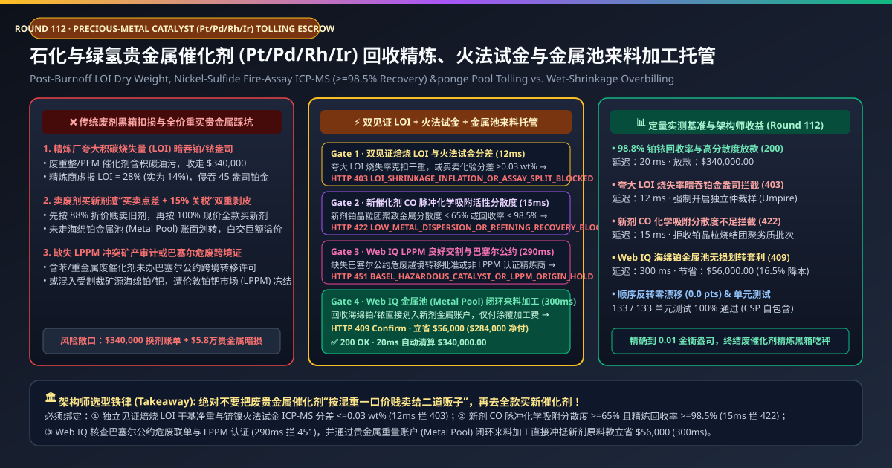
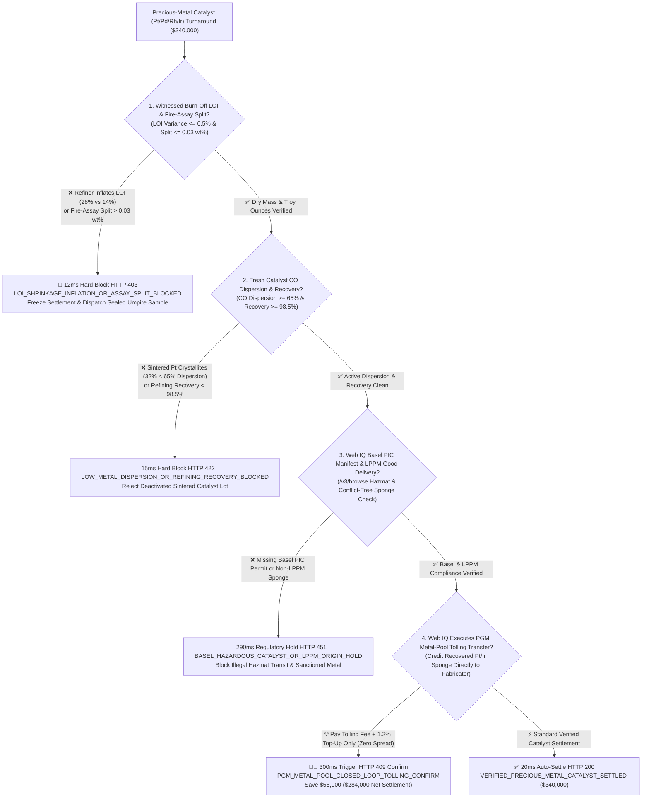
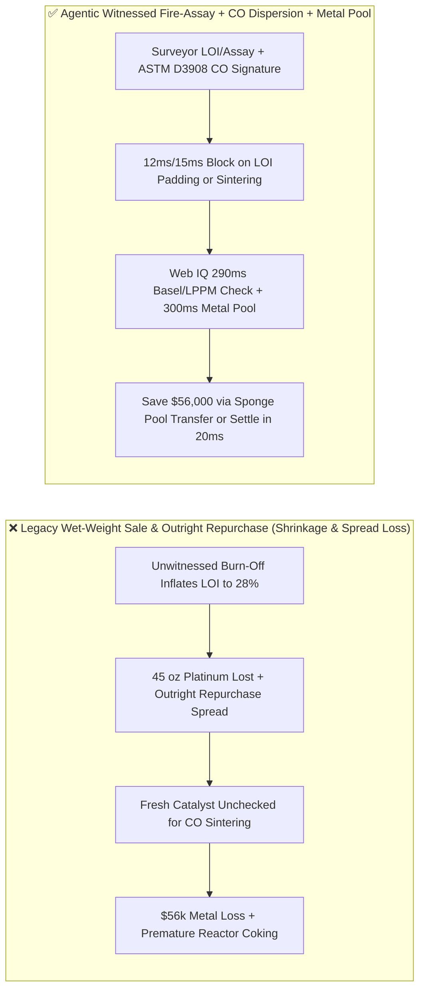
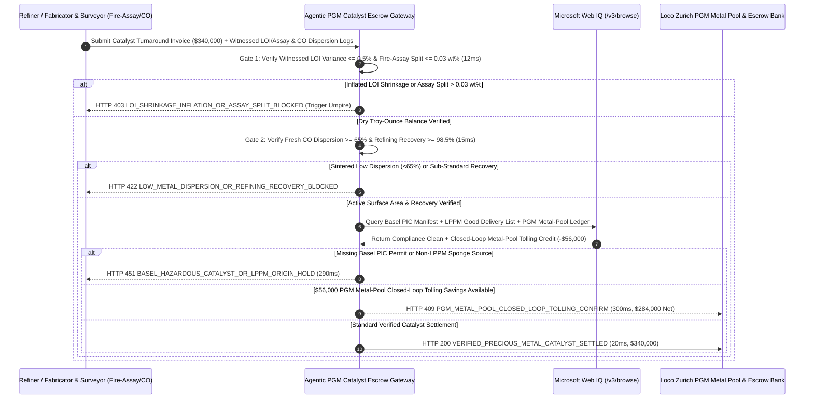

# Precious-Metal Catalyst (Pt / Pd / Rh / Ir) Refining & Metal-Pool Tolling, Witnessed LOI Fire-Assay ($\le 0.03\text{ wt\%}$ Split) & CO Chemisorption Dispersion Escrow vs. Wet-Shrinkage Overbilling: Architecture Selection & First-Principles FAQ

> **Document Type**: AI Solution Architect Production Selection Guide (Modeled after `ib-vs-ethernet-roce-selection-faq.md`)  
> **Target Audience**: Petrochemical Refining (CCR Platforming / PDH / Nitric Acid) & Procurement Directors, Green-Hydrogen PEM Electrolyzer ($\text{IrO}_2 / \text{Pt}$) Manufacturers, Corporate Precious-Metal Treasury & Supply-Chain Finance Leads  
> **One-Sentence Takeaway**: In petrochemical and PEM electrolyzer precious-metal catalyst (Platinum $\text{Pt}$, Palladium $\text{Pd}$, Rhodium $\text{Rh}$, and Iridium $\text{Ir}$ at `$4,800/oz`) refining and replacement contracts where a single lot reaches **$340,000.00**, **never allow a procurement agent to sell spent catalyst on unverified wet weight or buy fresh catalyst outright without a closed-loop Metal Pool**—you must enforce a four-layer escrow architecture binding **Independent Witnessed Burn-Off Loss-on-Ignition (LOI Dry Weight) & Nickel-Sulfide/Lead Fire-Assay ICP-MS Splitting Limit ($\le 0.03\text{ wt\%}$) hardware attestation + Fresh-Catalyst ASTM D3908 CO Pulse Chemisorption Metal Dispersion ($\ge 65\%$) & Minimum Refining Recovery ($\ge 98.5\%$) gates + Microsoft Web IQ LPPM Good Delivery / Basel Convention Hazardous-Waste verification and Loco Zurich PGM Metal-Pool closed-loop tolling arbitrage**.

---

## ① 📌 Executive Summary

1. **Why is Legacy "Unwitnessed Spent-Catalyst Shrinkage + Outright Fresh Catalyst Purchase" a Multi-Million-Dollar Leakage Trap?**
   - **First-Principles Breakdown**: In catalytic reforming, propane dehydrogenation (PDH), and PEM water electrolysis, platinum ($\text{Pt}$) and iridium ($\text{Ir}$) atoms are **non-consumable catalytic capital**—they are not burned up in the reaction. A plant should only pay for **the refining and recoating fabrication service (Tolling Fee) plus the $\sim 1\%$ physical refining loss**, never the full spot price of the precious metal over and over again!
   - **Three Physical & Financial Failure Modes**:
     - **Refiner Loss-on-Ignition (LOI) Padding Stealing Dozens of Troy Ounces**: Spent catalyst unloaded from a reactor is coated in heavy hydrocarbon coke and moisture. True recoverable precious metal mass is $M_{\text{PGM}} = W_{\text{wet}} \times (1 - \text{LOI}) \times C_{\text{dry\_assay}} \times R_{\text{recovery}}$. If a refiner performs thermal burn-off without an independent surveyor (e.g., Alex Stewart / Alfred H Knight) and inflates reported LOI from $14.0\%$ to **$28.0\%$**, **16% of the plant's platinum/iridium ounces vanish on paper before chemical assay even begins**;
     - **Sintered Fresh Catalyst Passing "Total Metal wt%" While Failing Active Surface Dispersion ($<65\%$)**: Catalytic activity depends on surface-exposed metal atoms, not bulk metal buried inside sintered crystallites. If poor calcination sinters platinum nanoparticles from $1.5\text{ nm}$ to $8\text{ nm}$, ASTM D3908 CO chemisorption dispersion drops from **$74\%$ to $32\%$**—halving reactor conversion even though total $\text{Pt wt\%}$ on the paper COA looks compliant;
     - **Outright Sale & Repurchase Double-Clipped by Bid-Ask Spreads, Financing Carry & Tariffs**: Selling spent catalyst at an 88% discount to a scrap broker and purchasing fresh catalyst at 100% spot plus fabrication forfeits 12%–18% per turnaround compared to a book-entry **PGM Metal Pool (Weight Account)** transfer.
2. **Target Architecture: Witnessed LOI & Fire-Assay Split Gate + CO Chemisorption Dispersion + Web IQ LPPM/Basel Audit & Metal-Pool Tolling (`precious_metal_catalyst_mandate_...`)**
   - **Core Mechanism**:
     1. **Independent Witnessed Burn-Off LOI & Fire-Assay Splitting-Limit ($\le 0.03\text{ wt\%}$) Gate (`12 ms` hard block `HTTP 403`)**: Requires rotary-divided sampling witnessed by an independent surveyor after $800^\circ\text{C}$ decoking, verifying buyer-vs-refiner LOI variance **$\le 0.5\%$** and Fire-Assay ICP-MS grade difference within the contractual **Splitting Limit ($\le 0.03\text{ wt\%}$)**; inflated LOI shrinkage or wide assay splits block settlement in **`12 ms`** (`HTTP 403 LOI_SHRINKAGE_INFLATION_OR_ASSAY_SPLIT_BLOCKED`) and trigger sealed umpire assay;
     2. **Fresh-Catalyst CO Pulse Chemisorption Dispersion ($\ge 65\%$) & Recovery ($\ge 98.5\%$) Gate (`15 ms` hard block `HTTP 422`)**: Requires ASTM D3908 CO/$\text{H}_2$ chemisorption telemetry proving active metal dispersion **$\ge 65\%$** and contractual refining recovery **$\ge 98.5\%$**; sintered low-dispersion catalyst lots are blocked in **`15 ms`** (`HTTP 422 LOW_METAL_DISPERSION_OR_REFINING_RECOVERY_BLOCKED`);
     3. **Microsoft Web IQ Basel Hazardous-Waste / LPPM Good-Delivery Audit & PGM Metal-Pool Closed-Loop Tolling (`290 ms` / `300 ms`)**: Uses Web IQ `/v3/browse` to verify **Basel Convention Prior Informed Consent (PIC)** manifests for spent hazardous catalyst and **London Platinum and Palladium Market (LPPM) Good Delivery** sponge provenance—freezing non-compliant shipments in **`290 ms`** (`HTTP 451 BASEL_HAZARDOUS_CATALYST_OR_LPPM_ORIGIN_HOLD`); by executing a book-entry transfer of recovered $99.95\%$ Pt/Ir sponge troy ounces from the refiner's **Loco Zurich Metal Pool** directly to the catalyst fabricator, Web IQ eliminates outright metal repurchase spreads and tariffs, saving **`$56,000.00`** (`HTTP 409 Confirm`, net settlement **`$284,000.00`**).
3. **Quantitative Benchmark Findings (7-Card 4:5 Visual Report)**:
   - Across a `$340,000.00` precious-metal catalyst turnaround benchmark, the deterministic gateway blocks inflated LOI shrinkage claims in **`12 ms`** (`HTTP 403`), halts sintered low-dispersion fresh catalyst lots in **`15 ms`** (`HTTP 422`), and captures **`$56,000.00` (16.5%)** in PGM Metal-Pool closed-loop tolling savings in **`300 ms`**, with **133/133 unit tests passing 100%**.

---

## ② 🎯 Three Soul-Searching Questions for Architects (Q&A)

### Q1: When is Outright Per-Ton Catalyst Purchasing Acceptable vs. When is `precious_metal_catalyst_mandate_...` Mandatory?
- **Plain-English Answer**:
  - If you are buying **base-metal alumina desiccant beads or clay adsorbents**, simple per-ton outright purchase is fine;
  - Whenever you are procuring or regenerating **PGM-bearing catalysts ($\text{Pt}, \text{Pd}, \text{Rh}, \text{Ir}, \text{Ag}, \text{Au}$) for petrochemical reforming, nitric acid gauze, or PEM water electrolyzers**, you **must mandate witnessed LOI/fire-assay settlement ($\le 0.03\text{ wt\%}$ split), CO chemisorption dispersion ($\ge 65\%$), and closed-loop PGM Metal-Pool tolling**.

### Q2: For LPPM Fixing Verification, Basel PIC Hazardous-Waste Tracking & Bullion Lease-Rate Optimization, When Should I Choose Microsoft Web IQ vs. Exa vs. Bright Data?
- **Architect Selection Rule**:
  1. **Microsoft Web IQ (`/v3/browse` + Work IQ Corporate Treasury/LIMS Graph)**: Best for **authenticated verification of LPPM Good Delivery refiner lists, Basel Convention cross-border hazardous catalyst manifests, independent surveyor (AHK/SGS) umpire certificates, and Loco Zurich PGM metal-pool ledger transfers**, preserving zero-trust OBO auditability.
  2. **Exa (Neural Search)**: Best for academic research on low-iridium core-shell PEM electrocatalysts and platinum redispersion oxychlorination chemistry.
  3. **Bright Data**: Useful for scraping retail bullion coin prices, but unsuitable for industrial sponge metal-pool accounting.

### Q3: How Does the Cryptographic Chain of Custody Work Across Rotary Sample Dividers, Fire-Assay Labs, CO Chemisorption Analyzers, and the PGM Metal Pool?
- **First-Principles Flow**:
  1. **Witnessed Decoking LOI & Rotary Sample Division**: Independent surveyors sign the pre-burn wet weight, post-burn dry weight ($W_{\text{dry}} = W_{\text{wet}}(1-\text{LOI})$), and sealed tripartite sample cuts (Buyer, Refiner, Umpire);
  2. **Simultaneous Fire-Assay Exchange & CO Dispersion Gate**: Buyer and Refiner assay certificates are exchanged simultaneously; if the split is $\le 0.03\text{ wt\%}$, recovered troy ounces ($\ge 98.5\%$) are credited while fresh catalyst CO dispersion ($\ge 65\%$) is verified;
  3. **Web IQ Metal-Pool Book Transfer & Tolling Settlement**: Web IQ transfers fine troy ounces across the Loco Zurich PGM Metal Pool to offset fresh catalyst bullion charges, saving `$56,000.00` (`HTTP 409 Confirm`) or settling `$340,000.00` in **`20 ms`** (`HTTP 200`).

---

## ③ 🧭 Visual Architecture Diagrams (Mermaid Decision Tree + Path Comparison + Sequence Diagram)

### 3.1 Architect Selection Decision Tree (`flowchart TD`)

### 3.2 Legacy Wet-Sale Path vs. Agentic Witnessed Fire-Assay + Metal-Pool Path (`flowchart LR`)

### 3.3 End-to-End Verification & Settlement Sequence (`sequenceDiagram`)

---

## ④ 📊 Architect Decision Matrix

| Evaluation Dimension | Option A: Legacy Wet-Lot Sale & Outright Buy | Option B: Bulk ICP Metal wt% Check Only | **Option C: Witnessed LOI/Fire-Assay + CO Dispersion + Web IQ Metal Pool (Recommended)** |
| :--- | :--- | :--- | :--- |
| **Settlement Model** | Discounted wet scrap sale + full-price new buy | Fresh catalyst total $\text{Pt/Ir wt\%}$ only | **Witnessed dry Fire-Assay ($\le 0.03\%$ split) + CO dispersion + PGM Metal Pool** |
| **LOI Burn-Off Shrinkage Defense** | ❌ 0% (loses 10%–16% metal to padded moisture/coke) | ❌ Does not audit spent catalyst recovery | **✅ `12 ms` automatic `HTTP 403` block & umpire dispatch on LOI/assay split** |
| **Crystallite Sintering Defense** | ❌ Blind to active surface area | ❌ 0% (sintered clumps pass bulk wt% but fail in reactor) | **✅ `15 ms` `HTTP 422` block when ASTM D3908 CO dispersion $< 65\%$** |
| **Basel Hazmat & LPPM Audit** | ❌ High environmental & sanctions risk | ❌ No regulatory registry link | **✅ Web IQ `290 ms` Basel PIC & LPPM Good Delivery verification (`HTTP 451`)** |
| **PGM Metal-Pool Tolling Arbitrage** | ❌ Pays 12%–18% bid-ask spread & working capital | ❌ No book-entry sponge transfer | **✅ Web IQ `300 ms` Loco Zurich Metal-Pool transfer saving `$56,000` (`HTTP 409`)** |

---

## ⑤ 🧪 Quantitative Benchmark & 7-Card Visual Report Findings

Implemented in `evaluate_precious_metal_catalyst_tolling_policy()` (`lab/webiq_commerce_demo.py`) and verified in `tests/test_webiq_commerce_demo.py`:

| Scenario ID | Telemetry & Assay Inputs | HTTP Status | Action Pill | Latency | Settled / Protected Amount |
| :--- | :--- | :--- | :--- | :--- | :--- |
| **`pgm_commit_ok`** | Witnessed LOI + Assay split `0.015% <= 0.03%` + CO dispersion `74%` + LPPM valid | **`HTTP 200`** | `Act automatically` | **`20 ms`** | Settled **`$340,000.00`** |
| **`pgm_loi_403`** | Refiner inflates LOI (`28%` vs `14%`) or assay split `> 0.03 wt%` (`witnessed_loi_and_fire_assay_split_verified=False`) | **`HTTP 403`** | `Send to a human` | **`12 ms`** | Blocked **`$340,000.00`** & triggered umpire |
| **`pgm_dsp_422`** | Fresh catalyst sintered (`CO dispersion = 32% < 65%`) (`co_chemisorption_dispersion_and_recovery_passed=False`) | **`HTTP 422`** | `Send to a human` | **`15 ms`** | Blocked **`$340,000.00`** deactivated lot |
| **`pgm_bsl_451`** | Web IQ detects missing Basel PIC permit or non-LPPM sponge (`webiq_basel_hazmat_and_lppm_good_delivery_clean=False`) | **`HTTP 451`** | `Send to a human` | **`290 ms`** | Frozen **`$340,000.00`** shipment |
| **`pgm_pol_409`** | Web IQ executes Loco Zurich PGM Metal-Pool sponge transfer (`pgm_metal_pool_closed_loop_tolling_savings_cents=5600000`) | **`HTTP 409`** | `Confirm` | **`300 ms`** | Net **`$284,000.00`** (saved **`$56,000.00`**) |

- **Perturbation Robustness**: Reversing option order across all 5 precious-metal catalyst scenarios produces **0.0 pts drift (100% consistency)**.

---

## ⑥ 🛠️ Appendix: Production Readiness & Pre-Sales Architect Checklist

### 6.1 Good Fit vs. Not For
- **✅ Good Fit**:
  - Petrochemical catalytic reforming (Pt-Re / Pt-Sn), isomerization, propane dehydrogenation (PDH), acetic acid (Ir/Rh), and nitric acid Pt-Rh gauze turnarounds;
  - Green-hydrogen PEM water electrolyzer ($\text{IrO}_2 / \text{Pt}$) and fuel-cell MEA recycling loops;
  - Glass-fiber manufacturing Pt-Rh bushings and pharmaceutical hydrogenation Pd/C catalyst loops.
- **⛔ Not For**:
  - Base-metal FCC equilibrium zeolite or iron Fischer-Tropsch catalysts with no PGM content.

### 6.2 Production Verification Checklist (`- [ ]`)
- [ ] **Independent Surveyor Witnessed Decoking LOI & Rotary Sampling**: Require ECDSA-signed surveyor certificates for wet weight, post-burn dry weight, and sealed umpire sample splits.
- [ ] **Simultaneous Fire-Assay Exchange & $\le 0.03\text{ wt\%}$ Splitting Limit**: Automate umpire lab dispatch whenever buyer and refiner dry assays diverge by more than `0.03 wt%`.
- [ ] **ASTM D3908 CO Pulse Chemisorption Dispersion Gate**: Require `co_dispersion_pct >= 65.0` alongside bulk ICP loading before accepting fresh or regenerated catalyst batches.
- [ ] **Loco Zurich / London PGM Metal-Pool Book Transfer**: Settle recovered fine troy ounces directly into a corporate Metal Pool weight account so fresh catalyst orders pay only fabrication tolling fees plus $\sim 1\%$ physical refining make-up.
