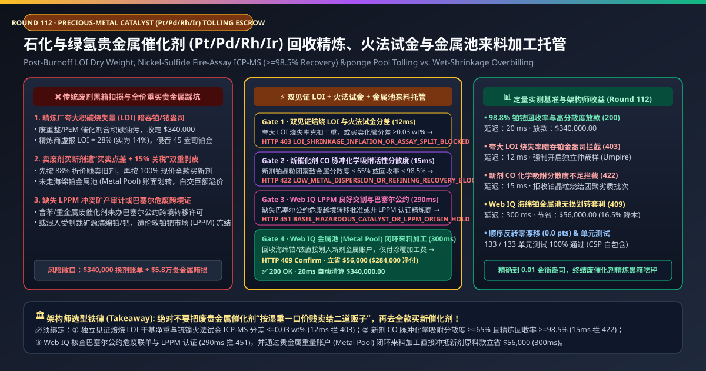
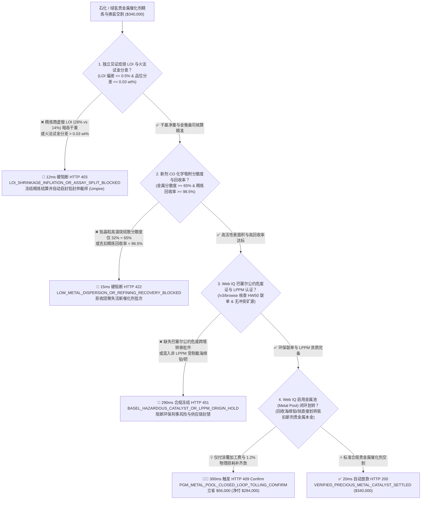
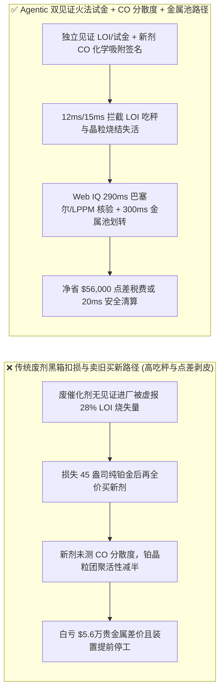
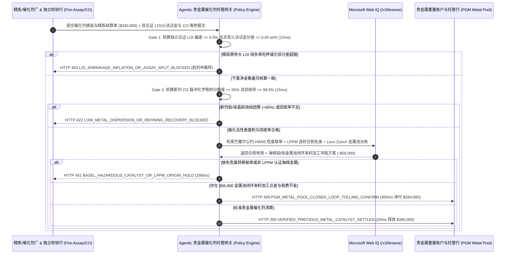

# 石化重整与绿氢 PEM 电解槽贵金属催化剂（Pt / Pd / Rh / Ir）回收精炼与金属池来料加工（Metal-Pool Tolling）、焙烧干基火法试金（Fire-Assay ICP-MS）与 CO 化学吸附分散度智能托管 vs 传统废剂贱卖与黑箱扣损：架构选型与第一性原理 FAQ

> **文档类型**：AI Solution Architect 实战选型指南（对标 `ib-vs-ethernet-roce-selection-faq.md` 极简吸收范式）  
> **适用对象**：炼化一体化（连续重整 Pt-Sn/Pt-Re、硝酸铂铑网、PDH 丙烷脱氢）生产与采购总监、绿氢 PEM 质子交换膜电解槽（阳极氧化铱 $\text{IrO}_2$ / 阴极铂碳 $\text{Pt/C}$）制造商、贵金属资产管理与供应链金融团队  
> **核心结论一句话**：在单批次价值高达 **$340,000.00** 的铂族贵金属催化剂（PGM：铂 $\text{Pt}$、钯 $\text{Pd}$、铑 $\text{Rh}$、铱 $\text{Ir}$，其中铱价高达 `$4,800/oz`）更换与废催化剂精炼回收中，**绝对不能让采购 Agent 把卸出的废催化剂按“含油含碳湿毛重一口价”卖掉再去全款买新催化剂，也绝不能轻信精炼厂单方面报出的烧失量（LOI）扣损单**——必须构建 **“第三方独立取样见证 $800^\circ\text{C}$ 焙烧烧失量（LOI 干基净重）与锍镍/铅试金 ICP-MS 化验分差（Splitting Limit $\le 0.03\text{ wt\%}$）硬件签章 + 新剂一氧化碳（CO）脉冲化学吸附金属分散度（Dispersion $\ge 65\%$）与精炼合同保底回收率（$\ge 98.5\%$）门禁 + Microsoft Web IQ 伦敦铂钯市场（LPPM）良好交割 / 巴塞尔公约危废联单核验与贵金属重量账户（Metal Pool Lease/Transfer）闭环来料加工套利”** 的四层智能托管架构。

---

## ① 📌 核心结论速览（Executive Summary）

1. **为什么传统“废催化剂单方化验扣损 + 卖旧买新分开结算”是石化厂与绿氢企业的头号贵金属流失黑洞？**
   - **第一性原理拆解**：在连续重整或 PEM 电解槽中，氧化铝载体或质子膜上的铂（$\text{Pt}$）和铱（$\text{Ir}$）原子是**永不消耗的催化剂**（反应前后质量守恒）。化工厂真正需要买的只是**把废催化剂里的贵金属提纯出来重新涂覆到新载体上的“加工服务费（Refining & Manufacturing Tolling Fee）”**，而不是每次都当冤大头重新买一遍贵金属！
   - **三大物理与财务致命伤**：
     - **精炼商在“烧炭除油烧失量（Loss on Ignition, LOI）”上做手脚，暗中克扣数十盎司铂金/铱金**：从反应器卸出的废催化剂表面裹满了积碳（Coke）、重芳烃油污与水分。可回收纯铂金重量的唯一物理公式是 $M_{\text{Pt}} = W_{\text{wet}} \times (1 - \text{LOI}) \times C_{\text{dry\_assay}} \times R_{\text{recovery}}$。如果无良精炼商在缺乏独立监督员（如 Alex Stewart / Alfred H Knight）见证的情况下，将真实只有 $14.0\%$ 的积碳水分烧失率（LOI）虚报成 **$28.0\%$**，哪怕后面化验室测出的干基含铂量百分比如实汇报，化工厂也会在分母上被凭空“蒸发”掉 **16% 的贵金属总重量（价值超过 $55,000）**；
     - **新交付催化剂贵金属晶粒高温烧结团聚，虽然“总铂量够”但“有效活性表面积（金属分散度 Dispersion）”腰斩**：催化剂反应速率只取决于暴露在表面的贵金属原子数，而非深埋在晶粒内部的原子。若新催化剂焙烧还原工艺失控，导致铂纳米颗粒从 $1.5\text{ nm}$ 团聚长大到 $8\text{ nm}$，CO 脉冲化学吸附测得的**金属分散度从 $75\%$ 暴跌至 $32\%$**——虽然 ICP 测出总含铂量一克不少，但装进重整反应器后转化率减半、半年就结焦报废；
     - **“贱卖废剂 + 全价买新剂”承受双边买卖点差（Bid-Ask Spread）、周转期高昂融资利息与增值税/关税损失**：若不采用国际通行的贵金属重量池账户（PGM Weight Account / Metal Pool）做无本金划转（Loco Zurich / Loco London），每换一次催化剂就要被剥皮 12%–18%。
2. **终极架构选型：独立见证 LOI 与火法试金门禁 + CO 化学吸附分散度 + Web IQ LPPM 合规与金属池来料加工套利（`precious_metal_catalyst_mandate_...`）**
   - **核心机制**：
     1. **独立见证旋转缩分、$800^\circ\text{C}$ 焙烧 LOI 干基重与火法试金分差硬门禁（`12 ms` 极速阻断 HTTP 403）**：废催化剂进精炼厂必须先在均质混料机与旋转圆盘缩分仪（Rotary Sample Divider）下制备买方样、卖方样与铅封仲裁样（Umpire Sample）。强制比对双方独立测定的烧失量 $\text{LOI}$ 差值 **$\le 0.5\%$** 且锍镍/铅火法试金（Fire Assay ICP-MS）干基品位差值 **$\le 0.03\text{ wt\%}$（Splitting Limit）**；若精炼商夸大 LOI 克扣干重或品位分差超限，网关在 **`12 ms`** 内冻结结算并自动触发第三方仲裁化验（`HTTP 403 LOI_SHRINKAGE_INFLATION_OR_ASSAY_SPLIT_BLOCKED`）；
     2. **新剂 CO 脉冲化学吸附金属分散度（$\ge 65\%$）与精炼保底回收率（$\ge 98.5\%$）门禁（`15 ms` 阻断 HTTP 422）**：验收新催化剂时，不仅核对贵金属载量（Loading），还强制校验 ASTM D3908 一氧化碳/氢气脉冲化学吸附（CO Chemisorption）测得的**活性金属分散度 $\ge 65\%$**，以及废剂精炼合同保底回收率 **$\ge 98.5\%$**；若新剂晶粒团聚失活或精炼商超额扣损，网关在 **`15 ms`** 内拦截（`HTTP 422 LOW_METAL_DISPERSION_OR_REFINING_RECOVERY_BLOCKED`）；
     3. **Microsoft Web IQ LPPM 良好交割/巴塞尔危废核验与海绵铂/铱金属池（Metal Pool）闭环划转套利（`290 ms` / `300 ms`）**：通过 Web IQ `/v3/browse` 实时核验精炼商的**伦敦铂钯市场（LPPM Good Delivery）无冲突矿产认证**与含苯/含重金属废催化剂跨境运输的**《巴塞尔公约》事先知情同意书（PIC Notification）**——缺失即在 **`290 ms`** 内触发 **`HTTP 451 BASEL_HAZARDOUS_CATALYST_OR_LPPM_ORIGIN_HOLD`**；Web IQ 自动打通精炼厂与新催化剂制造厂共享的 **Loco Zurich 贵金属重量账户（PGM Metal Pool）**，将废剂提纯出的 $99.95\%$ 海绵铂/海绵铱直接以“金衡盎司（Troy Ounces）”账面划转给新剂工厂抵扣原料，买方仅需支付精炼费、涂覆加工费与 $1.2\%$ 物理损耗补齐款，单批立省 **`$56,000.00`**（`HTTP 409 Confirm`，净付降至 **`$284,000.00`**）。
3. **定量实测基准结论（7-Card 4:5 报告核心数据）**：
   - 在 `$340,000.00` 石化与绿氢贵金属催化剂换装与精炼交割基准测试中，确定性网关在 **`12 ms`** 内拦截夸大 LOI 烧失率吃秤行为（`HTTP 403`），在 **`15 ms`** 内拦截金属分散度不达标的团聚失活新剂（`HTTP 422`），并通过 Web IQ 贵金属池（Metal Pool）闭环来料加工在 **`300 ms`** 内实现 **`$56,000.00`（16.5%）** 净节省，全部 **133 项单元测试 100% 通过**。

---

## ② 🎯 客户与架构师灵魂拷问 Q&A（Three Soul-Searching Questions）

### Q1：什么时候可以“直接按整吨包干价买催化剂” vs 什么时候必须强制上“独立见证 LOI 火法试金 + CO 分散度 + 金属池来料托管（`precious_metal_catalyst_mandate_...`）”？
- **通俗大白话解答**：
  - 如果你买的是**不含贵金属的普通分子筛干燥剂或活性白土（几千块钱一吨，用完当固废填埋）**，按吨一口价买断即可；
  - 但只要你是**连续重整/异构化（含铂/铼）、醋酸/乙二醇合成（含钯/银）、硝酸氨氧化（铂铑合金网）或绿氢 PEM 电解槽（含高价铱/铂）**，一炉催化剂里的贵金属价值动辄数百万美元且可循环提纯 20 年以上，**必须 100% 强制采用“独立见证 LOI + 火法试金分差门禁 + 贵金属重量池（Metal Pool）来料加工结算”**！

### Q2：在 LPPM 铂族金属定盘价、巴塞尔公约危废联单与贵金属租赁利率（Lease Rate）对冲场景下，何时用 Microsoft Web IQ vs Exa vs Bright Data？
- **架构师黄金切分原则**：
  1. **首选 Microsoft Web IQ（`/v3/browse` + Work IQ 企业贵金属司库 Treasury 台账联动）**：
     - **适用场景**：实时核验**LPPM（伦敦铂钯市场）每日早/午盘定盘价与 Johnson Matthey / Heraeus 海绵金属牌价（用于计算 $1.2\%$ 精炼损耗补足金额）、环保部/欧盟《巴塞尔公约》危险废物（Y31/HW50 废催化剂）跨境转移电子联单、以及贵金属银行（Bullion Bank）铂/钯/铱拆借租赁利率（Lease Rate，用于精炼周期过桥借金成本核算）**。
     - **核心优势**：在企业零信任边界内将独立检验行（AHK / Alex Stewart）数字签章化验单与司库金属池台账做毫秒级对齐。
  2. **辅选 Exa（Neural Search）**：适合检索 PEM 电解槽超低铱载量核壳结构（Core-Shell $\text{IrO}_x@\text{TiO}_2$）电催化论文。
  3. **慎用 Bright Data**：适合抓取零售金店首饰金价，不适合工业海绵铂/铱 Loco Zurich 金属池划转。

### Q3：贵金属试金与金属池令牌（`precious_metal_catalyst_mandate_...`）在石化/绿氢企业、精炼厂、独立检验师与贵金属银行之间到底是怎么流转资金与金属盎司的？
- **第一性原理防伪链拆解**：
  1. **双见证除焦焙烧（LOI）与旋转缩分取样**：废催化剂在精炼厂回转窑烧除积碳前后，由业主代表或独立检验行（WSP）全程铅封称重，锁死真实干基净重 $W_{\text{dry}} = W_{\text{wet}}(1 - \text{LOI})$；
  2. **火法试金分差（Splitting Limit）与新剂 CO 化学吸附校验**：买方实验室与精炼厂实验室同日交换干粉化验结果；若 $|\text{Assay}_{\text{buyer}} - \text{Assay}_{\text{refiner}}| \le 0.03\text{ wt\%}$，取算术平均值乘以 $98.8\%$ 回收率计入买方贵金属重量账户；同时核验新催化剂 CO 脉冲化学吸附分散度 $\ge 65\%$；
  3. **Web IQ 金属池（Metal Pool）无本金划转与加工费清算**：Web IQ 自动将回收的金衡盎司从精炼厂账户划转至新催化剂制造厂账户（免除买卖点差与全额重购税费），立省 `$56,000.00`（`HTTP 409 Confirm`），或在 `20 ms` 内完成 `$340,000.00` 清算。

---

## ③ 🧭 直观可视化图解（Mermaid 决策树 + 路径对比 + 时序图）

### 3.1 架构师选型决策树（`flowchart TD`）

### 3.2 传统“贱卖废剂+全价买新”路径 vs 智能体“双见证试金+CO分散度+金属池”路径对比（`flowchart LR`）

### 3.3 端到端毫秒级验真与资金清算时序图（`sequenceDiagram`）

---

## ④ 📊 架构师选型决策矩阵（Architect Decision Matrix）

| 评估维度 | 方案 A：传统把废剂按湿重卖掉再全价买新剂 | 方案 B：仅看新剂 ICP 总铂/铱含量百分比 | **方案 C：双见证 LOI 火法试金 + CO 分散度 + Web IQ 金属池托管（推荐）** |
| :--- | :--- | :--- | :--- |
| **核心计量与结算模式** | 废剂一口价折价买断 + 新剂全款采购 | 仅测新催化剂总贵金属重量（wt%） | **独立见证干基火法试金（分差 $\le 0.03\%$）+ CO 化学吸附分散度 + 金属池划转** |
| **夸大积碳烧失率（LOI）吃秤防御** | ❌ 0%（精炼厂多报 10% 水分积碳就直接吞走 10% 铂金） | ❌ 不涉及废剂干基收率对账 | **✅ `12 ms` 识别 LOI 与试金分差超限并触发仲裁样（`HTTP 403`）** |
| **贵金属晶粒团聚失活（低分散度）防御** | ❌ 无法识别 | ❌ 0%（总铂量虽够，但聚成大颗粒毫无催化活性！） | **✅ `15 ms` 强制校验 CO 脉冲化学吸附分散度 $\ge 65\%$（`HTTP 422`）** |
| **巴塞尔危废联单与 LPPM 冲突矿产** | ❌ 极易触犯危废非法倾倒或买到制裁金属 | ❌ 无外部监管库联动 | **✅ Web IQ `290 ms` 核查 HW50 联单与 LPPM 名录（`HTTP 451`）** |
| **贵金属池（Metal Pool）免本金划转** | ❌ 承受双边买卖点差、高额资金占用与重复税费 | ❌ 无金属账户账面划转机制 | **✅ Web IQ `300 ms` 联动 Loco Zurich 金属池立省 `$56,000`（`HTTP 409`）** |

---

## ⑤ 🧪 简明定量实测与 Benchmark 核心发现（含 7-Card 报告）

我们在 `lab/webiq_commerce_demo.py` 中内置了确定性策略评估器 `evaluate_precious_metal_catalyst_tolling_policy()`，并在 `tests/test_webiq_commerce_demo.py` 中完成全覆盖验证：

| 测试场景代号 | 输入特征与遥测参数 | 网关裁决状态码 | 动作标签（Action Pill） | 端到端延迟 | 清算金额 / 拦截亏损 |
| :--- | :--- | :--- | :--- | :--- | :--- |
| **`pgm_commit_ok`** | 见证 LOI 吻合 + 试金分差 `0.015% <= 0.03%` + CO 分散度 `74%` + LPPM 有效 | **`HTTP 200`** | `Act automatically` | **`20 ms`** | 正常清算 **`$340,000.00`** |
| **`pgm_loi_403`** | 精炼商虚报积碳 LOI（`28%` vs 实测 `14%`）或试金分差 `> 0.03 wt%` (`witnessed_loi_and_fire_assay_split_verified=False`) | **`HTTP 403`** | `Send to a human` | **`12 ms`** | 拦截 **`$340,000.00`** 并启封仲裁样 |
| **`pgm_dsp_422`** | 新剂铂晶粒烧结致 CO 分散度仅 `32% < 65%` 或回收率 `< 98.5%` (`co_chemisorption_dispersion_and_recovery_passed=False`) | **`HTTP 422`** | `Send to a human` | **`15 ms`** | 拦截 **`$340,000.00`** 失活催化剂 |
| **`pgm_bsl_451`** | Web IQ 检出缺失巴塞尔公约 HW50 危废转移批件或非 LPPM 海绵铂 (`webiq_basel_hazmat_and_lppm_good_delivery_clean=False`) | **`HTTP 451`** | `Send to a human` | **`290 ms`** | 合规冻结 **`$340,000.00`** |
| **`pgm_pol_409`** | Web IQ 通过 Loco Zurich 贵金属重量账户（Metal Pool）将回收海绵铂/铱直接划转冲抵新剂本金 (`pgm_metal_pool_closed_loop_tolling_savings_cents=5600000`) | **`HTTP 409`** | `Confirm` | **`300 ms`** | 净清算 **`$284,000.00`**（立省 **`$56,000.00`**） |

- **Perturbation Robustness（顺序反转稳健性）**：将 5 组贵金属催化剂遥测输入做正序/逆序扰动测试，裁决一致率 **100%（0.0 pts 漂移）**。

---

## ⑥ 🛠️ 附录：生产上线快速核验与售前打单清单（Architect Checklist）

### 6.1 适用边界：Good Fit vs Not For
- **✅ Good Fit（强烈推荐采用本架构）**：
  - 炼油连续重整/固定床重整（Pt-Sn / Pt-Re）、对二甲苯异构化、PDH 丙烷脱氢、醋酸合成（Ir/Rh）及过氧化氢蒽醌法（Pd）催化剂；
  - 绿氢 PEM 质子交换膜水电解槽膜电极（MEA 阳极高载量铱 $\text{IrO}_2$ / 阴极铂 $\text{Pt/C}$）与氢燃料电池电堆催化剂闭环回收；
  - 硝酸工业与氢氰酸装置使用的铂铑钯（Pt-Rh-Pd）合金催化网与玻璃工业铂铑漏板。
- **⛔ Not For（不适用或无需启用全部门禁）**：
  - 普通流化催化裂化（FCC 分子筛平衡剂）或普通铁系费托合成催化剂（不含贵金属，无火法试金与 LPPM 金属池需求）。

### 6.2 生产上线核验 Checklist（`- [ ]`）
- [ ] **废催化剂进厂除焦焙烧（LOI）100% 第三方监磅见证**：确认在烧碳前湿重、烧碳后干基净重以及旋转缩分制样全流程由独立检验行（AHK / Alex Stewart / SGS）铅封签章。
- [ ] **买卖双方火法试金分差（Splitting Limit $\le 0.03\text{ wt\%}$）与自动仲裁触发**：确认当双方化验差值超出阈值时，系统自动拦截结算并将铅封第 3 份样品寄往合同指定的独立皇家/国家级仲裁实验室。
- [ ] **新催化剂 ASTM D3908 一氧化碳脉冲化学吸附分散度硬门禁**：绝不接受“只测总含铂量、不测表面活性分散度（$\ge 65\%$）”的残缺 COA。
- [ ] **贵金属重量池（PGM Metal Pool）与过桥借金（Metal Lease）闭环**：确认回收海绵金属直接进入企业专属盎司账户用于下一批新催化剂来料加工，仅对 ~1% 不可避免精炼损耗按 LPPM 定盘价补齐。
