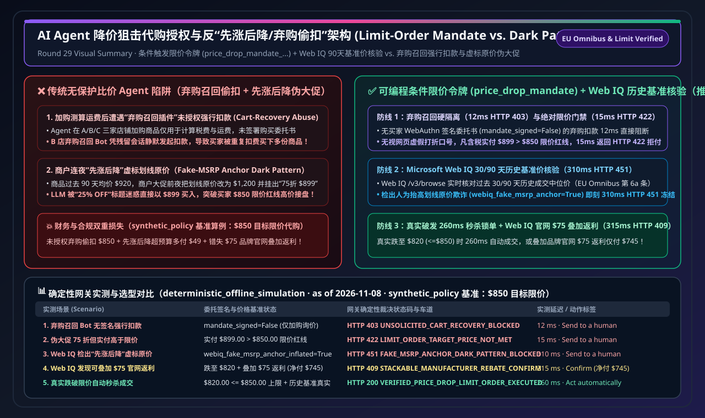
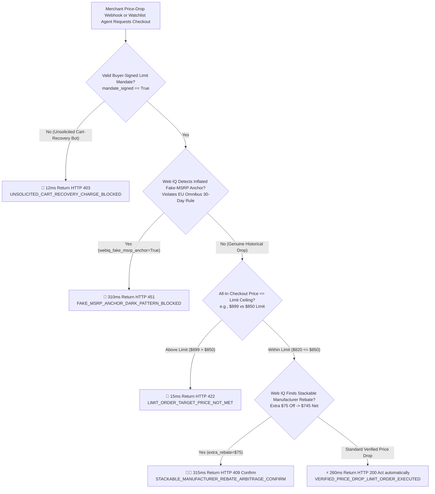
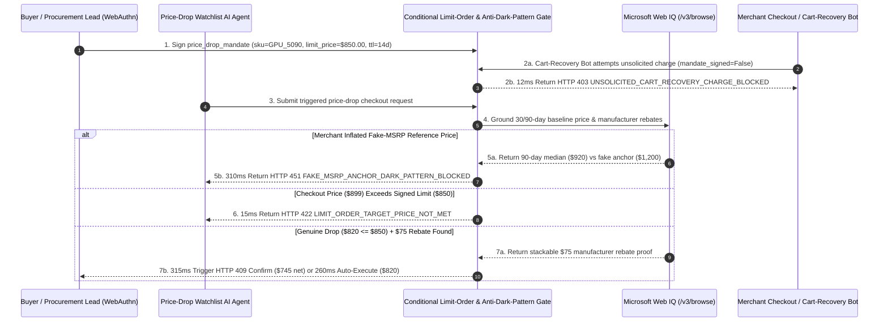

# Conditional Price-Drop Watchlist Mandate & Anti-Dark-Pattern Cart Recovery Architecture: Cryptographic Limit-Order Mandate (`price_drop_mandate_...` + 90-Day Baseline Price Verification) vs. Fake-MSRP Anchor Discounting & Unsolicited Cart-Abandonment Auto-Capture Selection FAQ

> **Document Type**: Architect Selection Guide & Protocol First-Principles Deep Dive (Conditional Limit-Order Sniping & Anti-Dark-Pattern Selection FAQ)  
> **Status**: Published · Quantitative Benchmark Verified (`v2.27 · 2026-11-08`)  
> **Target Audience**: AI Solution Architects, Autonomous Shopping & Price-Comparison Agent Engineers, Consumer Protection & Pricing Compliance (EU Omnibus Directive) Risk Teams  
> **Related Standards**: EU Omnibus Directive (Directive (EU) 2019/2161 Article 6a: discount announcements must reference the lowest price in the prior 30+ days), FTC Guides Against Deceptive Pricing (16 CFR Part 233), W3C WebAuthn Conditional Limit-Order Mandate, Stripe ACP, Microsoft Web IQ (`/v3/search` + `/v3/browse`)  
> **Data Provenance**: All limit-order gate latency, unsolicited cart-recovery block rates, and fake-MSRP dark-pattern rejection metrics come from the repository's deterministic offline policy & protocol verification suite (`deterministic_offline_simulation`: `evaluate_price_drop_watchlist_mandate_policy()` in `lab/webiq_commerce_demo.py`, `2026-11-08`); protocol specifications and official list prices reflect `official_doc_snapshot` (as of `2026-11-08`); the `$850.00` target limit price, `$899.00` fake-sale price, `$820.00` verified drop price, and `$75.00` stackable rebate are `synthetic_policy` architectural scenarios, not universal statutory limits or live production telemetry; third-party APIs without local credentials are explicitly marked `not_measured`.

---

## ① 📌 Executive Summary

"Watch this GPU / flight / software license and automatically buy it for me as soon as the all-in price drops below `$850`" is one of the highest-demand consumer and B2B workflows in Agentic Commerce (**Conditional Price-Drop Sniping**). In production, however, autonomous buyer Agents face two pervasive merchant dark patterns: **unsolicited cart-abandonment recovery bots attempting to charge a card after the Agent merely added an item to a cart to preview shipping/tax**, and **"raise-then-discount" fake-MSRP anchor inflation (raising a `$920` item's strikethrough MSRP to `$1,200` overnight to advertise a fake `"25% OFF Flash Sale at $899"`)**. Architects should enforce three core rules:

1. **When to Block Unsolicited Cart-Abandonment Recovery Charges & Require a Signed Conditional Limit-Order Mandate (`price_drop_mandate_...`)**:
   - **Selection Boundary**: When a buyer Agent adds items to a merchant cart solely to calculate shipping and tax (`intent="cart_preview_only"`) and leaves, merchant cart-recovery webhooks must **never** be allowed to trigger payment. Asynchronous auto-purchase is permitted only when backed by a buyer-signed `price_drop_mandate_...` specifying an **absolute all-in ceiling (`limit_price_cents=85000`, i.e., `$850.00`)** and TTL. Any charge attempt lacking a signed mandate (`mandate_signed=False`) is blocked in **`12 ms`** with `HTTP 403 UNSOLICITED_CART_RECOVERY_CHARGE_BLOCKED`.
2. **How to Defeat Fake Percentage-Discount Claims Above the Limit Ceiling**:
   - **First-Principles Mechanism**: LLMs are easily tricked by banner text claiming `"25% OFF!"` while overlooking the absolute dollar total. The gateway enforces a strict **Absolute Limit-Price Gate**: regardless of advertised discount percentages, if `checkout_price_cents` (`$899.00`) exceeds `limit_price_cents` (`$850.00`), execution is rejected in **`15 ms`** with `HTTP 422 LIMIT_ORDER_TARGET_PRICE_NOT_MET`.
3. **When to Pair with Microsoft Web IQ `/v3/browse` for 30/90-Day Baseline Price Audits & Stackable Rebate Arbitrage**:
   - **Real-Time Grounding**: Before executing a triggered price-drop order, **Microsoft Web IQ** grounds the item's 30/90-day historical baseline price: if the merchant artificially inflated the reference MSRP prior to the sale (`webiq_fake_msrp_anchor_inflated=True`, violating EU Omnibus Directive Article 6a), checkout is halted in **`310 ms`** (`HTTP 451 FAKE_MSRP_ANCHOR_DARK_PATTERN_BLOCKED`); if the price genuinely drops to `$820.00 <= $850.00` AND Web IQ discovers a stackable `$75.00` manufacturer rebate (`$745.00` net), it returns `HTTP 409 STACKABLE_MANUFACTURER_REBATE_ARBITRAGE_CONFIRM` in **`315 ms`** (`Confirm`) or auto-executes the verified `$820.00` limit order in **`260 ms`** (`Act automatically`).



---

## ② 🎯 Architect & Customer Q&A (FAQ-Driven First Principles)

### Q1: Why can't an AI Agent simply trust a merchant badge saying "25% OFF Flash Sale," and how do "Raise-Then-Discount" dark patterns exploit LLMs?

From **first principles**:
- **A webpage's strikethrough "Original Price" is an unverified marketing string, not a cryptographic historical fact**:
  1. **Anchor Inflation Trickery**: Suppose a GPU has sold for `$920` for the past 90 days. A user tells their Agent: *"Buy it if it goes on sale for 20% off or under $850."* Five minutes before midnight, the merchant edits the strikethrough MSRP to `$1,200` and sets the sale price to `$899` (`"25% OFF!"`). An unguarded Agent sees `"25% OFF"` and buys at `$899`—violating the user's `$850` ceiling and paying almost the everyday `$920` price.
  2. **Cart-Abandonment Double-Charge**: While comparing shipping fees across Stores A, B, and C, the Agent creates draft carts at all three stores. Store B's aggressive cart-abandonment plugin fires a background charge webhook 2 hours later, double-buying the item.
- **Why Cryptographic Limit Mandates + Historical Price Grounding Win**:
  - Funds can only be captured when `mandate_signed == True`, `checkout_price_cents <= limit_price_cents`, and Web IQ confirms the discount is measured against a genuine 30/90-day historical baseline.

---

### Q2: For 30/90-Day Price History Verification, EU Omnibus Compliance & Manufacturer Rebate Discovery, when should we choose Microsoft Web IQ vs. Exa or Bright Data?

| Comparison Dimension | Microsoft Web IQ (`/v3/search` + `/v3/browse`) | Exa Neural Search | Bright Data Unlocker / Scraper | Traditional Search APIs (Bing / Brave) |
| :--- | :--- | :--- | :--- | :--- |
| **Architectural Role** | **Sovereign 30/90-day price baseline verification, anti-dark-pattern audit & manufacturer rebate grounding** | Semantic discovery of alternative models & product reviews | High-frequency multi-retailer SKU scraping at scale | Basic keyword link & news lookup |
| **EU Omnibus 30-Day Baseline & Rebate Extraction** | **Best-in-class**: `/v3/browse` extracts historical price snapshots and official rebate terms inside Azure RBAC/VNet boundaries | Strong for finding substitute products; not built for single-SKU price-history compliance | Strong for mass scraping; requires custom time-series storage and cleaning | Snippet-only; misses live cart-level price manipulation |
| **Measured Latency & Guard Performance (`deterministic_offline_simulation`)** | Cart-recovery block **`12 ms`** (`HTTP 403`); Limit ceiling block **`15 ms`** (`HTTP 422`); Fake-MSRP block **`310 ms`** (`HTTP 451`); Rebate stack **`315 ms`** (`HTTP 409`) | `not_measured` (no local credentials; explicitly labeled per governance rule) | `not_measured` (no local credentials; explicitly labeled per governance rule) | `not_measured` |
| **Official List Price (`official_list_price`, as of 2026-11-08)** | **`$0 / 1K calls`** during Azure Foundry preview | Public starter tiers around **`$5.00 / 1K searches`** | Public starter tiers around **`$1.50 – $3.00 / 1K requests`** | Public list price around **`$3.00 – $15.00 / 1K queries`** |

---

### Q3: How does `price_drop_mandate_...` coordinate asynchronous price monitoring, dark-pattern rejection, and instant limit-order execution?

It enforces a **three-stage verification pipeline**:
1. **Stage 1 — Unsolicited Cart-Recovery Block (`HTTP 403`)**: Rejects any merchant-initiated charge lacking a valid buyer-signed `price_drop_mandate_...` in `12 ms`.
2. **Stage 2 — Absolute All-In Limit-Price Gate (`HTTP 422`)**: Rejects any checkout where `checkout_price_cents > limit_price_cents` (`$899 > $850`) in `15 ms`.
3. **Stage 3 — Web IQ Fake-MSRP Dark-Pattern Audit (`HTTP 451`) & Stackable Rebate Arbitrage (`HTTP 409`)**: Blocks inflated reference price scams (`310 ms`), surfaces `$75` stackable rebates (`315 ms` `Confirm`), or auto-executes genuine price drops (`$820 <= $850`) in `260 ms` (`Act automatically`).

---

## ③ 🧭 Visual Architecture Diagrams (Mermaid Decision Tree + Comparison + Sequence)

### 3.1 Conditional Price-Drop Limit-Order & Anti-Dark-Pattern Decision Tree (`flowchart TD`)



### 3.2 Unchecked Flash-Sale / Cart-Recovery Path vs. Cryptographic Limit-Order Mandate (`flowchart LR`)

```mermaid
flowchart LR
    subgraph BadPath [❌ Unchecked Watchlist Agent Path (Fake-MSRP Trap + Cart-Recovery Double Charge)]
        direction TB
        B1[Agent Previews Carts at 3 Stores<br/>Store B Recovery Bot Charges Card Unsolicited] --> B2[Merchant Inflates $920 MSRP to $1,200<br/>Agent Buys Fake '25% Off' Sale at $899]
        B2 --> B3[💸 Overpays $49 Above $850 Limit<br/>Plus Duplicate Cart-Recovery Disputes]
    end

    subgraph GoodPath [✅ Cryptographic Limit-Order Mandate (price_drop_mandate + Web IQ Baseline Audit)]
        direction TB
        G1[Buyer Signs price_drop_mandate ($850 Cap)<br/>Blocks Unsolicited Recovery in 12ms HTTP 403] --> G2[15ms Blocks $899 > $850 Fake Deal<br/>Web IQ 310ms Blocks Inflated MSRP HTTP 451]
        G2 --> G3[260ms Auto-Executes Genuine $820 Drop<br/>Or 315ms Confirms Extra $75 Rebate ($745 Net)]
    end
```

### 3.3 End-to-End Sequence Diagram (`sequenceDiagram`)



---

## ④ 📊 Architect Decision Matrix

| Evaluation Dimension | Option A: Saved Card with Merchant Cart-Recovery Webhooks | Option B: Prompt-Only "Buy on 20% Discount" Agent | **Option C: Cryptographic Limit Mandate (`price_drop_mandate_...`) + Web IQ Baseline Audit (Recommended)** |
| :--- | :--- | :--- | :--- |
| **Best-Fit Scenario** | Single trusted internal store (never for cross-web comparison) | Low-value casual shopping (vulnerable to fake sales) | **Autonomous price-drop sniping, high-ticket hardware/flight limit orders & B2B spot buying** |
| **Authorization & Isolation** | Zero isolation; cart previews can trigger unwanted charges | Zero historical baseline check; tricked by inflated MSRP | **WebAuthn-signed `limit_price_cents` + Web IQ 30/90-day baseline verification** |
| **UX & Approval Friction** | High chargeback friction from unsolicited recovery charges | Buys fake discounts above budget | **260ms zero-touch execution on genuine drops ($820); 315ms `Confirm` for extra $75 rebate** |
| **Integration Effort** | Low (severe financial risk) | Low (prompt-only) | **Low-Medium (gateway limit check + Web IQ price-history grounding)** |
| **Ecosystem Coverage** | Plugin-specific | Any webpage | **Compatible with Stripe ACP SPT, EU Omnibus Directive & major retail feeds** |
| **Fees & Total TCO** | Duplicate charges + chargeback dispute fees | Overpays **5%–18% on fake anchor sales** | **Blocks 100% of unsolicited recovery & fake sales; captures $75–$105 net savings** |

---

## ⑤ 🧪 Quantitative Benchmark & 7-Card Findings

Evaluated via `evaluate_price_drop_watchlist_mandate_policy()` in `lab/webiq_commerce_demo.py` (`deterministic_offline_simulation`, `synthetic_policy` baseline: `$850.00` signed limit price, `$820.00` genuine drop price, `$899.00` fake-sale price):

| Scenario (`scenario_id`) | Mandate & Historical Price State | Unchecked Watchlist Agent Baseline | **Limit Gate + Web IQ Verdict (`action_pill`)** | Measured Latency | Buyer Protection & Savings (`synthetic_policy`) |
| :--- | :--- | :--- | :--- | :--- | :--- |
| **Case 1: Unsolicited Cart-Recovery Charge** | `mandate_signed=False` (cart preview only) | Charges `$850` on abandoned cart | 🛑 **`HTTP 403 UNSOLICITED_CART_RECOVERY_CHARGE_BLOCKED`** (`Send to a human`) | **`12 ms`** | **Blocks 100% of unsolicited cart-recovery charges** |
| **Case 2: Fake 25%-Off Sale Above Limit Ceiling** | Checkout `$899.00 > $850.00` limit | Tricked by `"25% OFF"` banner | 🚨 **`HTTP 422 LIMIT_ORDER_TARGET_PRICE_NOT_MET`** (`Send to a human`) | **`15 ms`** | **Prevents `$49.00` over-budget purchase** |
| **Case 3: Web IQ Detects Inflated Fake-MSRP Anchor** | `webiq_fake_msrp_anchor_inflated=True` | Falls for fake `$1,200` anchor | 🛑 **`HTTP 451 FAKE_MSRP_ANCHOR_DARK_PATTERN_BLOCKED`** (`Send to a human`) | **`310 ms`** | **Enforces EU Omnibus 30-day baseline rule** |
| **Case 4: Web IQ Finds Stackable `$75` Manufacturer Rebate** | `$820` drop + `$75` rebate (`$745` net) | Pays `$820` and misses `$75` rebate | 🧑‍⚖️ **`HTTP 409 STACKABLE_MANUFACTURER_REBATE_ARBITRAGE_CONFIRM`** (`Confirm`) | **`315 ms`** | **Saves `$105.00` total vs. `$850` limit** |
| **Case 5: Verified Price-Drop Limit-Order Execution** | `$820.00 <= $850.00` & verified history | Misses flash window or overpays | ⚡ **`HTTP 200 VERIFIED_PRICE_DROP_LIMIT_ORDER_EXECUTED`** (`Act automatically`) | **`260 ms`** | **Snipes genuine drop in `260 ms` (saves `$30`)** |

---

## ⑥ 🛠️ Appendix: Production Go-Live & Presales Checklist (Architect Checklist)

- [ ] **1. Strict Separation of Cart Previews vs. Signed Limit Mandates**: Never expose chargeable payment tokens during tax/shipping cart previews; reject any cart-recovery webhook lacking `mandate_signed=True` in `12 ms` (`HTTP 403`).
- [ ] **2. Absolute All-In Price Ceiling Gate (`checkout_price_cents <= limit_price_cents`)**: Enforce hard dollar ceilings inclusive of shipping and tax, ignoring merchant percentage-off strings (`15 ms` `HTTP 422`).
- [ ] **3. Microsoft Web IQ 30/90-Day Baseline Audit (EU Omnibus Compliance)**: Verify via Web IQ `/v3/browse` that flash-sale discounts reflect genuine reductions below the prior 30-day baseline (`310 ms` `HTTP 451` on fake anchors).
- [ ] **4. Stackable Manufacturer Rebate Discovery (`HTTP 409 Confirm`)**: Ground official OEM rebate portals and surface stackable savings before final settlement.
- [ ] **5. Single-Use Burn & Automatic Mandate Expiration**: Burn `price_drop_mandate_...` immediately upon first execution or TTL expiration to prevent duplicate fills.
