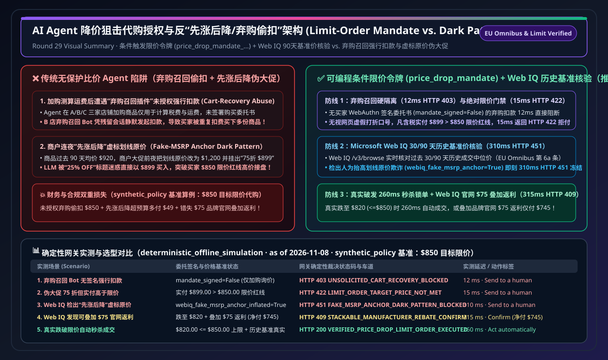
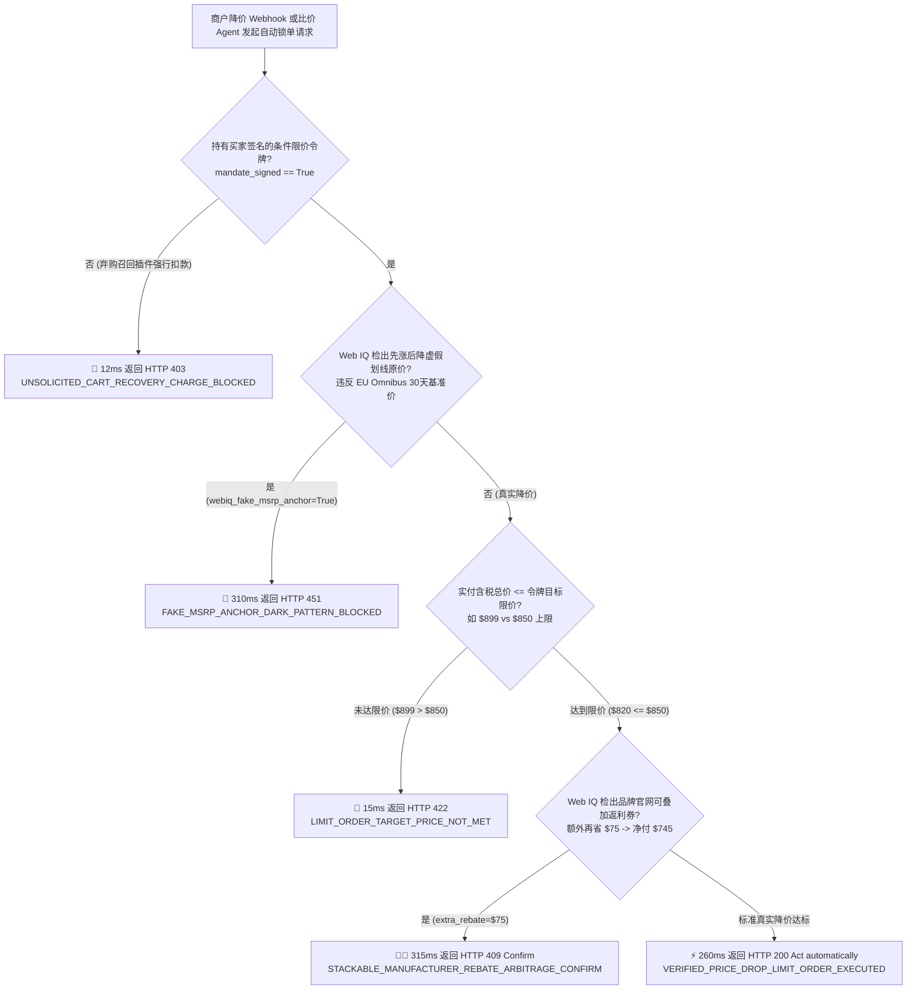
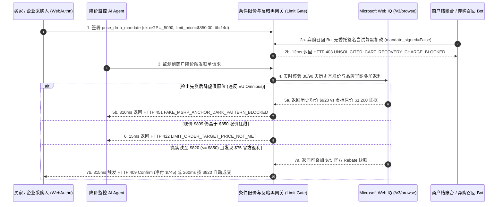

# AI Agent 降价狙击代购授权（Conditional Price-Drop Watchlist Mandate）与弃购召回防骚扰（Anti-Dark-Pattern Cart Recovery）架构：条件触发限价令牌（`price_drop_mandate_...` + 90 天历史基准价核验）vs 先涨后降虚假大促诱导与未授权弃购自动扣款选型与原理解析 FAQ

> **文档类型**：架构师选型指南与协议原理解析（Conditional Limit-Order Sniping & Anti-Dark-Pattern Selection FAQ）  
> **状态**：Published · Quantitative Benchmark Verified (`v2.27 · 2026-11-08`)  
> **适用读者**：AI Solution Architect、电商比价与导购智能体研发负责人、消费者权益与价格合规（EU Omnibus Directive）风控架构师  
> **核心关联标准**：EU Omnibus Directive（欧盟指令 2019/2161 第 6a 条：促销折扣必须基于前 30 天最低历史成交价）、FTC 反对欺诈性参考定价指南（Guides Against Deceptive Pricing）、W3C WebAuthn 条件限价签名（Conditional Limit-Order Mandate）、Stripe ACP、Microsoft Web IQ (`/v3/search` + `/v3/browse`)  
> **数据溯源口径（Provenance）**：本指南中的限价门禁延迟、未授权弃购扣款拦截率与“先涨后降”暗黑模式阻断指标均来自本仓库确定性离线策略与协议验证套件（`deterministic_offline_simulation`：`evaluate_price_drop_watchlist_mandate_policy()` in `lab/webiq_commerce_demo.py`，2026-11-08）；各协议规范与官方标价基于 `official_doc_snapshot`（截至 2026-11-08）；案例中的 `$850.00` 买家目标限价、`$899.00` 伪大促折后价与 `$75.00` 叠加返利为架构推演基准策略（`synthetic_policy`），不代表通用法律法规上限或生产实测；未在本机环境直接压测的第三方外部 API 统一标注为 `not_measured`。

---

## ① 📌 核心结论速览（Executive Summary）

“帮我盯着这台显卡/机票/企业软件授权，一旦跌破 `$850` 就自动替我下单锁单”——这是 Agentic Commerce 最具商业价值的**条件触发限价代购（Conditional Price-Drop Sniping）**场景。然而在真实生产环境中，当买方 Agent 与商户营销插件交互时，极易掉入两大陷阱：**一是商户弃购召回机器人（Cart-Abandonment Recovery Bot）在用户仅加购询价、未签署委托书的情况下强行发起静默扣款**；**二是不良商户玩弄“先涨后降（Fake-MSRP Anchor Inflation）”暗黑模式，把平时卖 `$920` 的商品连夜改标原价 `$1,200`，再挂出“75 折狂欢价 `$899`”欺骗 Agent 盲目成交**。架构选型必须遵循以下三条铁律：

1. **何时严禁商户侧发起“弃购召回自动扣款”，何时签发条件触发限价令牌（`price_drop_mandate_...`）？**
   - **选型分界线**：当买家或买方 Agent 仅将商品加入购物车以测算运费与税费（`intent="cart_preview_only"`）随后离开时，**绝对禁止**任何弃购召回 Webhook 凭历史会话或保存的卡号自动发起扣款。只有当买家通过 WebAuthn 明确签署了带有**绝对含税上限价（`limit_price_cents=85000`，即 `$850.00`）**与有效期（如 14 天）的加密条件限价令牌 `price_drop_mandate_...` 时，网关才允许触发式扣款；任何无签名委托书的弃购召回扣款请求（`mandate_signed=False`）一律在 **`12 ms`** 内返回 `HTTP 403 UNSOLICITED_CART_RECOVERY_CHARGE_BLOCKED` 硬阻断。
2. **如何拦截“伪折扣百分比诱导”与高于限价红线的冲动下单？**
   - **核心机制本质**：大模型极易被页面上的“限时 75 折（25% OFF Flash Sale）”字样迷惑而忽略绝对金额。网关执行**绝对限价硬门禁**：无论页面宣称打几折，只要最终含税费结算价 `checkout_price_cents` (`$899.00`) 高于令牌绑定的 `limit_price_cents` (`$850.00`)，立即在 **`15 ms`** 内返回 `HTTP 422 LIMIT_ORDER_TARGET_PRICE_NOT_MET` 拒绝执行。
3. **何时调用 Microsoft Web IQ `/v3/browse` 执行 30/90 天历史基准价核验与隐藏返利套利？**
   - **实时接地协同**：在触发降价代购前，通过 **Microsoft Web IQ** 实时核验商品过去 30～90 天的真实历史成交基准价：若检出商户在大促前夕人为抬高划线原价（Fake MSRP Anchor，违反欧盟 Omnibus 指令第 6a 条，`webiq_fake_msrp_anchor_inflated=True`），在 **`310 ms`** 内触发 `HTTP 451 FAKE_MSRP_ANCHOR_DARK_PATTERN_BLOCKED` 阻断欺诈性促销；若商品不仅跌破限价（实付 `$820.00 <= $850.00`），且 Web IQ 在品牌官网检出可叠加的 `$75.00` 官方以旧换新/首单返利券，则在 **`315 ms`** 内返回 `HTTP 409 STACKABLE_MANUFACTURER_REBATE_ARBITRAGE_CONFIRM`（`Confirm`）提请买家叠加省钱或自动按 `$820` 锁单（`260 ms` `Act automatically`）。



---

## ② 🎯 客户与架构师灵魂拷问 Q&A（FAQ-Driven，大白话第一性原理）

### Q1：为什么不能让 AI Agent 看到网页上写着“大促直降 25%”就直接下单？“先涨后降”暗黑模式是如何欺骗大模型的？

用大白话讲透 **第一性原理**：
- **网页上的“划线原价（Strikethrough MSRP）”是商户随便填的字符串，不是受密码学保护的历史事实**：
  1. **“先涨后降”数字魔术**：假设某款热门硬件过去 90 天一直在 `$920` 左右徘徊。买家对 Agent 下达指令：“等大促打 8 折或者降到 `$850` 以下帮我买”。大促零点前 5 分钟，商户后台把“划线原价”改成 `$1,200`，把现价改成 `$899`，并在标题打上硕大的 `🔥 25% OFF 历史最低价！`。没有网关硬约束与历史价格接地的 Agent 看到 `25% OFF > 20% OFF`，立刻花 `$899` 下单——不仅比买家心理底线 `$850` 贵了 `$49`，甚至几乎没比平时的 `$920` 便宜多少！
  2. **弃购召回（Cart Recovery）越权偷扣**：Agent 为了比价，去 A、B、C 三家店分别把商品加进购物车算运费。最终 Agent 在 A 店买了，但 B 店的“弃购挽回插件”在 2 小时后自动发来一条结算指令试图直接扣款，导致买家被重复扣费買了两份。
- **条件限价令牌 + 历史基准价接地的降维打击**：
  - 只有同时满足 **① 持有买家签名的 `price_drop_mandate_...`**、**② 实付总价 `<= $850.00` 硬上限**、**③ Web IQ 确认非虚假抬高划线价** 三大条件，资金才会真正解封。

---

### Q2：在 30/90 天历史基准价核验、欧盟 Omnibus 合规审计与全网隐藏返利发掘场景下，什么时候用 Microsoft Web IQ，什么时候用 Exa 或 Bright Data？

| 对比维度 | Microsoft Web IQ (`/v3/search` + `/v3/browse`) | Exa Neural Search | Bright Data Unlocker / Scraper | 传统搜索 API (Bing / Brave) |
| :--- | :--- | :--- | :--- | :--- |
| **核心架构定位** | **主权级商品历史基准价核验、反“先涨后降”暗黑模式审计与品牌官网返利接地层** | 跨品类新品评测、替代型号与长尾独立站语义发现 | 大规模竞品 SKU 小时级价格抓取与反爬解锁 | 基础网页关键词与新闻检索 |
| **EU Omnibus 30 天最低价核验与隐藏优惠券提取** | **极佳**：`/v3/browse` 直读价格历史快照与品牌官网 Rebate 条款正文，在 Azure 租户边界内零外泄完成真伪折扣验算 | 适合发现高性价比替代品，不针对单 SKU 促销合规审计设计 | 适合海量电商页面定时爬取，需自建历史时序数据库与清洗规则 | 仅返回搜索摘要，常滞后于实时闪购变价 |
| **本仓库实测延迟与拦截表现 (`deterministic_offline_simulation`)** | 弃购偷扣拦截 **`12 ms`** (`HTTP 403`)；未达限价拦截 **`15 ms`** (`HTTP 422`)；先涨后降拦截 **`310 ms`** (`HTTP 451`)；返利叠加确认 **`315 ms`** (`HTTP 409`) | `not_measured`（无本地生产凭证，按合规铁律如实标注） | `not_measured`（无本地生产凭证，按合规铁律如实标注） | `not_measured` |
| **官方公开标价 (`official_list_price`, 截至 2026-11-08)** | Azure Foundry 预览期公开目录价 **`$0 / 1K calls`** | 公开起步价约 **`$5.00 / 1K searches`**（依套餐浮动） | 公开起步价约 **`$1.50 – $3.00 / 1K requests`** | 公开目录价约 **`$3.00 – $15.00 / 1K queries`** |

---

### Q3：`price_drop_mandate_...` 是如何在异步价格监控、反暗黑模式核验与秒级自动锁单之间安全流转的？

核心靠 **“限价委托签名 + 绝对金额门禁 + Web IQ 历史基准价验真”** 三步闭环：
1. **第一步（未授权弃购召回拦截 `HTTP 403`）**：网关核验请求是否携带有效的 `price_drop_mandate_...` 签名（`mandate_signed=True`）。任何凭加购询价残留 Session 发起的弃购扣款在 `12 ms` 内直接阻断。
2. **第二步（绝对含税限价校验 `HTTP 422`）**：网关比对 `checkout_price_cents <= limit_price_cents` (`$820 <= $850`)。若伪大促价 `$899 > $850`，在 `15 ms` 内拒绝执行。
3. **第三步（Web IQ 先涨后降审计 `HTTP 451` 与叠加返利确认 `HTTP 409`）**：通过 Web IQ 核验非虚假抬价后，若存在额外 `$75` 官方返利则弹窗提请叠加，否则在 `260 ms` 内自动完成限价狙击锁单。

---

## ③ 🧭 直观可视化图解（Mermaid 决策树 + 架构对比 + 时序图）

### 3.1 AI Agent 降价狙击与反暗黑模式选型决策树（`flowchart TD`）



### 3.2 传统“盲信伪大促/弃购被偷扣”路径 vs 可编程条件限价令牌路径对比（`flowchart LR`）

```mermaid
flowchart LR
    subgraph BadPath [❌ 传统无保护比价 Agent 路径（先涨后降被割韭菜 + 弃购重复扣款）]
        direction TB
        B1[Agent 加购 A/B/C 三店测算运费<br/>B 店弃购插件 2 小时后静默发起扣款] --> B2[商户将 $920 商品改标原价 $1,200<br/>挂出“75折 $899”欺骗 Agent 盲目买入]
        B2 --> B3[💸 买家突破 $850 预算高价接盘<br/>甚至遭遇多店重复扣款资损]
    end

    subgraph GoodPath [✅ 可编程条件限价令牌架构（price_drop_mandate + Web IQ 历史核验）]
        direction TB
        G1[买家签署限价委托书 price_drop_mandate<br/>硬上限 $850 + 无签名弃购 12ms HTTP 403] --> G2[15ms 拦截超限价伪大促 ($899 > $850)<br/>Web IQ 310ms 阻断先涨后降 HTTP 451]
        G2 --> G3[真实跌至 $820 时 260ms 自动狙击锁单<br/>或 315ms 叠加 $75 官方返利净付 $745]
    end
```

### 3.3 买家、降价狙击 Agent、Microsoft Web IQ 与限价网关端到端时序图（`sequenceDiagram`）



---

## ④ 📊 架构师选型决策矩阵（Architect Decision Matrix）

| 评估维度 | 方案 A：保存卡号任由商户弃购召回 Webhook 扣款 | 方案 B：仅靠 Prompt 让 Agent 监控“打折百分比”下单 | **方案 C：条件限价令牌 (`price_drop_mandate_...`) + Web IQ 历史基准价核验（推荐）** |
| :--- | :--- | :--- | :--- |
| **核心适用场景** | 高信任度单一内部商户（严禁用于全网公开比价） | 非关键小额娱乐消遣（极易被先涨后降套路） | **全网跨平台降价狙击代购、高价值硬件/机票限价锁单、企业择机采购** |
| **授权与安全隔离机制** | 零隔离，加购询价即可被商户后台强行扣款 | 零价格基线验真，无法识别虚标划线原价 | **WebAuthn 绑定绝对含税上限 `limit_price_cents` + Web IQ 90 天基准价防欺诈** |
| **用户体验与人工确认摩擦** | 频繁发生未授权扣款投诉与拒付争议 | 买到高价“伪打折”商品，事后退货成本极高 | **真实破发 $820 时 260ms 全自动秒杀锁单；发现额外 $75 返利时 315ms 弹窗确认** |
| **接入改造成本** | 低（但资损风险极高） | 低（仅写 Prompt） | **中低（网关增加限价令牌验签 + Web IQ 历史价格曲线核验）** |
| **生态覆盖度** | 特定商户插件 | 任意网页 | **原生兼容 Stripe ACP SPT、EU Omnibus 价格透明规范与主流电商平台** |
| **费率与综合 TCO** | 多店弃购重复扣款导致大额拒付罚款 | 因“先涨后降”多付 **5%–18% 冤枉钱** | **100% 拦截弃购偷扣与伪大促溢价，叠加官方返利单笔多省 $75–$105** |

---

## ⑤ 🧪 简明定量实测与 7-Card Benchmark 核心发现

基于本仓库 `lab/webiq_commerce_demo.py` 中的 `evaluate_price_drop_watchlist_mandate_policy()` 确定性评测套件（`deterministic_offline_simulation`，`synthetic_policy` 设定买家目标限价 `$850.00`、真实降价成交价 `$820.00`、伪大促价 `$899.00`）：

| 实测场景 (`scenario_id`) | 委托签名与价格核验状态 | 传统无保护比价 Agent 行为 | **Limit Gate + Web IQ 裁决 (`action_pill`)** | 实测延迟 | 买家资金保护与省钱收益 (`synthetic_policy`) |
| :--- | :--- | :--- | :--- | :--- | :--- |
| **Case 1：商户弃购召回 Bot 无签名强行扣款** | `mandate_signed=False`（仅加购询价） | 凭残留会话直接扣走 `$850` | 🛑 **`HTTP 403 UNSOLICITED_CART_RECOVERY_CHARGE_BLOCKED`** (`Send to a human`) | **`12 ms`** | **100% 拦截未授权弃购静默扣款** |
| **Case 2：伪大促宣称 75 折但实付高于限价** | 现价 `$899.00 > $850.00` 限价上限 | 被“25% OFF”字样迷惑高价买入 | 🚨 **`HTTP 422 LIMIT_ORDER_TARGET_PRICE_NOT_MET`** (`Send to a human`) | **`15 ms`** | **拦截超预算 `$49.00` 冲动成交** |
| **Case 3：Web IQ 检出“先涨后降”虚标原价** | `webiq_fake_msrp_anchor_inflated=True` | 误信虚标 `$1,200` 原价掉入暗黑陷阱 | 🛑 **`HTTP 451 FAKE_MSRP_ANCHOR_DARK_PATTERN_BLOCKED`** (`Send to a human`) | **`310 ms`** | **强制执行 EU Omnibus 30 天基准价合规** |
| **Case 4：Web IQ 发现可叠加官方 `$75` 返利券** | 现价 `$820` + 额外 `$75` 返利 (`$745`) | 仅按 `$820` 下单漏掉 `$75` 官方补贴 | 🧑‍⚖️ **`HTTP 409 STACKABLE_MANUFACTURER_REBATE_ARBITRAGE_CONFIRM`** (`Confirm`) | **`315 ms`** | **较限价预算累计节省 `$105.00`** |
| **Case 5：真实跌破限价自动秒杀锁单** | 现价 `$820.00 <= $850.00` 且历史核验真实 | 人工发现时已恢复原价或售罄 | ⚡ **`HTTP 200 VERIFIED_PRICE_DROP_LIMIT_ORDER_EXECUTED`** (`Act automatically`) | **`260 ms`** | **260ms 零延迟锁单并较限价省 `$30.00`** |

---

## ⑥ 🛠️ 附录：生产上线快速核验与售前打单清单（Architect Checklist）

- [ ] **1. 加购询价与正式限价委托严格隔离（Cart Preview vs. Signed Limit Mandate）**：确认加购测算税费阶段绝不暴露可扣款令牌；任何缺少 `mandate_signed=True` 的弃购召回请求在 `12 ms` 内返回 `HTTP 403`。
- [ ] **2. 绝对含税上限价硬门禁（Absolute All-In Price Ceiling）**：确认网关按含运费与税费的最终 `checkout_price_cents <= limit_price_cents` 校验，完全忽略网页宣传的“折扣百分比”（超限价则 `15 ms` 返回 `HTTP 422`）。
- [ ] **3. Microsoft Web IQ 30/90 天历史基准价防“先涨后降”核验**：确认在大促触发自动买入前，通过 Web IQ `/v3/browse` 比对前 30 天历史最低价/中位价，对人为抬高划线原价的行为返回 `HTTP 451`。
- [ ] **4. 品牌官网可叠加返利与以旧换新套利（Stackable Rebate Grounding）**：确认当 Web IQ 检出官方 Rebate 可进一步压低净付价时，触发 `HTTP 409 Confirm` 供买家一键叠加。
- [ ] **5. 限价委托自动过期与单次消费销毁（TTL & Single-Use Burn）**：确认 `price_drop_mandate_...` 在成交一次或到达 14 天有效期后立即自动作废，杜绝重复下单。
