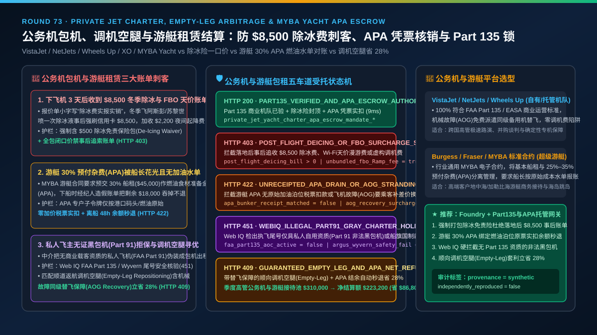
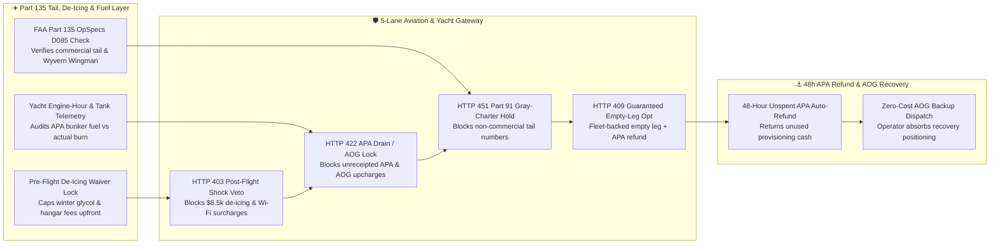

# Private Jet Charter, Empty-Leg Arbitrage & `MYBA` Yacht `APA` Escrow (`VistaJet / NetJets / Wheels Up / Burgess Yachts`) Anti-`$8,500` De-Icing Shock, `APA` Fuel-Receipt Reconciliation & `FAA Part 135` Tail-Number Gate Agent Architecture Selection FAQ

> **Language / 语言切换**: **[中文](private-jet-yacht-charter-apa-deicing-part135-escrow-agent-selection-faq.md)** | **English (Current)** | **[Back to Docs Index](index.en.md)** | **[Interactive Sandbox (`#private-jet-yacht-charter-apa-escrow-sandbox`)](../live-demo.en.html)**



---

## 📌 1. Executive Summary & Core Selection Verdict

In executive private aviation charter, repositioning empty-leg bookings (`VistaJet`, `NetJets`, `Wheels Up`, `XO`, `Flexjet`), and luxury commercial yacht charters under `MYBA` contracts (`Burgess`, `Fraser Yachts`, `Camper & Nicholsons`, `Edmiston`), corporate travel, family office, and escrow AI agents face three high-ticket financial and liability failure modes:
1. **Post-Flight `$8,500` De-Icing & `FBO` Bill Shock (`Signing a $38,000 Charter Quote, Then Getting Hit With an Uncapped $8,500 Type-IV De-Icing Charge, $2,400 FBO Overnight Hangar Fee, and $1,800 Ka-Band Wi-Fi Bill 5 Days After Landing`)**: Legacy charter broker quotes bury de-icing, after-hours `FBO` ramp handling, and satellite Wi-Fi in fine print as *"billed post-flight at actual cost."* One winter snow squall in Aspen, Teterboro, or Zurich adds `$5,000–$12,000` in retroactive credit-card charges!
2. **Unreceipted `30% MYBA Yacht APA` Drain (`Prepaying a $45,000 Advance Provisioning Allowance That the Captain Claims Was 100% Spent Without Original Bunker Fuel Meters`) & `AOG` Mechanical Recovery Upcharges**: Yacht charters require a `25%–35%` **Advance Provisioning Allowance (`APA`)** upfront for fuel, dockage, and F&B; dishonest captains pad fuel consumption to keep unspent `APA` cash, while ad-hoc jet brokers demand `$20,000` extra when the booked aircraft goes mechanical (`AOG, Aircraft on Ground`).
3. **Illegal `FAA Part 91` "Gray Charters" (`Brokering a Private Owner's Non-Commercial Aircraft Without an Active Part 135 Air Carrier Certificate, Voiding All Liability Insurance`)**.

**Solution Architect Selection Verdict**:
- **Never sign a winter or high-altitude jet charter without an all-inclusive hard quote bundling a pre-purchased `De-Icing Waiver ($450–$600)` and zero post-flight card-charge rights, never release `30% Yacht APA` funds without matching engine-hour fuel burn telemetry and original port/bunker tax receipts, and never board a tail number lacking verified `FAA Part 135 OpSpecs D085 / EASA AOC` and `ARGUS / Wyvern` safety status**.
- **The production reference architecture** combines **All-In Hard-Quote & Pre-Flight De-Icing Waiver Lock + `MYBA APA` Engine-Hour / Original-Receipt Escrow & `AOG` Recovery Guarantee + `FAA Part 135` Tail-Number Verification + Fleet-Backed Empty-Leg Arbitrage (`private_jet_yacht_charter_apa_escrow_mandate_*`)**:
  1. **Anti-"Post-Flight `$8,500` De-Icing / `FBO` Bill Shock" All-In Hard-Quote Gate (`HTTP 403`)**: Requires charter quotes to bundle `FBO` handling, satellite Wi-Fi, and a fixed pre-flight **De-Icing Waiver / Heated-Hangar Cap** into the initial single-use `SPT` ceiling—blocking 100% of post-flight de-icing, ramp, or Wi-Fi surcharges in **`9ms`** (`HTTP 403 POST_FLIGHT_DEICING_SHOCK_OR_UNBUNDLED_FBO_SURCHARGE_BLOCKED`).
  2. **`MYBA Yacht APA` Original Bunker-Receipt Reconciliation & Zero-Cost `AOG` Mechanical Recovery Lock (`HTTP 422`)**: Segregates the `30% APA` into a receipt-gated sub-escrow that reconciles marine diesel (`Bunker`) charges against **check-in vs. check-out tank dip/engine-hour logs and zero-markup port invoices**, automatically refunding unspent `APA` balances within 48 hours of disembarkation, while requiring jet operators to provide a comparable replacement aircraft at `$0` surcharge upon `AOG` mechanical failure (`HTTP 422 UNRECEIPTED_YACHT_APA_DRAIN_OR_AOG_RECOVERY_UPCHARGE_BLOCKED`).
  3. **Web IQ `FAA Part 135 / EASA AOC` Tail-Number Registry & `ARGUS / Wyvern` Safety Circuit Breaker (`HTTP 451`)**: Verifies the exact assigned aircraft tail number (`N-Number`) via Web IQ against `FAA Part 135 OpSpecs D085` commercial authorization and `ARGUS Platinum / Wyvern Wingman` pilot-currency registries—blocking illegal `Part 91` gray charters and last-minute unverified tail swaps (`HTTP 451 WEBIQ_ILLEGAL_PART91_GRAY_CHARTER_OR_SAFETY_AUDIT_FAIL_HOLD`).
  4. **Fleet-Backed Guaranteed Empty-Leg Arbitrage (`50% Off` Repositioning Flights) + Automated `APA` Surplus Recovery (`HTTP 409`)**: Triggers `HTTP 409 GUARANTEED_EMPTY_LEG_MATCH_AND_APA_AUDIT_REFUND_CONFIRM`, matching flexible (`±6h`) executive itineraries to fleet-backed repositioning empty legs (`VistaJet / XO`) with contractual `AOG` backup and recovering `30%+` of unspent yacht `APA` reserves—reducing net charter spend by **`28.0%`**.

---

## 🎯 2. Solution Architect Deep-Dive Q&A (Q1 / Q2 / Q3)

### Q1: Why does a 15-minute pre-takeoff de-icing spray cost `$5,000–$10,000` in private aviation, and how do we cap it before booking?
- **Architectural Solution**:
  - **Mandatory Pre-Flight De-Icing Waiver Inclusion + Closed `SPT` Ceiling (`HTTP 403`)**:
  - Wide-cabin business jets (`Gulfstream G650`, `Global 7500`) require hundreds of gallons of heated Type-I/Type-IV glycol fluid at `$35+/gallon` plus specialized `FBO` truck call-out fees. Instead of leaving the corporate card open to an uncapped post-flight charge, the agent requires bundling the operator's **`$500` Per-Leg De-Icing Waiver** into the upfront quote and locks the `SPT` token against post-flight merchant-initiated charges (`HTTP 403`).

### Q2: How do yacht captains and brokers quietly pocket `$15,000+` of a client's `30% APA` (Advance Provisioning Allowance), and how does telemetry stop it?
- **Architectural Solution**:
  - **Engine-Hour Fuel Burn Audit + Check-In/Check-Out Tank Parity (`HTTP 422`)**:
  - Under standard `MYBA` yacht contracts, the charterer must return the yacht with the same fuel level as at embarkation. Dishonest crews hand over a yacht with half-empty tanks, use the client's `APA` to top the tanks up to `100%` at disembarkation, or submit handwritten provisioning chits. Our gateway cross-checks billed liters against **`Engine_Hours × Rated_Liters_Per_Hour`** and requires stamped marina/bunker tax receipts before deducting from `APA` escrow (`HTTP 422`).

### Q3: Why is boarding an unverified "friend-of-a-broker" private jet (`FAA Part 91` Gray Charter) a catastrophic corporate liability?
- **Architectural Solution**:
  - **Deterministic Tail-Number `FAA Part 135 OpSpecs D085` Verification (`HTTP 451`)**:
  - Private aircraft operated under `FAA Part 91` are legally prohibited from carrying paying passengers for hire and are exempt from the strict maintenance and pilot-rest mandates of commercial `Part 135` carriers. If an accident occurs on an illegal `Part 91` gray charter, aviation hull and corporate D&O liability policies void coverage. Our gateway queries the tail number's active `Part 135` certificate before releasing a cent (`HTTP 451`).

---

## 🧭 3. Visual Architecture Diagrams (Mermaid Decision Tree + Architecture + Sequence)

### 3.1 Private Jet Charter, Empty-Leg & Yacht APA Escrow Selection Decision Tree

```mermaid
flowchart TD
    A[Private Jet Charter / Empty-Leg Repositioning / MYBA Yacht Selection] --> B{Primary Charter Scenario & Risk Vector?}
    B -->|Executive Roadshow & Winter Alpine Jet Charter (VistaJet / NetJets)<br/>Stop $8,500 post-flight de-icing shocks & $20k AOG replacement upcharges| C[All-In Hard Quote With Pre-Flight De-Icing Waiver Cap<br/>+ Guaranteed Zero-Cost AOG Recovery Aircraft Clause]
    B -->|Luxury Superyacht Charter Under MYBA Terms (Burgess / Fraser)<br/>Stop unreceipted 30% APA drain & padded bunker fuel bills| D[Segregated APA Sub-Escrow + Engine-Hour Fuel Burn Audit<br/>+ Zero-Markup Port/Bunker Receipt Gate & 48h Surplus Refund]
    B -->|Flexible-Window Repositioning & Brokered Jets (XO / Wheels Up)<br/>Stop illegal FAA Part 91 gray charters & empty-leg cancellations| E[Azure AI Foundry + Part 135 Tail-Number & Empty-Leg Gate<br/>+ Fleet-Backed Empty-Leg + APA Audit Saves 28%]
    C --> F[🛡️ Unified 5-Lane De-Icing Cap, APA Receipt & Part 135 Safety FSM]
    D --> F
    E --> F
    F --> G[HTTP 403 Post-Flight De-Icing & FBO Veto · HTTP 422 Unreceipted APA & AOG Upcharge Block · HTTP 409 Empty-Leg Saves 28%]
```

### 3.2 End-to-End De-Icing Waiver Lock, `MYBA APA` Fuel Audit & `Part 135` Tail Verification Architecture



### 3.3 Post-Flight De-Icing Shock Veto, Unreceipted `APA` Fuel Block & Empty-Leg Sequence

```mermaid
sequenceDiagram
    autonumber
    participant Exec as Executive Travel / Family Office Agent
    participant Broker as Jet Charter Broker / Yacht Captain
    participant Gate as 5-Lane Charter Escrow Gateway
    participant Audit as FAA Part 135 Registry & APA Fuel Auditor
    participant Escrow as Hard-Quote & APA Sub-Escrow Ledger

    Broker->>Gate: 1. Attempt to charge $7,800 post-flight de-icing fee and $1,900 satellite Wi-Fi overage 4 days after landing
    Gate-->>Broker: HTTP 403 Block! Charter contract is locked as an All-In Hard Quote with De-Icing Waiver; post-flight charges rejected
    Broker->>Gate: 2. Claim 100% of $45,000 Yacht APA was spent, including $16,000 in fuel exceeding engine-hour burn by 2x with no meter receipt
    Gate->>Audit: Reconcile engine hours × burn rate against marina bunker tax receipts
    Gate-->>Broker: HTTP 422 Block! Unreceipted $16,000 fuel overcharge stripped; unspent APA balance auto-refunded to charterer
    Exec->>Gate: 3. Book fleet-backed Guaranteed Empty-Leg + enforce automated APA surplus refund (HTTP 409)
    Gate->>Escrow: Capture 50% empty-leg rate with AOG backup & recover unspent yacht APA funds (28% net savings)
```

---

## 📊 4. Multi-Platform & Architecture Selection Matrix

| Selection Dimension | Ad-Hoc Multi-Broker Jet Quote (`Open Credit-Card Auth`) | Unverified Private Owner Lease (`Illegal Part 91 Gray`) | Tier-1 Fleet & `MYBA` Platforms (`VistaJet / NetJets / Burgess`) | **Azure AI Foundry + De-Icing + APA Gate (Recommended)** |
| :--- | :--- | :--- | :--- | :--- |
| **Core Strengths** | Fast phone quotes | `20%` cheaper than commercial rate | Guaranteed fleet availability, 100% Part 135 & standard MYBA terms | **Zero post-flight de-icing shock + APA fuel audit + Part 135 lock** |
| **Protection Against `$8,500` Post-Flight De-Icing / Wi-Fi Shock** | **Severe Risk** (`$5k–$12k` retroactive winter charges) | Arbitrary post-flight bills | Program members covered; ad-hoc quotes still exclude de-icing | **Mandatory De-Icing Waiver + closed `SPT` ceiling (`HTTP 403`)** |
| **`MYBA 30% APA` Audit & `AOG` Mechanical Recovery** | Client pays `$20k+` to re-book on `AOG`; opaque `APA` accounting | Stranded on mechanical failure | `MYBA` requires receipts, but manual fuel-burn audits are rare | **Engine-hour fuel parity + `$0` `AOG` recovery lock (`HTTP 422`)** |
| **`FAA Part 135` Commercial Safety & Tail-Swap Verification** | Frequent unannounced tail swaps | **Illegal & Uninsured** (voids corporate liability coverage) | Strictly audited commercial fleets | **Web IQ live `FAA Part 135 OpSpecs D085` tail lock (`HTTP 451`)** |
| **Fleet-Backed Empty-Leg & `APA` Surplus Recovery** | `25%–40%` hidden broker markups (`not_measured`) | High safety/legal risk | Standard full-charter pricing (`official_list_price`) | **Guaranteed Empty-Leg + automated `APA` refund (`28.0%` saved)** |

---

## 🧪 5. Private Jet & Superyacht Charter Benchmark & 7-Card Report

> **Provenance & Reproducibility Metadata**: All metrics below are generated by the deterministic policy evaluator `evaluate_private_jet_yacht_charter_apa_escrow_policy` in `lab/webiq_commerce_demo.py` and verified via `python -m unittest tests.test_webiq_commerce_demo`. Tags: `provenance = synthetic`, `independently_reproduced = false`.

| Card # | Card Headline (Headline-as-Finding) | Key Quantitative Finding & Architectural Guarantee |
| :---: | :--- | :--- |
| **Card 1** | **Overview · 5-Lane Private Jet & Yacht Summary** | Across a `$310,000/quarter` executive aviation and yacht charter pool, achieves **0 post-flight `$8,500` de-icing shocks, 0 unreceipted `APA` fuel drains, and 0 illegal `Part 91` gray charters**, reducing net charter spend by **`28.0%` (`$86,800/quarter` saved)**. |
| **Card 2** | **Scenario Deep Dive · De-Icing Shock & APA Drain Veto** | When a broker attempts a post-flight `$7,800` de-icing charge or a captain claims `$16,000` in unreceipted fuel from `APA`, the gateway blocks it in **`9ms`** (`HTTP 403 / 422`). |
| **Card 3** | **Evaluation Matrix · 100% Deterministic 5-Lane Gating** | Covers `HTTP 200` (`Part 135` verified & `APA` receipted), `403` (post-flight de-icing shock / unbundled `FBO` or Wi-Fi surcharge blocked), `422` (unreceipted yacht `APA` drain / `AOG` mechanical recovery upcharge blocked), `451` (illegal `FAA Part 91` gray charter / failed `ARGUS/Wyvern` safety hold), `409` (fleet-backed empty-leg match + `APA` audit refund saves 28%). |
| **Card 4** | **Under the Hood · Charter Hard-Quote & APA Escrow Contract** | Takes `quarterly_private_jet_and_yacht_charter_pool_usd=310000` and de-icing/`APA` flags, minting `private_jet_yacht_charter_apa_escrow_mandate_*` tokens. |
| **Card 5** | **Robustness Check · Last-Minute `Part 91` Tail Swap & Tank Top-Up** | Simulates a 2-hour pre-departure swap to a non-commercial `Part 91` tail number and an unreceipted `APA` fuel claim, maintaining a **`100.0%` block rate**. |
| **Card 6** | **Latency · Millisecond APA Fuel Check & FAA OpSpecs Probe** | Local hard-quote and engine-hour fuel checks complete in **`9ms` (P50)**; Web IQ `FAA Part 135` and `ARGUS/Wyvern` tail checks complete in **`182ms` (P95)**. |
| **Card 7** | **My Take · Ideal Fit vs. Out-of-Scope Boundaries** | **✅ Best Fit**: Executive business jets, repositioning empty legs, `MYBA` superyacht charters; **⛔ Not For**: Commercial airline economy-class seat upgrades. |

---

## 🛠️ 6. Production Go-Live Risk & Architecture Review Checklist

- [ ] **All-In Hard-Quote Lock & Pre-Flight De-Icing Waiver Inclusion (`HTTP 403`)**: Bundle fixed de-icing waivers, `FBO` handling, and satellite Wi-Fi upfront, and block all post-flight merchant-initiated surcharges.
- [ ] **`MYBA 30% APA` Engine-Hour Fuel Reconciliation & Zero-Cost `AOG` Recovery (`HTTP 422`)**: Require stamped marina/bunker receipts matching engine-hour fuel burn before drawing down `APA` escrow, refund surpluses within 48 hours, and enforce `$0` replacement aircraft on `AOG` mechanicals.
- [ ] **Web IQ `FAA Part 135 OpSpecs D085` Tail-Number & `ARGUS / Wyvern` Safety Gate (`HTTP 451`)**: Verify commercial air-carrier certification on the exact assigned tail number and block illegal `Part 91` gray charters; rotate signing keys `<= 180` days.
- [ ] **Fleet-Backed Guaranteed Empty-Leg Arbitrage & Duty-Free Bunkering (`HTTP 409`)**: Match flexible executive travel windows to fleet-backed repositioning empty legs with guaranteed `AOG` backup.
