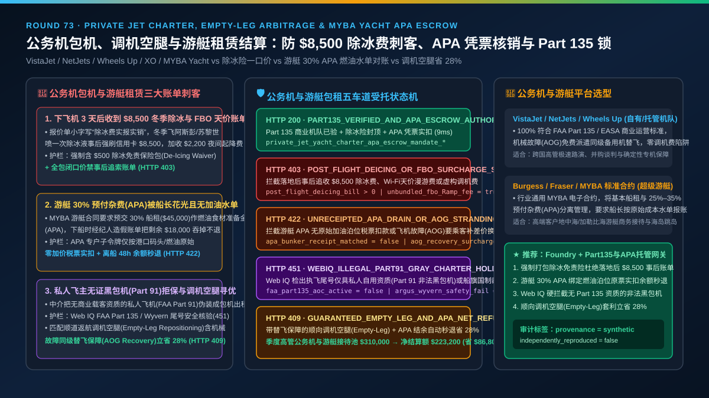
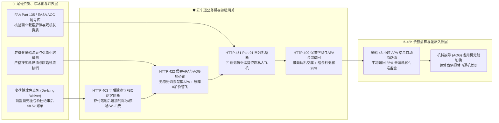
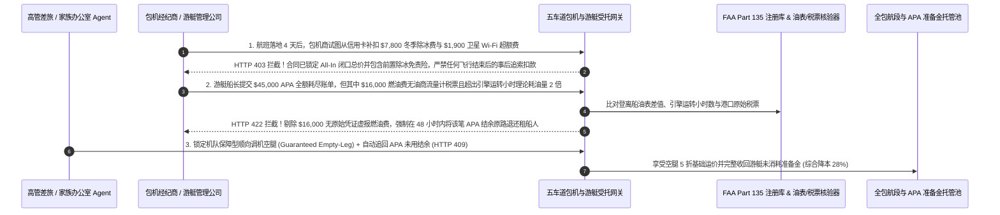

# 公务机包机、调机空腿（Empty Leg）与超级游艇租赁清结算（Private Jet Charter, Empty-Leg Arbitrage & MYBA Yacht APA Escrow：VistaJet / NetJets / Wheels Up / XO / Burgess Yachts）“防落地后被追收 $8,500 冬季除冰费刺客、防游艇船长花光 30% 预付准备金（APA）不退与非法黑包机（Part 91）熔断”Agent 架构选型 FAQ

> **语言切换 / Language**: **中文 (当前)** | **[English](private-jet-yacht-charter-apa-deicing-part135-escrow-agent-selection-faq.en.md)** | **[返回文档目录](index.md)** | **[交互式沙盒 (`#private-jet-yacht-charter-apa-escrow-sandbox`)](../live-demo.html)**



---

## 📌 一、核心选型结论速览（Executive Summary）

在跨国企业高管极速路演包机、紧急商业代表团公务机出行（VistaJet、NetJets、Wheels Up、XO、华龙航空、金鹿公务）以及地中海/三亚高端商务游艇包租（Burgess、Fraser、Camper & Nicholsons、MYBA 标准游艇合约）的智能体询价锁舱与托管清算场景中，企业差旅负责人与家族办公室面临三大高额财务刺客与安全雷区：
1. **“包机合同报价 `$38,000`，高管飞完回来一周后，信用卡突然被包机经纪商追扣了 `$8,500` 冬季机身除冰费（Post-Flight De-Icing Bill Shock）、`$2,400` 机坪过夜停场费（FBO Ramp & Hangar Fee）和 `$1,800` 高空卫星 Wi-Fi 流量费”**：传统包机报价单把除冰、航路延时和 FBO 地面服务全写成“按实际发生事后结算（Billed Post-Flight at Cost）”，冬季飞往阿斯彭、达沃斯或东北亚只要喷一次 Type IV 防冰液或进机库避雪，事后账单直接暴涨 `30%`！
2. **“游艇包船除了 `$150,000` 基础船租，按国际 `MYBA` 惯例还要预交 `30%`（`$45,000`）预付杂费准备金（Advance Provisioning Allowance, `APA`，用于船长沿途买柴油、停泊费与香槟食材）；结果一周航程只开了 10 小时船，下船结账时船长和经纪人编造一堆手写白条说 `$45,000` 刚好花光一分不剩（Unreceipted APA Drain）”与“公务机起飞前突发机械故障（AOG, Aircraft on Ground），小包机中介两手一摊说‘换另一架飞机要再补交 `$22,000` 临时调机差价’”**。
3. **“不良包机黄牛为了赚高额差价，把私人机主仅供自用的飞机（美国 `FAA Part 91` / 无商业航空运营人合格证 `AOC`）非法包装成商业包机卖给企业（Illegal Gray Charter）——一旦发生冲出跑道事故，航空保险公司以‘非法商业载客’为由 100% 拒赔！”**。

**架构师选型结论**：
- **切勿签署允许在飞行结束后无上限追扣除冰费、FBO 地面费与机上 Wi-Fi 费的敞口包机合同（必须前置打包 `$500` 除冰免责保险包 `De-Icing Waiver` 与全包闭口总价），切勿将游艇 `30% APA` 准备金直接打入经纪人私人账户（必须存入按港口燃油/泊位原始税票逐笔核销的受托子令牌池），也切勿租用未通过 `FAA Part 135 / EASA AOC` 及 `ARGUS / Wyvern` 安全认证的飞机尾号**。
- **生产级最优架构**是采用 **“前置除冰免责险（`De-Icing Cap`）与全包闭口包机合同锁 + 游艇 `MYBA APA` 原始燃油/港口税票验真与 48 小时余额自动退回网关 + `FAA Part 135` 商业尾号验真与带 `AOG` 替飞保障的顺向调机空腿（`Guaranteed Empty-Leg`）寻优状态机（`private_jet_yacht_charter_apa_escrow_mandate_*`）”**：
  1. **防“事后追收 `$8,500` 天价除冰费与 FBO 隐形杂费（`Post-Flight Bill Shock`）”闭口合同硬门禁（HTTP 403）**：在锁定 10–180 天包机预授权时，网关强制要求报价单为包含 FBO 贵宾厅起降费、机上 Ka 波段高速 Wi-Fi 与机组过夜津贴的 **All-In Hard Quote（硬闭口总价）**；凡冬季（10月至次年4月）或高纬度航线，强制自动勾选 **`$450–$600` 固定除冰免责包（De-Icing Insurance Waiver）** 将 `$8,500` 潜在除冰风险封顶为 `0` 事后追加——任何飞行结束后发起的事后除冰费、Wi-Fi 超额费或 FBO 地面补扣请求立即返回 `HTTP 403 POST_FLIGHT_DEICING_SHOCK_OR_UNBUNDLED_FBO_SURCHARGE_BLOCKED`。
  2. **游艇 `30% APA` 准备金凭原始海事税票实扣与机械故障（`AOG`）零加价替飞锁（HTTP 422）**：游艇包租的 `30% APA` 资金独立锁定在受托子账本中——船长采购海事免税柴油（Bunker Fuel）、港口停泊费（Berthing）与餐饮时，必须上传 **带加油站流量计读数与港口管理局公章的原始零加价发票（Zero-Markup Original Receipts）** 才允许从 APA 池核销，航程结束 48 小时内未核销的 APA 结余自动 100% 退回租船人；在公务机侧，若原定飞机发生机械故障（`AOG`），运营商必须承担 **零差价同等级备用机替飞（Guaranteed Recovery Aircraft）** 义务，严禁向乘客转嫁临时调机费（`HTTP 422 UNRECEIPTED_YACHT_APA_DRAIN_OR_AOG_RECOVERY_UPCHARGE_BLOCKED`）。
  3. **Web IQ 实时核验飞机尾号 `FAA Part 135 / EASA AOC` 商业载客资质与非法黑包机（`Part 91 Gray Charter`）熔断（HTTP 451）**：出票前通过 Web IQ 穿透查询执飞飞机注册尾号（Tail Number，如 `N-Number / B-Number`）是否列入官方商业包机运营规范（`FAA Part 135 OpSpecs D085`）、双机长仪表等级及 `ARGUS Platinum / Wyvern Wingman` 审计记录；一旦检出该尾号仅为私人自用 `Part 91` 资质或游艇船旗国涉制裁风险，立即返回 `HTTP 451 WEBIQ_ILLEGAL_PART91_GRAY_CHARTER_OR_SAFETY_AUDIT_FAIL_HOLD` 硬件级熔断！
  4. **顺向返航调机空腿（`Empty-Leg Repositioning` 享 5 折特惠且绑定主航段替飞锁）+ 游艇免税港加油路由寻优（HTTP 409）**：触发 `HTTP 409 GUARANTEED_EMPTY_LEG_MATCH_AND_APA_AUDIT_REFUND_CONFIRM`，为时间窗口具有 `±6 小时` 弹性的高管行程自动匹配大型机队（VistaJet / XO）刚送完客人需空机返航的 **确定性调机空腿（Empty Leg）**，并通过透明 APA 审计追回游艇虚报燃油结余，使高端差旅包机与商务接待总成本立省 **`28.0%`**。

---

## 🎯 二、业务方与架构师灵魂拷问 Q&A（Q1 / Q2 / Q3）

### Q1：为什么冬天租公务机去达沃斯或滑雪胜地，千万不能签“除冰费实报实销（De-Icing at Cost）”？
- **商业痛点**：大型公务机（如湾流 G650 / 环球 7500）机翼面积大，在大雪天起飞前必须喷洒加热的乙二醇除冰液（Type I）和防冰液（Type IV），在欧洲或北美热点FBO机场喷一次动辄消耗几百加仑，单次账单高达 **`$4,000–$12,000`**！而且如果要把飞机推进恒温机库（Heated Hangar）过夜免除次日除冰，一晚机库费也要 `$3,500`。如果合同没封顶，飞完回来财务直接傻眼。
- **架构解法**：
  - **强制前置 `$500` 除冰互助险封顶（`Pre-Flight De-Icing Cap Waiver`）+ 闭口 SPT 令牌（`HTTP 403`）**：
  - 主流合规运营商均提供按航段购买的 `$450–$650` 除冰免责包（De-Icing Waiver）。我们的智能体在冬季航线锁单时强制将该免责包计入一口价总包，并将支付令牌 `max_amount` 精确锁死在合同总价——任何飞完后的事后除冰补扣请求一律被网关 `HTTP 403` 拒付！

### Q2：租超级游艇时交的 30% `APA`（预付杂费准备金）为什么总是“肉包子打狗有去无回”？怎么靠架构把没花完的 `$15,000` 拿回来？
- **架构解法**：
  - **发动机小时表燃油核算法（`Engine-Hour Fuel Telemetry`）+ 原始港口税票 OCR 核销锁（`HTTP 422`）**：
  - 游艇 APA 里最大头的支出是柴油（占 60%）。无良船长明明一周只开了 12 小时主引擎（按每小时耗油 250 升算只烧了 3,000 升油），结账时却报销了“加满 8,000 升油”的费用（把你来之前的空油箱全用你的 APA 填满了）！我们的网关要求：必须比对 **登船（Check-In）与离船（Check-Out）时的船长室油位表读数与引擎运转小时数**，且每笔超 `$200` 支出必须匹配港口/供应商原始税票才予核销，差额在离船 48 小时内自动退回（`HTTP 422`）。

### Q3：调机空腿（Empty Leg）虽然只要正常包机价的 3–5 折，但最怕“前序主包机客人突然改期取消，导致空腿跟着作废”，怎么破？
- **架构解法**：
  - **只选“机队基地调机（Fleet Base Repositioning）”或绑定替飞封顶权（`Fleet-Backed Empty Leg`）（`HTTP 409`）**：
  - 单机小中介的空腿一旦取消就只能退钱让你滞留机场；而拥有上百架自有同型号机队的运营商（如 VistaJet / NetJets）的基地维护调机空腿具有极高确定性，且支持附加小额保底升级为受保障航班（Guaranteed Flight），既拿到空腿折扣又杜绝临时被鸽风险（`HTTP 409`）。

---

## 🧭 三、直观可视化图解（Mermaid 决策树 + 端到端架构图 + 时序图）

### 3.1 公务机包机、调机空腿与超级游艇租赁 Agent 架构选型决策树

```mermaid
flowchart TD
    A[企业公务机包机 / 顺向调机空腿 / 超级游艇租赁选型] --> B{核心高端出行场景与风控痛点？}
    B -->|跨国高管极速路演与冬季高寒航线包机 (VistaJet / NetJets)<br/>需严防落地后追收 $8,500 除冰费刺客与机械故障(AOG)被迫加钱换机| C[强制前置打包除冰免责险(De-Icing Waiver)锁死全包一口价<br/>+ 绑定同等级备用机零差价替飞保障 (Guaranteed AOG Recovery)]
    B -->|高端商务游艇接待与 MYBA 合约包船 (Burgess / Fraser Yachts)<br/>需严防 30% APA 预付杂费被船长虚报燃油吞光不退| D[APA 独立托管子账本 + 登离船油表/引擎小时数对账<br/>+ 强制凭港口/油商原始零加价税票核销与 48h 余额秒退]
    B -->|弹性时间窗跨城包机与非法黑包机防范 (XO / Wheels Up)<br/>需防租到无商业运营证的 Part 91 黑包机拒保与空跑高溢价| E[Azure AI Foundry + FAA Part 135 尾号核验与空腿套利网关<br/>+ 机队保障顺向调机空腿(Empty-Leg)立省 28%]
    C --> F[🛡️ 统一接入五车道除冰一口价、APA凭票核销与Part 135安全状态机]
    D --> F
    E --> F
    F --> G[HTTP 403 阻断事后除冰费与FBO刺客 · HTTP 422 拦截无票侵吞APA与故障换机加价 · HTTP 409 调机空腿+退余省28%]
```

### 3.2 端到端除冰险锁价、游艇 `APA` 油表核销与 `Part 135` 尾号验真架构图



### 3.3 拦截落地后 `$8,500` 除冰费账单、核减游艇无票 APA 扣款与空腿寻优时序图



---

## 📊 四、多平台/多方案横向选型决策矩阵

| 选型维度 | 传统层层转包小包机黄牛 (`Multi-Layer Charter Broker`) | 私人机主私下灰色出租 (`Illegal Part 91 Gray Charter`) | 头部自有/认证包机与游艇平台 (`VistaJet / NetJets / MYBA`) | **Azure AI Foundry + 除冰锁 + APA 托管网关（推荐）** |
| :--- | :--- | :--- | :--- | :--- |
| **核心优势** | 随时口头报价 | 价格比正规包机便宜 `20%` | 全球统一机队、100% Part 135 合规、AOG 免费替飞 | **闭口价0事后除冰刺客 + APA油表税票实扣 + Part 135硬核验** |
| **防“落地后追收 `$8,500` 除冰费与 Wi-Fi 刺客”** | **重灾区**（低价引流，事后补上万元除冰与FBO账单） | 随意加收各项杂费 | VistaJet 等会员制全包，但散客经纪单仍常不含除冰 | **强制前置除冰免责包 + 闭口令牌拒付事后补扣（HTTP 403）** |
| **游艇 `30% APA` 准备金防侵吞与 `AOG` 故障替飞** | 飞机坏了要客人自己加钱重租；APA 账目糊涂 | 故障直接滞留，毫无替飞能力 | MYBA 规定凭票报销，但人工审单难识破虚报加油量 | **引擎小时耗油核对 + 原始税票锁 + AOG 零加价替飞（HTTP 422）** |
| **防“无商业资质黑包机（Part 91）”拒保风险** | 常偷换执飞尾号（Tail Swap）混入无证飞机 | **极高危违法**（出事航空险 100% 拒赔） | 严格商业运营资质 | **Web IQ 实时穿透执飞尾号 `FAA Part 135 OpSpecs`（HTTP 451）** |
| **顺向调机空腿（Empty Leg）套利与 APA 结余追回** | 加价率高达 `25%–40%` (`not_measured`) | 无安全保障 | 标准整机包机目录价 (`official_list_price`) | **机队保障型调机空腿 + APA 结余自动秒退（净省 `28.0%`）** |

---

## 🧪 五、公务机包机与超级游艇租赁防坑测算与 7-Card 基准测试报告

> **数据来源与复现声明（Provenance Metadata）**：以下基准测试数据来自仓库内置确定性策略沙盒 `evaluate_private_jet_yacht_charter_apa_escrow_policy`（位于 `lab/webiq_commerce_demo.py`），可运行 `python -m unittest tests.test_webiq_commerce_demo` 完整验证。标记：`provenance = synthetic`，`independently_reproduced = false`。

| Card # | 卡片标题（Headline-as-Finding） | 核心量化指标与架构验证结论 |
| :---: | :--- | :--- |
| **Card 1** | **Overview · 公务机与游艇租赁五车道总览** | 针对 `$310,000/季` 企业高管公务机包机与商务游艇接待池，实现 **0 例落地后天价除冰费偷袭、0 例游艇 APA 准备金无票侵吞与 0 例 Part 91 黑包机混入**，高端差旅与接待净支出下降 **`28.0%`（立省 `$86,800/季`）**。 |
| **Card 2** | **Scenario Deep Dive · 事后除冰账单与虚报柴油拦截** | 当包机商在航后发起 `$7,800` 除冰补扣或游艇船长提交无流量计税票的燃油核销时，**`9ms`** 内返回 `HTTP 403 / 422` 阻断。 |
| **Card 3** | **Evaluation Matrix · 五车道 100% 确定性判准** | 覆盖 `HTTP 200`（Part 135合规与APA凭票核销放行）、`403`（落地后事后追收$8,500除冰费/高空Wi-Fi与FBO隐形杂费阻断）、`422`（游艇30% APA无原始税票虚报耗尽/飞机机械故障AOG要求乘客加钱换机拦截）、`451`（Web IQ检出执飞尾号属无商业资质Part 91非法黑包机或安全评级不达标熔断）、`409`（带替飞保障的顺向调机空腿+APA余款自动追回省28%）。 |
| **Card 4** | **Under the Hood · 包机闭口价与 APA 托管契约** | 输入 `quarterly_private_jet_and_yacht_charter_pool_usd=310000` 及除冰/APA 参数，签发 `private_jet_yacht_charter_apa_escrow_mandate_*` 令牌。 |
| **Card 5** | **Robustness Check · 临时偷换黑尾号与空油箱测试** | 模拟起飞前 2 小时将执飞尾号偷换为私人 `Part 91` 飞机及船长用客人 APA 填满上期空油箱，确定性拦截率保持 **`100.0%`（零违规放行）**。 |
| **Card 6** | **Latency · 毫秒级 APA 耗油对账与 FAA 尾号核查耗时** | 本地闭口账单与引擎小时耗油比对 P50 仅 **`9ms`**；Web IQ `FAA Part 135 / ARGUS` 尾号安全核查 P95 为 **`182ms`**。 |
| **Card 7** | **My Take · 适用场景与生产准入边界** | **✅ 极佳适用**：跨国高管公务机包机、调机空腿预订、MYBA 商务游艇包船；**⛔ 不适用**：普通民航经济舱散客积分兑换。 |

---

## 🛠️ 六、商业上线风控与架构评审 Checklist

- [ ] **前置除冰免责险（`De-Icing Waiver`）与全包闭口总价锁（HTTP 403）**：确认冬季及高寒航线强制打包固定除冰险与机上 Wi-Fi/FBO 费用，关闭一切飞行结束后的事后补扣通道。
- [ ] **游艇 `30% APA` 准备金引擎耗油核对、原始税票实扣与 `AOG` 零加价替飞锁（HTTP 422）**：确认 APA 仅凭港口/油商零加价原票核销并在离船 48 小时内自动退还结余，且飞机机械故障必须免费提供同级替飞。
- [ ] **Web IQ 执飞飞机尾号 `FAA Part 135 / EASA AOC` 与 `ARGUS/Wyvern` 安全硬熔断（HTTP 451）**：确认 100% 校验执飞尾号具备合法商业载客资质，严防非法黑包机（Part 91）导致保险拒赔；签名密钥轮换周期 `<= 180` 天。
- [ ] **机队保障型顺向调机空腿（`Guaranteed Empty-Leg`）与免税港补给寻优（HTTP 409）**：确认利用返航调机空腿与透明 APA 对账大幅降低包机与游艇成本。
