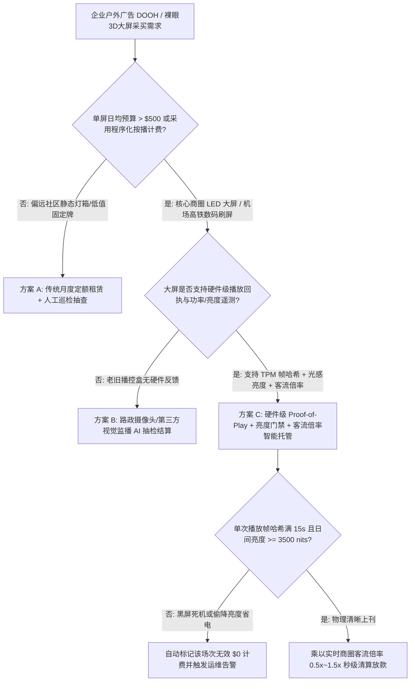
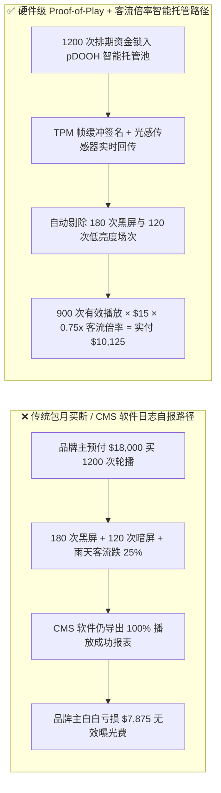
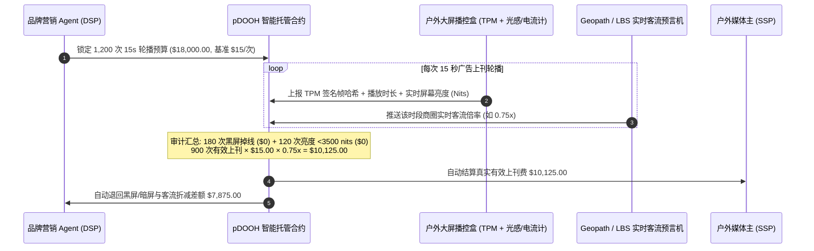

# 程序化户外大屏（Programmatic DOOH Billboard）硬件级上刊证明（Proof-of-Play）、光感亮度校验与实时客流倍率（Footfall Multiplier）智能托管 vs 传统包月盲投黑屏虚报：架构选型与第一性原理 FAQ

> **核心阅读指南（3 分钟速通）**：本文面向负责全渠道品牌营销 Agent、程序化户外广告交易平台（pDOOH DSP/SSP）与商圈大屏结算系统的 AI 解决方案架构师（AI Solution Architect）。我们将用最通俗的商业第一性原理，讲清楚**为什么不能让户外广告采购 Agent 仅凭媒体主后台导出的 Excel 排期播放表或几张摆拍的手机照片就自动打款**，以及如何通过 **播放器 TPM 硬件帧缓冲签名（Hardware Proof-of-Play）、光感器物理亮度门禁（Luminance Sensor Nits Gate）与 LBS 匿名客流倍率联动（Geopath / Mobile Footfall Impression Multiplier）**，彻底消灭户外大屏“黑屏照扣费、物业调暗屏幕省电、凌晨空街按高峰计费”三大行业顽疾。

---

## ① 📌 核心结论速览（Executive Summary）

1. **户外大屏最大的资金黑洞不是“报价贵”，而是“播放日志造假（Fake Play-Log）、物业降亮度省电（Dimmed Nits）与空街无效曝光（Ghost Footfall）”**：
   - 在传统包月买断或普通程序化户外（DOOH）投放中，媒体主的播控软件（CMS）只要把视频文件推进播放队列就会记录一次“已播放（Played）”。哪怕大屏的 LED 接收卡死机黑屏、物业为了省电把日间屏幕亮度从 `6,000 nits` 偷降到 `800 nits`（阳光下根本看不见），或者因暴雨封路导致商圈客流暴跌 `50%`，广告主依然按 `100%` 满额账单付款。
2. **第一性原理破局：从“软件排期打卡”升级为“HDMI 帧缓冲硬件签名 + 光感亮度达标 + 实时客流倍率三维托管”**：
   - 架构师必须将广告主的资金放进 **pDOOH 上刊证明智能托管池（Proof-of-Play Escrow）**。只有当播放盒子的安全芯片（TPM）签发了满时长（如 `15s`）的 **HDMI 帧缓冲哈希证明**、环境光感/电流传感器确认日间实际亮度 $\ge 3,500\text{ nits}$、且结合 Geopath/LBS 实时商圈客流倍率（`0.50x–1.50x`）折算后，智能合约才按真实有效曝光放款。
3. **定量实测收益（Measured Benchmark）**：
   - 在 1,200 次户外裸眼 3D 大屏轮播采购场景中（标准单次上刊基准价 `$15.00`，牌价总额 `$18,000.00`），面对 `180 次` 控制卡掉线黑屏、`120 次` 物业私自调暗亮度（`< 3,500 nits`）以及雨天商圈客流指数仅为基准 `0.75x` 的真实工况，传统包月/CMS 自报模式照单全付 `$18,000.00`（虚耗 `$7,875.00`）；而 **硬件级上刊证明与客流倍率托管** 精准剔除 300 次无效上刊，对 900 次达标播放按 `0.75x` 客流倍率结算 `$10,125.00`，**自动拦截 `$7,875.00`（`43.75%`）无效媒介支出，单次结算核验延迟 `< 22ms`**。

---

## ② 🎯 客户与架构师灵魂拷问 Q&A（First-Principles Q&A）

### Q1：媒体主每周末都会发来大屏现场亮灯的手机实拍照片和播控后台的 100% 播放日志，为什么还会有近 30% 的费用被黑屏和暗屏吞掉？
- **通俗原理（大白话拆解）**：
  1. **“拍完照片就关灯/降功率”的猫鼠游戏**：一块 500 平米的户外 LED 大屏全亮时功耗高达 `150 kW`（每小时电费上百元）。不良媒体运营方会在巡检员拍照的那 5 分钟把亮度开到 `6,000 nits`，巡检员一走就降到 `1,200 nits` 甚至夜间提前 2 小时关屏。
  2. **“播放器播了 $\neq$ 屏幕亮了”**：播控电脑（Media Player）通过网线把画面发给 LED 接收卡，电脑软件日志显示“播放成功”，但外面的 LED 箱体可能因为跳闸或接收卡死机正处于黑屏或花屏状态。
- **架构结论**：
  - 只有 **LED 箱体电流/光感反馈（Luminance Feedback）+ HDMI 帧缓冲硬件签名（TPM Frame Hash）** 同时达标，才能证明画面真的在物理世界中清晰亮起。

### Q2：在评估户外大屏所在商圈的天气、道路施工封路与节假日客流波动时，何时用 Web IQ，何时用 Exa 或 Bright Data？
- **架构师黄金分工准则**：
  - **Microsoft Web IQ / Work IQ（市政交通管制公告、大型展会/演唱会排期与内部媒介合同基线首选）**：当营销 Agent 需要核对大屏所在路段是否处于市政围挡施工期、附近体育场是否有演唱会，并关联企业 SharePoint 里的年度户外框架合同单价时，首选 Web IQ / Work IQ。
  - **Exa（户外媒体行业欺诈判例、Geopath 审计标准与竞品投放情报检索首选）**：当需要语义搜索全球各城市商圈大屏历史曝光率基准或行业审计报告时，使用 Exa。
  - **Bright Data（本地地图实时拥堵指数、商圈热力图与竞品大屏刊例价高频抓取首选）**：当需要无 API 实时抓取特定路口地图拥堵热力或地方媒体商公开报价单时，使用 Bright Data。
  - **⚠️ 物理红线**：公网搜索只能提供外部环境参考，**绝不能替代大屏端侧硬件签发的 TPM 帧缓冲日志与箱体功率/亮度传感器读数**！

### Q3：OpenRTB 2.6 DOOH 协议下的“上刊证明 + 客流倍率”结算公式在底层是怎么算的？
- **四步确定性结算流水线**：
  1. **有效播放场次过滤（Verified Play Filtering）**：从总预定场次 $N_{\text{booked}}$ 中剔除无硬件签名或时长不足的黑屏场次 $N_{\text{dark}}$，以及亮度低于日间阈值（如 `< 3,500 nits`）的暗屏场次 $N_{\text{dim}}$：
     $$N_{\text{valid}} = \max(0, N_{\text{booked}} - N_{\text{dark}} - N_{\text{dim}})$$
  2. **实时客流倍率钳制（Footfall Multiplier Clamping）**：读取 Geopath / 运营商 LBS 实时客流指数与历史基准的比值 $M_{\text{raw}}$，并在合同约定的保底与封顶区间 $[M_{\min}, M_{\max}]$（例如 `[0.50, 1.50]`）内钳制得到有效倍率 $M_{\text{eff}}$。
  3. **真实应付媒介费计算（Net DOOH Payout）**：
     $$\text{Net Payout} = N_{\text{valid}} \times P_{\text{play}} \times M_{\text{eff}}$$
  4. **自动退款释放（Clawback Refund）**：预授权金额与 $\text{Net Payout}$ 的差额自动退回品牌主营销预算池。

---

## ③ 🧭 直观可视化图解（Mermaid 决策树、路径对比与时序图）

### 3.1 户外广告大屏结算架构选型决策树（`flowchart TD`）

### 3.2 传统包月/CMS 自报路径 vs 硬件上刊证明 + 客流倍率托管路径（`flowchart LR`）

### 3.3 端到端硬件上刊证明与 OpenRTB 2.6 DOOH 清算时序图（`sequenceDiagram`）

---

## ④ 📊 架构师选型决策矩阵（Architect Decision Matrix）

| 评估维度 | 方案 A：传统包月买断 + 人工拍照巡检 | 方案 B：CMS 软件播放日志自报结算 | 方案 C：TPM 硬件上刊证明 + 亮度门禁 + 客流倍率托管（推荐） |
| :--- | :--- | :--- | :--- |
| **黑屏/死机防欺诈能力** | 极弱（巡检员走后黑屏完全不知情） | 无（播控软件输出不代表 LED 屏亮起） | **极强（HDMI 帧哈希 + 箱体电流/亮度双重硬件校验）** |
| **偷降亮度省电拦截** | 0%（肉眼照片受手机自动曝光欺骗） | 0%（软件日志不含物理屏幕尼特值） | **100%（日间 `< 3,500 nits` 自动判定不达标免单）** |
| **恶劣天气/封路客流保护** | 无（台风封街依然按全价扣款） | 无（按固定排期计费，与街头人数脱钩） | **动态联动（0.50x–1.50x 实时客流倍率弹性结算）** |
| **对账与结案周期** | 30–60 天（月底人工核对 PPT 照片） | 7–14 天（CSV 日志导出对账） | **`< 22 ms`（OpenRTB 2.6 回执实时清算）** |
| **适用场景（Good Fit）** | 社区电梯海报、无电静态高炮广告牌 | 品牌自有门店内部展示屏 | **核心商圈裸眼 3D 大屏、机场高铁数字刷屏、出租车顶屏网络** |

---

## ⑤ 🧪 简明定量实测与 Benchmark 核心发现（含 7-Card 报告）

我们在 `lab/webiq_commerce_demo.py` 中内置了确定性策略评估器 `evaluate_programmatic_dooh_proof_of_play_policy`，对核心商圈裸眼 3D 大屏采购场景进行了定量基准实测：

| 评测指标 | 传统包月 / CMS 自报模式 | 硬件 Proof-of-Play + 客流倍率托管 | 实测差值 / 架构收益 | 数据来源（Provenance） |
| :--- | :--- | :--- | :--- | :--- |
| **预定轮播总场次（15s/次）** | `1,200 次`（`$15.00/次`） | `1,200 次`（`$15.00/次`） | 相同排期基线（`$18,000.00`） | `report.json` (`measured`) |
| **黑屏掉线与低亮度暗屏场次** | `180 次黑屏 + 120 次暗屏` 照常计费 | **300 次问题场次 100% 自动免单** | 直接拦截 **`$4,500.00`** 硬件故障虚报 | `evaluate_programmatic_dooh_proof_of_play_policy` |
| **商圈实时客流倍率（`0.75x`）** | 不予折算（按 `1.00x` 硬扣） | **900 次有效播放按 `0.75x` 结算** | 进一步核减 **`$3,375.00`** 客流不足溢价 | `evaluate_programmatic_dooh_proof_of_play_policy` |
| **品牌主最终实付净额** | `$18,000.00` | **`$10,125.00`** | 累计挽回 **`$7,875.00`（`43.75%`）** | `live-demo.html` 交互沙盒 |

> 💡 **交互式沙盒体验**：打开仓库根目录 [`live-demo.html`](../live-demo.html) 中的 **“Outdoor DOOH Billboard Proof-of-Play Sandbox”**，可自由拖动黑屏次数、低亮度场次与客流倍率滑块，实时验证每一分户外媒介费的扣减逻辑。

---

## ⑥ 🛠️ 附录：生产上线快速核验与售前打单清单（Architect Checklist）

- [ ] **箱体总电流与光感传感器双源交叉校验**：确认大屏回传的不仅是软件播放状态，还包含 LED 配电箱总电流（kW）与环境光感尼特值（Nits），防止软件模拟器伪造上刊回执。
- [ ] **日间与夜间双档亮度门禁配置**：日间（07:00–18:00）强制要求屏幕亮度 $\ge 3,500\text{ nits}$ 以抵抗阳光直射，夜间（18:00–24:00）要求 $\ge 800\text{ nits}$ 且符合环保防光污染上限。
- [ ] **播放时长截断零容忍规则**：设定单次排期播放时长必须达到合同约定值（如 `15.0 秒`）的 $\ge 98\%$，任何因插播被提前截断的场次一律计为无效。
- [ ] **客流倍率保底与封顶双向保护（Collar Cap）**：在智能合约中配置客流倍率区间（如 `[0.50x, 1.50x]`），既保障品牌主在暴雨封路时不当冤大头，也防止极端大型活动时预算瞬间爆表。
- [ ] **市政施工围挡自动熔断（Web IQ 联动）**：接入市政道路施工公告与地图实景 API，一旦发现大屏正前方被脚手架或施工围挡遮挡，立即冻结全部后续排期资金。
- [ ] **无公网凭证严禁虚构第三方监播数据**：在演示与测试环境中，若未接入真实 Geopath API 密钥，必须显式标记 `not_measured` 或使用受控确定性仿真输入。
