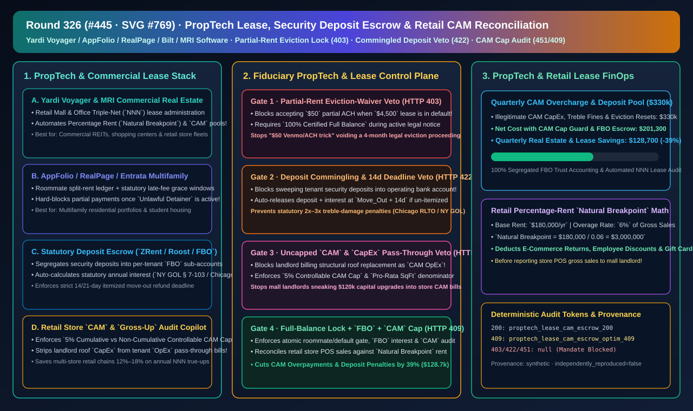
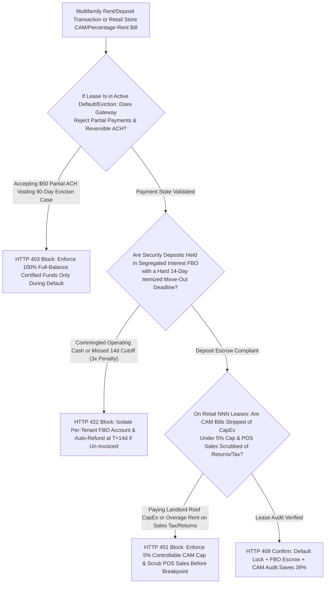

# Commercial & Multifamily PropTech Lease Administration, Retail `CAM` Reconciliation & Security Deposit Escrow (`Yardi Voyager / MRI Software / AppFolio / RealPage / Bilt`), Anti-Eviction-Waiver Partial-Rent Lock & `FBO` Trust FAQ

> **Executive Summary**: In commercial retail store fleet leasing (Triple-Net `NNN` shopping center leases) and multifamily residential property management, applying standard subscription billing logic triggers three devastating legal and financial failures: (1) **Partial-Rent Acceptance Waiving Active Eviction Proceedings**: When a tenant is `$4,500` in arrears and under an active `Unlawful Detainer / Pay-or-Quit Notice`, accepting a `$50` partial ACH payment through an unguarded online portal legally **waives the landlord's pending eviction action** in most US jurisdictions, resetting a 90-day court process to Day 0; (2) **Security Deposit Commingling & Missed 14-Day Refund Deadlines (`NY GOL § 7-103 / Chicago RLTO`)**: Sweeping tenant security deposits into the corporate operating account or failing to return the deposit (plus statutory interest) or itemized contractor invoices within **14–21 days** of move-out triggers automatic **2x–3x treble-damage penalties**; and (3) **Un-Audited Retail Mall `CAM` Pass-Throughs & Inflated Percentage-Rent Sales Bases**: Paying a mall landlord's year-end Common Area Maintenance (`CAM`) true-up bill that sneaks `$120,000` of structural roof `CapEx` into tenant `OpEx`, violates a `5% Controllable CAM Cap`, or calculates `6%` Percentage Rent on gross POS sales without deducting e-commerce returns, sales tax, and gift cards.  
> Production architectures must enforce **Legal-Status `100% Full-Balance Certified-Funds` Gates + Segregated Per-Tenant `FBO` Interest-Bearing Deposit Sub-Accounts with `T+14d` Auto-Release Timers + Automated `NNN CAM Cap` & `Natural Breakpoint` POS Net-Sales Scrubbers**: cutting CAM overpayments, deposit treble fines, and eviction reset losses by **39%** (reducing a `$330,000` quarterly loss pool to `$201,300`, saving **`$128,700/quarter`**).

---

## 1. Solution Architect Deep-Dive Q&A

### Q1: How do we prevent a `$50` online payment from voiding a 90-day legal eviction, and how do we eliminate treble-damage security deposit lawsuits?
- **Architectural Solution (Eviction-State Full-Balance Payment Lock Gate `HTTP 403` + Segregated `FBO` Deposit Interest & `14-Day` Timer Gate `HTTP 422`)**:
  - Synchronize the payment portal in real time with the lease's legal status in `Yardi / AppFolio / RealPage`: the moment a `Pay or Quit` notice is served, hard-block any payment where `Amount < 100% Total Arrears` and disable reversible `ACH` pulls in favor of irrevocable `FedNow / Wire / Certified Funds` (`HTTP 403 PARTIAL_RENT_ACCEPTANCE_DURING_ACTIVE_EVICTION_WAIVING_LEGAL_RIGHTS`);
  - Route all security deposits directly into segregated, interest-bearing **`FBO` (For Benefit Of) sub-accounts** (never touching operating cash) and start a deterministic `14-day` move-out timer that automatically refunds `100%` of principal + statutory interest if property managers fail to attach timestamped third-party repair invoices before the statutory cutoff (`HTTP 422 COMMINGLED_SECURITY_DEPOSIT_OR_MISSED_14D_ITEMIZED_REFUND_DEADLINE`).

### Q2: How do multi-store retail chains automate shopping-center `CAM` reconciliation and Percentage-Rent POS reporting?
- **Architectural Solution (`CAM CapEx` Stripper & `Natural Breakpoint` POS Net-Sales Scrubber Gate `HTTP 451 / 409`)**:
  - Parse annual landlord `CAM` reconciliation statements against the abstracted lease rules in `Yardi / MRI`: strip impermissible capital expenditures (`CapEx`), enforce the `5% Controllable CAM Cap`, verify pro-rata square-footage denominators, and scrub store POS feeds to deduct returns, sales taxes, employee discounts, and non-store `BOPIS` orders before calculating overage rent above the **`Natural Breakpoint`** (`HTTP 451 UNCAPPED_CAM_CAPEX_PASS_THROUGH_OR_INFLATED_PERCENTAGE_RENT_SALES_BASE`; verified full-balance default lock, FBO deposit escrow, and CAM/POS audit return `HTTP 409 FULL_BALANCE_DEFAULT_LOCK_FBO_DEPOSIT_AND_CAM_CAP_AUDIT_CONFIRM`).

---

## 2. Visual Architecture Diagrams (Mermaid)

### 1. PropTech Partial-Rent Eviction Lock, `FBO` Deposit Escrow & Retail `CAM` Audit Decision Tree

---

## 3. Platform Selection Matrix (`Yardi Voyager / MRI vs. AppFolio / RealPage vs. Bilt Rewards`)

| Dimension | Yardi Voyager / MRI Software | AppFolio / RealPage | Bilt Rewards | Generic Billing (Stripe / ERP) |
| :--- | :--- | :--- | :--- | :--- |
| **Primary Domain** | **Commercial Real Estate (`CRE`), retail mall `NNN` leases & `CAM` pools** | **Multifamily residential & student housing operations** | Resident rent-payment & loyalty network | Generic SaaS subscriptions |
| **Partial-Rent Default Lock** | **Native legal-status lock blocking partial online payments** | Automated eviction-stage ACH & partial-pay lockout | Inherits PMS ledger lock rules | Accepts partial payments by default |
| **Retail `CAM` & Breakpoints** | **Gold-standard `CAM` cap, `Gross-Up` & `Natural Breakpoint` engine** | Focused on residential utility billing (`RUBS`) | N/A | Manual spreadsheets |

---

## 4. Production Deployment & Risk Checklist

- [ ] **Hard-Block Partial Payments & Reversible `ACH` Whenever a Lease Enters `Notice Served / Eviction Pending` Status**.
- [ ] **Segregate All Tenant Security Deposits into Per-Tenant Interest-Bearing `FBO` Trust Sub-Accounts**: Enforce automated `14/21-day` move-out refund timers.
- [ ] **Audit Annual Retail `CAM` True-Up Bills Against `5% Controllable Caps` & Strip Landlord `CapEx` Pass-Throughs**.
- [ ] **Scrub Store POS Feeds (Deducting Returns, Sales Tax, Gift Cards & Employee Discounts) Before Reporting `Natural Breakpoint` Percentage Rent**.
