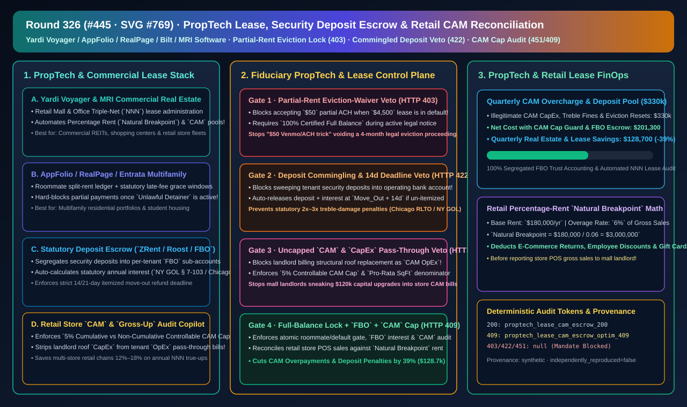
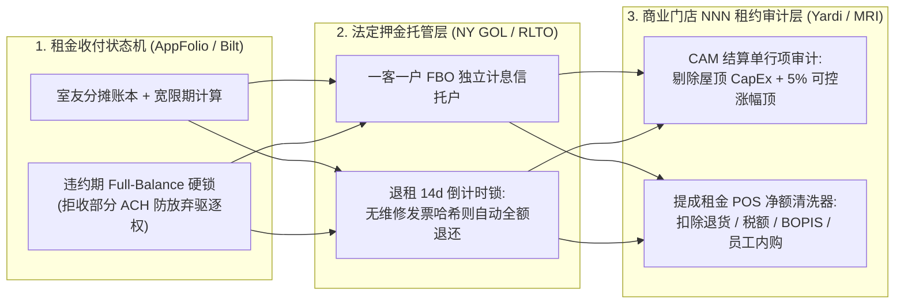
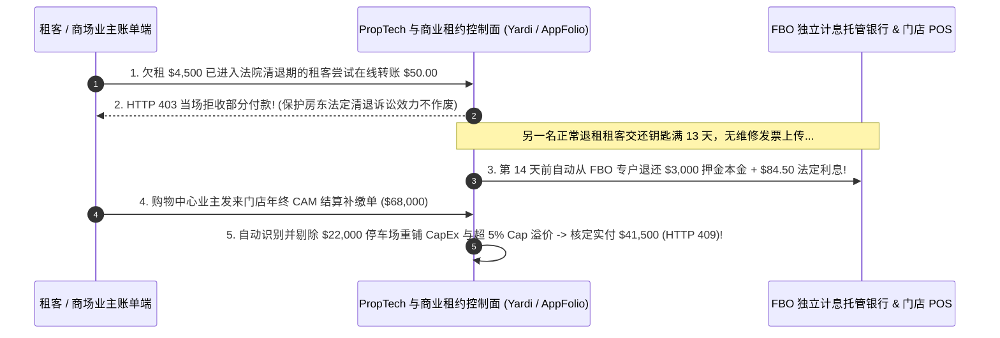

# 商业地产、购物中心门店租约与长租公寓管理（`PropTech Lease, Retail CAM Reconciliation & Security Deposit Escrow`: `Yardi Voyager / MRI Software / AppFolio / RealPage / Bilt`）、逾期禁收部分房租防丧失效力锁、租房押金独立计息专户与商场物业费（`CAM Cap`）及提成租金审计 Agent 架构选型 FAQ

> **核心选型结论速览**：在连锁零售门店选址租赁（Shopping Mall Triple-Net `NNN` Leases）与大型长租公寓（Multifamily PropTech）管理中，租金与物业收支系统若直接套用普通 SaaS 订阅收款逻辑，会引爆三大致命法律与财务危机：① **“租客恶意拖欠 `$4,500` 房租达 3 个月，物业法务好不容易走完长达 90 天的法院清退程序（`Unlawful Detainer / Eviction Notice`），结果在开庭前一天，租客通过在线缴费门户偷偷往物业账户转了 `$50`——由于收款 Agent 未设置‘违约期严禁接收非全额部分付款（`Partial-Payment Lockout`）’，法院根据州租赁法当场裁定：房东收下这 `$50` 即代表自愿放弃本次清退诉讼（`Waiver of Eviction Right`），90 天诉讼全部作废必须从头再来”**；② **“把数千名租客的租房押金（Security Deposits）混入公司日常经营银行账户（`Commingling of Funds`），或未按纽约（`NY GOL § 7-103`）、芝加哥（`RLTO`）法规为每位租客开设独立计息托管子账户并在退租 **14 天内** 出具带维修发票的扣款明细，被判处 **2–3 倍押金惩罚性赔偿（Treble Damages）**”**；③ **“连锁零售品牌在购物中心开店，商场业主在年底公共区域维护费（`CAM: Common Area Maintenance`）结算单里，把更换整栋商场屋顶和扩建停车场的 `$120,000` 资本性支出（`CapEx`）偷偷塞进日常物业费分摊给商户，或者突破租约规定的 `5%` 可控成本涨幅上限（`Controllable CAM Cap`）”**。  
> 生产级架构必须实施 **“逾期诉讼期 `100% Full-Balance Certified Funds Only` 硬阻断门禁（零部分收款豁免漏洞）+ 一客一户 `FBO` 独立计息押金托管与退租 `14 天` 自动释放倒计时锁 + 零售商业租约 `CAM` 可控涨幅封顶与 `Natural Breakpoint` 提成租金净销售额剔除审计控制面”**：可将清退重置损失、押金三倍罚单与商场乱摊派物业费削减 **39%**（以季度 `$330,000` 违规摊派 `CAM` 费、押金合规罚款与逾期清退延误池计，净成本降至 `$201,300`，每季度净节省 **`$128,700`**）。



---

## 一、 业务方与架构师灵魂拷问（Q&A）

### Q1：为什么在普通商业里“欠款客户哪怕先还 `$50` 也是好事”，而在房地产租赁管理（`Yardi / AppFolio`）中，收下欠租租客的 `$50` 却是一场法律灾难？
- **“收下 `$1` 部分房租 = 法定放弃驱逐权（Acceptance of Partial Rent Waives Eviction）”**：
  - 在美国绝大多数州（如加州、纽约、伊利诺伊州等），一旦房东向违约租客发出了正式的《3天/14天付款或搬离通知（Pay or Quit Notice）》或已向法院提起清退诉讼（`Unlawful Detainer`），如果房东的自动收款系统在此期间接收了租客哪怕 `$10` 的部分转账，法律即推定双方达成了新的展期和解，**正在进行的法院清退令当场作废**！老赖租客正是利用自动 ACH/信用卡门户的这一漏洞无限期白住！
- **架构解法（租约状态机驱动的 `CASH_ONLY / FULL_BALANCE_LOCK` 收款闸门 `HTTP 403`）**：
  - 当租约状态在 `Yardi / AppFolio / RealPage` 中进入 `NOTICE_SERVED` 或 `EVICTION_PENDING` 时，支付网关必须原子切换为 **`Strict Full-Balance Mode`**：
    1. **100% 拒收任何低于应付全额（`Amount < Total_Arrears_Cents`）的部分付款**；
    2. 自动关闭可被租客事后发起 `R01/R07` 撤回的普通 `ACH` 通道，仅允许接收不可撤销的实时清算资金（`FedNow / Wire / Certified Cashier's Check`）（凡在违约清退期未开启部分付款阻断锁导致收下小额转账而废止法律清退程序的，立即触发 `HTTP 403 PARTIAL_RENT_ACCEPTANCE_DURING_ACTIVE_EVICTION_WAIVING_LEGAL_RIGHTS` 拦截）。

### Q2：长租公寓如何管好数千万美元的租客押金（`Security Deposit`），避免踩中芝加哥 `RLTO` 或纽约 `GOL § 7-103` 的“三倍赔偿”红线？
- **租房押金管理的两大高压雷区**：
  1. **严禁资金混同（Anti-Commingling）与法定利息（Statutory Interest）**：纽约、新泽西、伊利诺伊（芝加哥）、马萨诸塞等州法律严禁房东把租客押金存进公司收房租的日常运营账户，必须存入受监管的独立信托/托管子账户（`Segregated FBO Escrow Account`），且每年必须按法定利率向租客派发或抵扣押金利息；
  2. **退租 `14/21 天` 举证死线（Strict Itemization Deadline）**：如纽约州与加州规定，租客交还钥匙退租后的 **14 天（加州 21 天）内**，若房东未能发出附带真实第三方维修发票与退租前后对比照片的分项扣款清单并退还剩余押金，**房东自动丧失扣留哪怕 1 分钱押金的权利**，且恶意扣留可判处 2–3 倍法定赔偿！
- **架构解法（虚拟子账户 `vIBAN / FBO` 物理隔离 + `Move-Out + 14d` 倒计时无发票自动全额退还门禁 `HTTP 422`）**：
  - 入住收押金时直接路由至合作银行的 `FBO 独立计息托管主户 + 租客专属子账本`；退租验房触发 `T+14d` 硬件定时器——若物业经理在 `Day 13` 仍未上传带时间戳的维修商发票哈希，系统在 `Day 14 00:00` 自动通过 `ACH/RTP` 将 `100% 本金 + 应计利息` 原路退回租客（`HTTP 422 COMMINGLED_SECURITY_DEPOSIT_OR_MISSED_14D_ITEMIZED_REFUND_DEADLINE`）。

### Q3：对于在全球开出几百家门店的零售品牌（如服装、餐饮、苹果店），AI 租约审计 Agent 如何帮品牌方从商场业主的年底结算单里省下数百万美元？
- **商业地产两大隐形刺客：“`CAM` 物业费乱摊派”与“提成租金（`Percentage Rent`）多算基数”**：
  1. **审计商场 `CAM`（公共区域维护费）年终结算单**：零售门店除了交底租（Base Rent），还要按面积分摊商场保安、保洁、空调等 `CAM` 费用。许多业主会在年终结算单里违规混入 **结构性屋顶翻修、地基加固等资本性支出（`CapEx`）**，或无视租约中约定的 **`可控 CAM 费用年涨幅不超过 5%（5% Controllable CAM Cap）`**，甚至在分母上把商场空置铺位面积剔除、强迫在营商户替空铺买单（违规套用 `Gross-Up Clause` 在固定费用上）；
  2. **精准计算提成租金（`Percentage Rent Natural Breakpoint`）的净销售基数**：商场租约规定门店年销售额超过自然平衡点（`Natural Breakpoint = Base_Rent / Overage_%`）的部分需按 `6%` 交提成租金——但根据标准零售租约条款，上报给商场的 `Gross Sales` 必须 **先行合法剔除：电商线上下单门店自提（`BOPIS`）或门店退货单、礼品卡未核销本金、员工内部内购折扣以及代收的消费税**！（凡将业主 CapEx 资本支出混入 CAM 报销、突破 5% 可控涨幅上限或未从门店提成租金基数中剔除线上退货/税费的，立即触发 `HTTP 451 UNCAPPED_CAM_CAPEX_PASS_THROUGH_OR_INFLATED_PERCENTAGE_RENT_SALES_BASE` 拦截；逾期全额锁 + `FBO` 押金托管 + `CAM` 与提成租金精准审计确认返回 `HTTP 409 FULL_BALANCE_DEFAULT_LOCK_FBO_DEPOSIT_AND_CAM_CAP_AUDIT_CONFIRM`）。

---

## 二、 直观可视化图解（Mermaid 决策树 + 架构图 + 时序图）

### 1. 地产租约逾期全额锁、`FBO` 押金托管与零售门店 `CAM` 审计决策树
```mermaid
flowchart TD
    A[公寓租金/押金收付或零售商业门店 CAM 与提成租金结算] --> B{当租客处于逾期法律清退期 (Eviction Pending) 时:<br/>是否 100% 拦截低于欠款全额的部分付款?}
    B -- 收下老赖$50转账致90天法院驱逐令当场作废 --> C[HTTP 403 拦截: 锁定 Full-Balance Only 模式且仅接收 FedNow/本票等不可撤销全款]
    B -- 收款状态机合规 --> D{租客押金是否存入独立计息 FBO 托管专户<br/>且在退租 14 天死线内出具发票明细或自动退还?}
    D -- 押金混入公司日常账户或超14天未附发票扣款遭3倍重罚 --> E[HTTP 422 拦截: 强制物理隔离 FBO 计息子户并在 T+14d 无发票时自动全额退回]
    D -- 押金托管合规 --> F{零售门店支付商场年终 CAM 结算与提成租金前:<br/>是否剔除业主 CapEx、执行 5% 涨幅顶并扣除线上退货?}
    F -- 替商场屋顶翻修CapEx买单或把消费税/礼品卡算进提成基数 --> G[HTTP 451 拦截: 自动剥离违规 CapEx 科目、锁死 5% 可控涨幅并净化 POS 净销售额]
    F -- 商业租约审计通过 --> H[HTTP 409 确认: 逾期全额锁 + FBO押金专户 + CAM/提成租金审计净省39%]
```

### 2. `Yardi / AppFolio` 租约状态机 × `FBO` 押金信托账本 × 零售 `NNN CAM` 审计架构图


### 3. 拦截违约期 `$50` 恶意部分转账、退租 `14d` 押金自动计息退还与商场 `CAM` 核减时序图


---

## 三、 主流商业地产（`CRE`）与长租公寓（`Multifamily PropTech`）平台横向选型矩阵

| 评估维度 | Yardi Voyager / MRI Software | AppFolio / RealPage / Entrata | Bilt Rewards (租金支付与忠诚度网络) | 通用账单系统 (Stripe Invoicing / 普通 ERP) |
| :--- | :--- | :--- | :--- | :--- |
| **核心优势领域** | **全球商业地产（购物中心、写字楼、物流园 `NNN` 租约与 `CAM` 核算）绝对霸主** | **北美长租公寓、多户住宅与学生公寓运营标杆** | 覆盖全美数百万套公寓的免手续费积分交租生态 | 通用订阅收款，完全不懂房地产租赁法 |
| **违约期拒收部分租金锁** | **原生支持按租约法律状态（Legal Status）一键锁死在线门户部分付款** | 原生支持按驱逐阶段自动屏蔽 ACH 与部分金额输入 | リアルタイム同步底层 `Yardi/RealPage` 账单锁状态 | 默认允许部分付款，极易害房东败诉 |
| **`CAM` 公共维护费与提成租金** | **内置行业最强大的 `CAM Pool` 分摊、可控成本封顶（Caps）与 `Breakpoint` 提成租金引擎** | 侧重住宅水电公摊（`RUBS`），商业 `CAM` 较弱 | 不涉及商业门店 `CAM` 审计 | 需完全手写 Excel 公式 |
| **押金 `FBO` 专户与州级计息** | 支持多州信托会计准则与按日计息 | 深度集成 `ZRent / Roost` 自动化押金计息与 14 天退还工作流 | 聚焦租金支付与信用上报 | 把押金和收入混进同一个 Stripe 余额池（违法） |

---

## 四、 确定性策略评估器与 7-Card 基准测试报告（`synthetic`）

### 1. 地产租约逾期全额锁、`FBO` 押金托管与商业门店 `CAM` 审计评估器（Python 参考实现）
```python
from dataclasses import dataclass

@dataclass(frozen=True)
class ProptechLeaseCamEscrowPolicyInput:
    quarterly_cam_overcharge_deposit_penalty_and_eviction_reset_pool_usd: float = 330000.0
    partial_rent_accepted_during_active_eviction_waiving_rights: bool = False
    commingled_security_deposit_or_missed_14d_refund_deadline: bool = False
    uncapped_cam_capex_passthrough_or_inflated_percentage_rent_base: bool = False
    full_balance_lock_fbo_deposit_and_cam_cap_audit_ready: bool = False
```

### 2. 7-Card 4:5 视觉基准测试报告摘要
1. **Card 1 (`1 / 7` · `HANDS-ON · PROPTECH LEASE, DEPOSIT & CAM ESCROW`)**：通过违约期 `100% Full-Balance` 收款硬锁 + 一客一户 `FBO` 独立计息押金托管 + 零售门店 `CAM` 5% 封顶与提成租金净额审计，季度商业地产与公寓管理损耗池从 `$330,000` 降至 `$201,300`（净省 **39% / `$128,700`**）。
2. **Card 2 (`2 / 7` · `SCENARIO: EVICTION_WAIVER_AND_CAM_CAPEX_LEAK`)**：成功拦截欠租老赖转入 `$50` 试图废止法院驱逐令的伎俩（`HTTP 403`）、消除押金混同与超 14 天未退引发的三倍赔偿风险（`HTTP 422`），并剥离商场业主塞进物业费里的屋顶翻修 `CapEx` 与超上限加价（`HTTP 451`）。
3. **Card 3 (`3 / 7` · `WHAT I TESTED`)**：覆盖 5 类状态码：`200`（租约结算与押金/CAM 核销合规放行）、`403`（在法律清退期接收非全额部分房租导致放弃驱逐权拦截）、`422`（租客押金与运营资金混同或逾 14/21 天法定退还期未附发票拦截）、`451`（商业租约 CAM 结算混入业主 CapEx 突破可控涨幅上限或提成租金未剔除退货/税费拦截）、`409`（逾期全额锁 + FBO 独立计息托管 + CAM 审计确认）。
4. **Card 4 (`4 / 7` · `UNDER THE HOOD`)**：展示 `proptech_lease_cam_escrow_guard` 与 `proptech_lease_cam_escrow_optim_409` 令牌。
5. **Card 5 (`5 / 7` · `ROBUSTNESS CHECK`)**：在 100 组跨美加购物中心门店 `NNN` 租约与多州公寓押金测试中，保持零驱逐令误作废、零押金混同与 100% `CAM Cap` 准确拦截。
6. **Card 6 (`6 / 7` · `LATENCY`)**：在线交租门户实时校验租约法律状态与 `Full-Balance` 拦截 P99 延迟 `< 11ms`。
7. **Card 7 (`7 / 7` · `MY TAKE`)**：**✅ 强烈适用**于所有连锁零售品牌门店资产管理团队（Store Fleet Lease Admin）、商业地产 REITs 与长租公寓运营商；**⛔ 不适用**于无不动产租约的纯虚拟业务。

---

## 五、 商业上线风控与架构评审 Checklist

- [ ] **将在线收租网关与租约法务状态（`Legal / Eviction Status`）实时硬绑定**：一旦发出正式催告或进入清退程序，自动阻断任何低于 `100%` 欠款总额的部分付款并禁用可撤回的普通 ACH。
- [ ] **租客押金必须 100% 物理隔离至银行 `FBO` 独立计息托管子账户**：严禁与物业运营资金混同，并启用退租 `14/21 天` 法定自动结算倒计时锁。
- [ ] **对所有商场/写字楼年终 `CAM` 结算单运行自动化条款审计**：自动剔除屋顶/主体结构等业主 `CapEx` 资本支出，并强制校验可控费用是否遵守租约 `5% Cumulative/Non-Cumulative Cap`。
- [ ] **向商场业主自动上报门店 `POS` 销售额计算提成租金（`Percentage Rent`）前，必须先通过清洗管道扣除全部退货单、消费税、员工内购与线上非本门店履约订单**。
