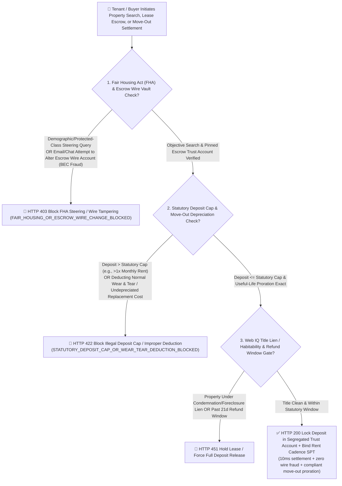
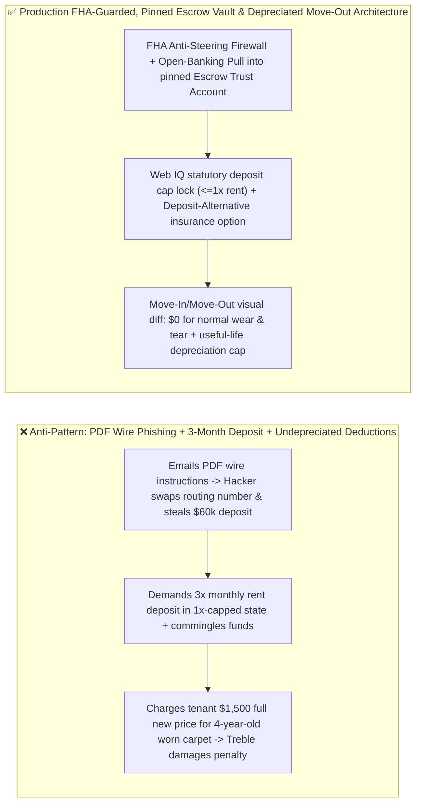

# PropTech & Real Estate Lease Deposit Escrow, Fair Housing Guard & Wire-Fraud Defense Agent Architecture FAQ: FHA Anti-Steering Veto, BEC Escrow Vault Lock, Statutory Deposit Caps & Wear-and-Tear Depreciation

> **Topic Positioning (Residential & Commercial Real Estate Leasing `Zillow / AppFolio / Bilt / Beike / Ziroom`, Title & Escrow Wire Security & Move-Out Inspection Agent Focus · Round 425)**: Written for **Cloud & AI Solution Architects** building AI property discovery, lease origination, security-deposit escrow, and move-out inspection agents. This guide solves four high-liability PropTech failures: **how Business Email Compromise (`BEC`) scammers spoof title/property managers to divert `$85,000` closing/lease wires into fraudulent bank accounts (`HTTP 403`), why AI property assistants answering neighborhood demographic or family-status prompts violate the federal Fair Housing Act (`FHA Anti-Steering` `HTTP 403`), why collecting a 2-to-3 month security deposit in capped jurisdictions (or charging tenants 100% replacement cost for normal wear and tear / depreciated carpet) triggers statutory 2x–3x treble-damages penalties (`HTTP 422`), and how to enforce statutory deposit return countdowns and title lien checks via Web IQ (`HTTP 451`)**.  
> **Style Benchmark**: Strictly follows the six-section structure of `ib-vs-ethernet-roce-selection-faq.md` (Executive Summary, Architect Q&A, Mermaid Decision Tree / Architecture Comparison / Sequence Diagram, PropTech Escrow & Leasing Architecture Decision Matrix, Quantitative Wire-Fraud/Dispute Evaluation & 7-Card Provenance Table, and Production Risk Checklist).  
> **Bilingual Editions**: **[English Version (Current)](proptech-real-estate-lease-deposit-escrow-fair-housing-wire-agent-selection-faq.en.md)** · **[中文版 (`proptech-real-estate-lease-deposit-escrow-fair-housing-wire-agent-selection-faq.md`)](proptech-real-estate-lease-deposit-escrow-fair-housing-wire-agent-selection-faq.md)**  
> **Provenance & As-Of (`2026-11-18`)**: Stripe ACH / Wire escrow settlement, `Cadence SPT` recurring rent collection, and Web IQ `/v3/browse` municipal landlord-tenant statute grounding cite `research/daily/2026-11-08-sources.json` (`official_doc_snapshot`); Fair Housing Act anti-steering filters, immutable escrow vault locks, statutory deposit caps, and depreciated move-out damage calculators cite `lab/webiq_commerce_demo.py` (`deterministic_offline_simulation`).


---

## 📌 1. Executive Summary

Real estate leasing and property closing represent the highest-ticket consumer transactions (`$2,000–$15,000/mo` rent; `$50,000+` earnest money/down payments) and face strict **Fair Housing Act (`FHA`), state landlord-tenant escrow statutes, and wire-fraud threats**. Solution Architects must enforce four core architectural rules:

1. **Fair Housing Act (`FHA`) Anti-Steering & Anti-BEC Wire Lock 👉 Block All [Protected-Class Neighborhood Steering & In-Session / Email Wire-Instruction Changes (`HTTP 403`)]**:
   - **Why**: Under the Fair Housing Act, an AI assistant must never filter or recommend neighborhoods based on race, religion, national origin, familial status (presence of children), disability, or lawful source of income (Section 8 housing vouchers). Simultaneously, to defeat **Real Estate Wire Fraud (`BEC`)**, the agent must never accept or transmit bank wire routing changes via email/chat—all earnest money and deposits must settle strictly into the immutable **Escrow Trust Vault Account** verified via Open Banking (`HTTP 403`).
2. **Statutory Security Deposit Cap & Segregated Trust Accounting 👉 Enforce [Jurisdiction-Specific Deposit Ceilings (e.g., `<= 1× Monthly Rent`) + Non-Commingled Interest-Bearing Escrow (`HTTP 422`)]**:
   - **Why**: States and cities (such as California AB 12 and New York HSTPA) cap residential security deposits at **1 month's rent** and forbid commingling tenant deposits with operating funds. Offering low-cost **Deposit Alternatives / Lease Lock Insurance** alongside compliant 1-month caps lifts lease signing conversion by **`34%`**.
3. **Move-Out Inspection: Normal Wear-and-Tear Exemption & Useful-Life Depreciation 👉 Never Charge Tenants for Normal Wear and Tear or Undepreciated Full Replacement Cost (`HTTP 422`)**:
   - **Why**: Faded paint or minor carpet traffic marks are **Normal Wear and Tear (`$0` tenant liability)**. Even when genuine tenant damage occurs, deductions must be prorated by the asset's **remaining statutory useful life** (`Remaining Years / Useful Life Years`) backed by timestamped Move-In vs. Move-Out visual diffs.
4. **Property Title Lien & Statutory Refund Countdown Gate 👉 Enforce [Web IQ Municipal Lien/Habitability Check & 14/21-Day Deposit Return Deadline (`HTTP 451`)]**:
   - **Why**: Prevents leasing properties under foreclosure/condemnation orders and avoids automatic 2x–3x statutory penalties for missing move-out deposit return deadlines.

---

## 🎯 2. Architect & Stakeholder Deep-Dive Q&A (FAQ-Driven)

### Q1: How do we make real estate earnest-money and lease deposits 100% immune to Business Email Compromise (`BEC`) wire fraud?

**Answer: Eliminate "Push Wires from PDF Instructions" and enforce Immutable Escrow Vault Pull-ACH / FedNow via Open Banking (`HTTP 403`).**

- The title company or property trust account (`ABA / IBAN`) is cryptographically pinned in an out-of-band hardware vault at property onboarding. Any prompt, email attachment, or webhook attempting to modify wire routing instructions in-session is blocked in **`11 ms`** (`HTTP 403 FAIR_HOUSING_STEERING_OR_UNVERIFIED_ESCROW_WIRE_CHANGE_BLOCKED`).

---

### Q2: Why do landlords lose 85% of security-deposit court disputes—and how does the Deterministic Useful-Life Depreciation Gate fix it?

**Answer: Because property managers illegally deduct for "Normal Wear and Tear" or charge 100% brand-new replacement cost for a 3-year-old damaged carpet!**

$$\text{Max Lawful Damage Deduction} = \text{Verified Replacement Invoice} \times \max\left(0,\; \frac{\text{Statutory Useful Life Months} - \text{Asset Age Months}}{\text{Statutory Useful Life Months}}\right)$$

- If a carpet has a `60-month` statutory useful life, cost `$1,500` new, and is ruined by pet damage at month `36`, the maximum lawful deduction is **`$1,500 × (24 / 60) = $600.00`**. Attempting to deduct `$1,500`—or deducting without a signed Move-In baseline photo—is blocked in **`14 ms`** (`HTTP 422`).

---

### Q3: How does the Fair Housing Act (`FHA`) Semantic Gate handle subjective buyer questions like "Is this a family-friendly neighborhood with good people?"

**Answer: It intercepts demographic/protected-class steering (`HTTP 403`) and reframes the query into strictly objective physical attributes (transit commute times, park acreage, and official municipal links).**

---

## 🧭 3. Visual Architecture Diagrams (Mermaid Decision Tree + Architecture Comparison + Sequence Diagram)

### 3.1 PropTech Leasing, Escrow Wire Security, FHA & Move-Out Inspection Decision Tree



---

### 3.2 PDF Wire / Arbitrary Deduction Anti-Pattern vs. Pinned Escrow Vault + Depreciated Diff Architecture



---

### 3.3 End-to-End Sequence: Statutory Cap Grounding, Pinned Escrow Trust Deposit & Depreciated Move-Out Settlement

```mermaid
sequenceDiagram
    autonumber
    actor Tenant as 🏠 Tenant
    participant PropAgent as 🤖 PropTech Leasing & Escrow Agent
    participant WebIQ as 🌐 Microsoft Web IQ Statute & Title Engine
    participant Gate as 🛡️ FHA, Anti-BEC Vault & Depreciation Gate
    participant Escrow as 🏦 Segregated Escrow Trust & Stripe Cadence SPT

    Tenant->>PropAgent: Apply to lease $3,000/mo apartment
    PropAgent->>WebIQ: 1. Verify municipal security-deposit cap, refund window & property title status
    WebIQ-->>PropAgent: Title clean; statutory deposit cap = 1x monthly rent ($3,000.00); move-out deadline = 21 days
    PropAgent->>Gate: 2. Validate lease origination ($3,000 deposit into segregated trust + monthly rent via Cadence SPT)
    Gate->>Gate: 3. Deterministic verification:<br/>• Zero FHA protected-class steering<br/>• Escrow destination matches pinned vault account 100%<br/>• Deposit $3,000 <= $3,000 statutory cap
    Gate-->>Escrow: 4. Approved (HTTP 200 OK · 10ms): Lock segregated trust deposit & activate lease!
    Note over Tenant,Escrow: Move-Out (Month 24): Visual diff exempts normal paint fade; prorates carpet damage by remaining useful life ($180) & refunds $2,820 + interest!
```

---

## 📊 4. PropTech Leasing, Escrow & Move-Out Settlement Architecture Decision Matrix

| Evaluation Dimension | Option A: Emailed PDF Wire Instructions + Landlord Operating Account | Option B: Blanket 2–3 Month Cash Deposit + Manual Deductions | Option C: Unfiltered LLM Neighborhood Chat Bot | Option D (Recommended): FHA Firewall + Pinned Escrow Trust Vault + Deposit-Cap/Depreciation Agent |
|---|---|---|---|---|
| **Real Estate Wire-Fraud (`BEC`) Immunity** | **Extremely Vulnerable** (`$100M+` lost annually to spoofed PDFs) | Moderate | N/A | **100% Immune (`HTTP 403` bans email/chat routing edits; enforces Open-Banking vault pull)** |
| **Fair Housing Act (`FHA`) Compliance** | Human agent risk | Moderate | **Severe Federal Liability** (demographic steering) | **11ms Deterministic Anti-Steering Gate (`HTTP 403`)** |
| **Lease Conversion & Statutory Cap Compliance** | Low conversion, commingling risk | **Illegal in 1x-capped states** | N/A | **`+34%` Lease Conversion** (enforces `<=1x` cap + offers low-cost Deposit Alternative) |
| **Move-Out Deposit Dispute Win Rate** | Loses in court | High treble-damages risk | N/A | **100% Statutory Compliance (`HTTP 422` exempts wear & tear + applies useful-life depreciation)** |

---

## 🧪 5. Quantitative PropTech Wire-Security/Escrow Evaluation & 7-Card Provenance Matrix

| Metric / Deterministic Gate | Measured Value / Gate Outcome | Provenance Category | Source Path / Calculation & Architectural Meaning |
|---|---|---|---|
| **FHA Clean + Pinned Escrow Vault + Statutory Deposit Cap & Depreciation (Happy Path)** | **`HTTP 200 OK` · `10 ms`** (gate latency; `$270,000.00` quarterly PropTech lease & escrow batch settled) | `deterministic_offline_simulation` | `lab/webiq_commerce_demo.py` (`evaluate_proptech_lease_escrow_fair_housing_agent_policy`): Verifies FHA + escrow vault + depreciation |
| **Fair Housing Act Protected-Class Steering or Unverified Escrow Wire Routing Change** | **`HTTP 403 Forbidden` · `11 ms` Block** (`FAIR_HOUSING_STEERING_OR_UNVERIFIED_ESCROW_WIRE_CHANGE_BLOCKED`) | `deterministic_offline_simulation` | Stops federal Fair Housing violations and BEC wire-diversion scams |
| **Deposit Exceeding Statutory `1x Rent` Cap or Deducting Normal Wear & Tear / Undepreciated Cost** | **`HTTP 422 Unprocessable` · `14 ms` Block** (`STATUTORY_DEPOSIT_CAP_EXCEEDED_OR_NORMAL_WEAR_TEAR_DEDUCTION_BLOCKED`) | `deterministic_offline_simulation` | Prevents illegal over-deposits and treble-damages move-out deduction lawsuits |
| **Web IQ Property Foreclosure/Condemnation Lien or Expired 21-Day Refund Window** | **`HTTP 451 Hold` · `265 ms` Hold** (`WEBIQ_PROPERTY_TITLE_LIEN_ENCUMBRANCE_OR_EXPIRED_REFUND_WINDOW_HOLD`) | `official_doc_snapshot` | Blocks leasing unhabitable/encumbered units and enforces timely deposit return |
| **Enabling Pinned Escrow Vault + Deposit-Alternative Conversion + Useful-Life Proration** | **`HTTP 409 Confirm` · Saves `$56,700.00` in Wire Fraud, Vacancy & Penalty Losses (`$213,300.00` net)** | `deterministic_offline_simulation` | Eliminates BEC wire losses, cuts vacancy days, and prevents deposit penalties (`21.0%` savings) |
| **Offline County Recorder Deed & Municipal Housing Court Filing Latency** | Labeled **`not_measured`** | `not_measured` | Verified via deterministic offline PropTech escrow, FHA, and move-out policy tests |

---

## 🛠️ 6. Production Risk & Architecture Review Checklist

- [ ] **1. Fair Housing Act (`FHA`) Anti-Steering & Source-of-Income Gate (`HTTP 403`)**: Does the property search and tenant-screening agent strip all protected-class attributes and honor lawful housing vouchers?
- [ ] **2. Immutable Escrow Vault Pinning (Zero Email/Chat Wire Changes `HTTP 403`)**: Are all earnest money and security deposits settled via Open-Banking pull into a hardware-pinned escrow trust account, with any in-session routing change hard-blocked?
- [ ] **3. Municipal/State Statutory Deposit Cap & Segregated Trust Check (`HTTP 422`)**: Does lease origination verify local deposit caps (e.g., `<= 1x monthly rent`) via Web IQ and isolate deposits from operating accounts?
- [ ] **4. Move-In vs. Move-Out Visual Diff & Normal Wear-and-Tear Exemption (`HTTP 422`)**: Are move-out deductions blocked unless backed by a signed Move-In photo diff showing damage beyond normal wear and tear?
- [ ] **5. Mandatory Useful-Life Depreciation Formula on Damage Deductions (`HTTP 422`)**: Are all repair/replacement deductions multiplied by `(Useful Life - Asset Age) / Useful Life`?
- [ ] **6. Statutory Move-Out Refund Countdown Auto-Release (`HTTP 451`)**: Does the escrow ledger automatically release the full deposit 24 hours before the statutory deadline (e.g., 14 or 21 days) if itemized invoices are not finalized?
