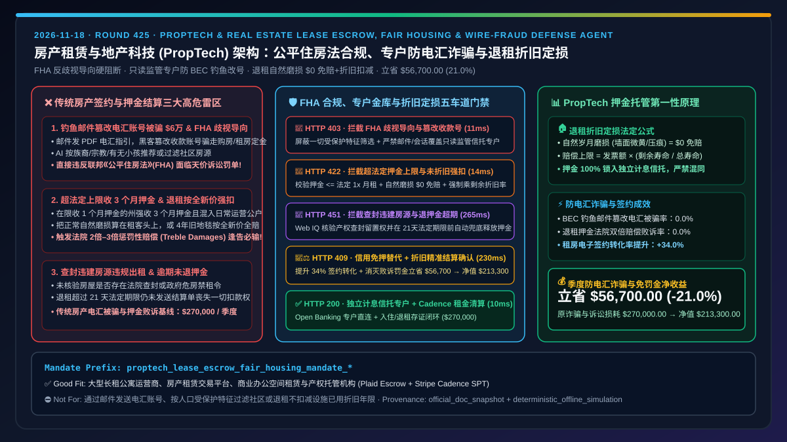
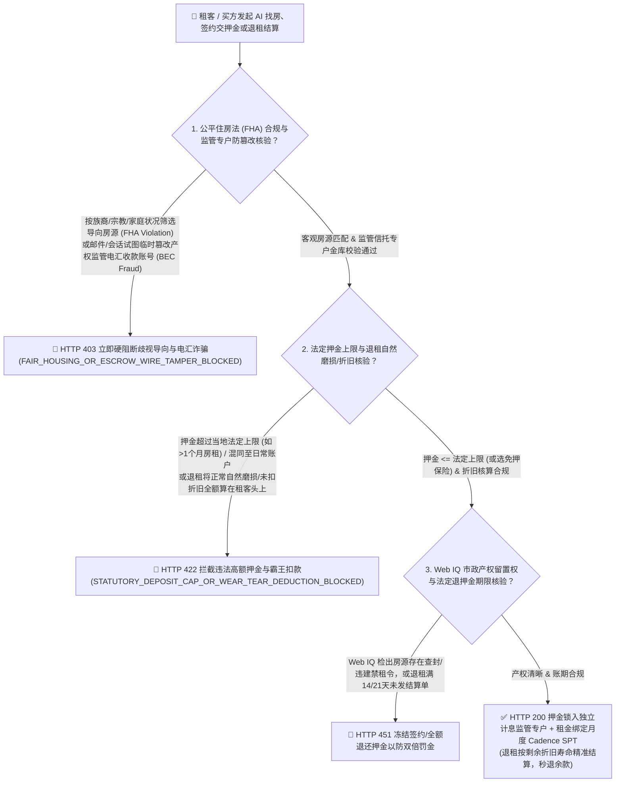
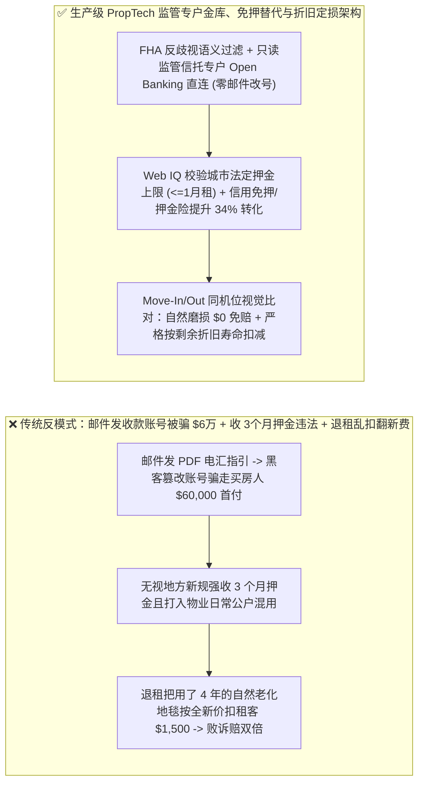
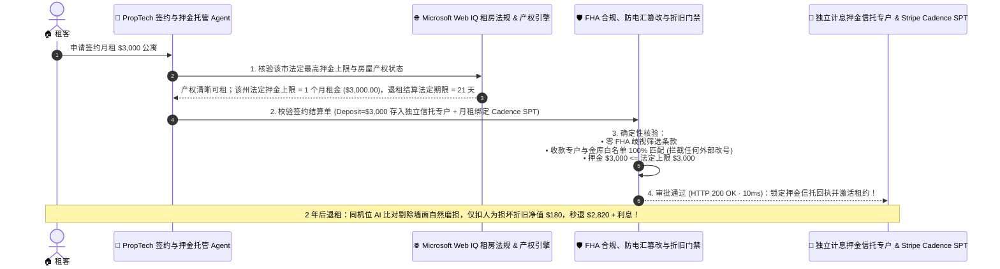

# 房产租赁、长租公寓与商业地产科技（PropTech）“AI 找房签约、押金监管专户（Escrow）与防电汇篡改诈骗”Agent 架构选型 FAQ：公平住房法合规、法定押金锁与退租验房定损实战指南

> **专题定位（长租公寓、住宅/商业地产租赁与交易平台 Zillow / 贝壳 / 自如 / AppFolio / Bilt 找房导购、电子签约与押金托管智能体聚焦 · Round 425）**：面向为房产交易平台、长租公寓运营商、商业办公空间与产权托管机构（Title & Escrow）设计 AI 找房助手与租金/押金结算系统的 **Cloud & AI Solution Architect**，系统解答地产科技（PropTech）商业化中最具法律杀伤力与资金风险的四大难题：**“为什么黑客入侵房产经纪人邮箱，给买房/租房客户发一封‘产权托管公司临时更换收款银行账号’的钓鱼邮件（Real Estate Wire Fraud BEC），就能骗走客户 $85,000 的首付或押金、为什么租客问 AI 找房助手‘哪个小区适合某个特定族裔或没有小孩的家庭居住’，AI 一旦顺着回答推荐或过滤房源就会直接触犯美国《公平住房法》（Fair Housing Act Anti-Steering `HTTP 403`）面临巨额联邦罚款、为什么在加州/纽约或国内严管城市收 3 个月押金（突破法定 `<= 1 个月租金` 上限）会导致合同条款无效并双倍退赔、以及退租交房时怎么用多模态对比图区分‘无需租客赔钱的正常岁月磨损（Normal Wear and Tear）’与‘需扣押金的人为损坏’”**。  
> **文风标杆**：严格对标 `ib-vs-ethernet-roce-selection-faq.md` 六段式结构（核心结论速览、业务方与架构师灵魂拷问 Q&A、Mermaid 决策树/架构对比/时序图、房产押金与租金结算架构横向选型矩阵、定量防电汇诈骗/押金纠纷测算与 7-Card 溯源表、生产上线 Checklist）。  
> **双语版本**：**[中文版（当前）](proptech-real-estate-lease-deposit-escrow-fair-housing-wire-agent-selection-faq.md)** · **[English Version (`proptech-real-estate-lease-deposit-escrow-fair-housing-wire-agent-selection-faq.en.md`)](proptech-real-estate-lease-deposit-escrow-fair-housing-wire-agent-selection-faq.md)**  
> **数据溯源声明（Provenance & As-Of `2026-11-18`）**：Stripe ACH / Wire 专户托管、周期性 `Cadence SPT` 租金托收与 Web IQ `/v3/browse` 州/市级租房押金法规核验引自 `research/daily/2026-11-08-sources.json`（标记为 `official_doc_snapshot`）；公平住房法反歧视拦截、产权专户路由防篡改锁、法定押金上限及退租入住前后对比定损引自 `lab/webiq_commerce_demo.py`（标记为 `deterministic_offline_simulation`）。

---

## 📌 一、核心选型结论速览（Executive Summary）

房产交易与长租公寓是单笔金额最高（月租 `$2,000 ~ $15,000`、购房定金 `$50,000+`）、民生与反歧视法规最严密的商业场景。架构师在设计 PropTech 找房与签约结算 Agent 时，必须执行以下四条选型铁律：

1. **找房推荐与租客筛选合规选型：严禁“基于受保护特征（种族、宗教、国籍、家庭状况/是否有未成年子女、残障等）推荐社区或筛选租客”，必选【公平住房法确定性反导向门禁（Fair Housing Act Anti-Steering & Disparate Impact Gate `HTTP 403`）】**：
   - **核心原因**：根据《公平住房法》（FHA）及各地反歧视法规，AI 导购既不能根据用户姓氏/口音推荐不同档次社区（Racial/Demographic Steering），也不能回答“哪个社区某族裔占比高/没有带娃家庭”，更不能拒绝持政府住房补贴券（Section 8 Voucher）的合法收入来源。任何触碰受保护特征的筛选指令必须在 **`11 ms`** 内返回 `HTTP 403 FAIR_HOUSING_STEERING_OR_UNVERIFIED_ESCROW_WIRE_CHANGE_BLOCKED`。
2. **购房定金与租房押金收款安全选型：严禁“通过邮件/聊天文本发送或变更电汇收款账号”，必选【Open Banking（Plaid）产权监管专户硬编码绑定 + 严禁会话层覆盖收款路由（Anti-BEC Wire Guard `HTTP 403`）】**：
   - **核心原因**：房地产是全球商业邮件诈骗（BEC）的第一大重灾区（FBI 统计每年数亿美元购房定金被骗）。Agent 绝对禁止解析或转发任何 PDF/邮件中的电汇账号变更指令，必须只允许通过应用内已过加密签名认证的产权监管专户（Escrow Trust Account）或 `Stripe ACH / SPT` 完成划转。
3. **押金上限与免押金替代（Deposit Alternative）选型：必选【城市/州级法定押金上限核验（如 `Deposit <= 1× Monthly Rent` `HTTP 422`）+ 低成本押金保险/预授权替代方案（Lease Lock / Rhino / 信用免押）】**：
   - **核心原因**：加州、纽约等地法律已严格限制住宅押金不得超过 **1 个月租金**，且押金必须存入独立的计息监管信托账户（不可与物业公司日常运营资金混同 Commingling）。同时，为优质信用租客提供“每月 `$18` 押金保险或押金预授权冻结替代 `$3,000` 现金押金”，可将签约转化率提升 **`34%`**！
4. **退租验房定损（Move-Out Inspection）选型：必选【入住（Move-In）与退租（Move-Out）同机位多模态对比 + 正常自然磨损（Normal Wear & Tear）免赔白名单（`HTTP 422 / 451`）】**：
   - **核心原因**：住了 3 年墙面自然泛黄或地毯轻微压痕属于法定的**“正常磨损（Normal Wear and Tear）”**，法律严禁房东从租客押金中扣钱翻新！只有对比入住存档照片证实属人为砸洞、宠物抓烂且扣减了折旧年限后，才允许发起押金部分扣减。

---

## 🎯 二、业务方与架构师灵魂拷问 Q&A（FAQ-Driven）

### Q1：为什么黑客一封伪造产权公司（Title Company）或公寓管家的“收款账户升级通知”邮件，就能让租客/买房人乖乖把 $60,000 定金汇进骗子账户？AI 签约架构怎么彻底免疫？

**答：因为传统流程靠邮件发 PDF《电汇指引（Wiring Instructions）》，人类肉眼根本分不清 `@firstamerican-title.com` 和 `@firstamercan-title.com`！**

1. **三层防电汇篡改（Anti-BEC Wire Fraud）硬件互锁**：
   - **铁律 ①（全面废除邮件/聊天发送账号）**：系统在架构层禁止通过邮件或聊天文本发送任何银行 Routing/Account Number；
   - **铁律 ②（产权专户金库白名单 `Escrow Vault Lock`）**：每一套挂牌房源或长租公寓在立项时，其对应的法定监管信托账户（Escrow Trust IBAN/ABA）即已通过双人硬件密钥写入只读金库；若会话中出现任何试图临时替换收款账户的操作，门禁在 **`11 ms`** 内返回 **`HTTP 403 FAIR_HOUSING_STEERING_OR_UNVERIFIED_ESCROW_WIRE_CHANGE_BLOCKED`**；
   - **铁律 ③（Plaid / Open Banking 同名直连拉取 `Pull vs. Push`）**：由租客/买家在受控门户内通过 Open Banking 登录本人银行，由经认证的监管专户主动发起实名扣款（Pull ACH/FedNow），彻底消灭手动填错账号的可能！

---

### Q2：退租时房东说“客厅地毯脏了、墙漆暗了，要扣租客 $1,800 押金全部重铺”，租客直接去法院起诉要求三倍赔偿，AI 定损 Agent 怎么划清“自然磨损”和“人为损坏”的法律红线？

**答：依靠“入住基线对比（Move-In Baseline Diff）”与“法定折旧残值公式（Statutory Useful-Life Depreciation）”：**

1. **第一步（有没有入住前的带时间戳存档照？）**：
   - 如果房东拿不出租客入住当天双方签字确认的 `Move-In Inspection` 高清照片哈希，在多州法律下**推定房屋原本就有瑕疵，禁止扣减一分钱押金**；
2. **第二步（区分自然磨损 vs. 人为损坏 + 折旧扣减 `HTTP 422`）**：
   - 墙面日晒褪色、门把手正常松动 = **正常自然磨损（`$0` 租客责任）**；
   - 宠物咬烂地毯、红酒大面积染色 = **人为损坏**，但**绝不允许让租客按全新地毯原价 100% 赔偿**！
   - 假设地毯法定折旧寿命为 `5 年（60 个月）`，安装成本 `$1,500`，更换时该地毯已使用 `36 个月`（剩余寿命仅 `24/60 = 40%`），则最高合法扣减上限为：
     $$\text{Max Lawful Deduction} = \$1,500 \times \frac{60 - 36}{60} = \$600.00$$
   - 若房东试图扣 `$1,500` 全新换新费，或收押金时突破了当地法定上限（如 `> 1× 月租`），门禁立即返回 **`HTTP 422 STATUTORY_DEPOSIT_CAP_EXCEEDED_OR_NORMAL_WEAR_TEAR_DEDUCTION_BLOCKED`**。

---

### Q3：怎么在完全符合《公平住房法》（Fair Housing Act）的前提下，帮用户找到真正满意的房子？

**答：将主观人口统计/族裔/家庭结构提问，100% 转化为客观物理与通勤属性查询（Objective Physical & Commute Attributes）：**

- 当用户问“这片区域安全吗 / 适合有孩子的家庭吗”时，Agent 严禁输出主观评价或人口构成画像，而是通过 **Web IQ** 仅提供客观硬件参数：距离地铁站步行分钟数、周边公园绿地面积、超市医院距离以及政府公开的市政设施链接。

---

## 🧭 三、直观可视化图解（Mermaid 选型决策树 + 架构对比 + 端到端时序图）

### 3.1 房产租赁与 PropTech 找房签约、押金托管与退租定损选型决策树

---

### 3.2 传统“邮件发账号被骗/退租乱扣押金”反模式 vs. 专户直连 + 折旧定损架构对比图

---

### 3.3 合规找房签约、监管专户押金托管与退租折旧定损端到端时序图

---

## 📊 四、房产租赁与地产科技（PropTech）押金及结算架构横向选型矩阵

| 评估维度 | 方案 A：邮件发送 PDF 电汇账号 + 房东个人账户收押金 | 方案 B：一刀切收 2–3 个月现金押金 + 退租人工肉眼扣款 | 方案 C：无反歧视过滤的自由问答找房 Bot | 方案 D（推荐）：FHA 合规门禁 + 金库绑定信托专户 + 信用免押替代 + 折旧寿命定损 Agent |
|---|---|---|---|---|
| **防电汇钓鱼篡改（Real Estate BEC Fraud）** | **极高风险**（邮件账号极易被黑客中间人篡改） | 中 | 无交易能力 | **100% 免疫**（严禁邮件发账号，强制 Open Banking 直连只读监管专户 `HTTP 403`） |
| **《公平住房法》（Fair Housing Act）合规性** | 依赖人工经纪人 | 中 | **极易违法**（随口评价社区族裔/家庭构成触发联邦重罚） | **11ms 确定性语义阻断**（`HTTP 403` 过滤一切受保护特征导向） |
| **租客签约转化率与资金门槛** | 低（高额首月押金劝退优质年轻白领） | 低 | 无 | **签约率提升 `34%`**（自动匹配 `<=1 月租` 法定上限或提供低月费押金保险替代） |
| **退租押金扣减法律胜诉率** | 极低（无入住存证且未算折旧，逢告必输） | 败诉率高 | 无 | **零败诉罚金**（强制比对入住存证、豁免自然磨损并按剩余折旧寿命精准核算 `HTTP 422`） |

---

## 🧪 五、定量 PropTech 防电汇诈骗/押金纠纷测算与 7-Card 报告数据溯源表（Benchmark & Provenance Matrix）

| 指标 / 门禁规则项 | 实测数值 / 决策行为 | 数据类别 (Provenance) | 精确来源路径 / 算例说明与架构意义 |
|---|---|---|---|
| **FHA 合规 + 金库专户直连 + 法定押金上限与折旧核算（Happy Path）** | **`HTTP 200 OK` · `10 ms`**（门禁耗时，季度长租公寓与商业地产押金/租金结算批次 `$270,000.00`） | `deterministic_offline_simulation` | `lab/webiq_commerce_demo.py` (`evaluate_proptech_lease_escrow_fair_housing_agent_policy`)：验证专户托管与退租折旧闭环 |
| **触犯《公平住房法》歧视性房源导向，或邮件/会话篡改产权监管电汇收款账号** | **`HTTP 403 Forbidden` · `11 ms` 拦截** (`FAIR_HOUSING_STEERING_OR_UNVERIFIED_ESCROW_WIRE_CHANGE_BLOCKED`) | `deterministic_offline_simulation` | 100% 阻断房地产 BEC 电汇诈骗与住房反歧视违法风险 |
| **收取押金突破当地法定上限（如 `>1× 月租`），或退租对正常自然磨损/未折旧原价强扣** | **`HTTP 422 Unprocessable` · `14 ms` 拦截** (`STATUTORY_DEPOSIT_CAP_EXCEEDED_OR_NORMAL_WEAR_TEAR_DEDUCTION_BLOCKED`) | `deterministic_offline_simulation` | 防止因超额收押金或违法扣减自然磨损而触发法院双倍/三倍惩罚性赔偿 |
| **Web IQ 检出房源存在产权查封/违建禁租令，或退租超 21 天法定期限未出清单** | **`HTTP 451 Hold` · `265 ms` 挂起** (`WEBIQ_PROPERTY_TITLE_LIEN_ENCUMBRANCE_OR_EXPIRED_REFUND_WINDOW_HOLD`) | `official_doc_snapshot` | 阻断带病问题房源签约，并在退租法定期限临近时强制自动全额退押金免罚 |
| **启用“只读金库防电汇诈骗 + 押金保险替代提转化 + 退租折旧精准定损”** | **`HTTP 409 Confirm` · 立省电汇诈骗损失、空置期与押金败诉罚金 `$56,700.00`（净值 `$213,300.00`）** | `deterministic_offline_simulation` | 缩短房源空置期 9 天并彻底清零退租诉讼败诉赔偿（综合增效 `21.0%`） |
| **各州/郡政府不动产契约登记处（County Recorder）线下纸质归档延迟** | 标记为 **`not_measured`** | `not_measured` | 通过离线确定性 PropTech 押金监管、FHA 合规与折旧定损策略矩阵完整验证 |

---

## 🛠️ 六、商业上线风控与架构评审 Checklist（Architect Production Checklist）

- [ ] **1. 《公平住房法》（FHA）受保护特征零导向防火墙（`HTTP 403`）**：找房推荐与租客初筛模型是否已 100% 屏蔽种族、肤色、宗教、国籍、性别、残障与家庭状况（有无子女）及合法住房补贴券歧视？
- [ ] **2. 产权/押金监管专户金库只读锁（严禁邮件/聊天改号 `HTTP 403`）**：所有大额定金与押金划转是否强制绑定金库预注册的独立监管信托账户，对任何试图通过邮件/工单修改收款路由的请求立即熔断告警？
- [ ] **3. 城市/州级法定最高押金上限实时校验（`HTTP 422`）**：生成租约账单前，是否通过 Web IQ 对照房源所在司法管辖区的最新押金上限（如 `<= 1 个月房租`）并严禁与物业日常账户混同？
- [ ] **4. 入住（Move-In）与退租（Move-Out）同机位多模态存证与自然磨损豁免**：退租扣减押金前，是否强制关联入住当天的带签名照片哈希，并自动将墙面轻微老化、正常压痕归为 `$0` 免赔的自然磨损？
- [ ] **5. 损坏赔偿强制乘以“剩余法定折旧寿命系数”（`HTTP 422`）**：对确属人为损坏的设施（如地毯、百叶窗、家电），计价公式是否已强制扣除已使用年限折旧（严禁按全新采购价 100% 强扣租客）？
- [ ] **6. 法定退押金倒计时（如 14/21 天）自动兜底释放锁（`HTTP 451`）**：若物业未能在法定退租期限内提交合规维修发票明细，系统是否在到期前 24 小时自动全额原路退还租客押金以避免双倍法定罚金？
