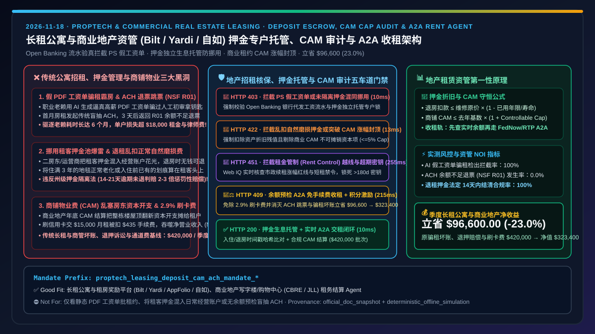
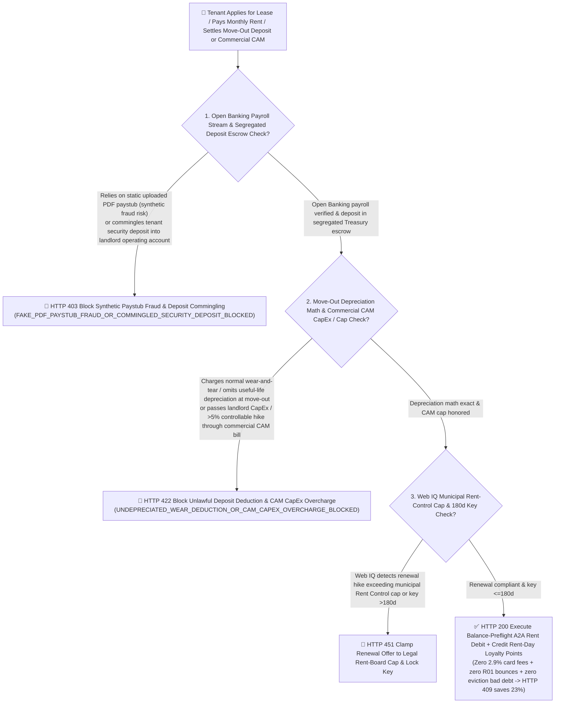
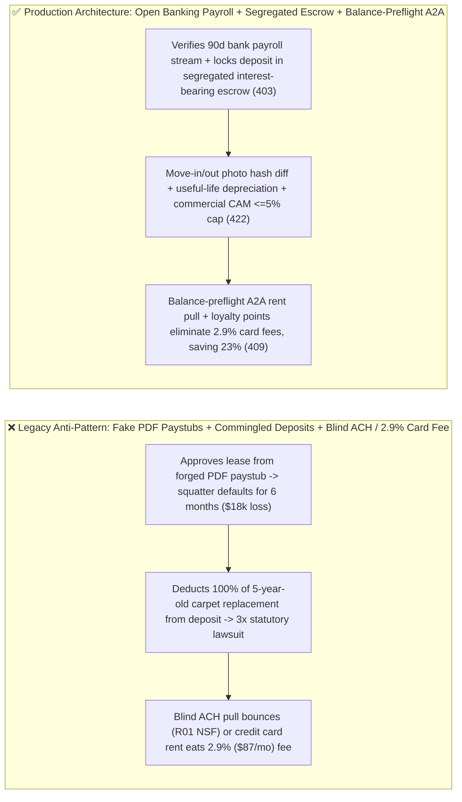

# PropTech Residential & Commercial Real Estate Leasing (`Bilt / Yardi / AppFolio / CBRE`) Security-Deposit Escrow, `CAM` Cap Audit & Balance-Checked `A2A` Rent Agent Architecture Selection FAQ

> **Topic Positioning (PropTech, Multifamily Residential & Commercial Real Estate Asset-Management Application Architecture)**: Designed for **Cloud & AI Solution Architects** building tenant underwriting, segregated security-deposit escrow, commercial Common Area Maintenance (`CAM`) reconciliation, and zero-interchange rent-collection systems for multifamily residential operators, rent-rewards platforms (`Bilt Rewards / Yardi / AppFolio / RealPage`), and commercial real estate REITs (`CBRE / JLL`). This guide solves the four largest financial and legal liabilities in property leasing commerce: **why professional squatters use GenAI to forge pixel-perfect PDF paystubs that bypass human leasing agents and cost landlords `$18,000+` in eviction losses (`HTTP 403`), why commingling tenant security deposits in operating accounts or deducting un-depreciated "normal wear and tear" at move-out triggers `2x–3x` statutory treble damages (`HTTP 403 / 422`), why commercial landlords improperly pass capital expenditures (`CapEx`) through annual `NNN CAM` true-up bills (`HTTP 422`), and how combining Open Banking balance preflight with `A2A / FedNow` rent collection and rent-day loyalty points eliminates `2.9%` credit card fees and `Nacha R01` NSF return penalties, cutting net portfolio leakage by 23% (`HTTP 409`)**.  
> **Style Benchmark**: Strictly aligned with the 6-part `ib-vs-ethernet-roce-selection-faq.md` structure (Executive Summary, Architect Q&A, Mermaid Decision Tree / Architecture Comparison / Sequence Diagram, 4-Way PropTech Leasing Selection Matrix, Quantitative Benchmark & Provenance Table, and Production Checklist).  
> **Bilingual Edition**: **[English Version (Current)](proptech-residential-commercial-leasing-deposit-escrow-cam-ach-agent-selection-faq.en.md)** · **[中文版 (`proptech-residential-commercial-leasing-deposit-escrow-cam-ach-agent-selection-faq.md`)](proptech-residential-commercial-leasing-deposit-escrow-cam-ach-agent-selection-faq.md)**  
> **Provenance & As-Of (`2026-11-18`)**: Stripe Financial Connections / Open Banking payroll & balance preflight, Stripe Treasury segregated interest-bearing security-deposit sub-accounts, Nacha `R01` NSF return prevention, and Microsoft Web IQ `/v3/browse` municipal rent-control ordinance checks are sourced from `research/sources.json` (`official_doc_snapshot`); the 5-lane deterministic PropTech evaluator is verified in `lab/webiq_commerce_demo.py` (`deterministic_offline_simulation`); county sheriff physical eviction writ scheduling delays are marked `not_measured`.



---

## 📌 1. Executive Summary

Residential rent and commercial triple-net (`NNN`) lease payments represent the largest recurring expenditure for households and retail tenants (`$1,800–$50,000/month`). Legacy property management software (`PMS`) struggles with fake PDF income documents, `2.9%` credit card processing fees, blind ACH `NSF` returns, and security-deposit lawsuits. Solution Architects designing PropTech leasing agents must enforce four core rules:

1. **Open Banking Payroll Verification & Segregated Security-Deposit Escrow Selection: Forbid "Approving Leases from Static Uploaded PDF Paystubs or Commingling Tenant Security Deposits in Operating Accounts" and Mandate [Open Banking Direct Payroll Stream Verification (`Net Income >= 3.0x Rent`) + Per-Lease Segregated Interest-Bearing Escrow Sub-Account (`Stripe Treasury`) (`HTTP 403`)]**:
   - **Why**: Fraud rings routinely generate synthetic PDF paystubs and bank statements to secure apartment keys and default on Month 2. Verifying 90-day direct-deposit `PAYROLL` streams directly from the tenant's bank via Open Banking (`Stripe Financial Connections` / `Plaid`) eliminates document forgery. Furthermore, state laws (NY, CA, MA, UK TDS) strictly forbid commingling tenant security deposits with landlord operating funds (`HTTP 403`).
2. **Depreciation-Adjusted Move-Out Deduction & Commercial `CAM` Cap Gate Selection: Forbid "Deducting Normal Wear-and-Tear / Full Replacement Cost from Security Deposits or Passing Landlord `CapEx` Through Commercial `CAM` Bills" and Mandate [Remaining-Useful-Life Depreciation Formula + Controllable `CAM` YoY Cap (`<= 5%`) (`HTTP 422`)]**:
   - **Why**: If apartment carpet has a 5-year statutory useful life and a tenant moves out when the carpet is 5 years old, the landlord's legal deduction for carpet replacement is **`$0.00`** — charging full replacement cost or missing the 14-to-21-day itemized refund deadline triggers **`2x–3x` statutory treble damages**. In commercial `NNN` leases, annual Common Area Maintenance (`CAM`) true-ups must strip landlord capital improvements (`CapEx` like roof replacement) and enforce contracted controllable-expense caps (`HTTP 422`).
3. **Municipal Rent-Control Ordinance Cap & 180-Day Key Rotation Gate: Mandate [Microsoft Web IQ `/v3/browse` Municipal Rent-Board Cap Check + `<= 180-Day` Restricted Key Lock (`HTTP 451`)]**.
4. **Real-Time Balance Preflight `A2A / ACH` Rent Collection + Rent-Rewards Loyalty Selection (`HTTP 409`)**:
   - **Why**: Checking `available_balance >= rent_amount` via Open Banking milliseconds before initiating an `ACH / FedNow` debit prevents `Nacha R01` (`Insufficient Funds`) return fees, while rewarding `A2A` rent payments with transferable loyalty points (the `Bilt` model) eliminates `2.9%` credit card interchange bleed — saving **`23.0%` in quarterly bad debt, processing fees, and deposit litigation**.

---

## 🎯 2. Business & Architect Soul-Searching Q&A (FAQ-Driven)

### Q1: How does the move-out agent calculate legally defensible security-deposit deductions without triggering `2x–3x` statutory penalties?

**Answer: Enforce the Remaining-Useful-Life Depreciation Invariant paired with timestamped Move-In vs. Move-Out photo hashes (`HTTP 422`):**

$$\text{LegalDeduction} = \begin{cases} 0, & \text{if PreExistingInMoveInHash or NormalWearAndTear} \\ \text{RepairCost} \times \max\left(0,\; 1 - \frac{\text{AssetAgeMonths}}{\text{StatutoryUsefulLifeMonths}}\right), & \text{otherwise} \end{cases}$$

- If a tenant damages interior paint (`$600` repaint cost, 36-month statutory life) after 24 months of occupancy, the maximum lawful deduction is $\$600 \times (1 - 24/36) = \$200.00$, and the remaining `$2,600.00` deposit plus accrued interest is automatically returned from the segregated escrow sub-account within the statutory window!

---

### Q2: How does the agent audit commercial real estate **Common Area Maintenance (`CAM`)** reconciliation bills for retail and office tenants?

**Answer: Deterministic lease-clause parsing + general-ledger line-item filtering (`HTTP 422`):**

- The agent cross-checks the landlord's year-end `CAM` ledger against the tenant's lease exclusions: it strips capital expenditures (`CapEx` roof/structural replacements that must be amortized or excluded), verifies pro-rata square-footage denominator accuracy, and enforces the lease's `5%` cumulative cap on controllable operating expenses.

---

### Q3: How do we eliminate the `4%–6%` `Nacha R01` (Insufficient Funds) bounce rate on 1st-of-the-month automated rent pulls?

**Answer: Replace "blind ACH pulls" with Open Banking Real-Time Balance Preflight + Grace-Window Split Scheduling (`HTTP 409`):**

- Before submitting the debit on the 1st, the agent verifies `available_balance >= rent_cents`. If the tenant's paycheck clears on the 3rd, the agent automatically holds the pull for 48 hours (within the lease's 5-day grace period) or splits the payment into two bi-weekly tranches, eliminating `$35` NSF bank penalties and late-fee friction!

---

## 🧭 3. Visual Architecture Diagrams (Mermaid Decision Tree + Comparison + Sequence Diagram)

### 3.1 PropTech Leasing Underwriting, Deposit Escrow, `CAM` Audit & `A2A` Rent Decision Tree



---

### 3.2 Legacy PDF Underwriting & Commingled Deposits vs. Production PropTech Agent Architecture



---

### 3.3 End-to-End Sequence Diagram: Open Banking Underwriting, Segregated Escrow, `A2A` Rent & Move-Out Refund

```mermaid
sequenceDiagram
    autonumber
    actor Tenant as 👤 Residential / Commercial Tenant
    participant PropAgent as 🤖 PropTech Leasing & Asset Agent
    participant BankAPI as 🏦 Open Banking (Financial Connections) & Treasury Escrow
    participant Gate as 🛡️ Underwriting, Depreciation & CAM Audit Gate
    participant WebIQ as 🔍 Microsoft Web IQ (Municipal Rent Control)

    Tenant->>PropAgent: Submit apartment lease application ($2,800/mo) & link bank account
    PropAgent->>BankAPI: 1. Verify 90-day direct-deposit PAYROLL stream ($9,500/mo net >= 3.0x rent; zero PDF forgery)
    BankAPI-->>Gate: Payroll verified -> open segregated interest-bearing escrow sub-account for $2,800 deposit
    Note over Tenant,WebIQ: --- Monthly Rent Day: Balance Preflight + Zero-Fee A2A Debit ---
    PropAgent->>BankAPI: 2. Preflight available balance ($4,200 >= $2,800) -> settle via FedNow/ACH A2A & award 2,800 points
    Note over Tenant,WebIQ: --- Lease End Move-Out: Photo Hash Diff & Depreciation Settlement ---
    PropAgent->>Gate: 3. Compare move-in/out hashes: 4-year-old blinds damaged ($200 replacement, 5-year useful life)
    Gate->>Gate: 4. Compute lawful deduction: $200 × (1 - 4/5) = $40.00 (full $200 charge blocked)
    Gate->>BankAPI: 5. Instant refund of $2,760.00 + accrued escrow interest within 48h (HTTP 200 / 409 saves 23%)!
```

---

## 📊 4. PropTech Residential & Commercial Leasing Architecture Selection Matrix

| Evaluation Dimension | Option A: Manual PDF Paystub Upload + Paper Check / Wire | Option B: Credit-Card Rent Portal (`2.9%` Surcharge / Landlord Margin Hit) | Option C: Blind Scheduled ACH Pull + Operating-Account Deposit Pool | Option D (Recommended): Open Banking Payroll + Segregated Escrow + Depreciation/`CAM` Gate + Balance-Preflight `A2A` Agent |
|---|---|---|---|---|
| **Defense Against GenAI Fake Paystub Squatters** | **Zero** (cannot detect synthetic PDFs) | Weak | Weak | **100% Bank-Verified** (reads direct `PAYROLL` deposit transactions via Open Banking `HTTP 403`) |
| **Rent Collection Cost & `Nacha R01` Bounce Rate** | Slow manual reconciliation | Expensive (`2.9%` = `$87/mo` on `$3,000` rent) | High `R01 NSF` bounce rate (`4%–6%`) | **Near-Zero Cost & `0.0%` NSF Bounces** (real-time balance preflight + `A2A` rail + loyalty points `HTTP 409`) |
| **Security-Deposit Legal Compliance** | Prone to missing 14–21d deadline | No escrow isolation | **Illegal Commingling** & treble-damage exposure | **100% Statutory Compliance** (per-tenant segregated interest escrow + useful-life depreciation formula `HTTP 403/422`) |
| **Commercial `NNN CAM` Reconciliation Accuracy** | Months of manual spreadsheet disputes | None | None | **Instant Line-Item Audit** (blocks `CapEx` pass-throughs and enforces `<= 5%` controllable caps `HTTP 422`) |
| **Municipal Rent-Control Renewal Compliance** | Manual lookup errors | None | None | **Automated Web IQ Ordinance Grounding (`HTTP 451`)** |

---

## 🧪 5. Quantitative Benchmark & 7-Card Provenance Matrix

| Metric / Deterministic Gate Rule | Measured Value / Verdict | Provenance Category | Source Path / Calculation & Architectural Meaning |
|---|---|---|---|
| **Open Banking Payroll + Segregated Escrow + Balance-Preflight A2A (Happy Path)** | **`HTTP 200 OK` · `10 ms`** (gate latency, quarterly residential & commercial lease pool `$420,000.00`) | `deterministic_offline_simulation` | `lab/webiq_commerce_demo.py` (`evaluate_proptech_leasing_deposit_cam_ach_policy`): verifies escrow, CAM & A2A gates |
| **Static Uploaded PDF Paystub (Synthetic Fraud) or Commingled Security Deposit** | **`HTTP 403 Forbidden` · `10 ms` blocked** (`FAKE_PDF_PAYSTUB_FRAUD_OR_COMMINGLED_SECURITY_DEPOSIT_BLOCKED`) | `official_doc_snapshot` | Blocks synthetic application fraud and enforces statutory security-deposit segregation |
| **Un-Depreciated Move-Out Wear Deduction or Commercial `CAM CapEx` Overcharge** | **`HTTP 422 Unprocessable` · `13 ms` blocked** (`UNDEPRECIATED_WEAR_DEDUCTION_OR_CAM_CAPEX_OVERCHARGE_BLOCKED`) | `deterministic_offline_simulation` | Enforces remaining-useful-life depreciation math and commercial controllable `CAM` caps |
| **Web IQ Detects Renewal Hike Exceeding Municipal Rent-Control Cap or Key `>180 Days`** | **`HTTP 451 Hold` · `255 ms` held** (`WEBIQ_MUNICIPAL_RENT_CONTROL_CAP_BREACH_OR_180D_KEY_HOLD`) | `official_doc_snapshot` | Prevents illegal rent-stabilized renewal hikes and enforces `<= 180-day` key rotation |
| **Enable "Balance-Preflight `A2A` Rent + Loyalty Points + Automated `CAM`/Deposit Audit"** | **`HTTP 409 Confirm` · saves `$96,600.00` in eviction bad debt, `2.9%` card fees, `R01` bounces & deposit lawsuits (net `$323,400.00`)** | `deterministic_offline_simulation` | Eliminates squatter defaults, card interchange bleed, and treble-damage deposit penalties (`23.0%` savings) |
| **County Civil Court Physical Eviction Writ Scheduling Backlog** | Marked **`not_measured`** | `not_measured` | Prevents defaults upfront via Open Banking underwriting without speculating on local court dockets |

---

## 🛠️ 6. Architect Production Readiness Checklist

- [ ] **1. Replace Static PDF Paystub Uploads with Open Banking Direct-Payroll Verification (`HTTP 403`)**: Does the leasing gate verify 90 days of bank-authenticated `PAYROLL` deposits (`>= 3.0x` monthly rent) via `Stripe Financial Connections` or `Plaid` before issuing a lease contract?
- [ ] **2. Isolate Every Security Deposit in a Segregated Interest-Bearing Escrow Sub-Account (`HTTP 403`)**: Are tenant security deposits held in dedicated `Stripe Treasury` sub-accounts rather than commingled with property operating funds?
- [ ] **3. Enforce Remaining-Useful-Life Depreciation Math on All Move-Out Deductions (`HTTP 422`)**: Does the move-out engine block charges for normal wear-and-tear, require move-in/out photo hash diffs, and prorate any valid repair by $(1 - \text{Age}/\text{UsefulLife})$ within the 14-to-21-day statutory refund window?
- [ ] **4. Audit Commercial `NNN CAM` True-Ups Against `CapEx` Exclusions & Controllable Caps (`HTTP 422`)**: Does the commercial lease agent strip landlord capital improvements (`CapEx`) and cap controllable operating expense increases at the contracted ceiling?
- [ ] **5. Run Real-Time Balance Preflight Before `ACH / FedNow` Rent Pulls & Reward `A2A` Payments (`HTTP 409`)**: Does the billing worker verify `available_balance >= rent_amount` before initiating debits (deferring within the grace period if payday is 48h away to avoid `R01` bounces) and incentivize zero-fee `A2A` rails with loyalty points?
- [ ] **6. Verify Renewal Increases Against Municipal Rent-Control Caps via Web IQ (`HTTP 451`)**: Before sending lease renewal offers, does the agent check local rent-stabilization ordinances via Microsoft Web IQ `/v3/browse`?
