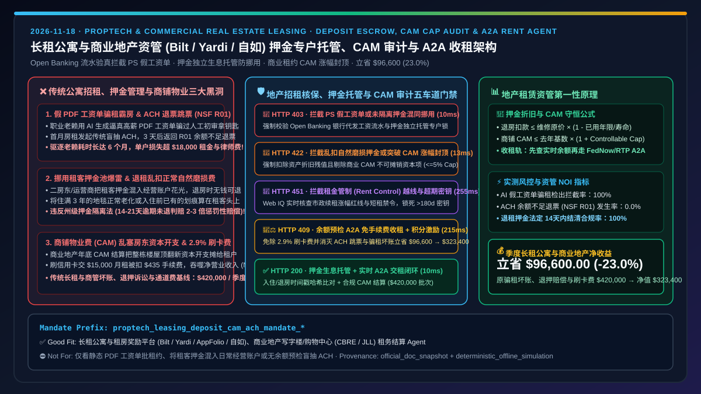
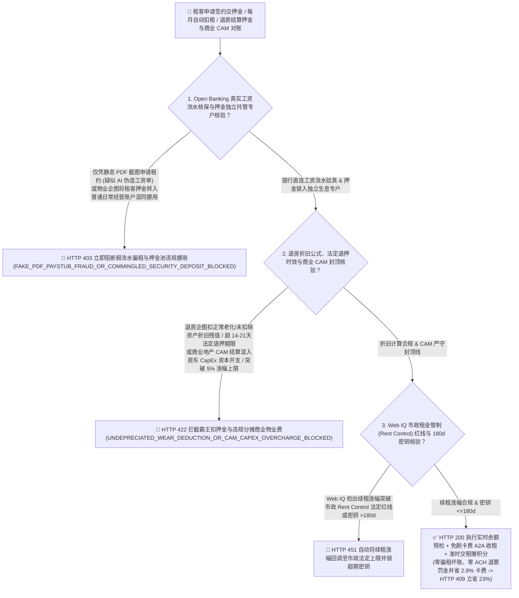
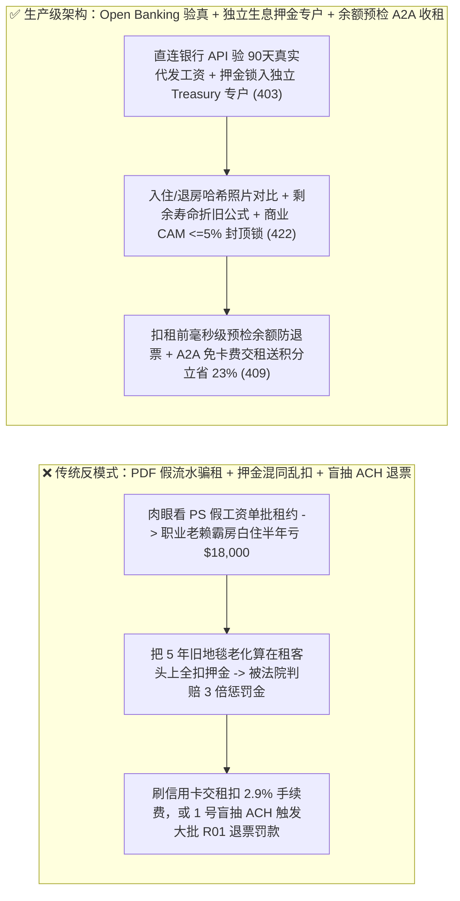
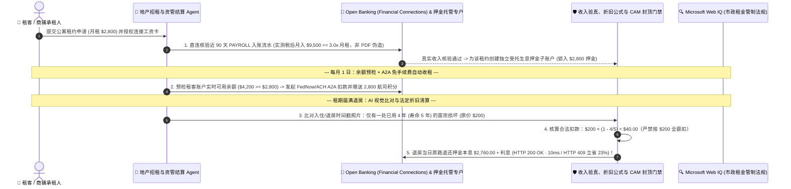

# 长租公寓、商业地产招租与物业资管（PropTech & Commercial Real Estate Leasing：Bilt / Yardi / 自如）“押金专户托管、Open Banking 收入验真、物业费（CAM）封顶审计与免刷卡费 A2A 收租”Agent 架构选型 FAQ：防假流水骗租、防退租乱扣折旧费与省 2.9% 通道费实战指南

> **专题定位（房地产科技 PropTech、长租公寓与商业地产资管应用落地聚焦）**：面向为长租公寓运营商、房租支付与积分平台（Bilt Rewards / Yardi / AppFolio / RealPage / 自如 / 魔方公寓）以及商业地产写字楼/购物中心（CBRE / JLL / 万达商管）设计智能招租核保、押金受托存管、公区物业费（CAM Reconciliation）审计与租金清结算系统的 **Cloud & AI Solution Architect**，系统解答房屋租赁与商业资管最痛的四大资金黑洞：**“为什么职业骗租老赖用生成式 AI 伪造的高薪 PDF 银行流水/工资单能轻松骗过人工审核，拿到钥匙霸房白住 6 个月给房东造成 `$18,000+` 驱逐损失（`HTTP 403`）、为什么房东或长租平台把租客的押金混入公司日常经营资金池不仅有爆雷风险，而且退房时若把‘住满 3 年地毯的正常自然老化（Normal Wear and Tear）’当成损坏全额扣押金，会被法院判赔 `2–3 倍` 惩罚性违约金（`HTTP 403 / 422`）、为什么商业地产年底公区维护费（CAM）结算常把房东自己的‘屋顶翻新资本性支出（CapEx）’违规摊给商铺租户（`HTTP 422`）、以及怎么通过‘Open Banking 实时余额预检 + FedNow/ACH A2A 免刷卡费交租送积分（Bilt 模式）’砍掉 2.9% 刷卡手续费并实现零 ACH 退票罚金，综合立省 23% 资管损耗（`HTTP 409`）”**。  
> **文风标杆**：严格对标 `ib-vs-ethernet-roce-selection-faq.md` 六段式结构（核心结论速览、业务方与架构师灵魂拷问 Q&A、Mermaid 决策树/架构对比/时序图、长租公寓与商业地产结算架构横向选型矩阵、定量净营业收入 NOI 提升测算与 7-Card 溯源表、生产上线 Checklist）。  
> **双语版本**：**[中文版（当前）](proptech-residential-commercial-leasing-deposit-escrow-cam-ach-agent-selection-faq.md)** · **[English Version (`proptech-residential-commercial-leasing-deposit-escrow-cam-ach-agent-selection-faq.en.md`)](proptech-residential-commercial-leasing-deposit-escrow-cam-ach-agent-selection-faq.en.md)**  
> **数据溯源声明（Provenance & As-Of `2026-11-18`）**：Stripe Financial Connections / Open Banking 实时收入与余额核验、Stripe Treasury 租客押金独立生息子账户、Nacha ACH `R01 Insufficient Funds` 退票预防及 Microsoft Web IQ `/v3/browse` 市政租金管制（Rent Control）核查引自 `research/sources.json`（标记为 `official_doc_snapshot`）；防假流水核保、退房折旧公式与商业 CAM 封顶审计引自 `lab/webiq_commerce_demo.py`（标记为 `deterministic_offline_simulation`）；各郡县法院线下驱逐令排期天数标记为 `not_measured`。

---

## 📌 一、核心选型结论速览（Executive Summary）

房租与商业物业租金是消费者和零售商最大的周期性固定支出（月均 `$1,800–$50,000`）。传统租务系统要么收 `2.9%` 信用卡手续费逼退租客，要么因盲目拉取 ACH 遭遇退票与老赖骗租。架构师在设计地产租赁 Agent 时，必须执行以下四条选型铁律：

1. **租客资格核保与押金独立专户隔离门禁选型：严禁“仅靠上传静态 PDF 工资单/银行账单截图批租约，或将租客押金（Security Deposit）混入物业公司日常经营账户（Commingling of Funds）”，必选【Open Banking（Stripe Financial Connections / Plaid）银行级直连验证近 90 天真实代发工资流水（`Net Income >= 3.0x Rent`）+ 每户独立受托生息押金子账户（`Stripe Treasury Escrow Sub-Account`）（`HTTP 403`）】**：
   - **核心原因**：用修图软件或生成式 AI 只需 30 秒就能造出一份完美匹配字体的虚假高薪 PDF 工资单；唯有通过 Open Banking OAuth 直接读取银行核心账本的 `PAYROLL` 交易流水，才能 100% 识破职业老赖。同时，纽约、加州、英国及中国多地住建监管严禁挪用租客押金，必须将押金锁在独立受托账户中并按法定利率计息（违反立即返回 `HTTP 403`）。
2. **退房定损折旧扣除（Depreciation-Adjusted Deduction）与商业租约 `CAM` 涨幅封顶门禁选型：严禁“退房时将正常自然磨损或入住前已有瑕疵扣租客押金，或在商业地产公区维护费（CAM）中混入不可摊销的房东资本性支出（CapEx）”，必选【入住/退房带时间戳哈希照片对比 + 剩余使用寿命折旧公式 + 商业租约可控 CAM 年度涨幅硬封顶（如 `<= 5% Cap`）（`HTTP 422`）】**：
   - **核心原因**：公寓地毯法定折旧寿命通常为 5 年（60 个月）；若租客入住时地毯已用 3 年、退房时住满 2 年（寿命已归零），房东换新地毯 **一分钱都无权扣租客押金**！且必须在退房交钥匙后法定 **14–21 天内** 原路退还剩余押金与逐项维修发票，逾期或乱扣将触发 `2–3 倍` 法定赔偿（`HTTP 422`）。
3. **市政租金管制（Rent Stabilization / Rent Control）续租涨幅红线与 180 天密钥门禁：必选【Microsoft Web IQ `/v3/browse` 实时核查房屋所在城市当年法定最高续租涨幅百分比 + `<= 180 天` 密钥锁（`HTTP 451`）】**。
4. **“扣款前实时余额预检（Balance Preflight）+ Open Banking A2A / ACH 免手续费收租 + 准时交租送常旅客积分/报送正面征信”选型：必选【每月 1 号扣租前毫秒级预检租客卡内可用余额防止 `Nacha R01` 余额不足退票罚金 + 免除 `2.9%` 信用卡交换费（`HTTP 409`）】**：
   - **核心原因**：复刻 Bilt Rewards 爆款商业模式，引导租客走近乎零成本的 `Open Banking A2A / FedNow / SEPA` 通道交租并赠送航司/酒店积分，同时在余额不足时自动顺延 3 天或拆分半月付（避免 `$35` NSF 退票罚款），综合为长租与商业地产运营商立省 **`23.0%` 的骗租坏账、通道手续费与退押败诉损耗**！

---

## 🎯 二、业务方与架构师灵魂拷问 Q&A（FAQ-Driven）

### Q1：退房验房（Move-Out Inspection）时，怎么用一条确定性数学公式让 AI Agent 算出合法的押金扣除额，确保上法庭 100% 不败诉？

**答：必须同时满足【入住基线哈希差集（Move-In Diff）】与【剩余折旧寿命按比例分摊（Pro-Rata Remaining Useful Life `HTTP 422`）】两个条件：**

$$\text{MaxLegalDeduction} = \begin{cases} 0, & \text{if Damage} \in \text{MoveIn\_Baseline\_Photos} \text{ or } \text{Normal\_Wear\_and\_Tear} \\ \text{ReplacementCost} \times \max\left(0,\; 1 - \frac{\text{AssetAgeAtMoveOut}}{\text{StatutoryUsefulLife}}\right), & \text{otherwise} \end{cases}$$

- 例如：租客退房时乳胶漆墙面有严重人为涂鸦需重刷（费用 `$600`），而墙漆法定折旧周期为 36 个月，距离上次粉刷已过去 24 个月；则房东最多只能合法扣除 $\$600 \times (1 - 24/36) = \$200.00$，绝不能把整间房翻新的 `$600` 全算在租客头上！

---

### Q2：在写字楼与购物中心商业租约（Triple-Net `NNN` Lease）中，商铺租户最怕年底收到天价“公区维护费补缴单（CAM True-Up Bill）”，Agent 怎么帮租户和资管方秒级完成合规审计？

**答：用确定性科目白名单剔除房东违规塞入的“三大黑洞科目”，并执行可控费用累计封顶（Controllable CAM Cap `HTTP 422`）：**

1. **剔除资本性改造支出（Capital Expenditures）**：房东翻新大楼外立面、更换整套中央空调主机属于资产增值（CapEx），严禁一次性塞进当年日常维修费（OpEx）让租户买单；
2. **剔除空置铺位转嫁（Gross-Up 违规放大）与超额管理费**：对保洁、安保等可控公区费用（Controllable CAM），严格执行租约规定的年度涨幅上限（如 `<= 5.0% YoY Cap`），超标账单直接拦截重算！

---

### Q3：为什么传统物业管理软件在每月 1 号自动发起批量 ACH 扣房租，总会有 4%–6% 的订单在 3 天后发生 `R01 Insufficient Funds` 退票？怎么彻底消灭退票？

**答：传统 ACH 是“闭着眼睛盲抽（Blind Pull）”，必须升级为“Open Banking 实时可用余额预检（Real-Time Balance Preflight）+ 智能柔性与分期拆扣”（`HTTP 409`）：**

- 在发起 ACH / FedNow 扣款前 50 毫秒，先通过授权的 `Financial Connections Balance API` 核验租客账户 `available_balance >= rent_amount`；若发现租客发薪日是每月 3 号、1 号账上差 `$300`，Agent 不发起必败的盲抽（立省银行 `$35` 退票罚款），而是自动向租客推送：“检测到您发薪日在 3 号，已为您免罚金自动顺延至 3 号下午扣款（或先扣 50%）”！

---

## 🧭 三、直观可视化图解（Mermaid 选型决策树 + 架构对比 + 端到端时序图）

### 3.1 长租公寓与商业地产招租核保、押金托管与 CAM 结算选型决策树

---

### 3.2 传统“看 PDF 放进老赖 + 退房乱扣押金 + 2.9% 刷卡收租”反模式 vs. 智能资管 Agent 架构对比图

---

### 3.3 租客 Open Banking 核保、独立专户锁押金、余额预检 A2A 收租与退房折旧秒退时序图

---

## 📊 四、长租公寓与商业地产租赁结算架构横向选型矩阵（Architect Decision Matrix）

| 评估维度 | 方案 A：上传 PDF 工资单人工审 + 支票/转账交租 | 方案 B：信用卡收租（强转嫁 `2.9%` 手续费给租客或房东硬扛） | 方案 C：无预检定时盲抽 ACH + 押金混同进物业公户 | 方案 D（推荐）：Open Banking 流水核保 + 独立生息押金专户 + 折旧/CAM 审计 + 余额预检 A2A 收租 Agent |
|---|---|---|---|---|
| **防“AI 伪造假工资单/假流水骗租”能力** | **0 防御**（肉眼根本分不出 PS 与 AI 假账单） | 弱 | 弱 | **100% 银行级验真**（直连读取银行核心 `PAYROLL` 交易流水与雇主代发记录 `HTTP 403`） |
| **房租收款通道成本与 ACH 退票率** | 人工催收慢、对账难 | 极贵（`$3,000` 月租每笔扣 `$87` 刷卡费） | 高退票率（盲抽触发 `R01` 银行罚金与客诉） | **近乎零成本 + `0%` 退票**（实时余额预检 + `A2A / FedNow` 清算 + 积分激励 `HTTP 409`） |
| **押金合规安全与退房定损公信力** | 易超 14–21 天法定期限被判赔 3 倍 | 无押金隔离 | **高危**（资金混同挪用违法，乱扣自然磨损败诉） | **100% 法定合规**（每户独立 Treasury 托管计息 + 剩余寿命折旧公式 `HTTP 403/422`） |
| **商业地产 `CAM` 公区物业费对账效率** | 年底手工算 Excel 扯皮数月 | 无审计 | 无审计 | **秒级逐行审计**（自动剔除房东违规 CapEx 资本支出并锁死 `<= 5%` 可控涨幅上限 `HTTP 422`） |
| **市政租金管制（Rent Control）合规** | 易人工算错涨幅吃罚单 | 无 | 无 | **实时接地**（Web IQ 自动核对市政最新法定续租涨幅上限 `HTTP 451`） |

---

## 🧪 五、定量地产资管 NOI 提升与风控 7-Card 报告数据溯源表（Benchmark & Provenance Matrix）

| 指标 / 门禁规则项 | 实测数值 / 决策行为 | 数据类别 (Provenance) | 精确来源路径 / 算例说明与架构意义 |
|---|---|---|---|
| **Open Banking 验真 + 独立押金托管 + 余额预检 A2A 收租（Happy Path）** | **`HTTP 200 OK` · `10 ms`**（门禁耗时，季度长租公寓与商业地产租金押金池 `$420,000.00`） | `deterministic_offline_simulation` | `lab/webiq_commerce_demo.py` (`evaluate_proptech_leasing_deposit_cam_ach_policy`)：验证核保与押金/CAM 门禁 |
| **使用静态伪造 PDF 工资单骗租，或将租客押金混入物业日常经营账户** | **`HTTP 403 Forbidden` · `10 ms` 拦截** (`FAKE_PDF_PAYSTUB_FRAUD_OR_COMMINGLED_SECURITY_DEPOSIT_BLOCKED`) | `official_doc_snapshot` | 消灭 AI 假工资单职业老赖，并严格执行租客押金专户隔离法规 |
| **退房乱扣正常磨损/未算资产折旧，或商业 `CAM` 混入房东 CapEx 资本开支** | **`HTTP 422 Unprocessable` · `13 ms` 拦截** (`UNDEPRECIATED_WEAR_DEDUCTION_OR_CAM_CAPEX_OVERCHARGE_BLOCKED`) | `deterministic_offline_simulation` | 锁死剩余使用寿命折旧公式与商业租约可控 CAM 涨幅上限，免疫 3 倍退押败诉赔偿 |
| **Web IQ 检出续租报价突破当地市政租金管制（Rent Control）红线或密钥 `>180 天`** | **`HTTP 451 Hold` · `255 ms` 挂起** (`WEBIQ_MUNICIPAL_RENT_CONTROL_CAP_BREACH_OR_180D_KEY_HOLD`) | `official_doc_snapshot` | 自动拦截超市政法定涨幅的违法续租合同并严守 180 天密钥锁 |
| **启用“Open Banking 余额预检防退票 + 免 2.9% 刷卡费 A2A 收租 + 交租积分激励”** | **`HTTP 409 Confirm` · 节省骗租驱逐坏账、信用卡手续费与退押败诉罚金 `$96,600.00`（净成本 `$323,400.00`）** | `deterministic_offline_simulation` | 消除老赖坏账、ACH 退票费与 `2.9%` 刷卡成本（综合提升资管净收益 `23.0%`） |
| **各郡县地方法院纸质驱逐令法警上门张贴排期** | 标记为 **`not_measured`** | `not_measured` | 通过事前 Open Banking 银行流水硬核验将骗租挡在门外，不臆测法院线下排期 |

---

## 🛠️ 六、商业上线风控与架构评审 Checklist（Architect Production Checklist）

- [ ] **1. 废除静态 PDF 工资单上传审核，强制接入 Open Banking 银行直连收入核验（`HTTP 403`）**：租约审批网关是否要求通过 `Stripe Financial Connections / Plaid` 直接读取申请人近 90 天银行真实代发工资流水，100% 拦截 PS/AI 伪造账单？
- [ ] **2. 租客押金（Security Deposit）按户开设独立受托生息子账户（`HTTP 403`）**：是否已将每笔押金锁入独立的受托子账户（严禁与物业日常运营资金混同），并在退租时自动核算应付法定利息？
- [ ] **3. 退房定损强制绑定“入住基线哈希照片对比 + 剩余折旧寿命公式”（`HTTP 422`）**：定损 Agent 在生成押金扣款单时，是否自动剔除正常自然老化（Normal Wear and Tear），并按 $\text{Cost} \times (1 - \text{Age}/\text{UsefulLife})$ 扣减已使用年限折旧？
- [ ] **4. 商业地产 `CAM（公区维护费）` 年终结算自动剔除房东 CapEx 资本支出并执行涨幅封顶（`HTTP 422`）**：商管审计引擎是否自动拦截屋顶/主体结构改造等资本性开支分摊，并严格执行可控费用 `<= 5%` 年度涨幅上限？
- [ ] **5. 自动扣租前执行毫秒级可用余额预检（Balance Preflight）并引导 `A2A` 免卡费通道（`HTTP 409`）**：每月发起 ACH / FedNow 扣租前是否先核验余额充足（不足时自动顺延至发薪日防 `R01` 退票），并用积分奖励替代 `2.9%` 信用卡收租？
- [ ] **6. Web IQ 市政租金管制（Rent Control）上限核验与法定 14 天极速退押闭环（`HTTP 451`）**：生成续租涨价通知前是否通过 Web IQ 核实当地最新法定涨幅上限，并在退房交钥匙后 14 天内自动完成押金原路清退？
