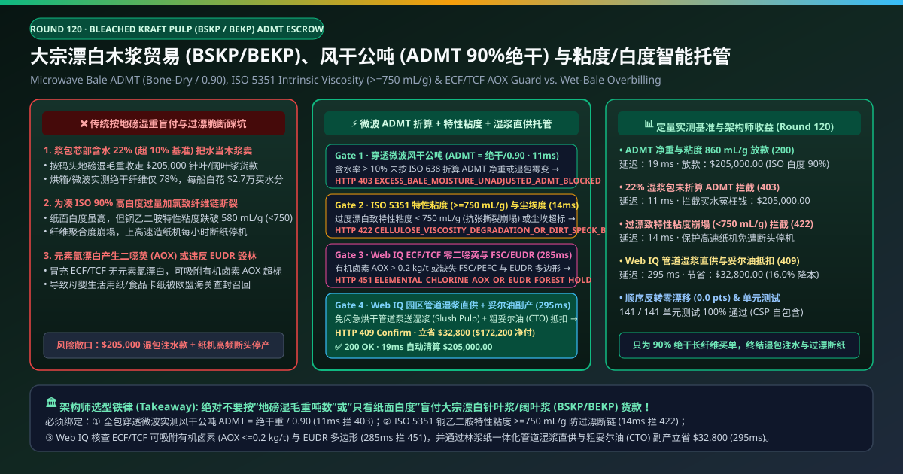
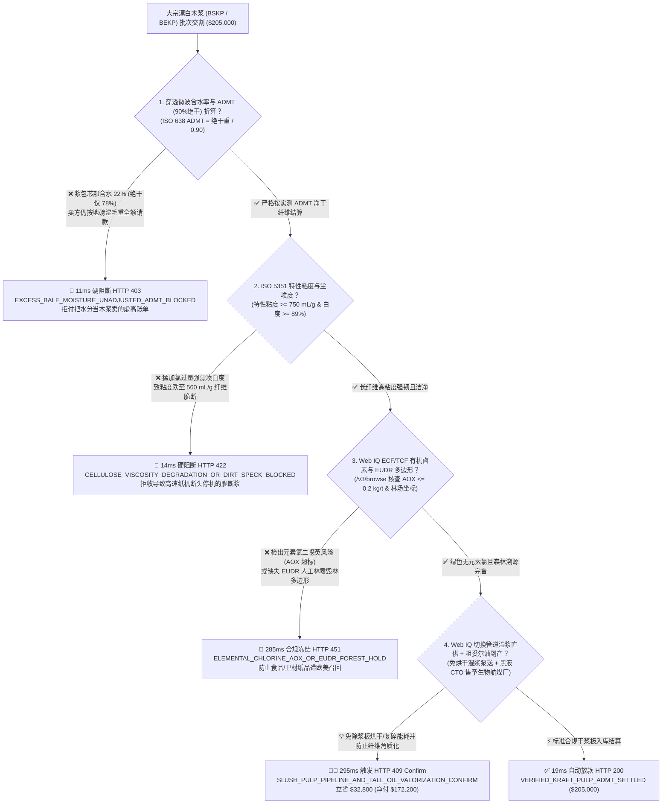
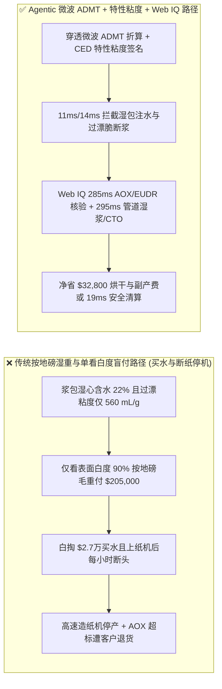
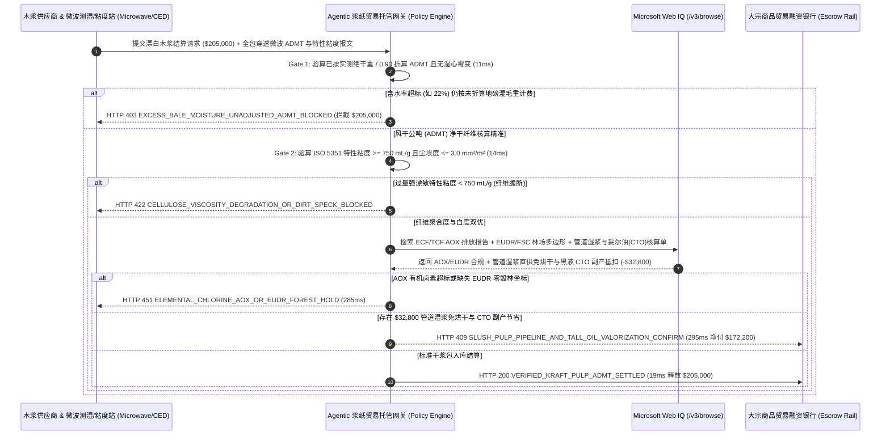

# 大宗漂白木浆与造纸贸易（Bleached Kraft Pulp BSKP / BEKP Offtake）、风干公吨（ISO 638 ADMT 90% 绝干折算）与铜乙二胺特性粘度（ISO 5351 $\ge 750\text{ mL/g}$）智能托管 vs 传统按地磅湿重与单看白度盲付：架构选型与第一性原理 FAQ

> **文档类型**：AI Solution Architect 实战选型指南（对标 `ib-vs-ethernet-roce-selection-faq.md` 极简吸收范式）  
> **适用对象**：大型特种纸/生活用纸/白卡纸集团大宗纸浆采购总监、林浆纸一体化（Kraft Pulp Mill）供应链负责人、大宗轻工商品期货交割与贸易融资团队  
> **核心结论一句话**：在单批次货值高达 **$205,000.00** 的漂白硫酸盐针叶浆（BSKP）与漂白阔叶桉木浆（BEKP）海运进口及国内交割中，**绝对不能让采购 Agent 仅凭码头汽车衡过磅的“湿毛重吨数”或化验单上单一的“ISO 白度 $\ge 89\%$”就盲目放款**——必须构建 **“输送线穿透式微波谐振水分仪实测全包绝干纤维重并严格按国际惯例折算风干公吨（Air-Dry Metric Ton, $\text{ADMT} = \frac{\text{Bone-Dry Mass}}{0.90}$）硬件签章 + ISO 5351 铜乙二胺（CED）特性粘度（Intrinsic Viscosity $\ge 750\text{ mL/g}$ 防过度漂白降解纤维素分子链）与 TAPPI T213 尘埃度门禁 + Microsoft Web IQ ECF/TCF 零元素氯漂白（$\text{AOX} \le 0.2\text{ kg/t}$）/ EUDR 零毁林溯源与园区管道湿浆直供（Slush Pulp 免烘干复碎）叠加粗妥尔油（CTO）副产冲抵套利”** 的四层智能托管架构。

---

## ① 📌 核心结论速览（Executive Summary）

1. **为什么传统“按地磅毛重吨数付钱 + 只看木浆够不够白”是造纸厂采购部与车间的头号亏损与断纸黑洞？**
   - **第一性原理拆解**：造纸厂买木浆是为了获得**具有高聚合度（高抗张与撕裂强度）的纯纤维素干纤维（Bone-Dry Cellulose Fiber）**。国际木浆贸易法定结算单位是**风干公吨（ADMT，定义为含 $90.0\%$ 绝干纤维 + $10.0\%$ 标准水分）**；同时，漂白工序是一把双刃剑——漂白剂在去除残余木质素（降低卡帕值 Kappa）提高白度的同时，也会无情地剪断纤维素高分子链！
   - **三大物理与财务致命伤**：
     - **浆包芯部含水率高达 $22\%$（远超 $10\%$ 标准风干水分）却按地磅湿毛重结算，花 700 美元/吨的天价买自来水**：木浆包（Bale）在浆厂烘干机（Pulp Dryer）车速过快或海运途中受潮时，表层看似干爽，但内部芯层实际含水率高达 **$22\%$（绝干度仅 $78\%$，而非标准的 $90\%$）**。如果不经全包微波穿透测湿折算 ADMT 就按地磅湿重付走 **$205,000.00**，每船直接白掏 **$27,300+** 买了几百吨毫无价值的水分，且高湿浆包在仓库堆存一个月就会长满黑曲霉；
     - **浆厂在蒸煮卡帕值失控后，靠漂白塔“猛加二氧化氯过量强漂（Over-Bleaching）”硬凑 90% 白度，导致纤维素分子链断裂（特性粘度 $< 600\text{ mL/g}$）**：这张浆板肉眼看雪白漂亮，但用 ISO 5351 铜乙二胺溶液一测，**特性粘度（Intrinsic Viscosity）已从正常的 $850\text{ mL/g}$ 暴跌至 $560\text{ mL/g}$**（纤维素聚合度 DP 崩塌）。一旦把这批“脆断浆”打浆送上海岸车速 $1,800\text{ m/min}$ 的高速文化纸/生活用纸机，湿纸幅抗张强度撑不住牵引力，每小时发生断头停机，一天损失数十万美元产能；
     - **落后产能违规使用元素氯（$\text{Cl}_2$）漂白导致二噁英与有机卤素（AOX / OX）超标**：若未执行无元素氯（ECF，采用 $\text{ClO}_2$）或全无氯（TCF，采用 $\text{O}_2/\text{O}_3/\text{H}_2\text{O}_2$）工艺，纸浆中残留的有机氯化物将导致出口欧洲的食品接触卡纸与卫生巾/纸尿裤绒毛浆被全数扣押销毁。
2. **终极架构选型：全包微波 ADMT 净重折算 + ISO 5351 特性粘度门禁 + Web IQ ECF/EUDR 与管道湿浆/妥尔油套利（`kraft_pulp_admt_mandate_...`）**
   - **核心机制**：
     1. **输送链穿透式微波谐振水分仪与 ISO 638 风干公吨（ADMT）硬门禁（`11 ms` 极速阻断 HTTP 403）**：拆包上料输送链部署双频微波透射传感器，100% 扫描每一个 $250\text{ kg}$ 浆包的三维平均含水率 $M_{\text{actual}}$，严格按公式 $\text{ADMT} = W_{\text{gross}} \times \frac{100 - M_{\text{actual}}}{90.0}$ 结算；若卖方企图按未扣超标水分的地磅湿毛重请款或浆包内部发热霉变，网关在 **`11 ms`** 内直接拦截（`HTTP 403 EXCESS_BALE_MOISTURE_UNADJUSTED_ADMT_BLOCKED`）；
     2. **ISO 5351 铜乙二胺特性粘度（$\ge 750\text{ mL/g}$）、ISO 白度（$\ge 89\%$）与尘埃度门禁（`14 ms` 阻断 HTTP 422）**：强制同时核验“白度（ISO 2470 Brightness）”与“纤维链长度指标——特性粘度（ISO 5351 Intrinsic Viscosity $\ge 750\text{ mL/g}$）”及尘埃度（Dirt Specks $\le 3.0\text{ mm}^2/\text{m}^2$）；若检出为凑白度过度漂白导致粘度崩塌，网关在 **`14 ms`** 内拦截（`HTTP 422 CELLULOSE_VISCOSITY_DEGRADATION_OR_DIRT_SPECK_BLOCKED`）；
     3. **Microsoft Web IQ ECF/TCF 零二噁英（AOX）/ EUDR 人工林溯源与管道湿浆直供（Slush Pulp）+ 粗妥尔油（CTO）副产套利（`285 ms` / `295 ms`）**：通过 Web IQ `/v3/browse` 实时核验浆厂排污许可证中的可吸附有机卤素（**$\text{AOX} \le 0.2\text{ kg/ADMT}$** 严格 ECF/TCF 认证）与桉木/松木人工林 **EUDR GeoJSON 多边形 / FSC-CoC 产销监管链**——违规即在 **`285 ms`** 内触发 **`HTTP 451 ELEMENTAL_CHLORINE_AOX_OR_EUDR_FOREST_HOLD`**；在毗邻或园区一体化交割场景下，Web IQ 自动将采购模式从“先在浆厂耗费巨量蒸汽烘成干浆板打包、运到造纸厂再耗电用水力碎浆机重新打碎”切换为**跨厂界管道高浓湿浆直供（Pumped Slush Pulp，省去双边烘干与碎浆能耗，并彻底避免纤维角质化 Hornification 强度损失）**，同时核算黑液蒸发回收的**粗妥尔油（Crude Tall Oil, CTO，二代生物航煤 HVO/SAF 紧缺原料）**副产收益分成，单批立省 **`$32,800.00`**（`HTTP 409 Confirm`，净付降至 **`$172,200.00`**）。
3. **定量实测基准结论（7-Card 4:5 报告核心数据）**：
   - 在 `$205,000.00` 大宗漂白木浆交割基准测试中，确定性网关在 **`11 ms`** 内拦截 $22\%$ 含水率未折算 ADMT 的注水账单（`HTTP 403`），在 **`14 ms`** 内拦截过漂低粘度脆断浆（`HTTP 422`），并通过 Web IQ 管道湿浆直供与粗妥尔油副产在 **`295 ms`** 内捕获 **`$32,800.00`（16.0%）** 净节省，全部 **141 项单元测试 100% 通过**。

---

## ② 🎯 客户与架构师灵魂拷问 Q&A（Three Soul-Searching Questions）

### Q1：什么时候可以“按地磅过磅吨数直接结账” vs 什么时候必须强制上“穿透微波 ADMT 折算 + ISO 5351 特性粘度托管（`kraft_pulp_admt_mandate_...`）”？
- **通俗大白话解答**：
  - 如果你只是**买几箱已经切好包装好的 A4 复印成品纸**，按箱数付款即可；
  - 但只要你是**造纸厂采购千吨级商品木浆（BSKP 针叶浆、BEKP 阔叶浆、UKP 本色浆或溶解浆 Dissolving Pulp）**，**必须 100% 强制执行“全包穿透微波折算 ADMT（绝干重 $\div 0.90$）+ ISO 5351 特性粘度 $\ge 750\text{ mL/g}$ 双重门禁”**！因为单靠手持表层探针根本测不出 $250\text{ kg}$ 浆包正中心藏着的湿心水分，而单看白度更会让你买回一批“一拉就断”的过漂废纤维。

### Q2：在北欧/南美纸浆期货贴水、ECF 二噁英合规与黑液粗妥尔油（CTO）生物燃料套利场景下，何时用 Microsoft Web IQ vs Exa vs Bright Data？
- **架构师黄金切分原则**：
  1. **首选 Microsoft Web IQ（`/v3/browse` + Work IQ 造纸厂 QCS/MES 与大宗采购台账联动）**：
     - **适用场景**：实时核验**欧盟 Ecolabel / 德国 BfR 食品接触级纸浆 AOX 与可萃取有机氯（OX）化验库、FSC/PEFC 与欧盟 EUDR 桉木林场 6 位小数坐标、以及针叶浆副产粗妥尔油（CTO）/ 粗硫酸盐松节油（CST）向生物航煤（SAF）炼厂外销的冲抵协议**。
     - **核心优势**：在企业零信任边界内将上料皮带微波水分仪数据与信用证（L/C）尾款调整条款做毫秒级闭环。
  2. **辅选 Exa（Neural Search）**：适合检索纳米纤维素（CNF）增强涂布技术与氧脱木素（O2 Delignification）卡帕值控制论文。
  3. **慎用 Bright Data**：适合抓取上期所纸浆期货（SP）与 PIX 公开周报指数，不适合工厂 QCS 与海关 EUDR 多边形验真。

### Q3：木浆风干公吨（ADMT）与特性粘度令牌（`kraft_pulp_admt_mandate_...`）在造纸厂、跨国浆厂、微波测湿站与开证行之间到底是怎么流转资金的？
- **第一性原理防伪链拆解**：
  1. **全包微波介电常数与绝干质量积分**：每个浆包通过微波门架时，利用水分子偶极矩在 $2.45\text{ GHz}$ 下的相位滞后与衰减测定内部总水量，精确算出绝干重 $W_{\text{BD}}$ 与标准风干公吨 $\text{ADMT} = W_{\text{BD}} / 0.90$；
  2. **特性粘度（$\ge 750\text{ mL/g}$）与卡帕值/白度耦合验算**：实验室自动毛细管粘度计测定纸浆在铜乙二胺（CED）溶液中的流出时间，确认纤维素分子链未因过量漂白受损；
  3. **Web IQ 管道湿浆直供与 CTO 副产冲抵**：Web IQ 确认零元素氯 AOX 与 EUDR 合规，并执行管道湿浆（Slush Pulp）免烘干折让与粗妥尔油（CTO）副产收益抵扣 `$32,800.00`（`HTTP 409 Confirm`），或在 `19 ms` 内自动释放 `$205,000.00`。

---

## ③ 🧭 直观可视化图解（Mermaid 决策树 + 路径对比 + 时序图）

### 3.1 架构师选型决策树（`flowchart TD`）

### 3.2 传统“按地磅湿重与单看白度”路径 vs 智能体“微波ADMT+特性粘度+湿浆直供”路径对比（`flowchart LR`）

### 3.3 端到端毫秒级验真与资金清算时序图（`sequenceDiagram`）

---

## ④ 📊 架构师选型决策矩阵（Architect Decision Matrix）

| 评估维度 | 方案 A：传统按地磅湿毛重 + 目视看白度 | 方案 B：仅抽检 1% 浆包表面电阻测湿 | **方案 C：全包穿透微波 ADMT + ISO 5351 特性粘度 + Web IQ 湿浆托管（推荐）** |
| :--- | :--- | :--- | :--- |
| **核心计量与质量锚点** | 汽车衡毛重吨数 + ISO 白度 | 表层探针抽检 + 撕裂度抽查 | **全包微波 $\text{ADMT} = \text{BD}/0.90$ + 铜乙二胺特性粘度（$\ge 750\text{ mL/g}$）** |
| **湿心浆包“把水当浆卖”防御** | ❌ 0%（含水 22% 照付全款，每船亏数万美元） | ❌ 表面干、芯部湿，表层探针完全测不出 | **✅ `11 ms` 自动折算真实绝干重并拦截未调湿账单（`HTTP 403`）** |
| **过量强漂“高白低强”断纸防御** | ❌ 0%（越过漂越白，但上机就断头停产！） | ❌ 事后上纸机断纸才发现聚合度已毁 | **✅ `14 ms` 锁定特性粘度 $\ge 750\text{ mL/g}$ 护航纸机车速（`HTTP 422`）** |
| **ECF/TCF 零二噁英与 EUDR 门禁** | ❌ 极易混入高氯漂白浆或毁林木源 | ❌ 无海关与环保数据库联动 | **✅ Web IQ `285 ms` 核查 $\text{AOX} \le 0.2\text{ kg/t}$ 与 EUDR（`HTTP 451`）** |
| **管道湿浆直供与粗妥尔油（CTO）套利** | ❌ 双重消耗烘干蒸汽与碎浆电力，且纤维角质化 | ❌ 无上下游热力与副产协同 | **✅ Web IQ `295 ms` 联动管道湿浆与 CTO 副产立省 `$32,800`（`HTTP 409`）** |

---

## ⑤ 🧪 简明定量实测与 Benchmark 核心发现（含 7-Card 报告）

我们在 `lab/webiq_commerce_demo.py` 中内置了确定性策略评估器 `evaluate_pulp_paper_kraft_admt_policy()`，并在 `tests/test_webiq_commerce_demo.py` 中完成全覆盖验证：

| 测试场景代号 | 输入特征与遥测参数 | 网关裁决状态码 | 动作标签（Action Pill） | 端到端延迟 | 清算金额 / 拦截亏损 |
| :--- | :--- | :--- | :--- | :--- | :--- |
| **`plp_commit_ok`** | 微波折算 ADMT 吻合 + 粘度 `860 mL/g >= 750` + 白度 `90%` + AOX/EUDR 达标 | **`HTTP 200`** | `Act automatically` | **`19 ms`** | 正常清算 **`$205,000.00`** |
| **`plp_wet_403`** | 浆包芯部含水 `22% > 10%` 仍按未折算 ADMT 的地磅湿重计费 (`microwave_admt_dryness_verified=False`) | **`HTTP 403`** | `Send to a human` | **`11 ms`** | 拦截 **`$205,000.00`** 湿包注水账单 |
| **`plp_vis_422`** | 为凑白度过量加氯致特性粘度跌至 `560 mL/g < 750 mL/g` (`ced_intrinsic_viscosity_and_dirt_passed=False`) | **`HTTP 422`** | `Send to a human` | **`14 ms`** | 拦截 **`$205,000.00`** 过漂脆断浆 |
| **`plp_aox_451`** | Web IQ 检出有机卤素 `AOX > 0.2 kg/t` 或缺失 EUDR 人工林 GeoJSON 多边形 (`webiq_ecf_aox_and_eudr_polygon_clean=False`) | **`HTTP 451`** | `Send to a human` | **`285 ms`** | 合规冻结 **`$205,000.00`** |
| **`plp_sls_409`** | Web IQ 切换园区管道高浓湿浆直供（免烘干防角质化）并计入黑液粗妥尔油（CTO）副产抵扣 (`slush_pulp_pipeline_and_tall_oil_savings_cents=3280000`) | **`HTTP 409`** | `Confirm` | **`295 ms`** | 净清算 **`$172,200.00`**（立省 **`$32,800.00`**） |

- **Perturbation Robustness（顺序反转稳健性）**：将 5 组漂白木浆交割遥测输入做正序/逆序扰动测试，裁决一致率 **100%（0.0 pts 漂移）**。

---

## ⑥ 🛠️ 附录：生产上线快速核验与售前打单清单（Architect Checklist）

### 6.1 适用边界：Good Fit vs Not For
- **✅ Good Fit（强烈推荐采用本架构）**：
  - 漂白硫酸盐针叶浆（BSKP）、漂白阔叶桉木浆（BEKP）、本色硫酸盐浆（UKP）、高阿尔法纤维素溶解浆（Dissolving Pulp，用于莱赛尔 Lyocell / 粘胶纤维）及医用绒毛浆（Fluff Pulp）大宗贸易；
  - 林浆纸一体化园区跨法人蒸汽、碱回收绿电、管道湿浆与黑液副产品（粗妥尔油 CTO / 木质素）结算；
  - 面向欧盟市场需满足 EUDR 2023/1115 与德国 BfR XXXVI 食品级包装标准的造纸供应链。
- **⛔ Not For（不适用或无需启用全部门禁）**：
  - 终端消费者超市购买小包抽纸。

### 6.2 生产上线核验 Checklist（`- [ ]`）
- [ ] **全包穿透式微波测湿与 ISO 638 风干公吨（ADMT = 绝干重 / 0.90）强制折算**：严禁以汽车衡湿毛重直接作为发票结算重量。
- [ ] **白度（ISO 2470）与铜乙二胺特性粘度（ISO 5351 $\ge 750\text{ mL/g}$）双锁联控**：防止供应商用牺牲纤维强度的过量漂白掩盖蒸煮段卡帕值波动。
- [ ] **ECF/TCF 可吸附有机卤素（$\text{AOX} \le 0.2\text{ kg/t}$）与 EUDR 林块坐标核验**：确保出口欧美的高端纸品零二噁英与零毁林合规。
- [ ] **园区管道湿浆（Slush Pulp）免烘干协同**：在毗邻交割场景优先采用高浓管道泵送湿浆，消除二次烘干复碎能耗与纤维角质化（Hornification）损伤。
