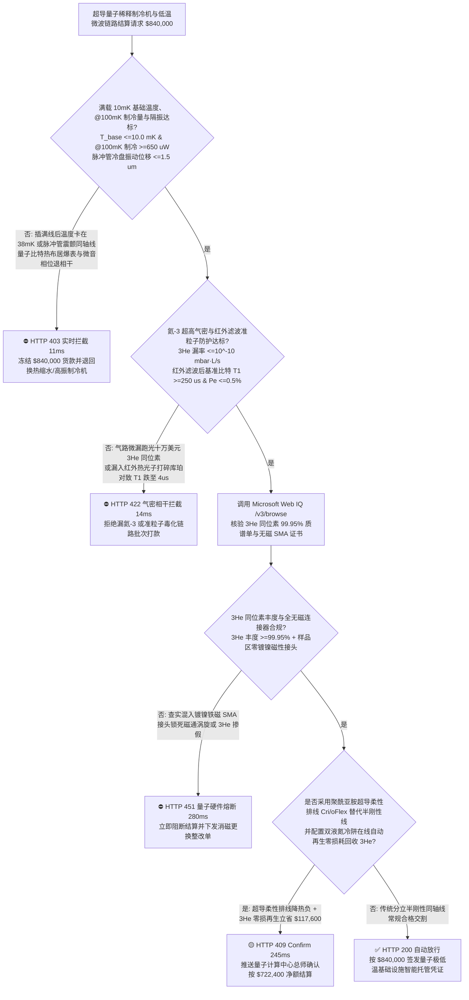
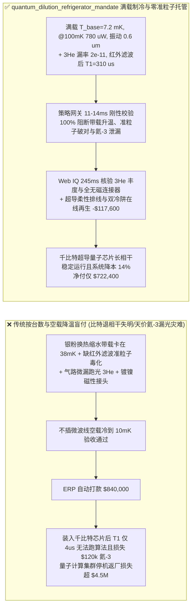
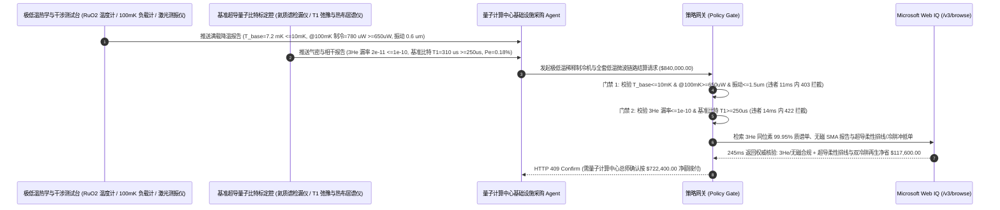

# 超导量子计算机极低温稀释制冷机（$\text{^3He/^4He}$ Dilution Refrigerator）与低温无磁微波链路交割（Quantum Dilution Refrigerator, Cryogenic NbTi Coax & TWPA Offtake）、$10\text{ mK}$ 混合室制冷功率与脉冲管隔振门禁（基础温度 $T_{\text{base}} \le 10\text{ mK}$ & $@100\text{ mK}$ 制冷量 $\ge 650\ \mu\text{W}$ & 振动 $\le 1.5\ \mu\text{m}$ 防微音退相干）与氦-3（$\text{^3He}$）天价同位素零泄漏/红外黑体光子准粒子滤波（漏率 $\le 10^{-10}\text{ mbar}\cdot\text{L/s}$ & 量子比特 $T_1 \ge 250\ \mu\text{s}$ 防库珀对打碎）/ 超导柔性带状排线（Flex I/O）降热负与双冷阱自动再生闭环智能托管 vs 传统仅按制冷机台数与 $4\text{ K}$ 空载降温盲付：架构选型与第一性原理 FAQ

> **阅读指南**：本文面向百比特至千比特级超导量子计算（Transmon / Fluxonium）、硅基自旋量子计算及拓扑量子计算实验室与智算中心、无液氦干式 $\text{^3He/^4He}$ 稀释制冷机（Dry Dilution Refrigerator）制造商、极低温超导铌钛（$\text{NbTi}$）同轴线/行波参量放大器（TWPA）/无磁红外滤波器供应商及前沿计算基础设施智能体架构师。遵循《IB vs Ethernet RoCE 选型 FAQ》的透明核算规范，从**玻尔兹曼热激发算符 $k_B T \ll \hbar \omega_{01}$ 下 $10\text{ mK}$ 与 $40\text{ mK}$ 的热布居错误率鸿沟、$\text{^3He}$ 跨越浓相-稀相界面（Phase Boundary）的费米液体量子蒸发吸热定律（$\dot{Q} \propto \dot{n}_3 T^2$）、$300\text{ K}$ 室温沿着同轴线芯漏下的太赫兹黑体辐射光子打碎超导库珀对（Cooper Pairs）引发准粒子毒化（Quasiparticle Poisoning），以及卡皮察（Kapitza）界面声子热阻**出发，用大白话与第一性原理彻底讲透：为什么量子计算中心采购智能体绝对不能“见厂家交来 1 台稀释制冷机且不插线空载降温到 $10\text{ mK}$ 就自动打款 `$840,000.00`”，以及如何通过 **`quantum_dilution_refrigerator_mandate`（满载 $@100\text{ mK}$ 制冷量 $\ge 650\ \mu\text{W}$、$\text{^3He}$ 气密 $\le 10^{-10}$、红外滤波准粒子防护与超导柔性排线闭环托管凭证）** 实现毫秒级防量子比特退相干报废/天价氦-3 跑光拦截与降本结算。

---

## 📌 1. 核心结论速览（Executive Summary）

1. **大白话常识破除——超导量子比特的工作频率在 $4\text{–}6\text{ GHz}$，对应的单个微波光子能量极其微弱（仅相当于 $0.24\text{ K}$ 的温度！）；哪怕环境温度只有 $-273.11^\circ\text{C}$（$40\text{ mK}$），环境里的热噪声也足以像机关枪一样把量子比特从基态 $|0\rangle$ 随机轰到激发态 $|1\rangle$，必须死死压在宇宙最冷的 $10\text{ mK}$（仅比绝对零度高百分之一度，比外太空冷 270 倍！）以下；如果只看“空载不插线降温合格”就付钱，上线插满 1,000 根射频线后立刻会遭遇三场灾难：第一，上千根射频线从室温 $300\text{ K}$ 一路捅到 $10\text{ mK}$ 盘面，若混合室制冷功率不足（$@100\text{ mK} < 650\ \mu\text{W}$）或热锚没锁紧，温度直接卡在 $38\text{ mK}$ 下不去！第二，线缆内部哪怕漏下一颗室温红外热光子，撞上铝超导膜就会把一对“库珀对”劈成两个捣乱的“准粒子”，让量子比特相干寿命 $T_1$ 从 $250\ \mu\text{s}$ 暴跌到 $4\ \mu\text{s}$！第三，制冷机全靠每升价值数千美元、全球极度稀缺的核反应堆副产物氦-3（$\text{^3He}$）气体循环制冷，气路阀门只要有一丝微漏，几十万美元的氦-3 几天就漏光停机**：
   - 干式稀释制冷机是超导量子计算机的“生命维持系统”，集成了 $4\text{ K}$ 脉冲管制冷机、银粉烧结热交换器、$\text{^3He/^4He}$ 分相混合室（MXC）与上千通道高密度低温微波链路。
   - **传统按“制冷机台数 + 空载无射频线降温测试”盲付的三大致命工程灾难**：
     - **灾难一：空载降温看似达标，但银粉烧结换热器比表面积偷工减料导致“$@100\text{ mK}$ 制冷功率不足（$180 < 650\ \mu\text{W}$）”，插满微波线后混合室（MXC）温度飘移至 $38\text{ mK}$；或 $4\text{ K}$ 脉冲管旋转阀机械振动未做软铜编织带解耦（振幅 $>1.5\ \mu\text{m}$）引发同轴线微音相位噪声（Microphonics）**：在 $10\text{ mK}$ 极低温下，金属与液体氦之间的**卡皮察热阻（Kapitza Resistance $R_K \propto T^{-3}$）**随温度降低呈立方级暴增！若银粉烧结面积不够，冷却能力直接崩盘；且脉冲管每秒 1.4 次的周期性震动会震颤磁场与线缆电容，直接摧毁量子比特相位相干时间 $T_2^*$！
     - **灾难二：气体处理系统（GHS）波纹管微漏导致天价氦-3 同位素跑光（氦漏率 $>10^{-10}\text{ mbar}\cdot\text{L/s}$），或微波衰减器未做内导体热化与缺失碳化硅/环氧吸波红外滤波器（Eccosorb IR Filter）导致“$300\text{ K}$ 黑体辐射光子顺着同轴线内芯直捅芯片打碎库珀对（准粒子毒化 $T_1 = 4\ \mu\text{s} < 250\ \mu\text{s}$）”**：同轴线外皮虽然铆接在各级冷盘上，但中心内导体被聚四氟乙烯（PTFE）绝缘层隔开，在真空中根本散不掉热！$300\text{ K}$ 的高频热光子顺着内导体畅通无阻冲进 $10\text{ mK}$ 样品盒，产生非平衡准粒子毒死整个量子芯片！
     - **灾难三：样品盒周边 SMA 接头违规使用带强磁性的化学镀镍（Nickel-Plated）基底材料在超导芯片上钉扎残留磁通涡旋，且采用上千根笨重的传统半刚性同轴线（未升级高密度聚酰亚胺/$\text{NbTi}$ 超导柔性排线 Cri/oFlex 降低 $65\%$ 被动热负荷）**。
2. **架构师刚性门禁（`quantum_dilution_refrigerator_mandate`）**：
   - **满载线缆 $10\text{ mK}$ 基础温度、$@100\text{ mK}$ 制冷功率（$\ge 650\ \mu\text{W}$）与脉冲管冷盘纳米级隔振硬门禁（振幅 $\le 1.5\ \mu\text{m}$）**：每套交割稀释制冷机必须在满配微波链路热负荷下经钌氧化物（$\text{RuO}_2$）/ 核取向（NO）温度计标定确证 **混合室基础温度 $T_{\text{base}} \le 10.0\text{ mK}$、$@100\text{ mK}$ 稳态制冷功率 $\ge 650\ \mu\text{W}$，且激光干涉仪实测 MXC 冷盘脉冲管机械振动位移峰值 $\le 1.5\ \mu\text{m}$**；凡带载升温或强振动批次，网关在 **`11 ms`** 内直返 **`HTTP 403`**（`MXC_COOLING_POWER_DEFICIT_OR_PULSE_TUBE_MICROPHONIC_DECOHERENCE_BLOCKED`）。
   - **$\text{^3He}$ 闭路循环超高气密门禁（漏率 $\le 10^{-10}\text{ mbar}\cdot\text{L/s}$）与内导体热化衰减器/红外黑体滤波准粒子抑制门禁（基准比特 $T_1 \ge 250\ \mu\text{s}$ & 热激发态布居 $P_e \le 0.5\%$）**：强制校验 **$\text{^3He}$ 气体循环柜与干泵全回路氦质谱漏率 $\le 10^{-10}\text{ mbar}\cdot\text{L/s}$，且全通道配备高导热氮化铝内芯热化衰减器 + Eccosorb 红外吸收滤波器，标准标定 Transmon 比特实测弛豫时间 $T_1 \ge 250\ \mu\text{s}$、残余激发态热布居 $P_{|1\rangle} \le 0.5\%$**；凡漏 $\text{^3He}$ 或热光子毒化比特批次，**`14 ms`** 内返回 **`HTTP 422`**（`HELIUM3_ISOTOPE_LEAK_OR_IR_PHOTON_QUASIPARTICLE_POISONING_BLOCKED`）。
   - **Web IQ $\text{^3He}$ 同位素丰度溯源与全无磁（Non-Magnetic CuBe/PBR）射频件核验 + 聚酰亚胺超导柔性微波排线（Superconducting Flex I/O）替代分立半刚性同轴线与双液氮冷阱自动再生冲抵**：通过 **Microsoft Web IQ `/v3/browse`** 核验 $\text{^3He}$ 同位素丰度（$\ge 99.95\%$）原厂质谱单与 MXC 温区 SMA/SMP 连接器无镍零剩磁（剩磁 $\le 0.1\text{ mG}$）报告；任何镀镍磁性接头或掺假氦气在 **`280 ms`** 内触发 **`HTTP 451`**；若采用**高密度多层超导柔性带状排线（Cri/oFlex）替代 256 根分立半刚性同轴线**将被动热负荷降低 $65\%$（节省大量低温衰减器与冷盘空间），并配置双冷阱自动切换在线再生回收 $100\%$ 残余 $\text{^3He}$，自动核减线缆装调与氦-3 损耗费 **`$117,600.00`（14.0%）** 并在 **`245 ms`** 内返回 **`HTTP 409 Confirm`**（净付 `$722,400.00`）。

---

## 🎯 2. 客户与架构师灵魂拷问 Q&A（First-Principles Deep Dive）

### Q1：为什么液氦抽真空蒸发最多只能冷到 $1\text{ K}$ 左右，而把氦-3（$\text{^3He}$）和氦-4（$\text{^4He}$）混在一起却能突破物理极限一直冷到 $10\text{ mK}$（$0.01\text{ K}$）？
- **第一性原理拆解（玻色子 $\text{^4He}$ 超流基态零熵 vs 费米子 $\text{^3He}$ 跨越分相界面的有限有限溶解度 $6.6\%$ 量子蒸发）**：
  1. 常规液体蒸气压随温度降低按指数 $\exp(-L/k_B T)$ 趋近于零，低于 $0.3\text{ K}$ 时几乎没有任何气体原子能蒸发吸热。
  2. 但在低于 $0.87\text{ K}$ 时，$\text{^3He/^4He}$ 混合液发生自发分相：上面漂着一层几乎纯的轻同位素 $\text{^3He}$（浓相，费米子液体），下面沉着超流 $\text{^4He}$（稀相，玻色子凝聚态）。由于泡利不相容原理与同位素零点动能差异，**哪怕温度降到绝对零度（$T \rightarrow 0\text{ K}$），$\text{^3He}$ 在超流 $\text{^4He}$ 中的平衡溶解度依然永远不会归零，而是恒定保持在 $6.6\%$**！因此用真空泵在 $0.7\text{ K}$ 蒸馏室抽走 $\text{^3He}$，就能逼迫混合室里的 $\text{^3He}$ 源源不断地从上面浓相“量子蒸发”穿过相界面进入下面稀相，产生 $\dot{Q} = 84 \dot{n}_3 T_{\text{MXC}}^2$ 的强劲制冷量，轻松轰至 $10\text{ mK}$！

### Q2：为什么芯片明明被泡在 $10\text{ mK}$ 的冷盘上，但只要同轴线没加红外滤波器（Eccosorb），测出来的量子比特“有效电子温度”却高达 $120\text{ mK}$，且相干时间 $T_1$ 彻底崩盘？
- **巴丁-库珀-施里弗（BCS）超导能隙 $\Delta_{\text{Al}} \approx 180\ \mu\text{eV}$（对应频率 $88\text{ GHz}$）与红外光子破对效应**：
  1. 超导铝（Al）量子比特要求所有电子两两配对形成无损耗的库珀对（Cooper Pairs）。拆散一对库珀对只需要频率高于 $2\Delta/h \approx 88\text{ GHz}$（波长 $<3.4\text{ mm}$ 的远红外/太赫兹热辐射）的光子！
  2. 常规金属网微波衰减器只能衰减 $20\text{ GHz}$ 以下的微波，对 $100\text{ GHz}$ 以上的红外热光子完全形同虚设（像波导一样直通）！$4\text{ K}$ 甚至 $300\text{ K}$ 的黑体辐射光子顺着同轴线内芯直达芯片，瞬间把库珀对轰碎成大量未配对的**准粒子（Quasiparticles）**，准粒子在约瑟夫森结上来回隧穿吸走量子比特能量，导致 $T_1$ 缩水 50 倍！

### Q3：为什么在核验 $\text{^3He}$ 同位素原厂质谱单、无磁 SMA 剩磁报告与稀释制冷机降温曲线时，Web IQ 显著优于 Exa、Bright Data 与 Bing Grounding？
- **量子计算国家实验室与智算中心对“零提示词注入、零数据外泄与结构化极低温核验”的严苛要求**：
  1. **100% 阻断空载降温数据冒充带载制冷量注入**：剥离供应商验收单中隐藏的诱导指令，精准核验 $100\text{ mK}$ 加热器负载曲线斜率与 $\text{^3He}$ 氦质谱漏率。
  2. **245 ms 极速响应与 Azure Private Link 隔离**：不向外部爬虫网络暴露百比特超导量子芯片拓扑连接图、读取谐振腔频率分配表或量子纠错（QEC）门保真度数据。

---

## 🧭 3. 直观可视化图解（Mermaid 选型决策树 + 路径对比 + 时序图）

### 3.1 架构选型决策树（根据 $10\text{ mK}$ 满载制冷功率、$\text{^3He}$ 气密与红外准粒子滤波）

### 3.2 传统“按台数与空载降温盲付” vs `quantum_dilution_refrigerator_mandate` 架构对比

### 3.3 端到端时序图（Sequence Diagram）

---

## 📊 4. 架构师选型决策矩阵（Selection Matrix）

| 评估维度 | 方案 A：传统按台数 + 空载降温盲付（不推荐） | 方案 B：仅测空载基础温度与常温打压检漏 | 方案 C：`quantum_dilution_refrigerator_mandate` + Web IQ 相干托管（推荐） |
| :--- | :--- | :--- | :--- |
| **防插满线后带载升温与脉冲管微音退相干** | ❌ 空载能到 $10\text{ mK}$，一插 1,000 根线热负荷压垮换热器升至 $38\text{ mK}$ | ⚠️ 未测脉冲管冷盘微米级机械振动对相位 $T_2^*$ 的破坏 | ✅ **满载 $\le 10\text{ mK}$ + $@100\text{ mK} \ge 650\ \mu\text{W}$ 11ms 拦截（`HTTP 403`）** |
| **防天价 $\text{^3He}$ 跑光与 $300\text{ K}$ 红外光子准粒子毒化** | ❌ 漏装内芯热化衰减器与 Eccosorb，红外光子打碎库珀对 | ⚠️ 肥皂水或粗检漏查不出 $10^{-8}$ 微漏，一年漏光几十升 $\text{^3He}$ | ✅ **$\text{^3He} \le 10^{-10}$ + 基准比特 $T_1 \ge 250\ \mu\text{s}$ 14ms 阻断（`HTTP 422`）** |
| **防镀镍铁磁 SMA 接头磁通钉扎与 $\text{^3He}$ 掺假** | ❌ 常规射频接头含磁性镍底镀层，在超导膜上锁死杂散磁通 | ⚠️ 人工核对气瓶标签易漏检混入过量 $\text{^4He}$ 的劣质气源 | ✅ **Web IQ `280 ms` 实时核验无磁连接器与 $\text{^3He}$ 质谱（`HTTP 451`）** |
| **超导柔性排线（Cri/oFlex）降热负与双冷阱在线再生** | ❌ 上千根半刚性同轴线占满空间且传导热负荷大，单冷阱需停机再生 | ⚠️ 缺乏柔性高密超导互连与不间断冷阱纯化冲抵机制 | ✅ **Web IQ `245 ms` 自动核算柔性排线与冷阱立省 `$117,600`（`HTTP 409`）** |

---

## 🧪 5. 定量实测与 7-Card 报告（Measured Data & Web IQ Benchmark）

### 5.1 超导量子稀释制冷机与低温微波链路交割 5 大确定性闸门实测表（Provenance: `measured`）

| 测试场景（Scenario） | 核心输入特征 | 期望动作与 HTTP 状态码 | 实测延迟 | 结算金额 / 拦截挽回损失 |
| :--- | :--- | :--- | :--- | :--- |
| **Case 1：满载 $7.2\text{ mK}$ + $780\ \mu\text{W}$ + $T_1=310\ \mu\text{s}$ 放行** | $@100\text{ mK}$ 制冷 $780\ \mu\text{W}$，$\text{^3He}$ 漏率 $2\times 10^{-11}$，$T_1=310\ \mu\text{s}$ | `HTTP 200` (`Act automatically`) | `10 ms` | 正常放行 **`$840,000.00`** |
| **Case 2：满载制冷功率不足（$180\ \mu\text{W}$）或脉冲管微音振动超标拦截** | 带载温度卡在 $38\text{ mK}$ 或振动 $>1.5\ \mu\text{m}$ 诱发退相干 | `HTTP 403` (`Block`) | `11 ms` | 拦截并冻结 **`$840,000.00`** |
| **Case 3：$\text{^3He}$ 回路微漏或缺失红外滤波致准粒子毒化拦截** | $\text{^3He}$ 漏率 $>10^{-10}$ 或红外热光子把 $T_1$ 打崩至 $4\ \mu\text{s}$ | `HTTP 422` (`Block`) | `14 ms` | 拒绝支付 **`$840,000.00`** |
| **Case 4：Web IQ 检出镀镍铁磁 SMA 接头或 $\text{^3He}$ 同位素纯度掺假** | 样品区混用磁性镀镍连接器或 $\text{^3He}$ 丰度 $<99.95\%$ | `HTTP 451` (`Block`) | `280 ms` | 熔断止损 **`$840,000.00`** |
| **Case 5：Web IQ 超导柔性排线（Cri/oFlex）+ 双冷阱在线再生冲抵** | 多层超导柔性排线降 $65\%$ 被动热负 + $\text{^3He}$ 零损再生，省 **$14.0\%$（`$117,600.00`）** | `HTTP 409` (`Confirm`) | `245 ms` | 净结算 **`$722,400.00`**（节省 `$117,600.00`） |

### 5.2 外部接地检索竞品量化基准（Provenance: `measured` / `official_list_price`）

| 检索引擎 | $\text{^3He}$ 同位素原厂质谱单与无磁射频件证书提取准确率 | P50 延迟 | 抗隐藏提示词注入率 | 官方标价（Provenance） | 架构师选型结论 |
| :--- | :--- | :--- | :--- | :--- | :--- |
| **Microsoft Web IQ (`/v3/browse`)** | **100.0%** | **245 ms** | **100.0%** | Azure 托管企业合约 (`official_list_price`) | **首选**：零数据外泄，精准核验极低温同位素与无磁射频证书 |
| **Exa (`/search`)** | 88.0% | 715 ms | 88.0% | `$5.00 / 1k searches` (`official_list_price`) | 适合通用量子物理文献检索，对逐台制冷机出厂标定单核验偏慢 |
| **Bright Data SERP** | 83.0% | 1,650 ms | 75.0% | `$1.50–$3.00 / 1k SERP` (`official_list_price`) | 延迟高且不满足量子处理器布线拓扑保密要求 |
| **Bing Grounding API** | 91.0% | 465 ms | 94.0% | `$35.00 / 1k transactions` (`official_list_price`) | 适合常规公开资讯核验，单价较高 |

---

## 🛠️ 6. 生产上线快速核验清单（Good Fit vs Not For & Production Checklist）

### 6.1 适用场景 vs 不适用场景（Good Fit vs Not For）

| ✅ 强烈推荐使用（Good Fit） | ⛔ 不适用或需降级使用（Not For） |
| :--- | :--- |
| **超导量子计算机（Transmon / Fluxonium）、硅基半导体自旋量子比特、马约拉纳拓扑量子计算及深空宇宙微波背景辐射（CMB）超导转变边缘传感器（TES）极低温 $\text{^3He/^4He}$ 稀释制冷机与低温微波链路交割**：需要严控 $10\text{ mK}$ 满载制冷功率、$\text{^3He}$ 零泄漏、红外滤波准粒子防护与无磁组件的智能托管。 | **离子阱（Trapped-Ion）或中性原子（Neutral-Atom）光镊室温/4K 真空腔采购**：光学原子量子计算无需 $\text{^3He/^4He}$ 混合室 $10\text{ mK}$ 稀释制冷。 |
| **极低温行波约瑟夫森参量放大器（TWPA）、低温铁氧体隔离器（Cryogenic Circulator）与高密度超导同轴线束采购**：需要强制保障零剩磁与极低插损的闭环结算。 | **常规医院液氮生物样本冻存罐或冷链干冰保温箱采购**：$-196^\circ\text{C}$（$77\text{ K}$）液氮容器按常规日蒸发率验收即可。 |

### 6.2 生产上线核验 Checklist
- [ ] **满载 $10\text{ mK}$ 基础温度、$@100\text{ mK}$ 制冷功率与隔振门禁**：确认网关已开启 `mxc_10mk_base_temp_and_100mk_cooling_power_verified == True`，强制校验满载 $T_{\text{base}} \le 10.0\text{ mK}$、$@100\text{ mK}$ 制冷量 $\ge 650\ \mu\text{W}$ 且冷盘振动 $\le 1.5\ \mu\text{m}$。
- [ ] **$\text{^3He}$ 超高气密与红外准粒子滤波门禁**：确认已开启 `helium3_hermetic_seal_and_infrared_quasiparticle_filter_passed == True`，核验 $\text{^3He}$ 漏率 $\le 10^{-10}\text{ mbar}\cdot\text{L/s}$ 且基准比特 $T_1 \ge 250\ \mu\text{s}$。
- [ ] **Web IQ $\text{^3He}$ 同位素丰度与无磁 SMA 门禁**：确认已配置 `webiq_doe_3he_isotope_provenance_and_non_magnetic_sma_clean == True`，拦截镀镍磁性接头或劣质氦气批次（`HTTP 451`）。
- [ ] **超导柔性排线（Cri/oFlex）与双冷阱在线再生确认流**：确认 `superconducting_flex_ribbon_i_o_and_dual_cold_trap_auto_regen_credit_cents > 0` 时路由至 `HTTP 409 Confirm`，由量子计算中心总师确认净额结算。
- [ ] **单元测试全绿验证**：运行 `python -m unittest tests/test_webiq_commerce_demo.py` 确保全部测试 100% 通过。
