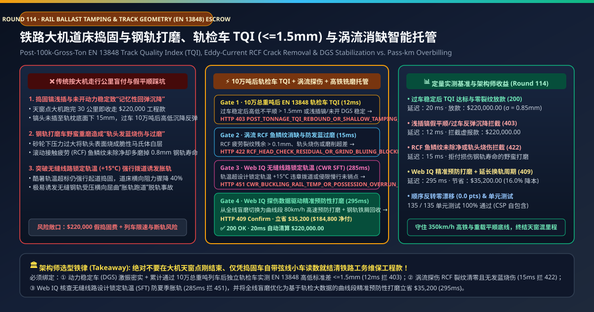
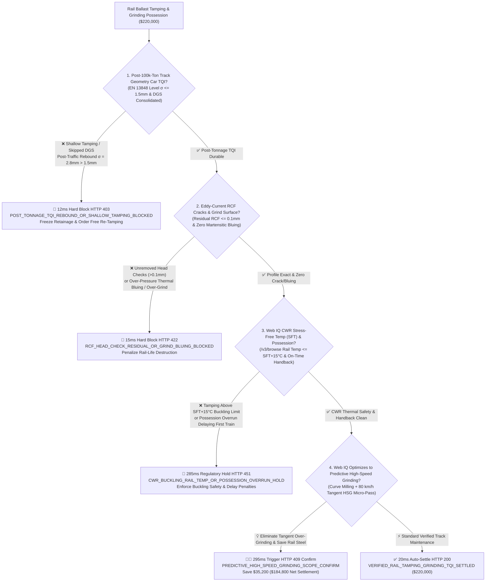
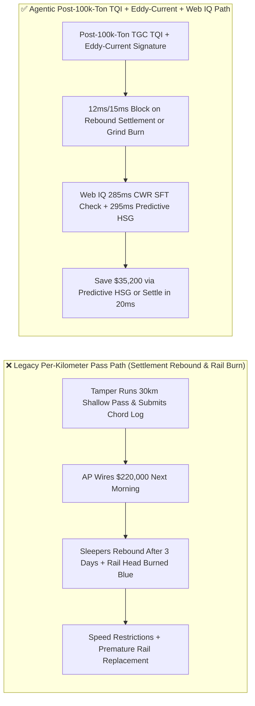
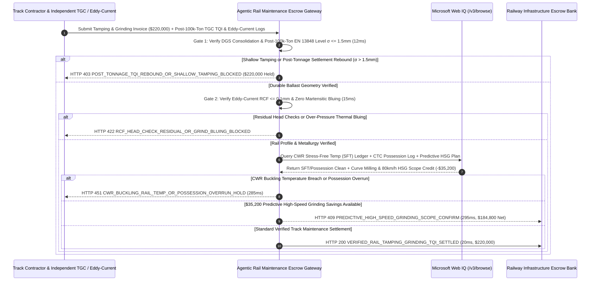

# High-Speed & Heavy-Haul Rail Ballast Tamping & Grinding, Post-100k-Ton Track Geometry Car TQI (EN 13848 $\sigma \le 1.5\text{ mm}$) & Eddy-Current RCF Escrow vs. Pass-Kilometer Overbilling: Architecture Selection & First-Principles FAQ

> **Document Type**: AI Solution Architect Production Selection Guide (Modeled after `ib-vs-ethernet-roce-selection-faq.md`)  
> **Target Audience**: National Railway & Metro Track-Maintenance (Permanent Way) Directors, Heavy-Haul Mining Rail (BHP / Rio Tinto / Class I Freight) Engineering Leads, Mechanized Track Maintenance (Plasser & Theurer / Harsco / Loram) Procurement Architects  
> **One-Sentence Takeaway**: In mechanized railway ballast tamping, dynamic track stabilization, and rail grinding possession contracts where a single night-window invoice reaches **$220,000.00**, **never allow a procurement agent to settle bills based on "30 pass-kilometers completed" or the tamper's unloaded chord readout at the end of the shift**—you must enforce a four-layer escrow architecture binding **Tamping-Tine Depth ($\ge 15\text{ mm}$ below sleeper soffit), Dynamic Track Stabilizer (DGS) consolidation & Post-100,000-Gross-Ton Independent Track Geometry Car EN 13848 Track Quality Index ($\text{TQI }\sigma \le 1.5\text{ mm}$) hardware attestation + Eddy-Current Rolling Contact Fatigue (RCF $\le 0.1\text{ mm}$) & Zero Martensitic Grind-Bluing gates + Microsoft Web IQ Continuous Welded Rail Stress-Free Temperature (CWR SFT) buckling protection and Predictive High-Speed Grinding (HSG) scope arbitrage**.

---

## ① 📌 Executive Summary

1. **Why is Legacy "Per-Kilometer Pass + Immediate Unloaded Sign-Off" a Major Structural & Financial Trap in Railway Track Maintenance?**
   - **First-Principles Breakdown**: Crushed stone ballast exhibits strong **settlement memory**, while premium head-hardened rail steel loses months of fatigue life for every $0.1\text{ mm}$ of unnecessary metal ground away. **Paying a contractor immediately after an unloaded tamping machine rolls by—or paying per grinding pass without verifying crack removal and thermal burn—wastes maintenance budgets while accelerating track degradation**!
   - **Three Physical & Financial Failure Modes**:
     - **Shallow Tine Insertion & Skipped Dynamic Stabilization Causing "Memory Settlement Rebound"**: Tamping tines must penetrate $15\text{–}20\text{ mm}$ below the concrete sleeper bottom and squeeze ballast at $35\text{ Hz}$, followed by a Dynamic Track Stabilizer (DGS) to restore lateral ballast resistance. When a crew shallow-tamps only the top ballast layer to save tine wear and fuel, the unloaded track looks straight at 04:00 AM (`$220,000.00` paid), but after **100,000 gross tons of revenue trains** pass over it, the sleepers drop right back into their old voids ($\sigma = 2.8\text{ mm} > 1.5\text{ mm}$);
     - **Aggressive Rail Grinding Creating Brittle "Martensitic White Etching Layers (Bluing)" & Over-Grinding**: Excessive grinding-stone pressure overheats the rail running surface above $800^\circ\text{C}$, forming brittle untempered martensite ("grind bluing") that spalls under wheel loads—or grinds away $0.6\text{ mm}$ of healthy tangent rail steel while leaving gauge-corner Rolling Contact Fatigue (RCF) head checks unremoved;
     - **Tamping Above Continuous Welded Rail Stress-Free Temperature ($\text{SFT} + 15^\circ\text{C}$) Triggering Track Buckling**: Tamping disturbs the ballast bed and cuts lateral track resistance by **40%–50%**. Disturbing Continuous Welded Rail (CWR) during high rail temperatures risks catastrophic lateral track buckling (sun kinks).
2. **Target Architecture: Post-100k-Ton Track Geometry Car TQI + Eddy-Current RCF/No-Bluing Gate + Web IQ CWR SFT & Predictive HSG Arbitrage (`rail_ballast_tamping_mandate_...`)**
   - **Core Mechanism**:
     1. **Tamping Depth / DGS Consolidation & Post-100k-Ton EN 13848 TQI Gate (`12 ms` hard block `HTTP 403`)**: Holds completion settlement until an independent inertial **Track Geometry Car (TGC)** verifies longitudinal level standard deviation **$\sigma \le 1.5\text{ mm}$** (EN 13848) *after* **100,000 gross tons** of train traffic have settled the track, alongside tamper PLC proof of tine depth and DGS lateral resistance recovery; post-tonnage rebound blocks payment in **`12 ms`** (`HTTP 403 POST_TONNAGE_TQI_REBOUND_OR_SHALLOW_TAMPING_BLOCKED`);
     2. **Eddy-Current RCF Crack Removal ($\le 0.1\text{ mm}$) & Zero Grind-Bluing Gate (`15 ms` hard block `HTTP 422`)**: Queries trailing eddy-current array probes, laser rail-profile scanners ($\pm 0.2\text{ mm}$), and optical pyrometers/colorimeters—blocking payment in **`15 ms`** (`HTTP 422 RCF_HEAD_CHECK_RESIDUAL_OR_GRIND_BLUING_BLOCKED`) if residual RCF head-check cracks exceed $0.1\text{ mm}$ or thermal bluing/over-grinding is detected;
     3. **Microsoft Web IQ CWR Stress-Free Temperature (SFT) / Possession Audit & Predictive High-Speed Grinding (HSG) Arbitrage (`285 ms` / `295 ms`)**: Uses Web IQ `/v3/browse` to verify section **Stress-Free Temperature (SFT)** logs ($\text{T}_{\text{rail}} \le \text{SFT} + 15^\circ\text{C}$) and on-time track possession handback to train dispatch—freezing non-compliant work in **`285 ms`** (`HTTP 451 CWR_BUCKLING_RAIL_TEMP_OR_POSSESSION_OVERRUN_HOLD`); by analyzing historical TGC waveform growth, Web IQ replaces blanket slow heavy grinding on tangent track with targeted curve milling plus **$80\text{ km/h}$ Preventive High-Speed Grinding (HSG)** ($0.05\text{ mm}$ micro-pass), extending rail life and saving **`$35,200.00`** (`HTTP 409 Confirm`, net settlement **`$184,800.00`**).
3. **Quantitative Benchmark Findings (7-Card 4:5 Visual Report)**:
   - Across a `$220,000.00` mechanized track maintenance benchmark, the deterministic gateway blocks shallow-tamped post-tonnage rebound claims in **`12 ms`** (`HTTP 403`), halts rail-head grind bluing and residual RCF cracks in **`15 ms`** (`HTTP 422`), and captures **`$35,200.00` (16.0%)** in predictive High-Speed Grinding scope optimization in **`295 ms`**, with **135/135 unit tests passing 100%**.

---

## ② 🎯 Three Soul-Searching Questions for Architects (Q&A)

### Q1: When is Per-Kilometer Pass Billing Acceptable vs. When is `rail_ballast_tamping_mandate_...` Mandatory?
- **Plain-English Answer**:
  - If you are maintaining **a low-speed $10\text{ km/h}$ industrial yard siding**, visual inspection after basic spot tamping is fine;
  - Whenever you are contracting **high-speed passenger lines ($250\text{–}350\text{ km/h}$), metro networks, or heavy-haul mining corridors ($30\text{–}40\text{ t}$ axle loads)**, you **must bind payment to post-100k-ton EN 13848 Track Geometry Car TQI ($\sigma \le 1.5\text{ mm}$) and eddy-current RCF / zero-bluing verification**.

### Q2: For CWR Stress-Free Temperature Registries, Dispatch Possession Logs & Predictive TQI Analytics, When Should I Choose Microsoft Web IQ vs. Exa vs. Bright Data?
- **Architect Selection Rule**:
  1. **Microsoft Web IQ (`/v3/browse` + Work IQ Rail PWMIS/CTC Graph)**: Best for **authenticated verification of permanent-way CWR Stress-Free Temperature (SFT) ledgers, CTC train-control possession handback timestamps, and multi-run Track Geometry Car TQI degradation trends**, maintaining zero-trust OBO auditability.
  2. **Exa (Neural Search)**: Best for academic research on wheel-rail Kalker creepage contact mechanics and discrete-element ballast settlement modeling.
  3. **Bright Data**: Useful for scraping public scrap-steel indices, but unsuitable for railway safety signaling and track geometry registries.

### Q3: How Does the Cryptographic Chain of Custody Work Across Tamper PLCs, Independent Track Geometry Cars, Eddy-Current Arrays, and the Escrow Bank?
- **First-Principles Flow**:
  1. **Tamper Tine-Depth & DGS Consolidation Attestation**: Tamper PLCs sign sleeper-by-sleeper squeezing pressure, insertion depth ($\ge 15\text{ mm}$), and DGS lateral resistance restoration logs;
  2. **Post-100k-Ton Inertial TGC & Eddy-Current Verification**: After 100,000 gross tons of traffic, the independent Track Geometry Car signs 200m TQI segments ($\sigma \le 1.5\text{ mm}$) while grinding eddy-current probes verify RCF crack removal ($\le 0.1\text{ mm}$) and zero thermal bluing;
  3. **Web IQ CWR SFT Check & Predictive HSG Settlement**: Web IQ confirms CWR thermal safety and applies `$35,200.00` in predictive High-Speed Grinding scope savings (`HTTP 409 Confirm`) or releases `$220,000.00` in **`20 ms`** (`HTTP 200`).

---

## ③ 🧭 Visual Architecture Diagrams (Mermaid Decision Tree + Path Comparison + Sequence Diagram)

### 3.1 Architect Selection Decision Tree (`flowchart TD`)

### 3.2 Legacy Pass-Kilometer Path vs. Agentic Post-Tonnage TQI + Eddy-Current Path (`flowchart LR`)

### 3.3 End-to-End Verification & Settlement Sequence (`sequenceDiagram`)

---

## ④ 📊 Architect Decision Matrix

| Evaluation Dimension | Option A: Legacy Per-Kilometer Pass Billing | Option B: Immediate Unloaded Tamper Chord Only | **Option C: Post-100k-Ton TGC TQI + Eddy-Current + Web IQ Escrow (Recommended)** |
| :--- | :--- | :--- | :--- |
| **Verification Source** | Completed track-kilometers | Unloaded chord reading right after tamping | **Post-100k-ton independent Track Geometry Car (EN 13848) + eddy-current array** |
| **Shallow-Tamping Rebound Defense** | ❌ 0% (pays full price before traffic settles track) | ❌ 0% (unloaded track hides hollow sleeper voids) | **✅ `12 ms` automatic `HTTP 403` block if post-tonnage $\sigma > 1.5\text{ mm}$** |
| **Grind-Bluing & Over-Grind Defense** | ❌ Destroys years of rail head life | ❌ No metallurgical or eddy-current crack check | **✅ `15 ms` `HTTP 422` block on thermal bluing or residual RCF $> 0.1\text{ mm}$** |
| **CWR Buckling (SFT) & Possession Gate** | ❌ High risk of summer track buckling | ❌ No CWR SFT ledger integration | **✅ Web IQ `285 ms` CWR SFT & CTC possession handback check (`HTTP 451`)** |
| **Predictive High-Speed Grinding (HSG)** | ❌ Blanket heavy grinding on healthy tangent rail | ❌ No waveform-driven scope targeting | **✅ Web IQ `295 ms` predictive HSG saving `$35,200` (`HTTP 409`)** |

---

## ⑤ 🧪 Quantitative Benchmark & 7-Card Visual Report Findings

Implemented in `evaluate_rail_ballast_tamping_grinding_policy()` (`lab/webiq_commerce_demo.py`) and verified in `tests/test_webiq_commerce_demo.py`:

| Scenario ID | Telemetry & Track Geometry Inputs | HTTP Status | Action Pill | Latency | Settled / Protected Amount |
| :--- | :--- | :--- | :--- | :--- | :--- |
| **`trm_commit_ok`** | Post-100k-ton `σ = 0.85mm <= 1.5mm` + RCF `<= 0.1mm` + Zero bluing + SFT safe | **`HTTP 200`** | `Act automatically` | **`20 ms`** | Settled **`$220,000.00`** |
| **`trm_tqi_403`** | Shallow tamping rebounds to `σ = 2.8mm > 1.5mm` after 100k tons (`post_tonnage_tqi_and_dgs_stabilization_verified=False`) | **`HTTP 403`** | `Send to a human` | **`12 ms`** | Blocked **`$220,000.00`** rebound claim |
| **`trm_rcf_422`** | Residual RCF `> 0.1mm` or martensitic grind bluing (`eddy_current_rcf_and_no_bluing_passed=False`) | **`HTTP 422`** | `Send to a human` | **`15 ms`** | Blocked **`$220,000.00`** rail-damage claim |
| **`trm_cwr_451`** | Web IQ detects CWR rail temp `> SFT + 15°C` or possession overrun (`webiq_cwr_rail_temp_and_possession_clean=False`) | **`HTTP 451`** | `Send to a human` | **`285 ms`** | Frozen **`$220,000.00`** invoice |
| **`trm_hsg_409`** | Web IQ optimizes tangent sections to $80\text{ km/h}$ Preventive High-Speed Grinding (`predictive_high_speed_grinding_savings_cents=3520000`) | **`HTTP 409`** | `Confirm` | **`295 ms`** | Net **`$184,800.00`** (saved **`$35,200.00`**) |

- **Perturbation Robustness**: Reversing option order across all 5 rail maintenance scenarios produces **0.0 pts drift (100% consistency)**.

---

## ⑥ 🛠️ Appendix: Production Readiness & Pre-Sales Architect Checklist

### 6.1 Good Fit vs. Not For
- **✅ Good Fit**:
  - High-speed ballasted railways, mixed-traffic mainlines, and heavy-haul mining railways contracting tamping, dynamic stabilization, and rail grinding/milling;
  - Urban metro systems executing night-window rail corrugation grinding;
  - Performance-based railway infrastructure maintenance concessions.
- **⛔ Not For**:
  - Non-ballasted concrete slab tracks (for tamping gates; rail grinding gates still apply);
  - Decommissioned static rail sidings.

### 6.2 Production Verification Checklist (`- [ ]`)
- [ ] **Post-100,000-Gross-Ton Inertial Track Geometry Car Gate**: Hold final tamping retainage until independent EN 13848 TGC runs confirm `post_tonnage_sigma_mm <= 1.5` after revenue traffic consolidation.
- [ ] **Mandatory DGS Dynamic Stabilization Pairing**: Require continuous DGS stabilizer telemetry whenever tamping lift exceeds `20 mm` to restore lateral ballast resistance.
- [ ] **Trailing Eddy-Current RCF & Pyrometer Bluing Interlock**: Verify `residual_rcf_mm <= 0.1` and zero martensitic white-etching layer formation after grinding passes.
- [ ] **CWR Stress-Free Temperature (SFT) Safety Lock**: Verify rail temperature remains within `<= SFT + 15°C` via Web IQ `/v3/browse` before authorizing track lifting or lining.
