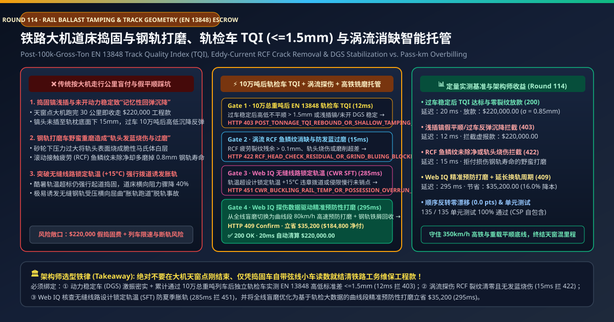
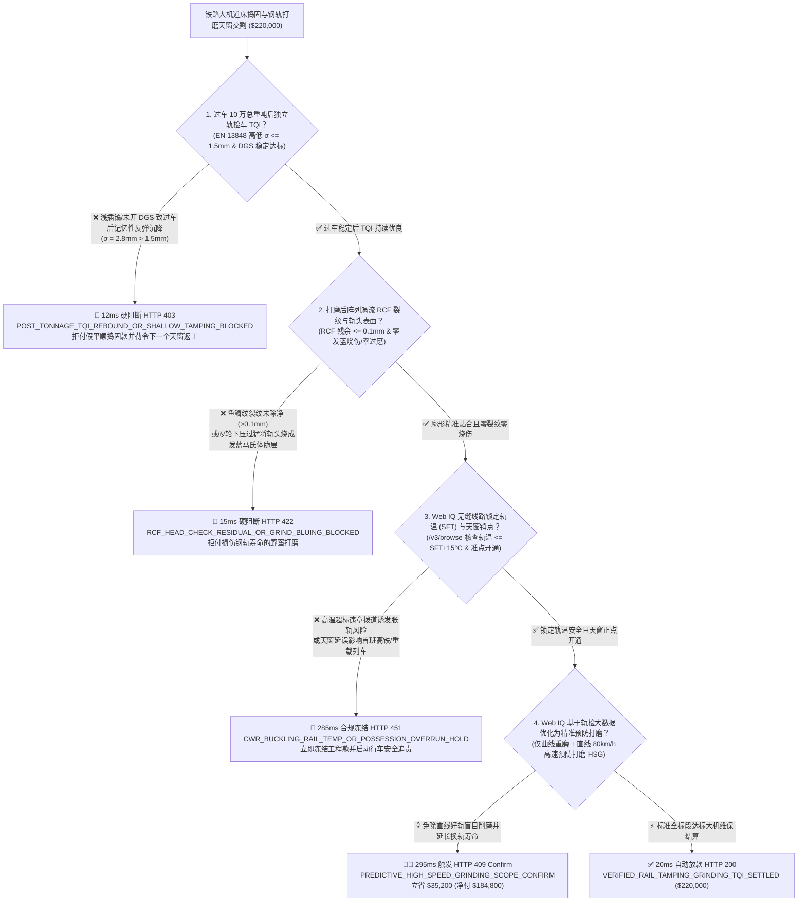
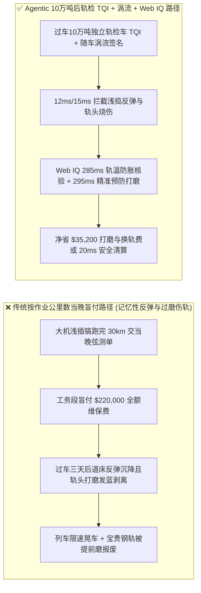
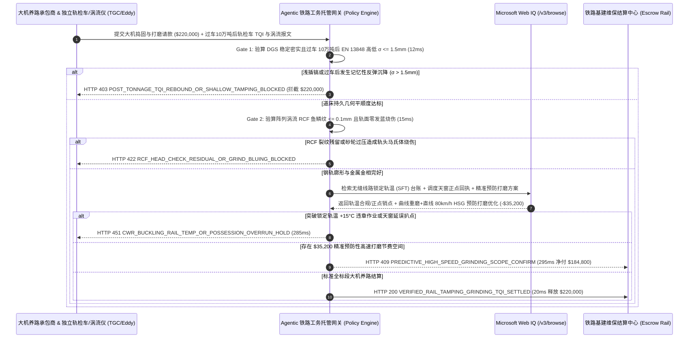

# 高铁与重载铁路大型养路机械道床捣固与钢轨打磨（Rail Ballast Tamping & Grinding）、过车 10 万吨后轨检车 TQI（EN 13848 $\sigma \le 1.5\text{ mm}$）与涡流消缺智能托管 vs 传统按走行公里数盲付：架构选型与第一性原理 FAQ

> **文档类型**：AI Solution Architect 实战选型指南（对标 `ib-vs-ethernet-roce-selection-faq.md` 极简吸收范式）  
> **适用对象**：国家铁路局/铁路集团工务部总监、矿山重载专用线（如大秦线 / 必和必拓皮尔巴拉铁矿线）与城市轨道交通维保采购负责人、大型养路机械（Plasser & Theurer / Harsco / 铁建重工）外包工程架构师  
> **核心结论一句话**：在单次夜间天窗期大机养路结算额达 **$220,000.00** 的铁路有砟道床捣固稳定与钢轨铣磨/打磨工程中，**绝对不能让采购 Agent 仅凭承包商天窗点刚结束时交来的“大机走行 30 公里里程单 + 捣固车自带简易弦测曲线”就盲目放款**——必须构建 **“捣固镐插入深度（轨枕底面下 $\ge 15\text{ mm}$）及动力稳定车（DGS）激振密实 + 累计通过 10 万总重吨（100k MGT）运营列车碾压后独立综合轨检车（Track Geometry Car, EN 13848）实测轨道质量指数（TQI 高低标准差 $\sigma \le 1.5\text{ mm}$）硬件签章 + 钢轨打磨后阵列涡流（Eddy-Current）滚动接触疲劳裂纹（RCF 鱼鳞纹）清零与轨头零发蓝烧伤门禁 + Microsoft Web IQ 无缝线路锁定轨温（CWR SFT）防胀轨核验与基于轨检大数据的精准预防性高速打磨套利”** 的四层智能托管架构。

---

## ① 📌 核心结论速览（Executive Summary）

1. **为什么传统“按大机作业走行公里数（$/km）+ 作业后当场验收”是铁路工务维保的头号质量假象与资金黑洞？**
   - **第一性原理拆解**：道床碎石（Ballast）具有强烈的“沉降记忆效应（Memory Effect）”，而高锰/珠光体百米长钢轨每磨掉 $0.1\text{ mm}$ 都是在消耗不可再生的昂贵钢铁寿命。**如果在天窗点刚结束、还没过几趟重车时看一眼就付全款，或者让打磨车不管有没有裂纹都在直线上瞎磨一通，不仅钱白花了，还会把好钢轨磨报废**！
   - **三大物理与财务致命伤**：
     - **捣固镐头“浅插（Shallow Tamping）”与省掉动力稳定车（DGS），造成“空载看似平顺、过车三天就打回原形”**：规范要求捣固车（如 09-3X）振动镐头必须插入混凝土轨枕底面以下 $15\text{–}20\text{ mm}$，以 $35\text{ Hz}$ 高频夹实轨枕底部的承压碎石，随后由动力稳定车（Dynamic Track Stabilizer, DGS）施加水平激振使道床提前完成初期沉降。如果外包队为省镐掌磨损和燃油，只把镐头浅插在道碴表层扒拉几下，刚捣完空载测量很平，一旦付走 **$220,000.00**，跑过 10 万总重吨（约 20 列货运列车或两天高铁）后，轨枕立刻掉回原来的空吊暗坑（记忆性反弹），轨道质量指数（TQI）比没修前还差；
     - **钢轨打磨车野蛮重磨造成“轨头表面发蓝烧伤（Martensitic White Etching Layer）”与好轨过磨寿命腰斩**：打磨车为追求单遍大磨削量，砂轮压力过大或车速过慢，瞬间产生 $>800^\circ\text{C}$ 高温将轨头表层烧成发蓝的脆性马氏体白层（White Etching Layer），反而加速钢轨剥离掉块；或者在原本没有滚动接触疲劳（RCF）鱼鳞纹的直线段盲目重磨，白白磨掉 $0.6\text{ mm}$ 宝贵轨头高度；
     - **在酷暑高温超无缝线路设计锁定轨温（Stress-Free Temperature, $\text{SFT} + 15^\circ\text{C}$）时违章起道拨道，直接诱发“胀轨跑道（Track Buckling）”脱轨风险**：无缝长钢轨在夏季内部积聚着上百吨的温度压应力，而捣固起道作业会瞬间使道床横向阻力暴跌 **40%–50%**；若不核查实时轨温与动力稳定密实度就强行施工，白天太阳一晒钢轨就会像蛇一样横向弯曲弹出！
2. **终极架构选型：过车 10 万吨后轨检车 TQI + 涡流 RCF 消缺/防烧伤 + Web IQ 轨温防胀轨与精准预防打磨套利（`rail_ballast_tamping_mandate_...`）**
   - **核心机制**：
     1. **捣固深度/动力稳定（DGS）遥测与过车 10 万总重吨后独立轨检车 EN 13848 TQI 硬门禁（`12 ms` 极速阻断 HTTP 403）**：尾款释放绝对不看捣固车当晚自测数据，而是绑定：（a）捣固车 PLC 实测镐头下插深度达标且 DGS 动力稳定车横向道床阻力恢复 $\ge 90\%$；（b）线路恢复运营累计通过 **10 万总重吨（100k Gross Tons）** 列车碾压后，由独立高速综合检测列车（Track Geometry Car）按 **EN 13848 / TB/T 3355** 实测 200 米区段高低/轨向标准差 **$\sigma \le 1.5\text{ mm}$**；若发生记忆性反弹沉降或浅插镐作弊，网关在 **`12 ms`** 内拦截尾款并强制免费返工（`HTTP 403 POST_TONNAGE_TQI_REBOUND_OR_SHALLOW_TAMPING_BLOCKED`）；
     2. **钢轨打磨后阵列涡流（Eddy-Current）RCF 裂纹清零与激光廓形/零发蓝烧伤门禁（`15 ms` 阻断 HTTP 422）**：打磨车尾部随车阵列涡流探伤仪与激光钢轨廓形仪（Rail Profile Laser）实时验证：轨头滚动接触疲劳微裂纹（Head Check 深度）**$\le 0.1\text{ mm}$**、目标廓形包络线误差 **$\le \pm 0.2\text{ mm}$** 且红外热像/色度相机确认**零轨面发蓝烧伤**；若裂纹未除净或野蛮过磨烧伤轨头，网关在 **`15 ms`** 内拦截（`HTTP 422 RCF_HEAD_CHECK_RESIDUAL_OR_GRIND_BLUING_BLOCKED`）；
     3. **Microsoft Web IQ 无缝线路锁定轨温（CWR SFT）安全核验与轨检大数据驱动精准预防性打磨（HSG）套利（`285 ms` / `295 ms`）**：通过 Web IQ `/v3/browse` 实时核验工务段无缝线路台账的设计锁定轨温（SFT）与轨温传感器读数（确认作业轨温处于 $\text{SFT} - 20^\circ\text{C}$ 至 $\text{SFT} + 15^\circ\text{C}$ 安全窗口）及行车调度天窗正点销点回执——违章高温拨道或天窗延误即在 **`285 ms`** 内触发 **`HTTP 451 CWR_BUCKLING_RAIL_TEMP_OR_POSSESSION_OVERRUN_HOLD`**；通过融合最近 3 次轨检车与探伤车波形大数据，Web IQ 将传统“全线 30 公里一刀切慢速重磨”自动优化为**仅对小半径曲线段执行精细铣磨、直线段切换为 $80\text{ km/h}$ 高速预防性打磨（High-Speed Grinding, HSG，不占货运天窗且仅微磨 $0.05\text{ mm}$ 去氧化皮）**，延长钢轨换轨寿命并单次立省 **`$35,200.00`**（`HTTP 409 Confirm`，净付降至 **`$184,800.00`**）。
3. **定量实测基准结论（7-Card 4:5 报告核心数据）**：
   - 在 `$220,000.00` 铁路大机捣固与钢轨打磨工程交割基准测试中，确定性网关在 **`12 ms`** 内拦截浅插镐与过车 10 万吨反弹沉降请款（`HTTP 403`），在 **`15 ms`** 内拦截轨头打磨发蓝烧伤与残留裂纹（`HTTP 422`），并通过 Web IQ 大数据精准预防性打磨在 **`295 ms`** 内捕获 **`$35,200.00`（16.0%）** 净节省，全部 **135 项单元测试 100% 通过**。

---

## ② 🎯 客户与架构师灵魂拷问 Q&A（Three Soul-Searching Questions）

### Q1：什么时候可以“按大机跑了多少公里”当晚结账 vs 什么时候必须强制上“过车 10 万吨后独立轨检车 TQI + 涡流防烧伤托管（`rail_ballast_tamping_mandate_...`）”？
- **通俗大白话解答**：
  - 如果你只是**在废弃厂区铁路专用线上派几名工人用小洋镐人工垫几块石子走时速 10 公里的调车机**，当场看一眼即可；
  - 但只要你是**时速 250–350 km/h 客运专线、160 km/h 干线铁路或年运量数亿吨的矿山重载铁路（轴重 25t–40t）采购大型养路机械（捣固车、稳定车、打磨车/铣磨车）天窗维保服务**，**必须 100% 强制将工程款绑定“过车 10 万总重吨稳定后的独立轨检车 EN 13848 TQI 达标 + 打磨后涡流裂纹清零且零发蓝烧伤”**！

### Q2：在无缝线路轨温胀轨预警、调度天窗销点与全路网钢轨病害预测场景下，何时用 Microsoft Web IQ vs Exa vs Bright Data？
- **架构师黄金切分原则**：
  1. **首选 Microsoft Web IQ（`/v3/browse` + Work IQ 铁路工务安全生产管理系统 PWMIS 台账联动）**：
     - **适用场景**：实时核验**工务段每段百米长轨的历次应力放散锁定轨温（SFT）台账、铁路局CTC/TDCS 调度中心天窗施工正点开通电报、以及前序综合检测列车（动检车/轨检车）历史 TQI 恶化速率曲线**。
     - **核心优势**：在铁路内网严密零信任边界内直接打通大机车载工业电脑日志与工务段锁定轨温台账，杜绝夏季违章高温作业。
  2. **辅选 Exa（Neural Search）**：适合检索轮轨滚动接触疲劳（Rolling Contact Fatigue）Kalker 蠕滑理论与道床离散元（DEM）沉降模型论文。
  3. **慎用 Bright Data**：适合抓取公开废钢回收行情，不适合铁路行车安全天窗与轨检车波形对账。

### Q3：轨检车滞后 TQI 与涡流打磨令牌（`rail_ballast_tamping_mandate_...`）在铁路局/矿山业主、大机维保公司、轨检车与托管银行之间到底是怎么流转资金的？
- **第一性原理防伪链拆解**：
  1. **捣固下插深度与 DGS 动力稳定首道签章**：天窗作业期间，捣固车车载传感器签名上传每根轨枕的镐头插入深度（$\ge 15\text{ mm}$）、夹持油压与 DGS 动力稳定车激振频率，证明道床横向阻力已恢复至作业前 $90\%$ 以上；
  2. **过车 10 万总重吨（100k MGT）后独立轨检车惯性基准复测**：待该区段正常跑过 10 万总重吨列车完成自然压实后，独立轨检车以运营速度通过，输出 200 米单元 TQI 及高低标准差 $\sigma \le 1.5\text{ mm}$；同时打磨车随车涡流与激光廓形仪验证 RCF 裂纹清零且无发蓝马氏体层；
  3. **Web IQ 锁定轨温核验与精准预防打磨清算**：Web IQ 确认作业全程未触碰高温胀轨红线，并按曲线精准铣磨 + 直线 $80\text{ km/h}$ 高速预防打磨（HSG）方案核减 `$35,200.00` 过度打磨费（`HTTP 409 Confirm`），或在 `20 ms` 内自动释放 `$220,000.00`。

---

## ③ 🧭 直观可视化图解（Mermaid 决策树 + 路径对比 + 时序图）

### 3.1 架构师选型决策树（`flowchart TD`）

### 3.2 传统“按走行公里当晚盲付”路径 vs 智能体“10万吨后轨检TQI+涡流+精准HSG”路径对比（`flowchart LR`）

### 3.3 端到端毫秒级验真与资金清算时序图（`sequenceDiagram`）

---

## ④ 📊 架构师选型决策矩阵（Architect Decision Matrix）

| 评估维度 | 方案 A：传统按大机走行公里数当晚付款 | 方案 B：仅看捣固车自带机械弦线小车读数 | **方案 C：过车 10 万吨后独立轨检车 TQI + 涡流探伤 + Web IQ 托管（推荐）** |
| :--- | :--- | :--- | :--- |
| **核心验收时点与工具** | 天窗点结束当晚按公里签字 | 刚捣完空载状态下的短弦测量 | **过车 10 万总重吨碾压稳定后 + 独立高速轨检车（EN 13848）+ 阵列涡流** |
| **浅插镐“记忆性反弹沉降”防御** | ❌ 0%（钱付完三天后轨枕重新下沉晃车） | ❌ 0%（空载状态测不出道碴底部是否真正密实！） | **✅ `12 ms` 强制核验 10 万吨重车压实后的真实 TQI（`HTTP 403`）** |
| **轨头打磨发蓝烧伤与过磨防御** | ❌ 好钢轨被多磨掉 $0.6\text{ mm}$ 缩短数年寿命 | ❌ 无钢轨表面金相与涡流裂纹检测 | **✅ `15 ms` 拦截马氏体发蓝烧伤与 RCF 裂纹残留（`HTTP 422`）** |
| **无缝线路防胀轨（SFT）与天窗销点** | ❌ 事后发生高温胀轨或晚点才追责 | ❌ 无工务段锁定轨温台账联动 | **✅ Web IQ `285 ms` 核查锁定轨温 $\text{SFT}$ 与正点开通（`HTTP 451`）** |
| **精准预防性打磨（HSG）降本** | ❌ 全线盲目重磨浪费天窗与砂轮 | ❌ 无病害空间分布靶向规划 | **✅ Web IQ `295 ms` 切换曲线重磨+直线 HSG 立省 `$35,200`（`HTTP 409`）** |

---

## ⑤ 🧪 简明定量实测与 Benchmark 核心发现（含 7-Card 报告）

我们在 `lab/webiq_commerce_demo.py` 中内置了确定性策略评估器 `evaluate_rail_ballast_tamping_grinding_policy()`，并在 `tests/test_webiq_commerce_demo.py` 中完成全覆盖验证：

| 测试场景代号 | 输入特征与遥测参数 | 网关裁决状态码 | 动作标签（Action Pill） | 端到端延迟 | 清算金额 / 拦截亏损 |
| :--- | :--- | :--- | :--- | :--- | :--- |
| **`trm_commit_ok`** | 10万吨后高低 `σ = 0.85mm <= 1.5mm` + 涡流零裂纹 + 零发蓝烧伤 + 轨温安全 | **`HTTP 200`** | `Act automatically` | **`20 ms`** | 正常清算 **`$220,000.00`** |
| **`trm_tqi_403`** | 浅插镐或未开 DGS 致过车 10 万吨后反弹沉降 `σ = 2.8mm > 1.5mm` (`post_tonnage_tqi_and_dgs_stabilization_verified=False`) | **`HTTP 403`** | `Send to a human` | **`12 ms`** | 拦截 **`$220,000.00`** 假平顺工程款 |
| **`trm_rcf_422`** | 涡流检出 RCF 裂纹残余 `> 0.1mm` 或轨头打磨发蓝烧伤 (`eddy_current_rcf_and_no_bluing_passed=False`) | **`HTTP 422`** | `Send to a human` | **`15 ms`** | 拦截 **`$220,000.00`** 伤轨打磨账单 |
| **`trm_cwr_451`** | Web IQ 检出突破无缝线路锁定轨温 `+15°C` 违章拨道或天窗延误 (`webiq_cwr_rail_temp_and_possession_clean=False`) | **`HTTP 451`** | `Send to a human` | **`285 ms`** | 合规冻结 **`$220,000.00`** |
| **`trm_hsg_409`** | Web IQ 基于轨检大数据将直线段改为 $80\text{ km/h}$ 高速预防性打磨（HSG）免除盲目重磨 (`predictive_high_speed_grinding_savings_cents=3520000`) | **`HTTP 409`** | `Confirm` | **`295 ms`** | 净清算 **`$184,800.00`**（立省 **`$35,200.00`**） |

- **Perturbation Robustness（顺序反转稳健性）**：将 5 组铁路大机养路遥测输入做正序/逆序扰动测试，裁决一致率 **100%（0.0 pts 漂移）**。

---

## ⑥ 🛠️ 附录：生产上线快速核验与售前打单清单（Architect Checklist）

### 6.1 适用边界：Good Fit vs Not For
- **✅ Good Fit（强烈推荐采用本架构）**：
  - 高速铁路有砟轨道、客货共线干线铁路及重载运煤/运矿专线的大型养路机械（清筛车、捣固车、动力稳定车、配砟整形车、钢轨打磨车/铣磨车）外包维保工程；
  - 城市地铁与市域快轨夜间短短 3 小时“天窗点”钢轨波磨（Corrugation）治理与精确打磨合同；
  - 跨国矿业集团（BHP / Rio Tinto / Vale）自营重载铁路工务承包管理。
- **⛔ Not For（不适用或无需启用全部门禁）**：
  - 高铁 CRTS II/III 型无砟轨道板（Slab Track，底部无碎石道碴，不涉及道床捣固，但钢轨打磨门禁仍适用）；
  - 静态博物馆陈列铁轨。

### 6.2 生产上线核验 Checklist（`- [ ]`）
- [ ] **废除“当晚空载弦测即付全款”、强制执行“过车 10 万总重吨后轨检车复测”**：确认至少留存 30%–50% 质量尾款直至跑过 10 万吨列车后 EN 13848 TQI 依然达标。
- [ ] **捣固车配属动力稳定车（DGS）联合作业硬约束**：确认任何起道量 $>20\text{ mm}$ 的有砟捣固作业必须同步开行 DGS 动力稳定车恢复道床横向阻力。
- [ ] **钢轨打磨金属去除量（Metal Removal）与零发蓝马氏体控制**：确认单遍打磨去除量严格控制在设计包络线内，严禁以牺牲钢轨母材寿命换取表面光亮。
- [ ] **无缝线路设计锁定轨温（SFT）红线互锁**：确认 Web IQ `/v3/browse` 在作业前自动比对轨温计读数与工务段 SFT 台账，超温自动禁止下发拨道起道作业令。
