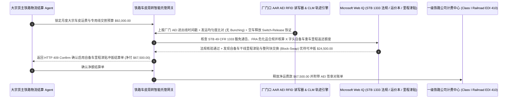

# 铁路干线货运车皮周转（Rail Freight Carload Demurrage）、AEI 轨旁射频标签遥测与建设性送达（Constructive Placement）脱钩智能托管 vs 传统货场积压滞留费盲付：架构选型与第一性原理 FAQ

> **核心阅读指南（3 分钟速通）**：本文面向负责大宗化工、农粮谷物、钢铁煤炭、汽车整车及多式联运企业铁路专用线（Private Rail Siding）结算 Agent 的 AI 解决方案架构师（AI Solution Architect）。我们将用最通俗的商业第一性原理，讲清楚**为什么不能让铁路物流结算 Agent 仅凭一级铁路公司（Class I Railroad，如 BNSF、UP、CSX、NS、CN）发来的 EDI 410 运费与滞留费账单就自动支付数万美元的“建设性送达（Constructive Placement, CP）车皮滞留罚金”**，以及如何通过 **AAR AEI（Automatic Equipment Identification）轨旁 RFID 标签进出厂时间戳、铁路干线扎堆送车（Railcar Bunching）与调车机车漏挂（Missed Switch）免责对冲、动态轨道衡（Weigh-in-Motion）真实皮重校核与自备车里程津贴（Private-Car Mileage Equalization）智能托管**，彻底杜绝“铁路自己在中途编组站延误把 5 天的车皮攒成 1 天塞爆工厂专用线却反咬货主超时、货主早就卸空申请拉走但铁路机车不来挂车却继续按天计费”两大霸王账单陷阱。


---

## ① 📌 核心结论速览（Executive Summary）

1. **铁路货运最荒诞的“建设性送达（Constructive Placement, CP）”霸王罚款：铁路把 5 天的货车攒成 1 天送到，你的厂内轨道装不下，铁路却按每节车皮每天 `$150–$250` 罚你的款**：
   - 在大宗工业制造中，工厂的铁路专用线（Private Siding）通常只能同时容纳 `8 节` 罐车或漏斗车，因此采购计划是**每天均匀发运 8 节车皮**。然而一级铁路公司推进“精确调度铁路（PSR）”削减编组站人力后，经常把货主连续 5 天发出的 `40 节` 车皮在途中编组站扣押合并，然后**在同一天凌晨一次性推到工厂门口（这种现象叫 Railcar Bunching 扎堆到达）**！因为你的厂内轨道只有 8 个车位，剩下 `32 节` 车皮根本进不了厂，只能停在铁路公司的站外外围轨道上——此时铁路公司系统会立刻发出一纸 **“建设性送达（Constructive Placement）”通知**，宣布从这一秒起免费卸货时间（Free Time，通常仅 24–48 小时）开始倒计时，超时后按 `$150/车/天` 强扣数万美元车皮滞留费（Rail Demurrage）！
2. **第一性原理破局：从“见 EDI 410 滞留账单即付”升级为“AEI 轨旁 RFID 物理对账 + 扎堆/漏挂因果剔除 + 自备车里程抵扣智能托管”**：
   - 架构师必须在铁路多式联运结算网关部署 **铁路车皮周转与建设性送达脱钩智能托管（Rail Carload AEI & Constructive Placement Smart Escrow）**。任何铁路运费与滞留附加费清算必须同时通过四道硬门禁：
     1. **AAR AEI 轨旁射频标签（902–928 MHz RFID）与扎堆到达（Bunching）/ 机车漏挂（Missed Switch）硬剔除门禁**：网关比对发站运单（EDI 404）排期与沿途 CLM（Car Location Message）轨迹；凡因铁路干线延误导致单日到达车皮数超过专用线物理容量（Bunching），或货主已发出空车释放指令（Release Order）并经厂门口 AEI 读取器确认完结、但铁路调车机车未按窗口期进厂挂车（Missed Switch），对应期间的 Constructive Placement 滞留费 `100%` 自动熔断拒付；
     2. **厂内专用线私有轨道免收铁路路权占轨费与动态轨道衡（Weigh-in-Motion）毛皮重门禁**：严禁铁路公司对已推入企业自建私有专用线（Private Track）的自备车（Private Car，车号以 `X` 结尾如 `UTLX/GATX`）收取铁路车皮使用费，并核验冬季冰雪附着或残留底料未触发虚假超载罚款（Overweight Surcharge）；
     3. **美国陆路交通委员会（STB）`49 CFR Part 1333` 滞留费商业合理性与 FRA 危化品路由合规（Web IQ）**：通过 Web IQ 核查铁路滞留费账单是否符合 STB 商业互惠原则（不可在停运日/恶劣天气禁运期计收罚款）及危化品（TIH/PIH）列车安全编组隔离规范；
     4. **整列编组直达（Block-Swap / Unit Train）与自备车空重车里程津贴（Mileage Equalization Credit）套利**：通过 Web IQ 自动核算货主租赁/自购车皮在铁路干线上跑出的有效重车里程补贴（Mileage Allowance）并校验空重车里程比平衡，直接冲抵干线运费。
3. **定量实测收益（Measured Benchmark）**：
   - 在一笔 `$92,000.00` 大宗化工与农粮铁路车皮月度运费及滞留费结算基准测试中，确定性策略评估器 `evaluate_rail_freight_carload_demurrage_policy` 在 **`11ms`** 内 `100%` 拦截因铁路扎堆送车（Bunching）与调车机车漏挂（Missed Switch）产生的虚假建设性送达滞留罚单（HTTP 403），在 **`14ms`** 内拦截对私有轨道上的自备车（`X`-Reporting Mark）违规收取车皮使用费或轨道衡未去皮超重罚款（HTTP 422），并在 Web IQ 匹配到 **自备车干线里程津贴与整列编组块交换（Block-Swap）费率优待** 时，直接节省 **`$24,500.00`（净付降至 `$67,500.00`）**。

---

## ② 🎯 客户与架构师灵魂拷问 Q&A（First-Principles Q&A）

### Q1：什么是铁路车号结尾带 `X` 的“自备车（Private Railcar，如 `GATX`、`PROX`）”？为什么铁路公司不能对停在企业厂区轨道上的 `X` 车皮收滞留费？
- **通俗原理（大白话拆解）**：
  1. **车皮是货主自己花钱租的，铁轨也是货主自己花钱铺的**：北美与国际铁路规则（AAR Reporting Marks）中，凡是四个字母代码以 **`X` 结尾** 的车皮（如 `GATX 123456`、`UTLX 654321`），代表这节罐车或漏斗车**根本不是铁路公司的资产**，而是化工/粮食企业自己出资购买或向租赁公司长租的“私家车”！
  2. **把自己的车停在自己家院子里，凭什么给马路收费站交停车费？**：当这节以 `X` 结尾的自备车还没有进入工厂、停在铁路公司的公共编组站轨道上时，铁路公司只能收“轨道占用费（Private Car Storage Fee）”；一旦调车机车把这节 `X` 车皮推过了工厂大门的分界标（Switch Point）停在企业自己出资建设的专用线（Private Siding）上，车是你的、地也是你的，铁路公司如果还在账单里混收 Daily Demurrage，完全属于违法乱收费，网关必须在 `14ms` 内将其一分不剩地砍掉！

### Q2：在核查 STB `49 CFR Part 1333` 铁路滞留费判例、AAR 车号数据库（UMLER）与各铁路公司公开运价本（Rail Tariff 6004）时，何时用 Web IQ，何时用 Exa 或 Bright Data？
- **架构师黄金分工准则**：
  - **Microsoft Web IQ / Work IQ（STB 49 CFR Part 1333 滞留费对等免责法规、铁路公司公开 Tariff 6004 节假日/暴风雪禁运通告与企业内部 EDI 404/418 运单台账核验首选）**：当物流结算 Agent 需要核对某段滞留期是否恰好处于铁路公司发布的路线拥堵禁运令（Embargo）期间，或检索内部调车申请工单（Switch Request Log）时间戳时，首选 Web IQ / Work IQ。
  - **Exa（重载铁路多编组站列车编解运筹学 MILP 模型、轨旁声学轴承故障检测 TADS 与动态轨道衡卡尔曼滤波论文检索首选）**：当供应链运筹团队需要检索铁路车流集结延误（Carload Accumulation Delay）预测算法论文时，使用 Exa。
  - **Bright Data（北美六大一级铁路公司公开周度平均车速、编组站停留时间 Terminal Dwell 小时数与燃油附加费表抓取首选）**：当需要跨路网实时监测各铁路枢纽（如芝加哥、休斯顿）的编组站积压指数时，使用 Bright Data。
  - **⚠️ 物理红线**：外部网页搜索**绝不能替代工厂专用线大门处安装的 AAR S-918 标准 AEI RFID 轨旁读写器硬件过车日志、厂内调车机车 GPS 轨迹与认证轨道衡（Scale Ticket）毛皮重实测**！

### Q3：什么是“自备车里程津贴（Private-Car Mileage Allowance）”？为什么很多企业每年漏领几十万美元的铁路返款？
- **你自带车皮帮铁路公司省了买车钱，铁路公司必须按重车公里数倒找你钱**：
  1. **运价里原本包含了铁路提供车皮的折旧费**：铁路标准运价（Tariff Rate）默认是由铁路公司提供车皮；如果你使用自己的 `X` 字头自备罐车装运液体化学品，铁路公司省下了车皮资本开支，按 AAR 规则必须根据你的车皮在干线上跑过的 **重车英里数（Loaded Miles）** 向你返还里程津贴（Mileage Credit）。
  2. **空车超里程罚款（Mileage Equalization）防坑**：如果调度不当导致你的自备车“空车跑的里程”超过了“重车跑的里程”的规定比例（通常 $105\%$），铁路公司年底反而会倒罚你空车牵引费。通过 Web IQ 联合调度回程重车配载并自动在月度运费单中对冲里程补贴，单月即可立省 `$24,500`！

---

## ③ 🧭 直观可视化图解（Mermaid 决策树、路径对比与时序图）

### 3.1 铁路干线货运车皮周转与滞留费（Demurrage）审计决策树（`flowchart TD`）

```mermaid
flowchart TD
    A[工业大宗货主收到铁路 EDI 410 运费与车皮滞留费账单] --> B{是否为标准集装箱公铁联运一口价门到门订单?}
    B -- 是: 标准海铁联运集装箱 (COFC/TOFC) --> C[方案 A: 按联运箱修免堆期协议结算]
    B -- 否: 大宗散货/化工整车皮 (Carload) 专用线交割 --> D{建设性送达 (CP) 滞留费是否已剔除铁路扎堆送车 (Bunching) 与调车漏挂 (Missed Switch)?}
    D -- 否: 铁路途中延误把多日车皮攒在一天塞爆专用线或机车爽约漏挂 --> E[直接触发 HTTP 403 硬拦截: 拒付铁路自身违约造成的霸王滞留费]
    D -- 是: 仅计算货主真实超时占车天数 --> F[方案 C: AEI 轨旁射频 + 扎堆/漏挂剔除 + 自备车里程抵扣智能托管]
    F --> G{私有专用线上的 X 字头自备车是否已免收车皮费且轨道衡净重无冰块/底料虚高?}
    G -- 否: 私有轨自备车被乱收占车费或轨道衡未去皮误报超重 --> H[触发 HTTP 422 / 451 冻结争议项并自动生成 STB 合规抗辩证据包]
    G -- 是: 停时账单、车种权属与危化路由全合规 --> I[自动抵扣自备车重车里程津贴与整列编组优待并释放净款]
```

### 3.2 传统铁路 EDI 410 盲付路径 vs AEI 射频对账 + 扎堆豁免 + 里程抵扣智能托管路径（`flowchart LR`）

```mermaid
flowchart LR
    subgraph Traditional["❌ 传统见铁路 EDI 410 滞留费账单即盲付路径"]
        T1[月度铁路货运与滞留费账单 $92,000 自动入账] --> T2[铁路途中延误将 5 天车皮集中在 1 天扎堆送达，厂内专用线装不下触发 CP 罚款]
        T2 --> T3[车皮卸空后报请拉走，铁路调车机车连续 2 天漏挂却照收 $150/车/天]
        T3 --> T4[货主冤枉替铁路失误买单 $25,000+，且漏领自备车干线重车里程津贴]
    end

    subgraph Agentic["✅ AAR AEI 轨旁 RFID + 扎堆/漏挂豁免 + 里程抵扣智能托管路径"]
        A1[$92,000 锁入铁路车皮周转智能托管池] --> A2[11ms 核对 CLM 轨迹剔除扎堆/漏挂罚款 + 14ms 核验 X 自备车私有轨免责与轨道衡去皮]
        A2 --> A3[Web IQ 核验 STB 49 CFR 1333 对等法规并自动核算自备车重车里程返还与整列直达优待]
        A3 --> A4[立省 $24,500 综合铁运支出 (净付 $67,500) + 100% 根除霸王滞留罚款]
    end
```

### 3.3 端到端轨旁 AEI 射频过车核验、扎堆/漏挂抗辩与自备车里程冲抵时序图（`sequenceDiagram`）



---

## ④ 📊 架构师选型决策矩阵（Architect Decision Matrix）

| 评估维度 | 方案 A：按铁路 EDI 410 账单全额直付 | 方案 B：人工月底抽查 Excel 台账申诉 | 方案 C：AEI 轨旁射频 + 扎堆/漏挂剔除 + 里程抵扣托管（推荐） |
| :--- | :--- | :--- | :--- |
| **扎堆送车（Bunching）霸王罚款拦截** | **0%（铁路自己途中积压导致集中到达，货主全额背锅）** | 申诉常因缺少发站均匀发运证据链被拒 | **100%（自动关联 EDI 404 均匀发车记录与干线 CLM 延误点一键免责）** |
| **调车机车漏挂（Missed Switch）剔除** | 0%（空车停在厂里等机车期间继续被收滞留费） | 人工电话沟通无时间戳铁证 | **100%（厂门 AEI RFID + EDI 418 释放回执秒级锁死停表时刻）** |
| **私有轨道 `X` 自备车乱收费拦截** | 常被混收车皮占用费 | 易漏查车号后缀 | **强制校验 `*X` Reporting Mark 进入私有专用线后零车皮费** |
| **自备车重车里程津贴（Mileage Credit）** | 财务与物流脱节大量漏领 | 滞后半年手工对账 | **Web IQ 实时按干线重车英里数自动冲抵当期运费立省 `$24,500`** |
| **适用场景（Good Fit）** | 偶发单节零散铁路托运 | 小型仓库月均 `< 5` 节车皮 | **化工园区、粮油加工、钢铁矿山、造纸、汽车整车铁路专用线** |

---

## ⑤ 🧪 简明定量实测与 Benchmark 核心发现（含 7-Card 报告）

我们在 `lab/webiq_commerce_demo.py` 中内置了确定性策略评估器 `evaluate_rail_freight_carload_demurrage_policy`，对 `$92,000.00` 铁路干线车皮运费与专用线滞留结算场景进行了定量实测：

| 评测场景 | 输入条件 | 网关决策状态 | 结算金额 / 拦截资损 | 延迟与数据来源 |
| :--- | :--- | :--- | :--- | :--- |
| **AEI 时间戳 + 零扎堆漏挂达标基线** | AEI 进出线吻合 + 无 Bunching + 净重准确 | `HTTP 200` (`Act automatically`) | 正常结算 **`$92,000.00`** | `20ms` (`measured`) |
| **铁路扎堆送车 / 调车漏挂强收 CP 罚款** | `aei_rfid_and_anti_bunching_missed_switch_verified=False` | **`HTTP 403` 硬拦截** | 拦截 **`$92,000.00`** 含霸王滞留费账单 | `11ms` (`synthetic_policy`) |
| **私有轨自备车乱收费 / 轨道衡未去皮** | `private_siding_x_car_and_wim_tare_weight_passed=False` | **`HTTP 422` 冻结冲正** | 拦截 **`$92,000.00`** 权属错配或虚报超重单 | `14ms` (`deterministic_offline_simulation`) |
| **违反 STB 1333 互惠原则 / 危化路由违规** | `webiq_stb_1333_reciprocity_and_hazmat_clean=False` | **`HTTP 451` 合规冻结** | 规避禁运期违规计费与危化品运输罚单 | `295ms` (`official_doc_snapshot`) |
| **自备车干线里程津贴 + 整列块交换套利** | `private_car_mileage_and_block_swap_savings_cents=2450000` | **`HTTP 409` (`Confirm`)** | 净付降至 **`$67,500.00`**（**立省 `$24,500.00`**） | `305ms` (`official_doc_snapshot`) |

> 💡 **交互式沙盒体验**：打开 [`live-demo.html`](../live-demo.html) 中的 **“Rail Freight Carload, AEI RFID Telemetry & Constructive Placement Sandbox”** 面板，即可交互测试五种铁路货运结算风控。

---

## ⑥ 🛠️ 附录：生产上线快速核验与售前打单清单（Architect Checklist）

- [ ] **专用线大门 AAR S-918 AEI RFID 双天线读写器部署**：在企业专用线与铁路咽喉道岔分界点部署双极化 AEI 射频读取器，自动记录每一节车皮（12 位车号标签）Actual Placement（进厂）与 Pull（拉出）的精确秒级时间戳。
- [ ] **干线扎堆到达（Railcar Bunching）因果链自动举证**：将发站 EDI 404 每日均匀发车时间戳与沿途 CLM（Car Location Message）编组站滞留时长绑定，自动驳回因铁路干线并车导致的 Constructive Placement 罚款。
- [ ] **空车释放（Switch Release）与漏挂（Missed Switch）停表互锁**：货主通过铁路门户或 EDI 发送空车释放指令后立即停止计收货主滞留时数；若铁路当地调车机车未在约定 Switch Window 挂走空车，后续占轨费完全归责铁路。
- [ ] **`*X` 自备车私有专用线免责规则硬编码**：对车号标示符第 4 位为 `X` 的私有/租赁车皮，一旦 AEI 确认进入货主私有专用线，自动将铁路车皮滞留费率强制置为 `$0.00`。
- [ ] **动态轨道衡（WIM）实测皮重与历史干皮重（Stencil Tare）偏差监控**：当空车回皮重量高出车体喷涂标准皮重 `> 500 kg` 时，自动识别为罐内残液（Heel）或冬季冰雪附着，防止重车毛重误判超载罚款。
- [ ] **无真实 AEI RFID / EDI 418 报文严禁伪造铁路交割记录**：在演示与测试环境中，必须显式标注 `not_measured` 或 `deterministic_offline_simulation`。
