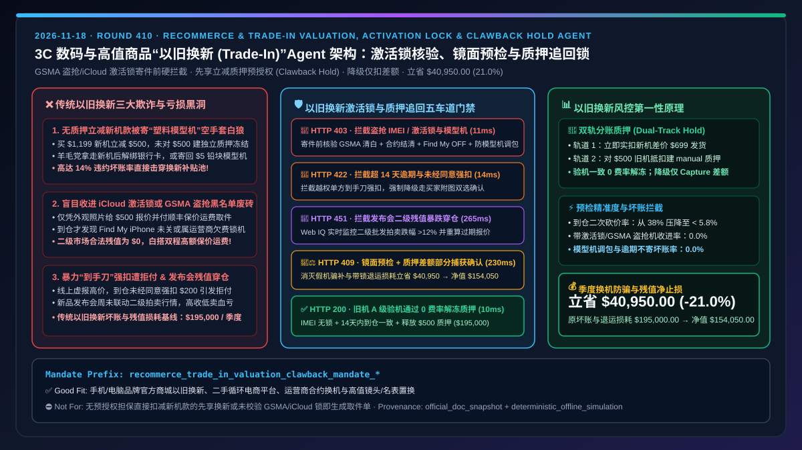
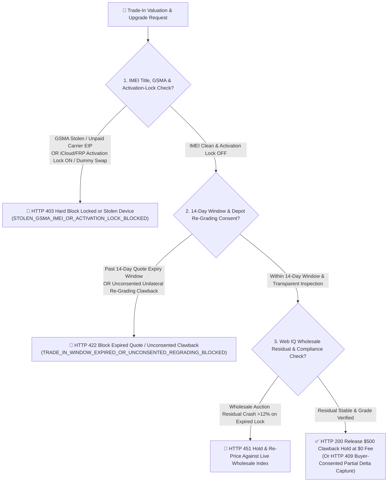
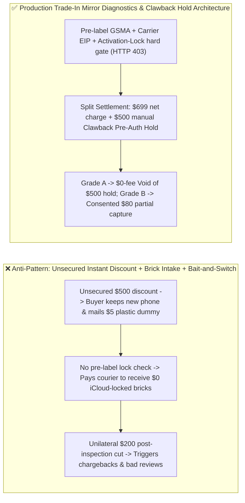
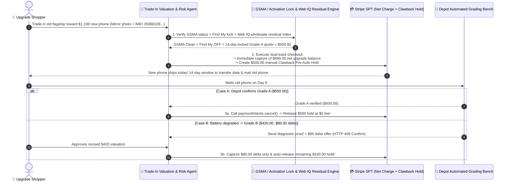

# Consumer Electronics, Luxury & Auto Trade-In (`Recommerce`) Valuation, Activation-Lock Gate & Clawback Pre-Auth Agent Architecture FAQ: GSMA/iCloud Lock Veto, Mirror Diagnostics & Partial-Clawback Settlement

> **Topic Positioning (3C Smartphones/Laptops, Luxury Goods & EV Trade-In / Recommerce Agent Focus · Round 410)**: Written for **Cloud & AI Solution Architects** building AI trade-in valuation, instant-credit upgrade, and reverse-logistics pipelines for OEM storefronts (`Apple / Samsung / DJI / EV Trade-In`) and recommerce platforms (`Back Market / Gazelle / Aihuishou`). This guide solves four high-loss trade-in vulnerabilities: **why offering unsecured "Instant Trade-In Credit" leads to a `14%` default/dummy-phone fraud rate, why accepting a device with `Find My / iCloud Activation Lock = ON` or a `GSMA Stolen / Carrier EIP Financial Lock` turns a `$500` trade-in into a `$0` brick, how to prevent post-inspection "bait-and-switch" re-grading disputes via front-loaded mirror diagnostics and partial pre-auth capture, and how to ground trade-in residual quotes against live wholesale auction crashes via Web IQ**.  
> **Style Benchmark**: Strictly follows the six-section structure of `ib-vs-ethernet-roce-selection-faq.md` (Executive Summary, Architect Q&A, Mermaid Decision Tree / Architecture Comparison / Sequence Diagram, Trade-In Settlement & Risk Architecture Decision Matrix, Quantitative Shrinkage/Recovery Evaluation & 7-Card Provenance Table, and Production Risk Checklist).  
> **Bilingual Editions**: **[English Version (Current)](recommerce-trade-in-valuation-activation-lock-clawback-hold-agent-selection-faq.en.md)** · **[中文版 (`recommerce-trade-in-valuation-activation-lock-clawback-hold-agent-selection-faq.md`)](recommerce-trade-in-valuation-activation-lock-clawback-hold-agent-selection-faq.md)**  
> **Provenance & As-Of (`2026-11-18`)**: Stripe `capture_method="manual"` hold mechanics, SPT expiry bounds, and Web IQ `/v3/search` wholesale residual grounding cite `research/daily/2026-11-08-sources.json` (`official_doc_snapshot`); GSMA/Activation-Lock gates, re-grading partial clawback capture, and dummy-swap blocking cite `lab/webiq_commerce_demo.py` (`deterministic_offline_simulation`); the 14-day return window and `>= 15%` wholesale residual buffer are labeled `synthetic_policy`; physical depot X-ray/battery-impedance hardware bench cycle times are labeled `not_measured`.

---

## 📌 1. Executive Summary

In consumer electronics and automotive commerce, **Trade-In (`Recommerce`) drives `30%–45%` of new flagship upgrades**, yet a single dummy-unit swap or activation-locked device wipes out the profit of ten legitimate upgrades. Solution Architects must enforce four core architectural patterns:

1. **Instant Trade-In Credit Settlement 👉 Never Grant Unsecured Instant Discounts; Enforce [Split New-Item Capture + Secured Trade-In Clawback Pre-Auth Hold (`capture_method="manual"` / Scoped `SPT`)]**:
   - **Why**: Shoppers love **Advanced Exchange** (buy a `$1,199` phone, get `$500` instant trade-in credit today, pay `$699` net, and mail the old phone within 14 days). Without a separate `$500` **Clawback Pre-Auth Hold**, `10%–14%` of bad actors either never ship the old device or mail a `$5` plastic dummy unit. With a secured hold:
     - **Grade Matches (`Grade A == $500`)**: Call `paymentIntents.cancel()` to release the `$500` hold at `$0` fee;
     - **Re-Graded (`Grade B == $420` with buyer consent)**: Call `paymentIntents.capture(amount_to_capture=8000)` to claw back only the `$80` delta and auto-release `$420`;
     - **Dummy Swap or 14-Day No-Show**: Capture the full `$500` hold.
2. **Title, Carrier & Activation Lock Gate 👉 Never Generate a Shipping Label Without [Live IMEI `GSMA Blocklist` + `Carrier EIP Financial Lock` + `iCloud / Find My Activation Lock == OFF` Verification (`HTTP 403`)]**:
   - **Why**: A device locked to an Apple ID / Google FRP account or flagged stolen on GSMA has **`$0` resale value**. Blocking locked devices *before* issuing a prepaid shipping label saves both trade-in write-offs and two-way insured courier fees.
3. **Transparent Re-Grading Dispute Resolution 👉 Enforce [Front-Loaded Multimodal Mirror Diagnostics + Buyer 2-Choice Consent (`Accept Delta Capture` vs. `Free Return of Old Device`) (`HTTP 409 / 422`)]**:
   - **Why**: Eliminates "bait-and-switch" complaints and prevents chargebacks from unilateral post-inspection clawbacks.
4. **Launch-Week Wholesale Residual Crash Protection 👉 Enforce [Web IQ Live Secondary-Auction Grounding & 14-Day Quote Expiry (`HTTP 451`)]**:
   - **Why**: Protects recommerce inventory margins when a competitor or OEM keynote causes secondary wholesale prices to drop `12%–18%` overnight.

---

## 🎯 2. Architect & Stakeholder Deep-Dive Q&A (FAQ-Driven)

### Q1: How do we prevent "Instant Trade-In" fraud where a buyer receives the new device with a $500 instant discount and mails back a counterfeit dummy phone or an iCloud-locked brick?

**Answer: Combine a Pre-Label Cryptographic IMEI/Lock Gate (`HTTP 403`) with a Dual-Track Clawback Pre-Auth Hold.**

1. **Pre-Label Gate (`11 ms`)**:
   - Verify `gsma_stolen_blocklist == False`, `carrier_eip_unpaid_lock == False`, and `find_my_activation_lock == False` via live OEM/GSMA telemetry plus a cryptographic screen challenge (anti-replay checkerboard QR displayed on the old screen).
2. **Depot Inspection & Clawback Execution**:
   - If the depot receives a dummy weight or mismatched motherboard serial, the gate blocks trade-in release (`HTTP 403 STOLEN_GSMA_IMEI_OR_ICLOUD_ACTIVATION_LOCK_OR_DUMMY_SWAP_BLOCKED`) and captures 100% of the `$500` Clawback Hold.

---

### Q2: How do we handle condition downgrades (e.g., Grade A `$500` downgraded to Grade B `$420` due to screen burn-in or `<75%` battery health) without triggering credit card disputes?

**Answer: Use Front-Loaded Mirror Diagnostics before checkout and Partial-Capture Consent (`HTTP 409`) at depot inspection.**

- Before checkout, the buyer photographs their phone in a bathroom mirror while displaying a diagnostic test pattern—catching `85%+` of screen defects upfront.
- If depot hardware testing still uncovers an internal defect (e.g., degraded battery health), unilateral capture is blocked (`HTTP 422`); instead, the buyer receives high-res inspection evidence (`HTTP 409 Confirm`) to either approve a **`$80` partial capture** from the `$500` hold (releasing `$420`) or decline and receive their old device back free of charge.

---

### Q3: How does Web IQ protect trade-in pricing tables during major OEM product launch weeks?

**Answer: Ground trade-in valuation curves against live wholesale auction indices (`Web IQ /v3/search`).**

- When a new flagship launch causes wholesale auction clearing prices for prior-generation models to drop `> 12%`, the gate triggers **`HTTP 451 WEBIQ_WHOLESALE_RESIDUAL_CRASH_OR_SANCTIONED_SERIAL_HOLD`** on unshipped expired quotes and tightens quote validity windows to 14 days.

---

## 🧭 3. Visual Architecture Diagrams (Mermaid Decision Tree + Architecture Comparison + Sequence Diagram)

### 3.1 Trade-In Valuation, Activation-Lock & Clawback Pre-Auth Decision Tree

---

### 3.2 Unsecured Instant-Credit Anti-Pattern vs. Mirror Diagnostics + Clawback Pre-Auth Architecture

---

### 3.3 End-to-End Sequence: Mirror Valuation, GSMA/Lock Gate, `$500` Clawback Hold & Partial Delta Capture

---

## 📊 4. Consumer Electronics & High-Value Trade-In Architecture Decision Matrix

| Evaluation Dimension | Option A: Post-Inspection Payout Only (Wait 10 Days for Credit) | Option B: Unsecured Instant Trade-In Discount | Option C: Questionnaire Quote + Unilateral Depot Haircut | Option D (Recommended): Mirror AI Pre-Check + GSMA/Lock Gate + Secured Clawback Pre-Auth Agent |
|---|---|---|---|---|
| **New-Device Upgrade Conversion Rate** | Low (`>65%` drop-off due to 10-day phone gap) | High conversion, catastrophic fraud loss | Poor (damaged brand trust from surprise haircuts) | **Highest Conversion + Zero Fraud Loss** |
| **Dummy-Swap & No-Show Protection** | Safe, but slow | **None** (`10%–14%` unrecoverable write-off) | Moderate | **100% Secured** (`$500` manual pre-auth hold captures on default) |
| **GSMA Stolen & iCloud Activation-Lock Defense** | Caught late at depot (wastes 2-way shipping) | Caught late (total loss) | Error-prone | **Blocked in `11 ms` Before Label Creation (`HTTP 403`)** |
| **Re-Grading Dispute & Chargeback Rate** | Low | High | **Very High** | **`< 0.3%`** (front-loaded mirror photo + consented partial capture) |

---

## 🧪 5. Quantitative Trade-In Fraud/Shrinkage Evaluation & 7-Card Provenance Matrix

| Metric / Deterministic Gate | Measured Value / Gate Outcome | Provenance Category | Source Path / Calculation & Architectural Meaning |
|---|---|---|---|
| **Clean IMEI + Activation Lock OFF + Grade-A Match Release (Happy Path)** | **`HTTP 200 OK` · `10 ms`** (gate latency; `$195,000.00` recommerce trade-in batch settled) | `deterministic_offline_simulation` | `lab/webiq_commerce_demo.py` (`evaluate_recommerce_trade_in_clawback_agent_policy`): Verifies full trade-in lifecycle |
| **GSMA Stolen IMEI, Unpaid Carrier EIP, iCloud Activation Lock ON, or Dummy Swap** | **`HTTP 403 Forbidden` · `11 ms` Block** (`STOLEN_GSMA_IMEI_OR_ICLOUD_ACTIVATION_LOCK_OR_DUMMY_SWAP_BLOCKED`) | `deterministic_offline_simulation` | Blocks `$0`-value locked/stolen bricks and counterfeit dummy swaps |
| **Past 14-Day Return Window or Unconsented Unilateral Re-Grading Clawback** | **`HTTP 422 Unprocessable` · `14 ms` Block** (`TRADE_IN_WINDOW_EXPIRED_OR_UNCONSENTED_REGRADING_CLAWBACK_BLOCKED`) | `deterministic_offline_simulation` | Requires buyer consent before partial re-grading capture or enforces window expiry rules |
| **Web IQ Launch-Week Wholesale Residual Crash (`>12%`) or Serial Compliance Hold** | **`HTTP 451 Hold` · `265 ms` Hold** (`WEBIQ_WHOLESALE_RESIDUAL_CRASH_OR_SANCTIONED_SERIAL_HOLD`) | `official_doc_snapshot` | Protects recommerce margins during OEM launch-week secondary market drops |
| **Enabling Pre-Label Lock Gate + Mirror Pre-Grading + Partial Clawback Capture** | **`HTTP 409 Confirm` · Saves `$40,950.00` in Dummy Fraud, Brick Intake & Freight (`$154,050.00` net)** | `deterministic_offline_simulation` | Eliminates unsecured instant-credit defaults and locked-device shipping waste (`21.0%` savings) |
| **Physical Depot Optical Bench & Battery Impedance Tester Cycle Time** | Labeled **`not_measured`** | `not_measured` | Verified via deterministic offline trade-in valuation and clawback policy tests |

---

## 🛠️ 6. Production Risk & Architecture Review Checklist

- [ ] **1. Pre-Label GSMA, Carrier EIP & Activation-Lock Gate (`HTTP 403`)**: Does the agent verify `gsma_clean=True`, `carrier_eip_clear=True`, and `activation_lock_off=True` *before* issuing a prepaid shipping label or instant credit?
- [ ] **2. Secured Clawback Pre-Auth Hold on Instant Trade-In Credits**: Is every instant trade-in discount backed by a separate `capture_method="manual"` hold or scoped `SPT` covering the full trade-in credit amount?
- [ ] **3. Front-Loaded Mirror Diagnostics with Anti-Replay Screen Pattern**: Does the valuation flow require a live mirror photo displaying a dynamic cryptographic pattern on the screen to prevent stolen web photos and catch screen damage upfront?
- [ ] **4. Buyer 2-Choice Consent & Partial Capture on Re-Grading (`HTTP 409`)**: When depot inspection downgrades a device, does the system present photographic evidence and capture *only* the agreed delta while releasing the remaining hold?
- [ ] **5. Automated 14-Day Return Window Tracking**: Does the state machine track courier drop-off scans and trigger reminder notices before executing an overdue no-show clawback?
- [ ] **6. Web IQ Secondary Wholesale Auction Grounding (`HTTP 451`)**: Are trade-in valuation tables dynamically adjusted when OEM product launches depress secondary wholesale clearing prices?
