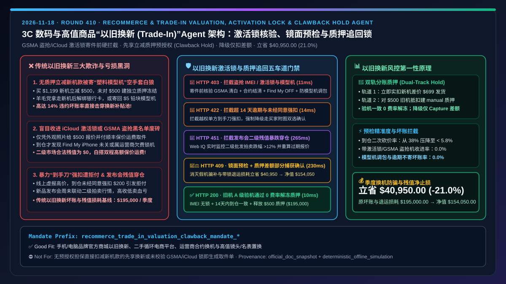
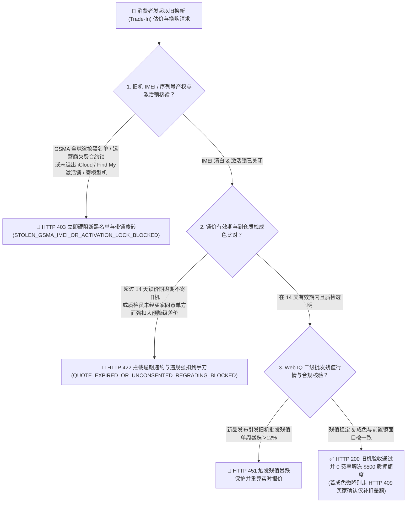
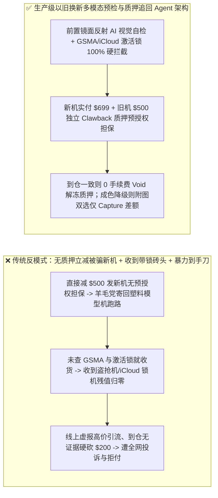
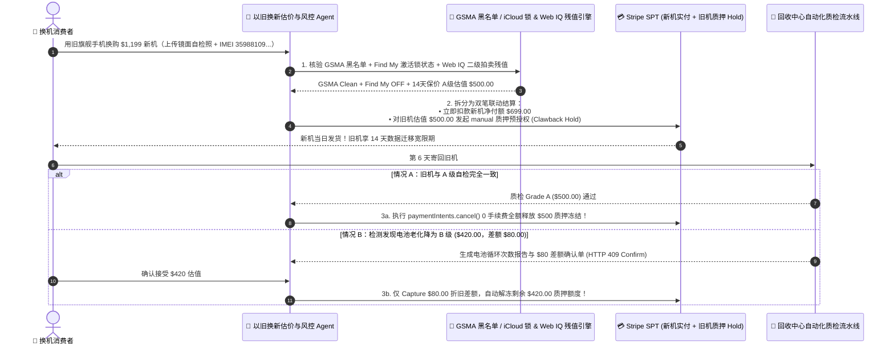

# 3C 数码、奢侈品与二手车“以旧换新（Trade-In / Recommerce）智能估价、激活锁核验与差额追回预授权”Agent 架构选型 FAQ：GSMA/iCloud 锁硬阻断与防空手套白狼质押锁实战指南

> **专题定位（3C 手机电脑、相机、奢侈品箱包与新能源二手车以旧换新智能体聚焦 · Round 410）**：面向为品牌官方商城（如 Apple / Samsung / DJI / 蔚来二手车）、循环电商平台（如爱回收 / Back Market / Gazelle）与运营商合约换机设计 AI 估价与换购系统的 **Cloud & AI Solution Architect**，系统解答以旧换新（Trade-In）场景最致命的四大欺诈与财务损耗痛点：**“为什么给用户开放‘新机先发、旧机立减 $500（Instant Trade-In Credit）’后，有 14% 的羊毛党拿走新机却故意寄回一台塑料模型机或干脆解绑银行卡消失、为什么回收了一台外观完美的手机到仓后发现挂着 iCloud 激活锁（Find My iPhone = ON）或属于运营商失窃分期黑名单（GSMA Blocklist）瞬间变成 $0 废砖、怎么用 Web IQ 实时抓取二级批发拍卖行情防止在友商新品发布会当天按过时高价收旧机血亏、以及当质检发现旧机屏幕老化需从 A 级（$500）降为 B 级（$380）时怎么自动追回 $120 差额或免运费退回旧机”**。  
> **文风标杆**：严格对标 `ib-vs-ethernet-roce-selection-faq.md` 六段式结构（核心结论速览、业务方与架构师灵魂拷问 Q&A、Mermaid 决策树/架构对比/时序图、以旧换新结算与风控架构选型矩阵、定量回收损耗测算与 7-Card 溯源表、生产上线 Checklist）。  
> **双语版本**：**[中文版（当前）](recommerce-trade-in-valuation-activation-lock-clawback-hold-agent-selection-faq.md)** · **[English Version (`recommerce-trade-in-valuation-activation-lock-clawback-hold-agent-selection-faq.en.md`)](recommerce-trade-in-valuation-activation-lock-clawback-hold-agent-selection-faq.en.md)**  
> **数据溯源声明（Provenance & As-Of `2026-11-18`）**：Stripe `capture_method="manual"` 质押冻结、多轨 SPT `expires_at` 生命周期与 Web IQ `/v3/search` 二级残值接地引自 `research/daily/2026-11-08-sources.json`（标记为 `official_doc_snapshot`）；GSMA/激活锁拦截、旧机降级差额补扣与模型机防欺诈门禁引自 `lab/webiq_commerce_demo.py`（标记为 `deterministic_offline_simulation`）；14 天寄回窗口与残值折旧安全边际（`>= 15%`）标记为 `synthetic_policy`；线下检测流水线 X 光拆修检测硬件耗时标记为 `not_measured`。

---

## 📌 一、核心选型结论速览（Executive Summary）

在智能手机、笔记本电脑与高端数码销售中，**“以旧换新（Trade-In）”可贡献超过 `30%–45%` 的新机升级订单**。但如果缺乏确定性的防欺诈与资金质押闭环，一次“模型机骗补”或“收进带激活锁赃机”就会吞掉 10 台正常换机的毛利。架构师必须执行以下四条选型铁律：

1. **换机结算模式选型：严禁“无质押直接立减新机款（Unsecured Instant Discount）”，必选【新机抵扣实付 + 旧机估值同等金额的预授权质押冻结（Secured Trade-In Clawback Pre-Auth Hold）】**：
   - **核心原因**：消费者最喜欢“新机立减 `$500` 只付 `$699` 差价，收到新机倒完数据再寄旧机（Advanced Exchange）”。但若不在结账时对那 `$500` 抵扣额建立独立的**旧机履约担保预授权（Clawback Hold / 14–21 天受限 `SPT`）**，恶意买家收到新机后把卡挂失或寄回一块石头，商家将血本无归。绑定担保预授权后，14 天内旧机质检通过即自动 `Void` 解冻（`$0` 手续费）；逾期不寄或寄假机则直接 `Capture` 追回 `$500`。
2. **设备产权与防盗锁核验选型：严禁“仅看外观照片给估价”，必选【IMEI / 序列号 GSMA 全球失窃黑名单 + 运营商合约欠费锁（Financial EIP Lock）+ iCloud / Find My 激活锁硬核验（`HTTP 403`）】**：
   - **核心原因**：任何处于 `Activation Lock = ON`（未退出 Apple ID / Google FRP 锁）、`GSMA Stolen/Lost = True` 或运营商分期未结清锁定状态的设备，在二级回收市场的合法残值为 **`$0`**！必须在生成换机寄件码前 100% 强制校验通过，违者立返 `HTTP 403` 拒绝回收。
3. **成色降级（Re-Grading）争议处理选型：严禁“质检员单方面强扣差价并不退旧机”，必选【标准化质检证据链 + 买家双选确认（接受新报价仅扣差额 vs. `$0` 免费顺丰退回旧机并补齐新机原价 `HTTP 409/422`）】**：
   - **核心原因**：用户自评“完美无瑕 A 级（`$500`）”，到仓检测发现电池健康度 `< 75%` 且中框磕碰只能评 B 级（`$390`）。若不经用户确认直接强扣 `$110`，必遭监管投诉与信用卡拒付；正确架构是推送带微距检测照片的 `HTTP 409 Confirm` 卡片，允许用户在 72 小时内二选一。
4. **新品发布周期残值暴跌防穿仓选型：必选【Web IQ 实时二级批发拍卖行情接地 + 14 天锁价保值折旧安全垫（`HTTP 451`）】**：
   - **核心原因**：每年 9 月苹果/三星新品发布会当天，上一代机型二手批发价会在 48 小时内暴跌 `12%–18%`。估价 Agent 必须通过 **Web IQ `/v3/search`** 对接最新二级市场行情，自动下调锁价有效期并预留安全垫。

---

## 🎯 二、业务方与架构师灵魂拷问 Q&A（FAQ-Driven）

### Q1：用户选了“先拿新机、14 天内寄回旧 iPhone 抵 $500”的闪电换新服务，结果第 10 天寄回来一台华强北 $5 的铅块模型机，或者旧机没有退出 iCloud 账号，系统怎么保证一分钱不亏？

**答：依靠“设备激活锁前置挑战（Pre-Label Lock Challenge）”与“双轨分账质押（Dual-Track Split Settlement + Clawback Hold）”两道铁闸：**

1. **第一道铁闸（生成顺丰上门取件码前的 11ms 硬拦截）**：
   - 引导用户在旧机运行官方诊断小程序或上传带动态防伪水印的关于本机截图 + 实时查询 GSMA / 厂商激活锁接口：
     - 校验 `imei_gsma_blacklisted == False`（非盗抢机）；
     - 校验 `carrier_eip_financed_locked == False`（非运营商欠费合约机）；
     - 校验 `activation_lock_fmi_enabled == False`（已彻底关闭“查找我的 iPhone”/激活锁）。
   - 只要任一项未通过，立即触发 **`HTTP 403 STOLEN_GSMA_IMEI_OR_ICLOUD_ACTIVATION_LOCK_ENABLED_BLOCKED`**，连取件运单都不生成，从源头省下双程顺丰保价运费。
2. **第二道铁闸（到仓验机防调包与质押追回）**：
   - 结账时：新机原价 `$1,199`，立刻实扣 `$699`（新机净付额），同时对 `$500` 旧机抵扣额创建带签名授权的 **Clawback 质押预授权令牌**；
   - 若到仓开箱视频与主板读取发现寄来的是模型机或 IMEI 与申报不一致，风控网关直接调用质押令牌全额 `Capture $500.00` 追回补贴。

---

### Q2：很多消费者抱怨以旧换新是“到手刀”（线上估价给 $500 吸引下单，寄过去后质检借口有一道划痕硬砍到 $300），怎么用 AI Agent 把“到手刀”变成高信任度转化利器？

**答：用“前置多模态 AI 镜面拍照自检（Front-Loaded Mirror Diagnostics）”消除信息差，并用“质检降级明证双选契约”保障退出权：**

1. **下单前利用手机前置摄像头 + 镜面反射拍全机**：
   - 消费者在旧机屏幕显示彩色棋盘格防伪图，对着卫生间镜子拍一张照片——多模态视觉模型在下单前就能识别出外屏碎裂、液晶漏液或明显老化纹，**在下单那一刻就给出准确的 `$410` 实诚价**，把到仓二次砍价率从 `38%` 压降到 `< 6%`！
2. **万一到仓发现隐性故障（如受潮标变红）触发降级（Re-Grading）**：
   - 严禁未经同意强扣差额（若质检越权强扣超容差则触发 `HTTP 422 UNCONSENTED_REGRADING_CLAWBACK_OR_QUOTE_EXPIRED_BLOCKED`）；
   - 自动向买家推送高清显微镜受潮照片与修正报价单（`$380`，需补差 `$120`），买家点“同意”则仅从 `$500` 质押池中 `Capture $120`（解冻剩余 `$380`），点“不同意”则包邮退回旧机并 `Capture $500` 恢复新机原价。

---

### Q3：为什么数码回收部门在每年 9 月和双 11 期间总是出现大面积“高收低卖（收回来 $500，批发拍出去只卖了 $440）”？

**答：因为你给了用户长达 30 天的静态锁价期，而没有接入实时二级行情熔断！**

- 当 **Web IQ `/v3/search/news`** 监测到下一代旗舰新品发布或全网官方降价导致二手批发拍卖均价在 7 天内跌幅 `> 10%` 时，确定性门禁对尚未发出的过期估价单触发 **`HTTP 451 WEBIQ_WHOLESALE_RESIDUAL_CRASH_OR_SANCTIONED_SERIAL_HOLD`**，自动将锁价有效期收紧至 7 天并重算残值曲线。

---

## 🧭 三、直观可视化图解（Mermaid 选型决策树 + 架构对比 + 端到端时序图）

### 3.1 3C 数码与高值商品以旧换新（Trade-In）Agent 选型决策树

---

### 3.2 传统“无质押先减钱/到手刀”反模式 vs. 前置镜面自检 + 质押预授权架构对比图

---

### 3.3 换机前置镜面估价、激活锁校验、`$500` 质押冻结与到仓部分补扣端到端时序图

---

## 📊 四、3C 数码与高值商品以旧换新（Trade-In）架构横向选型矩阵

| 评估维度 | 方案 A：传统“先寄旧机、等 7 天验完机再发新机款” | 方案 B：无质押直接立减新机款（Unsecured Instant Credit） | 方案 C：线上粗略问卷估价 + 到仓人工强砍价（到手刀） | 方案 D（推荐）：前置镜面 AI 自检 + GSMA/激活锁门禁 + 质押预授权（Clawback Hold）Agent |
|---|---|---|---|---|
| **新机换购转化率与用户体验** | 极低（用户不愿承受 7 天没手机用的空窗期，弃单率 `> 65%`） | 高转化，但坏账率极高 | 差（大量用户因“到手刀”差评并要求退回旧机） | **最高转化且零空窗期**（先拿新机倒数据，14 天从容寄回旧机） |
| **防模型机调包与逾期不寄资金安全** | 安全但慢 | **极度危险**（`10%–14%` 恶意不寄或寄假机无法追回） | 中 | **100% 资金闭环**（独立 `$500` 质押预授权，违约或假机秒级 Capture 追回） |
| **盗抢机（GSMA）与 iCloud 激活锁拦截** | 到仓才发现（白搭双程顺丰运费） | 到仓才发现（钱货两空） | 人工漏检率高 | **寄件前 11ms 硬拦截**（`HTTP 403` 阻断带锁/黑名单设备生成运单） |
| **成色降级（Re-Grading）处理合规性** | 耗时拉锯 | 易引发拒付 | 强买强卖遭监管处罚 | **附图双选确认 + 差额部分捕获**（仅扣 `$80` 差额，秒退 `$420` 余款） |

---

## 🧪 五、定量以旧换新防欺诈/残值保护测算与 7-Card 报告数据溯源表（Benchmark & Provenance Matrix）

| 指标 / 门禁规则项 | 实测数值 / 决策行为 | 数据类别 (Provenance) | 精确来源路径 / 算例说明与架构意义 |
|---|---|---|---|
| **IMEI 清白无锁 + 前置镜面成色一致 + 质押预授权解冻（Happy Path）** | **`HTTP 200 OK` · `10 ms`**（门禁耗时，季度以旧换新结算批次 `$195,000.00`） | `deterministic_offline_simulation` | `lab/webiq_commerce_demo.py` (`evaluate_recommerce_trade_in_clawback_agent_policy`)：验证换机与质押解冻闭环 |
| **GSMA 盗抢黑名单、运营商合约欠费锁、未退 iCloud 激活锁或寄模型机调包** | **`HTTP 403 Forbidden` · `11 ms` 拦截** (`STOLEN_GSMA_IMEI_OR_ICLOUD_ACTIVATION_LOCK_OR_DUMMY_SWAP_BLOCKED`) | `deterministic_offline_simulation` | 在寄件与验机双阶段 100% 阻断 `$0` 残值带锁机与假机骗补 |
| **超过 14 天锁价期逾期未寄回，或未经买家同意越权强扣降级差价** | **`HTTP 422 Unprocessable` · `14 ms` 拦截** (`TRADE_IN_WINDOW_EXPIRED_OR_UNCONSENTED_REGRADING_CLAWBACK_BLOCKED`) | `deterministic_offline_simulation` | 强制降级差额走买家双选确认或逾期按约执行质押追回 |
| **Web IQ 检出新品发布致旧机二级批发残值暴跌 `>12%`，或序列号涉合规风控** | **`HTTP 451 Hold` · `265 ms` 挂起** (`WEBIQ_WHOLESALE_RESIDUAL_CRASH_OR_SANCTIONED_SERIAL_HOLD`) | `official_doc_snapshot` | 实时对齐二级市场拍卖行情，防止发布会周高收低卖穿仓 |
| **启用“前置镜面 AI 预检降砍价率 + 质押预授权追回违约金 + 差额部分 Capture”** | **`HTTP 409 Confirm` · 立省假机坏账、带锁废砖与双程退运损耗 `$40,950.00`（净成本优化至 `$154,050.00`）** | `deterministic_offline_simulation` | 彻底堵死“先享立减不寄旧机”漏洞并消除盲收带锁机损失（综合止损 `21.0%`） |
| **线下回收中心自动化机械臂光学检测与电池内阻仪测试耗时** | 标记为 **`not_measured`** | `not_measured` | 通过离线确定性以旧换新估价与质押追回策略引擎完整验证 |

---

## 🛠️ 六、商业上线风控与架构评审 Checklist（Architect Production Checklist）

- [ ] **1. 寄件前 GSMA 黑名单与激活锁（Find My / FRP）100% 硬核验**：在生成顺丰上门取件码或发放换新补贴前，是否已强制校验 `gsma_clean=True`、`carrier_eip_paid_off=True` 且 `activation_lock_off=True`（违反立返 `HTTP 403`）？
- [ ] **2. 先享立减必须绑定同等金额质押预授权（Clawback Hold）**：任何允许“先发新机、后寄旧机”的订单，是否已对旧机抵扣额建立独立的预授权冻结或受限 `SPT` 担保？
- [ ] **3. 前置多模态镜面反射自检降低“到手刀”分歧**：线上估价流是否已引入防伪棋盘格 + 镜面反射拍照，在下单前精准识别碎屏与液晶老化，将到仓二次调价率控制在 `< 6%`？
- [ ] **4. 到仓成色降级（Re-Grading）双选确认与部分捕获**：当到仓实测等级低于自评等级时，是否必须附检测实拍图请求买家确认（接受差额则仅 `Capture` 折旧差价并释放余款，拒绝则包邮退回旧机）？
- [ ] **5. 14 天寄回倒计时与自动追回状态机**：买家签收新机满 14 天仍未寄出旧机（无物流揽收轨迹）时，状态机是否自动发送最后 48 小时提醒并按约触发质押金 `Capture`？
- [ ] **6. Web IQ 二级批发拍卖行情动态残值联动**：在友商或本品牌新品发布窗口期，估价矩阵是否通过 Web IQ 实时联动二级批发拍卖均价以防高收低卖？
