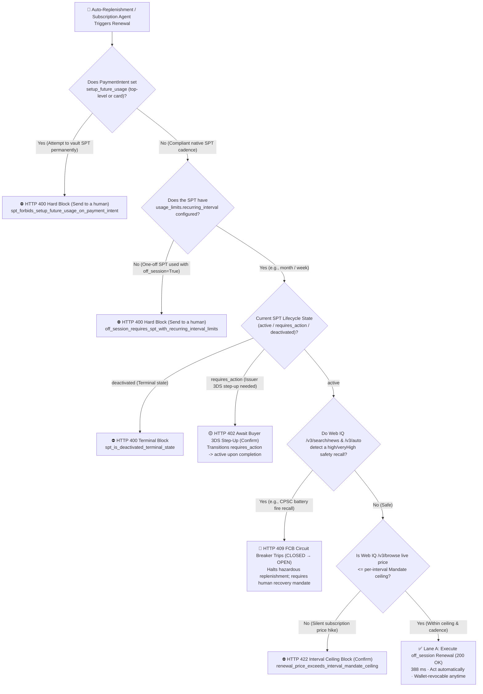
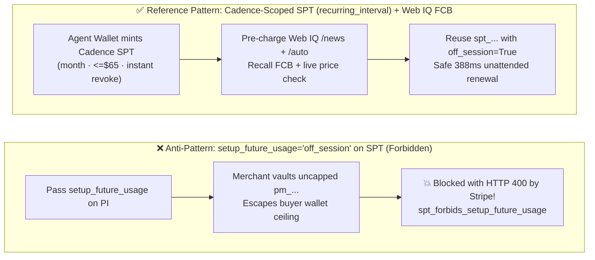
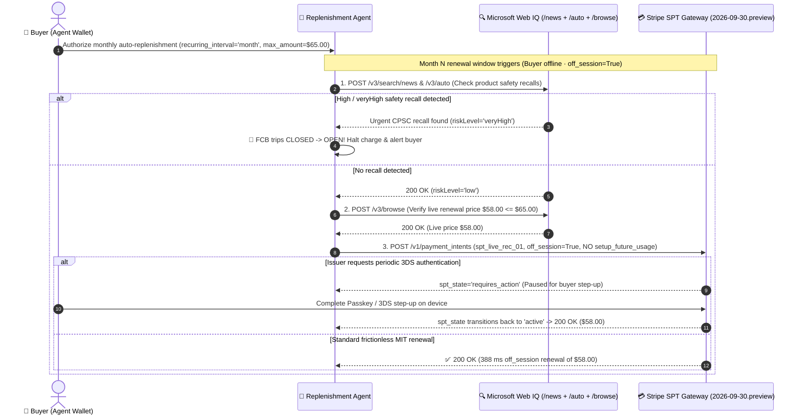

# Recurring Subscription & Autonomous Replenishment Agent Architecture: Cadence-Scoped SPT (`usage_limits.recurring_interval` + Web IQ Recall Circuit Breaker) vs. Forbidden `setup_future_usage` Vaulting Selection & First-Principles FAQ

> **Document Scope**: Single-topic architectural selection and first-principles protocol guide for **AI Solution Architects** (strictly following the one-topic-per-guide rule and the 6-section structure of `ib-vs-ethernet-roce-selection-faq.md`).  
> **Bilingual Editions**: **[中文版](recurring-replenishment-spt-cadence-vs-vaulting-faq.md)** · **[English Version (Current)](recurring-replenishment-spt-cadence-vs-vaulting-faq.en.md)**  
> **Related Single-Topic Guides**: [Payment Rails Selection FAQ (Topic 1A)](agentic-payment-rails-spt-vic-x402-selection-faq.en.md) · [Web Grounding Selection FAQ (Topic 1B)](webiq-vs-exa-brightdata-grounding-selection-faq.en.md) · [B2B Spend Mandate FAQ (Topic 2)](b2b-procurement-mandate-vs-hitl-selection-faq.en.md) · [Cross-Border Settlement FAQ (Topic 3)](cross-border-agent-settlement-x402-vs-card-network-faq.en.md) · [Web Bot Auth vs. WAF FAQ (Topic 4)](ecommerce-agent-identity-web-bot-auth-tap-vs-waf-faq.en.md) · [BNPL Controlled WebView Handover FAQ (Topic 5)](bnpl-webview-handover-vs-headless-agent-faq.en.md) · [Multi-Merchant Split-Cart Saga vs. Connect FAQ (Topic 6)](multi-merchant-split-cart-saga-vs-connect-faq.en.md) · [Post-Purchase Return Grounding vs. Refund Gate FAQ (Topic 7)](post-purchase-return-eligibility-vs-refund-confirmation-faq.en.md)  
> **Companion Deliverables**: **[🚀 Interactive Recurring SPT & Recall Circuit-Breaker Sandbox (`live-demo.en.html#recurring-spt-selector-sandbox`)](../live-demo.en.html)** · **[📊 7-Card 4:5 Benchmark Deck (`benchmark-cards.en.html`)](../benchmark-cards.en.html)**

---

## ① 📌 Executive Summary

1. **Recurring Auto-Replenishment, SaaS Renewals & Price-Drop Triggers (`off_session=True`) → Choose "Lane A: Buyer-Wallet-Sovereign Cadence-Scoped SPT (`usage_limits.recurring_interval`) + Pre-Renewal Web IQ Price & Recall Gate"**: Have the buyer's Agent Wallet mint a Shared Payment Token (`spt_...`) configured with an explicit `usage_limits.recurring_interval` (`day` | `week` | `month` | `year`), `interval_count`, and per-interval `max_amount`. On each renewal cycle, the merchant reuses that same `spt_...` with `off_session=True` (`official_doc_snapshot`).
2. **Never Pass `setup_future_usage` on Any SPT `PaymentIntent` (`HTTP 400` Hard Block)**: Under the official Stripe Shared Payment Token (`2026-09-30.preview`) specification (`official_doc_snapshot`), Stripe strictly forbids both top-level `setup_future_usage` and nested `payment_method_options[card][setup_future_usage]` when charging an SPT (`spt_forbids_setup_future_usage_on_payment_intent`). This prevents merchants from converting a buyer-governed SPT into an uncapped, merchant-vaulted card (`pm_...`).
3. **Wire a Pre-Renewal Microsoft Web IQ Safety Recall Circuit Breaker (`FCB`)**: Before executing any unattended `off_session=True` renewal, the agent must query **Web IQ `/v3/search/news` and `/v3/auto`** (`maxResponseLength` clamped to `[1500, 500000]`, malformed evidence omitted) plus `/v3/browse` for current pricing. If a `high` or `veryHigh` product safety recall is detected (e.g., a CPSC lithium-ion battery fire recall) or the renewal price exceeds the per-interval ceiling, the Financial Circuit Breaker (`FCB`) trips from `CLOSED` to `OPEN` (`409 Conflict` / `422 Unprocessable`), halting unattended charges (`synthetic_policy + deterministic_offline_simulation`).

---

## ② 🎯 Architect & Client Q&A (From First Principles in Plain English)

### Q1: In traditional web checkout, merchants pass `setup_future_usage="off_session"` to save a customer's card for subscriptions. Why does Stripe strictly forbid `setup_future_usage` on Shared Payment Tokens (`SPT`)?
- **Plain-English First Principles**:
  - **The core issue is who holds the kill-switch and budget ceiling (`Wallet Sovereignty vs. Merchant Vaulting`)**!
  - In legacy card vaulting (`setup_future_usage="off_session"`), the merchant receives a permanent `PaymentMethod` (`pm_...`) stored in the merchant's own Stripe account. From that moment on, the merchant controls when and how much to charge—leading to dark-pattern "subscription traps" where buyers struggle to cancel or suffer surprise price hikes.
  - In **Agentic Commerce with Shared Payment Tokens (`spt_...`)**, **the buyer's Agent Wallet retains cryptographic sovereignty**! The buyer authorizes a specific cadence and ceiling (`usage_limits.recurring_interval="month"`, `max_amount=$65.00`).
  - If a merchant could pass `setup_future_usage` on the first `PaymentIntent` to clone the SPT into a permanent merchant-owned `pm_...`, the buyer's per-interval ceiling, cadence lock, and instant wallet-side revocation (`deactivated`) would be bypassed!
  - Therefore, Stripe's protocol rejects any SPT `PaymentIntent` containing `setup_future_usage` or `payment_method_options[card][setup_future_usage]` with **`HTTP 400 Bad Request`** (`official_doc_snapshot`).

### Q2: Without `setup_future_usage`, how do legitimate `off_session=True` recurring renewals and the SPT state machine (`active` ⇄ `requires_action` → `deactivated`) work under the hood?
- **First-Principles Protocol Mechanics (`official_doc_snapshot`)**:
  1. **Cadence-Scoped SPT Minting**: The buyer's Agent Wallet provisions `usage_limits.recurring_interval` on the SPT. Attempting `off_session=True` on a one-off SPT without `recurring_interval` fails with **`HTTP 400 off_session_requires_spt_with_recurring_interval_limits`**.
  2. **Three-State Lifecycle (`active` ⇄ `requires_action` → `deactivated`)**:
     - **`active`**: Unattended `off_session=True` renewals succeed in `388 ms` within the per-interval ceiling.
     - **`requires_action` (Reversible)**: If the card issuer requests a periodic 3DS step-up challenge, the SPT transitions to `requires_action`. Once the buyer completes the 3DS/Passkey challenge, the same SPT transitions **back to `active`**.
     - **`deactivated` (Terminal)**: When the buyer revokes the subscription in their Agent Wallet or the mandate expires, the SPT enters `deactivated` permanently.

### Q3: Why must an autonomous replenishment agent run a Microsoft Web IQ `/v3/search/news` + `/v3/auto` safety check before every `off_session` charge?
- **Real-World Failure Mode & Solution**:
  - Suppose a buyer delegates monthly auto-replenishment for baby formula or a portable power bank. In Month 3, regulators issue an urgent safety recall (`riskLevel="veryHigh"`), or the seller quietly raises the subscription price from `$58.00` to `$74.00` (above the `$65.00` mandate cap).
  - By querying **Web IQ `/v3/search/news` + `/v3/auto`** and `/v3/browse` before firing the `PaymentIntent`, our **Financial Circuit Breaker (`FCB`)** automatically trips from `CLOSED` to `OPEN` (`409 Conflict`) on recall alerts and blocks silent price hikes (`422 Unprocessable`).

---

## ③ 🧭 Visual Architecture Diagrams (Mermaid Decision Tree + Vaulting Comparison + Sequence)

### 3.1 Recurring Subscription & Auto-Replenishment Selection Decision Tree (`flowchart TD`)

### 3.2 Legacy `setup_future_usage` Merchant Vaulting vs. Wallet-Sovereign Cadence SPT (`flowchart LR`)

### 3.3 End-to-End Auto-Replenishment, Recall FCB & `requires_action` Recovery Sequence (`sequenceDiagram`)

---

## ④ 📊 Architect Decision Matrix

| Evaluation Dimension | Lane A: Wallet-Sovereign Cadence SPT (`usage_limits.recurring_interval` + Web IQ FCB) | Lane B: Per-Cycle One-Off SPT with Human Approval (`One-Off SPT + HITL`) | Anti-Pattern: Passing `setup_future_usage` on an SPT `PaymentIntent` |
| :--- | :--- | :--- | :--- |
| **Primary Use Case** | **Monthly/weekly consumable auto-replenishment, SaaS seat renewals, price-drop sniping** | **Low-frequency, high-ticket annual enterprise license renewals** | Reusing legacy web checkout code that sets `setup_future_usage` on SPTs |
| **Protocol Compliance & HTTP Status** | **100% Compliant (`200 OK`)**: Native `off_session=True` reuse of cadence-scoped `spt_...` | **100% Compliant (`200 OK`)**: Requires buyer online every cycle to mint a fresh SPT | **Hard Protocol Error (`HTTP 400`)**: `spt_forbids_setup_future_usage_on_payment_intent` (`official_doc_snapshot`) |
| **Revocation & Ceiling Sovereignty** | **100% Buyer-Wallet Controlled**: Instant `deactivated` kill-switch + hard per-interval ceiling | 100% Buyer Controlled per transaction | Would leak permanent uncapped `pm_...` authority to merchant (blocked by Stripe) |
| **Anti-Recall & Anti-Price-Hike Guard** | Protocol per-interval cap + Web IQ `/news` & `/auto` FCB circuit breaker | Manual review each cycle | No protocol-enforced per-interval cap |
| **State Machine Recovery** | Supports reversible `active ⇄ requires_action` 3DS step-up recovery | Stateless single-use | Rejected at API boundary |
| **User Experience & Human Friction** | **Zero Routine Friction (`Act automatically`)**: `388 ms` unattended renewal; alerts only on recall/hike | **High Friction (`Confirm`)**: Manual approval required every billing cycle | Checkout failure (`HTTP 400`) |

---

## ⑤ 🧪 Quantitative Benchmark Findings (With Explicit Provenance Ledger)

> **Provenance & Scope Disclosure (`as_of: 2026-11-08`)**:
> - **`official_doc_snapshot`**: Stripe Shared Payment Token (`2026-09-30.preview`) prohibition on top-level `setup_future_usage` and nested `payment_method_options[card][setup_future_usage]`, requirement for `usage_limits.recurring_interval` on `off_session=True` charges, and `active ⇄ requires_action → deactivated` lifecycle rules; plus Microsoft Web IQ `/v3/auto` `maxResponseLength` `[1500, 500000]` clamping and malformed-evidence omission.
> - **`synthetic_policy + deterministic_offline_simulation`**: The 6 recurring replenishment and FCB evaluation scenarios, `$65.00` per-interval ceiling, and `388 ms` sandbox latency come from `evaluate_recurring_replenishment_spt_policy()` in `lab/webiq_commerce_demo.py` and `tests/test_webiq_commerce_demo.py`.
> - **`not_measured`**: Live issuer-specific Merchant-Initiated Transaction (`MIT`) soft-decline rates across multi-year subscription lifecycles are labeled **`not_measured`** and never coerced to zero.

| Benchmark Scenario (`evaluate_recurring_replenishment_spt_policy`) | SPT & `PaymentIntent` Configuration | Web IQ Recall & Live Price State | Deterministic Verifier Verdict | Sandbox Latency / Safety Outcome | Action Pill |
| :--- | :--- | :--- | :--- | :--- | :--- |
| **Case 1: Compliant Cadence SPT `off_session` Renewal** | `off_session=True`, `recurring_interval="month"`, no `setup_future_usage` | Safe (`low`), live price `$58.00 ≤ $65.00` | **`200 OK` (`cadence_spt_off_session_renewed`)** | **`388 ms`** · Frictionless renewal | `Act automatically` |
| **Case 2: Forbidden `setup_future_usage` (Top-Level or `card`)** | `setup_future_usage="off_session"` or `card_setup_future_usage_set=True` | — | **`400 Bad Request` (`blocked_spt_forbids_setup_future_usage`)** | **`15 ms`** · Blocked card vaulting | `Send to a human` |
| **Case 3: `off_session=True` Without `recurring_interval`** | `off_session=True`, `recurring_interval_configured=False` | — | **`400 Bad Request` (`blocked_off_session_without_recurring_interval`)** | **`15 ms`** · Blocked un-scoped SPT | `Send to a human` |
| **Case 4: Web IQ Detects `veryHigh` Battery Fire Recall** | `off_session=True`, `recurring_interval="month"` | CPSC recall (`riskLevel="veryHigh"`) | **`409 Conflict` (`fcb_tripped_product_safety_recall_blocked`)** | **FCB `CLOSED → OPEN` · 0 unsafe orders** | `Send to a human` |
| **Case 5: Silent Subscription Price Hike (`$74.00 > $65.00`)** | `off_session=True`, `recurring_interval="month"` | Safe, but live price `$74.00 > $65.00` cap | **`422 Unprocessable` (`blocked_renewal_price_exceeds_interval_ceiling`)** | **`32 ms`** · Blocked price hike | `Confirm` |
| **Case 6: `requires_action` 3DS Step-Up Recovery** | `spt_state="requires_action"`, `buyer_completed_3ds=True` | Safe, live price `$58.00 ≤ $65.00` | **`200 OK` (`recovered_requires_action_to_active_renewed`)** | Restored to `active` · **`410 ms`** | `Confirm` |

---

## ⑥ 🛠️ Production Readiness & Pre-Sales Checklist (Architect Checklist)

- [ ] **Stripped `setup_future_usage` from All SPT PaymentFlows**: Verified that neither top-level `setup_future_usage` nor `payment_method_options[card][setup_future_usage]` is ever sent when charging an `spt_...` token.
- [ ] **Enforced `usage_limits.recurring_interval` on All `off_session=True` Charges**: Confirmed that unattended renewals only use SPTs provisioned with a recurring interval and in the `active` state.
- [ ] **Wired Pre-Renewal Web IQ `/v3/search/news` + `/v3/auto` Recall Circuit Breaker (`FCB`)**: Configured automatic FCB `CLOSED → OPEN` tripping whenever Web IQ detects `high` or `veryHigh` product recall evidence.
- [ ] **Implemented Reversible `requires_action ⇄ active` Step-Up Handling**: Routed issuer 3DS step-up challenges to the buyer's device so the recurring SPT resumes `active` status without re-provisioning.
