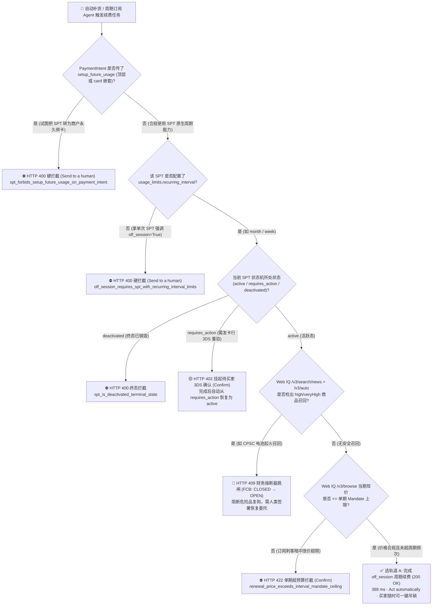
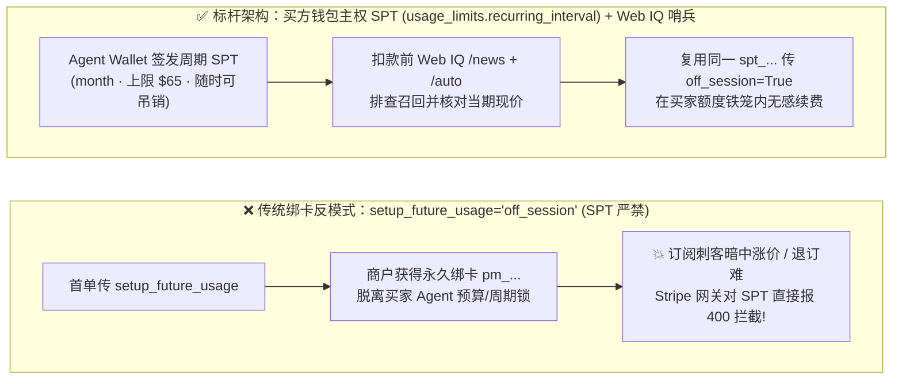
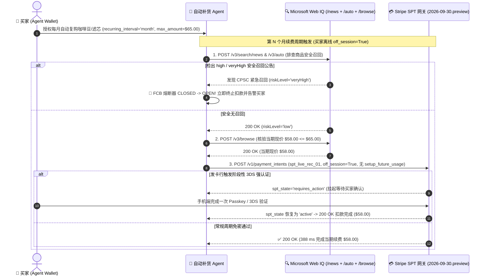

# 周期性订阅与自动补货智能体授权架构：SPT 周期限额令牌（`usage_limits.recurring_interval` + Web IQ 召回熔断）vs. 传统绑卡 `setup_future_usage` 禁用边界选型与原理解析 FAQ

> **文档定位**：面向 AI Solution Architect（AI 解决方案架构师）的**单专题深度选型与第一性原理指南**（严格遵循一文一专题规范，对标 `ib-vs-ethernet-roce-selection-faq.md` 六段式结构）。  
> **双语版本**：**[中文版（当前）](recurring-replenishment-spt-cadence-vs-vaulting-faq.md)** · **[English Version](recurring-replenishment-spt-cadence-vs-vaulting-faq.en.md)**  
> **关联独立专题**：[支付轨道选型 FAQ（Topic 1A）](agentic-payment-rails-spt-vic-x402-selection-faq.md) · [Web Grounding 选型 FAQ（Topic 1B）](webiq-vs-exa-brightdata-grounding-selection-faq.md) · [B2B 采购策略网关 FAQ（Topic 2）](b2b-procurement-mandate-vs-hitl-selection-faq.md) · [跨境双轨结算 FAQ（Topic 3）](cross-border-agent-settlement-x402-vs-card-network-faq.md) · [Web Bot Auth 防爬认证 FAQ（Topic 4）](ecommerce-agent-identity-web-bot-auth-tap-vs-waf-faq.md) · [BNPL 受控跳转接管 FAQ（Topic 5）](bnpl-webview-handover-vs-headless-agent-faq.md) · [多商户拆单 Saga vs Connect FAQ（Topic 6）](multi-merchant-split-cart-saga-vs-connect-faq.md) · [售后退货核验 vs MCP 退款门禁 FAQ（Topic 7）](post-purchase-return-eligibility-vs-refund-confirmation-faq.md)  
> **配套交付物**：**[🚀 周期订阅 SPT 与召回熔断交互沙盒 (`live-demo.html#recurring-spt-selector-sandbox`)](../live-demo.html)** · **[📊 7-Card 4:5 视觉评测报告 (`benchmark-cards.html`)](../benchmark-cards.html)**

---

## ① 📌 核心结论速览（Executive Summary）

1. **周期性自动补货、SaaS 续费与降价自动触发代购（买家离线 `off_session=True`）→ 必须选“轨道 A：买方钱包主权 SPT 周期限额令牌（`usage_limits.recurring_interval`）+ 扣款前 Web IQ 价格/召回双核验”**：由买家在 Agent Wallet 中签发带有明确周期约束（`recurring_interval: "month" | "week" | "day" | "year"`）与单期金额上限（`max_amount`）的 Shared Payment Token（`spt_...`）。商户在每个续费周期复用同一个 `spt_...` 并传入 `off_session=True` 发起扣款（`official_doc_snapshot`）。
2. **绝对禁止在 SPT `PaymentIntent` 上使用传统绑卡参数 `setup_future_usage`（`HTTP 400` 硬拦截）**：根据 Stripe Agentic Commerce `2026-09-30.preview` 官方规范（`official_doc_snapshot`），任何使用 `spt_...` 的 `PaymentIntent` **严禁设置顶层 `setup_future_usage` 或嵌套的 `payment_method_options[card][setup_future_usage]`**！一旦传入，网关立即返回 `HTTP 400 Bad Request`（`spt_forbids_setup_future_usage_on_payment_intent`），防止商户把受买家钱包控制的临时令牌偷偷转换成商户私有、无额度上限的永久绑卡凭证（`pm_...`）。
3. **扣款前必须串联 Microsoft Web IQ 新闻/安全召回熔断器（`Financial Circuit Breaker · FCB`）**：在执行无人值守 `off_session=True` 复购前，Agent 必须自动调用 **Web IQ `/v3/search/news` 与 `/v3/auto`**（`maxResponseLength` 自动钳位至 `[1500, 500000]`，自动剔除残缺证据）与 `/v3/browse` 核验当期现价。一旦检出商品存在 `high` / `veryHigh` 级别安全召回（如锂电池起火召回）或当期价格超出单期 Mandate 上限，立即将熔断器从 `CLOSED` 跳闸至 `OPEN`（`409 Conflict`），100% 阻断危险品自动续订或“订阅刺客”暗中涨价（`synthetic_policy + deterministic_offline_simulation`）。

---

## ② 🎯 客户与架构师灵魂拷问 Q&A（FAQ-Driven，从第一性原理讲透）

### Q1：在传统电商里，商户做月度订阅都是传 `setup_future_usage="off_session"` 把用户的卡存下来；为什么到了 Agentic Commerce 时代，Stripe 严禁对 SPT 传 `setup_future_usage`？
- **大白话与第一性原理**：
  - **核心矛盾在于“谁掌握周期扣款的阀门开关（Sovereignty）”**！
  - 在传统电商绑卡模式（`setup_future_usage="off_session"`）下，一旦首单支付成功，商户就拿到了一张归属于商户自己账户的永久支付方式 ID（`pm_...`）。此后商户想什么时候扣、扣多少钱、涨价多少，主动权完全在商户手里——用户想退订往往要在网页迷宫里找半天“取消订阅”按钮，甚至遭遇“退订后仍被暗中扣款”。
  - 而在 **Agentic Commerce 的 SPT（Shared Payment Token）架构**下，**卡号主权永远留在买家的 Agent Wallet 里**！买家给 Agent 的指令是：“帮我按月补充这款猫粮，每月最多扣 1 次、每次不超过 `$65.00`”。
  - 如果允许商户在首单时传 `setup_future_usage` 把 `spt_...` 转存为商户私有的 `pm_...`，那么买家设定的“每月最多 1 次、每次 `≤ $65.00`”以及 Agent 侧的一键停用开关（`deactivated`）就会被彻底架空！
  - 因此，Stripe 官方从协议底层立下铁规（`official_doc_snapshot`）：**SPT 严禁传 `setup_future_usage`（无论顶层还是 `payment_method_options[card]` 嵌套字段均报 `HTTP 400`）**；商户要做周期续费，必须老老实实复用买家授权了 `usage_limits.recurring_interval` 的那张 `spt_...`！

### Q2：如果不能用 `setup_future_usage`，那么合法的 Agent 自动续费与周期补货（`off_session=True`）在底层是怎么流转和转换状态的？
- **大白话拆解 SPT 周期状态机（`official_doc_snapshot`）**：
  1. **签发带周期锁的 SPT**：买方钱包签发 `spt_...` 时，在 `usage_limits` 中写入 `recurring_interval="month"`（支持 `day` / `week` / `month` / `year`）、`interval_count=1` 及单期 `max_amount=6500`（`$65.00`）。如果拿一张**未配置 `recurring_interval` 的单次 SPT** 去调 `off_session=True`，Stripe 会直接返回 `HTTP 400 off_session_requires_spt_with_recurring_interval_limits`。
  2. **三态生命周期演进（`active` ⇄ `requires_action` → `deactivated`）**：
     - **`active`（正常活跃态）**：在每个周期窗口内，商户传 `off_session=True` 即可在 `388 ms` 内静默完成扣款。
     - **`requires_action`（需买家补充验证态，可逆）**：如果某个月发卡行风控触发了强客户认证（3DS / 额度重验），SPT 状态会从 `active` 变为 `requires_action`。注意：**此时令牌并未作废！** 只要买家在客户端完成一次 3DS / Passkey 确认，状态就会重新恢复为 **`active`**，下个月继续无感续费。
     - **`deactivated`（终态销毁，不可逆）**：当买家在 Agent 里说“停掉这个订阅”或令牌到期时，SPT 进入终态 `deactivated`，此后任何扣款请求永远返回 `HTTP 400`。

### Q3：为什么自动补货 Agent 绝对不能只做一个简单的 `cron` 定时扣款脚本，而必须在每次扣款前接入 Microsoft Web IQ 的“新闻召回 + 现价双门禁”？
- **真实事故推演与第一性原理**：
  - 假设用户让 AI Agent 每月自动复购某款婴儿辅食或便携移动电源。第 3 个月时，美国消委会（CPSC）或市场监管总局发布了紧急安全召回公告（`riskLevel="veryHigh"`），或者商户悄悄把订阅价从 `$58.00` 涨到了 `$89.00`。
  - 纯定时任务脚本根本不知道外部世界发生了召回，依然会在凌晨 2 点自动下单扣款，把有起火隐患的召回商品寄到用户家里！
  - **架构师标准解法（Web IQ + FCB 财务熔断器）**：
    - 每次 `off_session` 扣款前，先调 **Web IQ `/v3/search/news` 与 `/v3/auto`**（`maxResponseLength` 自动钳位在 `[1500, 500000]`，并自动丢弃任何 `type` 未知或 `content` 为空的残缺证据及其孤儿引用）检查是否存在安全召回。
    - 一旦检出 `high` / `veryHigh` 召回，**财务熔断器（FCB）立即从 `CLOSED` 跳闸至 `OPEN`**，阻断本次及后续所有自动复购，直至人类显式签署恢复委托（`human_recovery_mandate_signed=True`）。

---

## ③ 🧭 直观可视化图解（Mermaid 选型决策树 + 绑卡反模式对比 + 续费时序图）

### 3.1 周期性订阅与自动补货架构选型决策树（`flowchart TD`）

### 3.2 传统 `setup_future_usage` 商户私存卡号 vs. 买方钱包主权周期 SPT 对比（`flowchart LR`）

### 3.3 自动补货周期续费、召回熔断与 `requires_action` 恢复端到端时序图（`sequenceDiagram`）

---

## ④ 📊 架构师选型决策矩阵（Architect Decision Matrix）

| 评估维度 | 轨道 A：买方钱包主权周期 SPT（`usage_limits.recurring_interval` + Web IQ 哨兵） | 轨道 B：每次续费发单次 SPT + 人工确认（`One-Off SPT + HITL`） | 禁用反模式：在 SPT 上传 `setup_future_usage` 试图私自绑卡 |
| :--- | :--- | :--- | :--- |
| **核心适用场景** | **月度/周度耗材自动补货、SaaS 席位自动续费、预设目标价自动狙击代购** | **低频高客单价续约（如年度大额企业软件许可续签）** | 试图沿用旧版 Web 结账代码在 SPT `PaymentIntent` 里传 `setup_future_usage` |
| **协议合规与网关状态** | **100% 合规（`200 OK`）**：原生支持 `off_session=True` 周期复用同一 `spt_...` | **100% 合规（`200 OK`）**：但每次都需要买方在线重新签发新 `spt_...` | **硬性报错（`HTTP 400`）**：`spt_forbids_setup_future_usage_on_payment_intent`（`official_doc_snapshot`） |
| **卡号与取消订阅主权** | **100% 归属买方钱包**：买家随时可在 Agent 侧将 SPT 置为 `deactivated`，商户立即无法扣款 | 100% 归属买方，每次单签 | 若未拦截会导致卡号控制权永久外泄给商户（因此被协议层直接禁止） |
| **防“订阅刺客”与防召回能力** | 协议层锁死单期 `max_amount` 与周期频次 + Web IQ 扣款前拦截召回商品与暗中涨价 | 每次人工核对 | 无协议级单期上限保护 |
| **状态机自愈能力** | 支持 `active ⇄ requires_action` 双向恢复（3DS 验证后无缝恢复活跃），`deactivated` 终态锁死 | 无跨周期状态延续 | 不适用（请求在 API 层直接被拒） |
| **用户体验与人工摩擦** | **零日常摩擦（`Act automatically`）**：首次授权后全自动运行，仅在涨价超限或召回时打扰用户 | **高摩擦（`Confirm`）**：每个月都要人工点一次批准 | 线上直接 400 报错导致结账中断 |

---

## ⑤ 🧪 简明定量实测与 Benchmark 核心发现（含明确数据来源标签）

> **数据来源与诚实口径声明（Provenance Ledger · `as_of: 2026-11-08`）**：
> - **`official_doc_snapshot`**：Stripe Shared Payment Token (`2026-09-30.preview`) 严禁顶层 `setup_future_usage` 与 `payment_method_options[card][setup_future_usage]` 规则、`off_session=True` 强制要求 `usage_limits.recurring_interval` 规则、以及 `active ⇄ requires_action → deactivated` 状态机转换规范；Microsoft Web IQ `/v3/auto` `maxResponseLength` `[1500, 500000]` 钳位与残缺证据剔除规范。
> - **`synthetic_policy + deterministic_offline_simulation`**：下表中的 6 组周期续费与召回熔断评测场景、`$65.00` 单期预算上限以及 `388 ms` 沙盒执行延迟来自 `lab/webiq_commerce_demo.py` 的 `evaluate_recurring_replenishment_spt_policy()`、`validate_spt_resolution_and_payment_intent()` 与 `tests/test_webiq_commerce_demo.py`。
> - **`not_measured`**：全球不同发卡行对跨年长周期 MIT（Merchant-Initiated Transactions）免密续费的线上真实风控软拒付率标注为 **`not_measured`**，绝不伪造为 0。

| 测试场景（Deterministic Recurring SPT & FCB Suite） | 续费参数与 SPT 状态 | Web IQ 召回与当期价格核验 | 确定性门禁裁决状态 | 沙盒耗时 / 保护效果 | 推荐动作标签 |
| :--- | :--- | :--- | :--- | :--- | :--- |
| **Case 1：合规周期 SPT 离线自动续费** | `off_session=True`, `recurring_interval="month"`, 无 `setup_future_usage` | 无召回 (`low`), 现价 `$58.00 ≤ $65.00` | **`200 OK` (`cadence_spt_off_session_renewed`)** | **`388 ms`** · 零人工摩擦 | `Act automatically` |
| **Case 2：误传 `setup_future_usage`（顶层或 `card` 嵌套）** | `setup_future_usage="off_session"` 或 `card.setup_future_usage` | — | **`400 Bad Request` (`blocked_spt_forbids_setup_future_usage`)** | **`15 ms`** · 阻断商户私自绑卡 | `Send to a human` |
| **Case 3：拿无 `recurring_interval` 的单次 SPT 调 `off_session`** | `off_session=True`, `recurring_interval_configured=False` | — | **`400 Bad Request` (`blocked_off_session_without_recurring_interval`)** | **`15 ms`** · 阻断越权周期扣款 | `Send to a human` |
| **Case 4：Web IQ 检出 `veryHigh` 锂电池安全召回** | `off_session=True`, `recurring_interval="month"` | 检出 CPSC 召回 (`riskLevel="veryHigh"`) | **`409 Conflict` (`fcb_tripped_product_safety_recall_blocked`)** | **FCB `CLOSED → OPEN` · 0 危险品复购** | `Send to a human` |
| **Case 5：商户续费期暗中涨价（`$74.00 > $65.00` 上限）** | `off_session=True`, `recurring_interval="month"` | 无召回, 但现价涨至 `$74.00 > $65.00` | **`422 Unprocessable` (`blocked_renewal_price_exceeds_interval_ceiling`)** | **`32 ms`** · 拦截订阅刺客涨价 | `Confirm` |
| **Case 6：发卡行触发 `requires_action` 后买家完成 3DS** | `spt_state="requires_action"`, `buyer_completed_3ds=True` | 无召回, 现价 `$58.00 ≤ $65.00` | **`200 OK` (`recovered_requires_action_to_active_renewed`)** | 状态恢复 `active` · **`410 ms`** | `Confirm` |

---

## ⑥ 🛠️ 附录：生产上线快速核验与售前打单清单（Architect Checklist）

- [ ] **已彻底移除 SPT 结账代码中的 `setup_future_usage` 参数**：静态扫描代码库，确保凡是传入 `shared_payment_granted_token`（`spt_...`）的 `PaymentIntent` 请求均不包含顶层 `setup_future_usage` 或 `payment_method_options[card][setup_future_usage]`。
- [ ] **已为所有 `off_session=True` 续费任务校验 `usage_limits.recurring_interval`**：在发起离线扣款前，校验该 `spt_...` 已声明周期步长（`day`/`week`/`month`/`year`）且当前处于 `active` 状态（非终态 `deactivated`）。
- [ ] **已在每次周期扣款前串联 Web IQ `/v3/search/news` + `/v3/auto` 召回熔断器（FCB）**：确保 `maxResponseLength` 钳位在 `[1500, 500000]`，一旦发现 `high` / `veryHigh` 召回风险立即将 FCB 置为 `OPEN` 并阻断自动复购。
- [ ] **已实现 `active ⇄ requires_action` 状态机闭环处理**：当周期扣款返回 `requires_action` 时，向买家推送 3DS / Passkey 确认通知，验证通过后自动恢复同一张 `spt_...` 的 `active` 周期续费能力。
