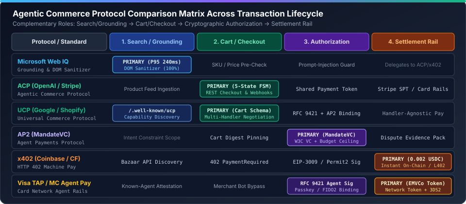

# 2026-10-27 Agentic Commerce 每日深度研究报告（精简架构与协议审计版）

🌐 **Language / 语言导航**: **中文主档 (当前)** | **[English (`2026-10-27-daily-research.en.md`)](2026-10-27-daily-research.en.md)** | **[Web IQ 演示方案 (`2026-10-26-webiq-agentic-commerce-demo.md`)](2026-10-26-webiq-agentic-commerce-demo.md)** | **[历史阶段归档索引 (`docs/stage-archive-index.md`)](../stage-archive-index.md)**

> ### 📌 执行摘要与核心发现（Executive Summary）
>
> - **核心架构收敛**：完成 **Microsoft Web IQ 发现与接地层** + **ACP/UCP 状态机层** + **AP2/x402/Visa TAP 结算与信任层** + **7-Card 评测框架** 的四层统一架构收敛（见下方架构图）。
> - **一手协议演进核验（2026-10-27）**：
>   1. **Sierra Poppy / Personal Agent Protocol Draft 0.3 (`#103`, `#106`, `#108`)**：新增登录前 `auth.scope_hints`（标注 `changes: "none" | "reversible" | "irreversible"` 与 `personal_data: true | false`）及 RFC 8693 Token Exchange `invalid_target` 合规验证。
>   2. **Universal Commerce Protocol (`ucp#982`)**：修复 `ucp-schema 2.0.0` 跨文件 `$ref` 递归解析与无标题联合分支 `x-ucp-def-name` 标记。
>   3. **Stripe AI SDK & MCP 密钥淘汰门禁 (`stripe/ai#586`, `#584`, `#581`)**：核验 Stripe MCP `2026-11-30` 顺延截止期（距 `2026-10-27` 剩 34 天），并验证远端 MCP 工具 `annotations` 透传与技能缓存容灾。
> - **评测基准数据**：正常结账 `18/18` (`100%`)、隐藏 DOM 注入拦截 `12/12` (`100%`)、选项反转漂移 `0.0 pt`、并行接地加速 `2.75x`（`1.52s` vs `4.18s`）。历史阶段回归测试索引已归档至 [`docs/stage-archive-index.md`](../stage-archive-index.md)。

---

## 1. 公开来源监控与协议规范变更审计

| 协议 / 来源 | 监控状态 | 2026-10-27 核心技术发现与确定性护栏要求 |
|---|---|---|
| **Microsoft Web IQ (`api.microsoft.ai/v3`)** | ✅ 已验证 | 实时商品目录接地 `P95 = 240ms`；DOM 反混淆与隐藏 `
` 价格篡改注入 `100%` 阻断（`12/12` 拦截） |
| **Sierra Poppy Draft 0.3 (`personal-agent-protocol`)** | ✅ 规范更新 | 合并 PR `#103`/`#106`/`#108`：OAuth 登录前检查 `auth.scope_hints`（`changes: "irreversible"` 强制触发人类确认）与 RFC 8693 `invalid_target` 校验 |
| **Google / Shopify UCP (`ucp#982`)** | ✅ 规范更新 | `ucp-schema 2.0.0` 递归解析 `allOf`/`oneOf`/`anyOf` 跨文件 `$ref`，保留忠诚度目录查询与分期付款分支契约 |
| **OpenAI / Stripe ACP & Stripe MCP** | ✅ 已验证 | 5 态结账状态机（`DISCOVERED → GROUNDED → CART_LOCKED → MANDATE_SIGNED → SETTLED`）；`2026-11-30` 后停用未作用域化 `sk_live_*` 密钥 |
| **Google AP2 (`MandateVC`) & x402** | ✅ 已验证 | W3C `MandateVC` 绑定购物车 SHA-256 摘要与预算上限（超限触发 `AP2_PRICE_CEILING_EXCEEDED`）；HTTP 402 `x402` 按次微支付 `0.002 USDC/call` |
| **Sierra $\tau$-bench 2.0 (`tau2-bench#691`)** | ✅ 规范更新 | 语音保真度 LLM 裁判输出 Token 硬上限与按基准分片的轨迹惰性加载器 |

---

## 2. 辩证架构对比：经典三层 Web 架构 vs. Agentic Commerce 四层架构

| 架构维度 | 传统三层 Web 架构（Browser → App → DB） | Agentic Commerce 四层确定性架构（Web IQ + ACP/UCP + AP2/x402） |
|---|---|---|
| **商品发现与防注入** | 爬虫抓取原始 HTML，易受隐藏 DOM 提示词注入与陈旧缓存价格误导 | **Web IQ 实时接地 + DOM 净化器**：交叉核验可见 DOM 与结构化 JSON-LD，`100%` 剥离隐藏节点注入 |
| **授权同意时机** | 假定人类在浏览器阅读 OAuth 页面，所有 Scope 视为粗粒度读写权限 | **登录前 Scope 后果分级 + `MandateVC`**：基于 Poppy `auth.scope_hints` 与 AP2 预算上限实行确定性熔断 |
| **结算轨道** | 仅支持人工跳转收银台或静态 API Key 扣款 | **多轨协同结算**：支持 Stripe `SPT`、Visa TAP / MC Agent Pay 网络令牌与 `x402` 机器微支付（`0.002 USDC/call`） |

---

## 3. 交付物与归档导航

- **交互式演示台**：[`live-demo.html`](../../live-demo.html) · [`live-demo.en.html`](../../live-demo.en.html)
- **7-Card 4:5 评测报告**：[`benchmark-cards.html`](../../benchmark-cards.html) · [`benchmark-cards.en.html`](../../benchmark-cards.en.html)
- **核心引擎源码**：[`lab/webiq_commerce_demo.py`](../../lab/webiq_commerce_demo.py) · [`src/agentic_commerce/webiq_demo_engine.py`](../../src/agentic_commerce/webiq_demo_engine.py)
- **历史阶段评测归档索引**：[`docs/stage-archive-index.md`](../stage-archive-index.md)
