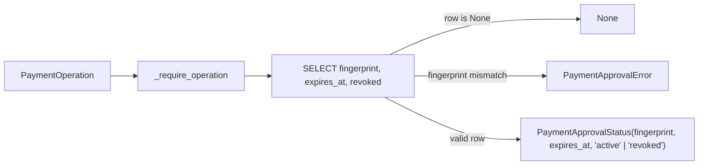

# 2026-10-31: Stage 1726 — `PaymentApprovalStore.read_approval` Scoped Read-Only Approval Status Lookup and Authority Boundary

[中文](2026-10-31-payment-approval-read.md) |
[Daily Report](../../research/daily/2026-10-31.en.md) |
[Prior First-Admission History](2026-10-25-admission-provenance.en.md) |
[Prior Stripe Claim Status Reader](2026-10-31-stripe-claim-read.en.md) |
[Stage Archive Index](../stage-archive-index.md)

**Conclusion:** Added `PaymentApprovalStore.read_approval(operation)` and the frozen dataclass `PaymentApprovalStatus(fingerprint, expires_at, state)` (`ApprovalState = Literal["active", "revoked"]`) in [`lab/payment_approvals.py`](../../lab/payment_approvals.py) to inspect persisted local approval records in `payment_approvals` by `(tenant_id, approval_id)` and full 10-dimension `PaymentOperation` fingerprint binding.
**Returning `state="active"` only indicates that the local `payment_approvals` row has not been marked `revoked=1`; it does not sample a clock, does not prove the approval is currently unexpired (`now < expires_at`), does not validate RFC 9421 request signatures or merchant signers, does not create `payment_admissions` or `payment_attempts` rows, and grants no payment dispatch authority.**

This stage has `provenance=synthetic` and `independently_reproduced=false`: it is a deterministic offline SQLite engineering asset with zero live funds, credentials, or cloud mutations.

## 1. Upstream Verification Context (2026-10-31 23:05 BJT Night Window)

- **Source Monitor Refresh**: Ran `python scripts/source_monitor.py` to refresh [`research/daily/2026-10-31-sources.json`](../../research/daily/2026-10-31-sources.json) (`checked_at = 2026-10-31T23:05:47.385783+08:00`), with `51/51` official sources `status="ok"`, `gate_health.blocking=false`, and all 3 cross-source checks `consistent`.
- **Stripe MCP 2026-10-31 Original Cutoff vs. 2026-11-30 Extended Deadline**: Today (`2026-10-31`) is the originally announced Stripe MCP legacy API key cutoff (`previous_deadline=2026-10-31`); primary-source inspection of `docs.stripe.com/mcp.md` confirms the deadline extended on 2026-10-16 remains **`2026-11-30`** (enforcement starting **2026-12-01** requiring OAuth or restricted API keys `rk_*`), with `30` calendar days remaining.
- **Stripe Link Agent Wallet Primary-Source Update (`stripe-link-wallet`)**: Verified the content update on `docs.stripe.com/agentic-commerce/agents/link-agent-wallet.md` (`9791e558... -> e4130b93...`) and its official subpages (`oauth.md`, `use-link-wallet-pay-online.md`, `machine-payments.md`):
  1. **Control-Plane & Credential Boundary**: Link API (`api.link.com` / `login.link.com`) authenticates via customer-scoped OAuth access tokens (`liwltoken_...`) and rotating refresh tokens (`liwlrefresh_...`), never Stripe `sk_*`/`rk_*` keys; authorization codes are single-use with a 10-minute TTL and mandatory PKCE `S256`.
  2. **Three-Way Credential Routing & No-Fallback Rule**: Spend requests (`lsrq_...`) route to `link_pay_token` (WebMCP), `shared_payment_token` (SPT API or MPP HTTP `402` `method="stripe"` omitting `--merchant-name`/`--merchant-url` in favor of `--network-id`, stopping immediately if `method!="stripe"`), or `card` (virtual card requiring `--merchant-name` and `--merchant-url`).
  3. **Approval Polling vs. Admission Separation**: Polling an approval record's state is strictly distinct from consuming a single-use payment credential under an atomic admission lock.

## 2. Dialectical Architecture Analysis: AI-Native Agentic Commerce vs. Classic 3-Tier Web / Cloud WAF

| Architectural Dimension | Cloud Well-Architected (WAF) / Classic 3-Tier Web App | Agentic Commerce AI-Native Architecture Improvement |
|---|---|---|
| **Read-Only Status Inspection vs. Admission Authority** | Web tiers commonly read `GET /approval -> active` and proceed directly to downstream side effects in application code (TOCTOU race window). | **Strict Separation of Observation and Atomic Admission**: `read_approval` provides lock-free read-only metadata observation; actual dispatch admission must re-verify `revoked==0`, sample the trusted clock (`now < expires_at`), and reserve the attempt inside `admit()` under `BEGIN IMMEDIATE`. |
| **Idempotency & Operation Binding Granularity** | Often keys idempotency by a bare `request_id`, ignoring parameter drift across agent retries (e.g., mutated amount, currency, or merchant). | **10-Dimension Operation Fingerprint Binding**: Even during read-only `read_approval(operation)`, any mismatch between the stored `fingerprint` for `(tenant_id, approval_id)` and the candidate `PaymentOperation` raises `PaymentApprovalError`. |
| **Untrusted External Responses** | Treats upstream HTTP headers/bodies as trusted internal contracts. | **Treat Seller Responses as Data, Not Instructions**: Aligns with Link Agent Wallet MPP `402` `_next.pay_argv` process-argument isolation and strict validation of persisted SQLite metadata. |

## 3. Implementation Details

### `lab/payment_approvals.py`

1. Added `ApprovalState = Literal["active", "revoked"]` and frozen dataclass `PaymentApprovalStatus(fingerprint: str, expires_at: int, state: ApprovalState)`.
2. Added `PaymentApprovalStore.read_approval(self, operation: PaymentOperation) -> PaymentApprovalStatus | None`:
   - Calls `_require_operation(operation)` prior to opening any SQLite connection;
   - Executes a read-only `SELECT fingerprint,expires_at,revoked FROM payment_approvals WHERE tenant_id=? AND approval_id=?` without `BEGIN IMMEDIATE`, writer locks, or clock sampling;
   - Returns `None` when no row exists for `(tenant_id, approval_id)`;
   - Raises `PaymentApprovalError("Approval differs from the bound operation.")` if `row["fingerprint"] != operation.fingerprint`;
   - Validates stored `expires_at` (positive signed 64-bit integer, excluding `bool`) and `revoked` (strictly `int` in `(0, 1)`).



## 4. Validation Results

Executed during the Beijing-time night window at `2026-10-31 23:13+08:00`:

```bash
python -m pytest tests/test_payment_approval_read.py tests/test_payment_approvals.py tests/test_admission_provenance.py -q
```

- Added [`tests/test_payment_approval_read.py`](../../tests/test_payment_approval_read.py) with **10 unit tests (15 subtests)** covering: `None` on absent approval with zero side effects, pre-admission read and fresh-process persistence, frozen dataclass immutability, idempotent revocation coexisting with `read_admission` history, `active` record status not bypassing `admit()` expiry enforcement, 10-dimension binding conflict detection and tenant/approval scope isolation, failed commit rollback consistency, pre-connection invalid input rejection, corrupted stored metadata rejection, storage error propagation, and SQL trace verification of single `SELECT` execution.
