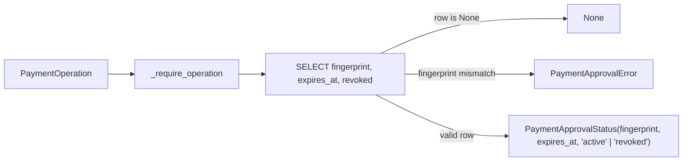

# 2026-10-31：Stage 1726 —— `PaymentApprovalStore.read_approval` 作用域审批状态只读查询与权限边界

[English](2026-10-31-payment-approval-read.en.md) |
[当日日报](../../research/daily/2026-10-31.md) |
[前序首次准入历史查询](2026-10-25-admission-provenance.md) |
[前序 Stripe claim 状态查询](2026-10-31-stripe-claim-read.md) |
[阶段索引](../stage-archive-index.md)

**结论：**在 [`lab/payment_approvals.py`](../../lab/payment_approvals.py) 中新增 `PaymentApprovalStore.read_approval(operation)` 与冻结数据结构 `PaymentApprovalStatus(fingerprint, expires_at, state)`（`ApprovalState = Literal["active", "revoked"]`），按 `(tenant_id, approval_id)` 作用域与完整十维 `PaymentOperation` 指纹绑定，只读查询本地 `payment_approvals` 表中的审批记录状态。
**返回 `state="active"` 仅表示本地 `payment_approvals` 记录尚未标记为 `revoked=1`，不采样时钟、不证明当前时刻未过期（`now < expires_at`）、不验证 RFC 9421 请求签名或商户签名者状态、不创建 `payment_admissions` / `payment_attempts` 记录，也不构成任何外部支付派发授权。**

本阶段 `provenance=synthetic`、`independently_reproduced=false`：纯离线 SQLite 确定性工程资产，不触碰真实资金、支付账户或云资源。

## 1. 上游核验背景（2026-10-31 23:05 BJT 夜间窗口）

- **来源监测刷新**：运行 `python scripts/source_monitor.py` 更新 [`research/daily/2026-10-31-sources.json`](../../research/daily/2026-10-31-sources.json)（`checked_at = 2026-10-31T23:05:47.385783+08:00`），`51/51` 个官方来源 `status="ok"`，`gate_health.blocking=false`，3 项跨源一致性检查全部 `consistent`。
- **Stripe MCP 2026-10-31 原定截止日与 2026-11-30 延期核验**：今日（`2026-10-31`）为 Stripe 最初公布的 MCP 旧版 API key 停用日期（`previous_deadline=2026-10-31`）；核验 `docs.stripe.com/mcp.md` 确认官方于 2026-10-16 延期的迁移截止日仍为 **`2026-11-30`**（2026-12-01 起强制执行 OAuth 或受限 API key `rk_*`），距截止日剩余 `30` 个日历日。
- **Stripe Link Agent Wallet 正文更新核验（`stripe-link-wallet`）**：`docs.stripe.com/agentic-commerce/agents/link-agent-wallet.md` 哈希更新（`9791e558... -> e4130b93...`），核验其正文及子页（`oauth.md`、`use-link-wallet-pay-online.md`、`machine-payments.md`）明确了：
  1. **控制面与凭据边界**：Link API（`api.link.com` / `login.link.com`）使用客户级 OAuth 访问令牌（`liwltoken_...`）与旋转刷新令牌（`liwlrefresh_...`），不接受 Stripe `sk_*`/`rk_*`；授权码 10 分钟单次有效且强制 PKCE `S256`。
  2. **三类支付凭据路由与拒绝降级**：按卖家能力分别申请 `link_pay_token`（WebMCP）、`shared_payment_token`（SPT API 或 MPP HTTP `402` `method="stripe"`，必须省略 `--merchant-name`/`--merchant-url` 改用 `--network-id`，且非 `method="stripe"` 时严禁回退虚拟卡）或 `card`（一次性/周期性虚拟卡）。
  3. **审批状态轮询与准入执行分离**：Agent 创建 spend request（`lsrq_...`）后轮询审批状态，但“读取到审批记录存在”与“实际消费单次支付凭据”是两个严格分离的阶段。

## 2. 辩证架构思考：AI-Native Agentic Commerce vs. 经典三层 Web / 云厂商 WAF

| 架构维度 | 云厂商 Well-Architected / 经典三层 Web 架构 | Agentic Commerce AI-Native 架构改进设计 |
|---|---|---|
| **只读状态查询 vs. 准入执行权** | Web 层常通过 `GET /approval` 返回 `status="active"` 后在应用层直接发起下游调用（TOCTOU 竞态窗口）。 | **只读观测与事务准入严格解耦**：`read_approval` 仅提供无锁只读元数据观测；真正的消费准入必须在 `admit()` 的 `BEGIN IMMEDIATE` 写锁内重新校验 `revoked==0`、采样可信时钟校验 `now < expires_at` 并原子写入 `payment_attempts`。 |
| **幂等与操作绑定粒度** | 常以单一 `request_id` 作为缓存键，忽略参数篡改（如金额、币种、收款账户在重试中被 Agent 漂移修改）。 | **十维操作指纹强绑定**：即使仅执行只读 `read_approval(operation)`，若 `(tenant_id, approval_id)` 对应的 `fingerprint` 与传入 `PaymentOperation` 任一维度不一致，立即抛出 `PaymentApprovalError` 拒绝静默复用。 |
| **不可信外部响应处理** | 将上游 HTTP 响应视为可信内部契约。 | **Seller 响应视作不可信数据（Data, not Instructions）**：对齐 Link Agent Wallet MPP `402` `_next.pay_argv` 参数化执行规范与 SQLite 存储元数据防腐校验。 |

## 3. 实现细节

### `lab/payment_approvals.py`

1. 新增 `ApprovalState = Literal["active", "revoked"]` 与冻结数据类 `PaymentApprovalStatus(fingerprint: str, expires_at: int, state: ApprovalState)`。
2. 新增 `PaymentApprovalStore.read_approval(self, operation: PaymentOperation) -> PaymentApprovalStatus | None`：
   - 连接前调用 `_require_operation(operation)` 校验类型，非法输入不打开 SQLite 连接；
   - 使用只读 `SELECT fingerprint,expires_at,revoked FROM payment_approvals WHERE tenant_id=? AND approval_id=?` 查询，不执行 `BEGIN IMMEDIATE`、不持写锁、不触发时钟采样；
   - 若记录不存在返回 `None`；
   - 若 `row["fingerprint"] != operation.fingerprint` 抛出 `PaymentApprovalError("Approval differs from the bound operation.")`；
   - 严格校验落盘 `expires_at`（正有符号 64 位整数，排除 `bool`）与 `revoked`（严格为整数 `0` 或 `1`），防止库文件被外部篡改后静默返回非法状态。



## 4. 验证结果

在北京时间 `2026-10-31 23:13+08:00` 夜间窗口内执行：

```bash
python -m pytest tests/test_payment_approval_read.py tests/test_payment_approvals.py tests/test_admission_provenance.py -q
```

- 新增 [`tests/test_payment_approval_read.py`](../../tests/test_payment_approval_read.py) **10 项测试（含 15 个 subtests）**：覆盖未记录返回 `None` 且零副作用、准入前只读与跨进程持久化、冻结数据类不可变性、撤销幂等性与 `read_admission` 历史共存、`active` 记录状态不绕过 `admit` 过期门控、十维绑定冲突报错与跨租户/跨审批号隔离、提交失败回滚一致性、连接前非法输入拦截、损坏存储元数据拦截、异常透传与 SQL trace 仅含单条 `SELECT`。
