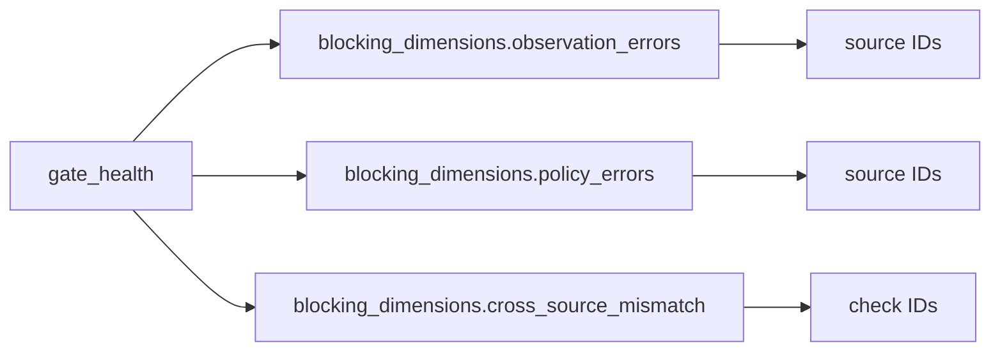

# 2026-10-31: Stage 1692 — Source monitor gate_health blocking-dimensions telemetry

[中文](2026-10-31-source-monitor-gate-health-blocking-dimensions.md) | [Stage archive index](../stage-archive-index.md)

## Background and objective

Stage 1691 introduced the unified blocker set `blocking_sources`.  
Automation still needed to classify whether blockers came from fetch failures, facts-parse failures, or cross-source mismatch checks.

Stage 1692 adds `blocking_dimensions`, exposing blocker objects grouped by blocker dimension.

## Implementation

### `scripts/source_monitor.py`

- Extended `summarize_gate_health(...)` with:
  - `blocking_dimensions.observation_errors`: fetch-failure source IDs
  - `blocking_dimensions.policy_errors`: facts-parse-failure source IDs
  - `blocking_dimensions.cross_source_mismatch`: mismatch check IDs
- Kept backward compatibility with existing `blocking_sources` and `blocking_reasons`.

### `tests/test_source_monitor.py`

- Extended failure-path assertions to validate the full `blocking_dimensions` structure.
- Updated gate-health summary tests to cover:
  - observation/policy source-ID partitioning;
  - cross-source mismatch check-ID partitioning.

## Visual map (blocking dimension to object class)



## Validation

Executed during the user-authorized daytime window:

```bash
python -m unittest tests.test_source_monitor -v
python -m unittest tests.test_source_monitor tests.test_mcp_policy_facts tests.test_mcp_migration -q
python scripts/source_monitor.py
```

Results:
- `tests.test_source_monitor`: `30/30` passing;
- focused regression: `54/54` passing;
- refreshed `research/daily/2026-10-31-sources.json` now includes
  `gate_health.blocking_dimensions` (all three lists empty in the current successful run).

## Architecture impact

1. **Finer blocker routing**: automation can dispatch directly by blocker dimension to fetch, parsing, or cross-source remediation paths.  
2. **More coherent gate contract**: `blocking_reasons` (type) and `blocking_dimensions` (objects) now form a stable two-layer interface.  
3. **Boundary unchanged**: still public-source retrieval and offline aggregation, with no payment execution or account authority.
