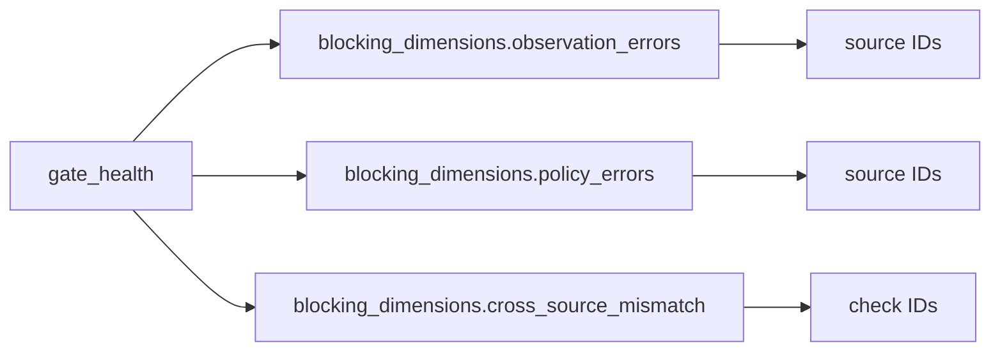

# 2026-10-31：Stage 1692 —— source-monitor gate_health 阻塞维度分组信号

[English](2026-10-31-source-monitor-gate-health-blocking-dimensions.en.md) | [阶段索引](../stage-archive-index.md)

## 背景与目标

Stage 1691 已给出统一阻塞源集合 `blocking_sources`。  
但自动化路由仍需要知道“源自抓取错误、事实解析错误还是跨来源互证 mismatch”。

Stage 1692 新增 `blocking_dimensions`，把阻塞对象按维度直接分组输出。

## 实现

### `scripts/source_monitor.py`

- 在 `summarize_gate_health(...)` 新增：
  - `blocking_dimensions.observation_errors`: 抓取失败 source ID 列表
  - `blocking_dimensions.policy_errors`: 事实解析失败 source ID 列表
  - `blocking_dimensions.cross_source_mismatch`: mismatch check_id 列表
- 与既有 `blocking_sources`、`blocking_reasons` 并存，保持向后兼容。

### `tests/test_source_monitor.py`

- 失败路径断言新增 `blocking_dimensions` 全量结构校验。
- 更新 gate-health 汇总测试，覆盖：
  - observation/policy 两类来源的分组；
  - cross-source mismatch check_id 分组。

## 图示（阻塞维度到对象映射）



## 验证

北京时间白天授权窗口内执行：

```bash
python -m unittest tests.test_source_monitor -v
python -m unittest tests.test_source_monitor tests.test_mcp_policy_facts tests.test_mcp_migration -q
python scripts/source_monitor.py
```

结果：
- `tests.test_source_monitor`: `30/30` 通过；
- 聚焦回归：`54/54` 通过；
- 刷新后的 `research/daily/2026-10-31-sources.json` 中，
  `gate_health.blocking_dimensions` 已落地（当前成功 run 三类均为空列表）。

## 架构影响

1. **阻塞路由粒度提升**：可按阻塞维度直接分发到抓取、解析或互证处理路径。  
2. **门禁语义更一致**：`blocking_reasons`（类型）与 `blocking_dimensions`（对象）形成稳定二层契约。  
3. **边界保持不变**：仍是公开来源抓取与离线聚合，不涉及支付执行或账户权限。
