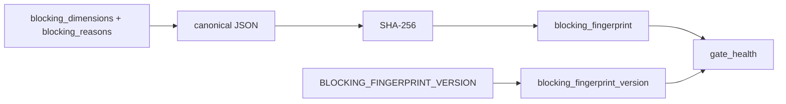

# 2026-10-31: Stage 1694 — Source monitor gate_health blocking-fingerprint version telemetry

[中文](2026-10-31-source-monitor-gate-health-blocking-fingerprint-version.md) | [Stage archive index](../stage-archive-index.md)

## Background and objective

Stage 1693 introduced `blocking_fingerprint` for single-value blocker-state comparison.  
Consumers still need to know which digest contract/version produced that fingerprint.

Stage 1694 adds `blocking_fingerprint_version` and makes the fingerprint contract explicit in the report.

## Implementation

### `scripts/source_monitor.py`

- Added constant: `BLOCKING_FINGERPRINT_VERSION = "sha256-json-v1"`.
- Extended `summarize_gate_health(...)` output with:
  - `gate_health.blocking_fingerprint_version`

### `tests/test_source_monitor.py`

- Added failure-path assertion for `blocking_fingerprint_version`;
- Added summary-path assertion for `blocking_fingerprint_version`;
- Added stability test: `BLOCKING_FINGERPRINT_VERSION == "sha256-json-v1"`.

## Visual map (fingerprint value separated from fingerprint contract version)



## Validation

Executed during the user-authorized daytime window:

```bash
python -m unittest tests.test_source_monitor -v
python -m unittest tests.test_source_monitor tests.test_mcp_policy_facts tests.test_mcp_migration -q
python scripts/source_monitor.py
```

Results:
- `tests.test_source_monitor`: `32/32` passing;
- focused regression: `56/56` passing;
- refreshed `research/daily/2026-10-31-sources.json` now includes
  `gate_health.blocking_fingerprint_version = "sha256-json-v1"`.

## Architecture impact

1. **Comparison contract is now explicit:** downstream interpretation of `blocking_fingerprint` can bind to a declared version and avoid silent contract drift.  
2. **Upgrade path is safer:** future fingerprint algorithm upgrades can be versioned without breaking existing consumers.  
3. **Boundary unchanged:** still public-source retrieval and offline aggregation, with no payment execution or account authority.
