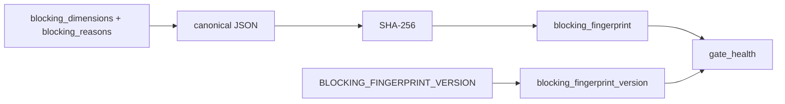

# 2026-10-31：Stage 1694 —— source-monitor gate_health 阻塞指纹版本信号

[English](2026-10-31-source-monitor-gate-health-blocking-fingerprint-version.en.md) | [阶段索引](../stage-archive-index.md)

## 背景与目标

Stage 1693 已新增 `blocking_fingerprint`，用于阻塞状态单值对比。  
但消费方仍需要知道“这个指纹采用了哪一版计算契约”。

Stage 1694 新增 `blocking_fingerprint_version`，将指纹算法版本显式写入报告。

## 实现

### `scripts/source_monitor.py`

- 新增常量：`BLOCKING_FINGERPRINT_VERSION = "sha256-json-v1"`。
- 在 `summarize_gate_health(...)` 返回对象中新增：
  - `gate_health.blocking_fingerprint_version`

### `tests/test_source_monitor.py`

- 失败路径断言新增 `blocking_fingerprint_version` 校验；
- 汇总路径断言新增 `blocking_fingerprint_version` 校验；
- 新增稳定性测试：`BLOCKING_FINGERPRINT_VERSION == "sha256-json-v1"`。

## 图示（指纹值与指纹契约版本分离）



## 验证

北京时间白天授权窗口内执行：

```bash
python -m unittest tests.test_source_monitor -v
python -m unittest tests.test_source_monitor tests.test_mcp_policy_facts tests.test_mcp_migration -q
python scripts/source_monitor.py
```

结果：
- `tests.test_source_monitor`: `32/32` 通过；
- 聚焦回归：`56/56` 通过；
- 刷新后的 `research/daily/2026-10-31-sources.json` 已包含
  `gate_health.blocking_fingerprint_version = "sha256-json-v1"`。

## 架构影响

1. **比较契约可显式治理**：下游对 `blocking_fingerprint` 的解释可绑定明确版本，避免静默契约漂移。  
2. **回归升级更可控**：未来若指纹算法升级，可通过版本字段并行兼容老消费逻辑。  
3. **边界不变**：仍是公开来源抓取与离线聚合，不涉及支付执行或账户权限。
