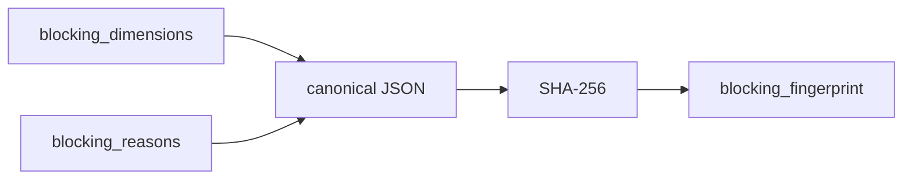

# 2026-10-31: Stage 1693 — Source monitor gate_health blocking-fingerprint telemetry

[中文](2026-10-31-source-monitor-gate-health-blocking-fingerprint.md) | [Stage archive index](../stage-archive-index.md)

## Background and objective

Stage 1692 already exposes blocker dimensions and object lists.  
Automation that only needs to detect “did gate state change structurally?” still had to compare multiple fields.

Stage 1693 adds `blocking_fingerprint`, a stable single-value digest for gate blocker state.

## Implementation

### `scripts/source_monitor.py`

- Extended `summarize_gate_health(...)` with:
  - `blocking_fingerprint = sha256(canonical_json(blocking_dimensions + blocking_reasons))`
- Canonicalization rules:
  - `sort_keys=True`
  - `separators=(",", ":")`
  to keep serialization stable across runs.

### `tests/test_source_monitor.py`

- Failure-path assertion: `blocking_fingerprint` must be 64 chars.
- Summary assertion: fixed inputs produce expected fingerprint value.
- Added change-detection test: changing blocker reasons changes `blocking_fingerprint`.

## Visual map (compressing blocker state into one value)



## Validation

Executed during the user-authorized daytime window:

```bash
python -m unittest tests.test_source_monitor -v
python -m unittest tests.test_source_monitor tests.test_mcp_policy_facts tests.test_mcp_migration -q
python scripts/source_monitor.py
```

Results:
- `tests.test_source_monitor`: `31/31` passing;
- focused regression: `55/55` passing;
- refreshed `research/daily/2026-10-31-sources.json` now includes
  `gate_health.blocking_fingerprint` (stable fixed value in the current successful run).

## Architecture impact

1. **Lower gate-change detection cost**: consumers can compare one field instead of deep-comparing multiple blocker structures.  
2. **More stable regression tracking**: unchanged blocker dimensions and reasons preserve fingerprint identity across runs.  
3. **Boundary unchanged**: still public-source retrieval and offline aggregation, with no payment execution or account authority.
