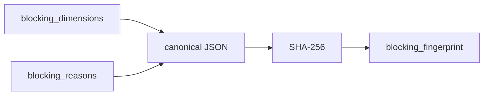

# 2026-10-31：Stage 1693 —— source-monitor gate_health 阻塞指纹信号

[English](2026-10-31-source-monitor-gate-health-blocking-fingerprint.en.md) | [阶段索引](../stage-archive-index.md)

## 背景与目标

Stage 1692 已输出阻塞维度对象列表。  
自动化若仅需判断“门禁状态是否发生结构性变化”，仍需对多字段做比对。

Stage 1693 新增 `blocking_fingerprint`，为阻塞状态提供稳定单值指纹。

## 实现

### `scripts/source_monitor.py`

- 在 `summarize_gate_health(...)` 中新增：
  - `blocking_fingerprint = sha256(canonical_json(blocking_dimensions + blocking_reasons))`
- 规范化策略：
  - `sort_keys=True`
  - `separators=(",", ":")`
  以保证跨运行的序列化稳定性。

### `tests/test_source_monitor.py`

- 失败路径断言：`blocking_fingerprint` 长度为 64。
- 汇总测试：校验固定输入下指纹值可预测。
- 新增变化测试：阻塞原因变化时，`blocking_fingerprint` 必然变化。

## 图示（阻塞状态压缩为单值指纹）



## 验证

北京时间白天授权窗口内执行：

```bash
python -m unittest tests.test_source_monitor -v
python -m unittest tests.test_source_monitor tests.test_mcp_policy_facts tests.test_mcp_migration -q
python scripts/source_monitor.py
```

结果：
- `tests.test_source_monitor`: `31/31` 通过；
- 聚焦回归：`55/55` 通过；
- 刷新后的 `research/daily/2026-10-31-sources.json` 中，
  `gate_health.blocking_fingerprint` 已落地（当前成功 run 指纹为稳定固定值）。

## 架构影响

1. **门禁变化检测成本降低**：消费方可用单字段比较替代多字段深比对。  
2. **回归追踪更稳定**：在阻塞维度与原因不变时，指纹可作为状态恒等锚点。  
3. **边界保持不变**：仍是公开来源抓取与离线聚合，不涉及支付执行或账户权限。
