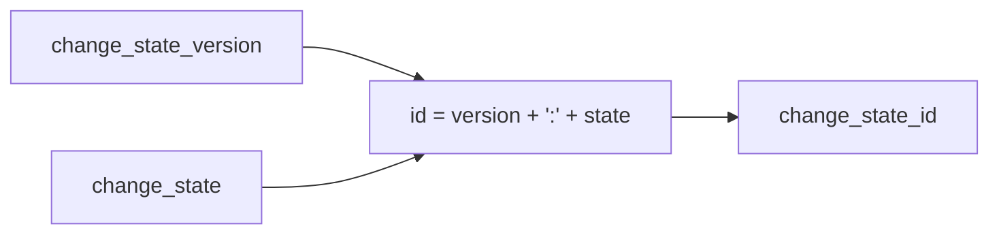

# 2026-10-31: Stage 1720 — Source monitor gate_health blocking-reasons delta change-state identifier

[中文](2026-10-31-source-monitor-gate-health-blocking-reasons-delta-change-state-id.md) | [Stage archive index](../stage-archive-index.md)

## Background and objective

Stage 1719 introduced `blocking_reasons_delta_change_state_version`.  
For idempotent deduplication and key-based routing, downstream systems still had to compose version + state manually.

Stage 1720 adds `blocking_reasons_delta_change_state_id` as a direct versioned state identifier.

## Implementation

### `scripts/source_monitor.py`

- Added field:
  - `gate_health.blocking_reasons_delta_change_state_id`
- Semantics:
  - emits `null` when `blocking_reasons_delta_change_state is None`;
  - otherwise emits
    `"{blocking_reasons_delta_change_state_version}:{blocking_reasons_delta_change_state}"`;
  - current examples: `reasons-delta-change-state-v1:changed` / `...:unchanged`.

### `tests/test_source_monitor.py`

- Baseline assertion: `blocking_reasons_delta_change_state_id is None`;
- Changed assertion:
  `blocking_reasons_delta_change_state_id == "reasons-delta-change-state-v1:changed"`;
- Unchanged assertion:
  `blocking_reasons_delta_change_state_id == "reasons-delta-change-state-v1:unchanged"`;
- Remaining regression remains green.

## Visual map (versioned state ID)



## Validation

Executed during the user-authorized daytime window:

```bash
python -m pytest tests/test_source_monitor.py -q
python -m pytest -q
python scripts/source_monitor.py --registry research/sources.json --output-dir research/daily
```

Results:
- `tests/test_source_monitor.py`: `43 passed, 6 subtests passed`;
- full regression: `4267 passed, 1089 subtests passed`;
- refreshed `research/daily/2026-10-31-sources.json` now includes
  `gate_health.blocking_reasons_delta_change_state_id`.

## Architecture impact

1. **Direct idempotency key consumption:** downstream pipelines can use one stable ID for dedupe/cache/sharding.  
2. **Centralized contract composition:** version+state joining is owned by producer logic, reducing duplicated consumer code.  
3. **Boundary unchanged:** still public-source retrieval and offline aggregation, with no payment execution or account authority.
