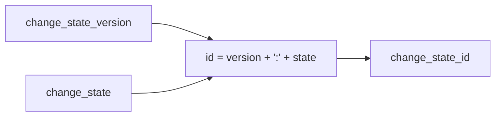

# 2026-10-31：Stage 1720 —— source-monitor gate_health 阻塞原因增量变化状态标识符

[English](2026-10-31-source-monitor-gate-health-blocking-reasons-delta-change-state-id.en.md) | [阶段索引](../stage-archive-index.md)

## 背景与目标

Stage 1719 已提供 `blocking_reasons_delta_change_state_version`。  
下游若要做幂等去重或键值路由，仍需把版本与状态自行拼接为标识符。

Stage 1720 新增 `blocking_reasons_delta_change_state_id`，直接输出版本化状态 ID。

## 实现

### `scripts/source_monitor.py`

- 新增字段：
  - `gate_health.blocking_reasons_delta_change_state_id`
- 语义：
  - 若 `blocking_reasons_delta_change_state is None`，输出 `null`；
  - 否则输出
    `"{blocking_reasons_delta_change_state_version}:{blocking_reasons_delta_change_state}"`；
  - 当前示例值：`reasons-delta-change-state-v1:changed` / `...:unchanged`。

### `tests/test_source_monitor.py`

- baseline 场景断言 `blocking_reasons_delta_change_state_id is None`；
- changed 场景断言
  `blocking_reasons_delta_change_state_id == "reasons-delta-change-state-v1:changed"`；
- unchanged 场景断言
  `blocking_reasons_delta_change_state_id == "reasons-delta-change-state-v1:unchanged"`；
- 其余回归保持通过。

## 图示（版本化状态 ID）



## 验证

北京时间白天授权窗口内执行：

```bash
python -m pytest tests/test_source_monitor.py -q
python -m pytest -q
python scripts/source_monitor.py --registry research/sources.json --output-dir research/daily
```

结果：
- `tests/test_source_monitor.py`：`43 passed, 6 subtests passed`；
- 全量回归：`4267 passed, 1089 subtests passed`；
- 刷新后的 `research/daily/2026-10-31-sources.json` 已包含
  `gate_health.blocking_reasons_delta_change_state_id`。

## 架构影响

1. **幂等键可直接消费**：下游可直接使用 ID 做去重、缓存与分区路由。  
2. **契约拼接集中化**：版本+状态拼接逻辑收敛到生产端，减少消费端重复实现。  
3. **边界不变**：仍为公开来源抓取与离线聚合，不涉及支付执行或账户权限。
