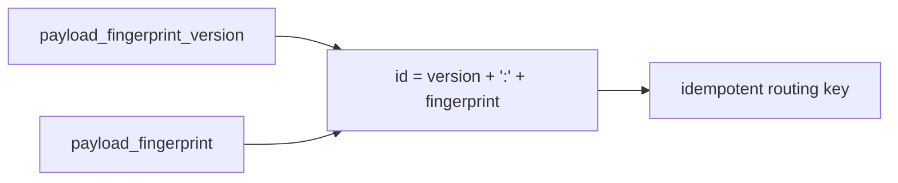

# 2026-10-31: Stage 1724 — Source monitor gate_health blocking-reasons delta change-state payload fingerprint identifier

[中文](2026-10-31-source-monitor-gate-health-blocking-reasons-delta-change-state-payload-fingerprint-id.md) | [Stage archive index](../stage-archive-index.md)

## Background and objective

Stage 1723 introduced payload fingerprint plus fingerprint version.  
For idempotent keys, sharding keys, and alert dedupe, downstream systems still had to compose `<version>:<fingerprint>` themselves.

Stage 1724 adds `blocking_reasons_delta_change_state_payload_fingerprint_id` as a direct versioned fingerprint identifier.

## Implementation

### `scripts/source_monitor.py`

- Added field:
  - `gate_health.blocking_reasons_delta_change_state_payload_fingerprint_id`
- Semantics:
  - emits `null` when payload fingerprint is absent (baseline);
  - when payload fingerprint exists, emits:
    `"<payload_fingerprint_version>:<payload_fingerprint>"`.

### `tests/test_source_monitor.py`

- Baseline assertion: `...payload_fingerprint_id is None`;
- Changed/unchanged assertions:
  `...payload_fingerprint_id == "<version>:<fingerprint>"`;
- Remaining regression remains green.

## Visual map (versioned fingerprint ID)



## Validation

Executed during the user-authorized daytime window:

```bash
python -m pytest tests/test_source_monitor.py -q
python -m pytest -q
python scripts/source_monitor.py --registry research/sources.json --output-dir research/daily
```

Results:
- `tests/test_source_monitor.py`: `43 passed, 6 subtests passed`;
- full regression: `4267 passed, 1089 subtests passed`;
- refreshed `research/daily/2026-10-31-sources.json` now includes
  `gate_health.blocking_reasons_delta_change_state_payload_fingerprint_id`.

## Architecture impact

1. **Direct idempotent key consumption:** consumers can use versioned fingerprint IDs directly for dedupe and partitioning.  
2. **Less duplicated composition logic:** clients no longer need custom version+fingerprint concatenation.  
3. **Boundary unchanged:** still public-source retrieval and offline aggregation, with no payment execution or account authority.
